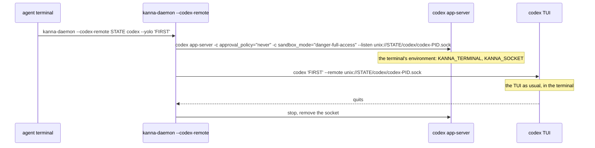

# Codex's app-server

**Status:** built · **Tested:** `cargo test -p kanna-daemon` (codex_remote, messages), e2e `agent_messaging`, `planner_choice`, `backlog_runners` (the mock agent as `codex`) · **Builds on:** [tasks](tasks.md), [agent messaging](agent-messaging.md) · **Why:** [research](../research/agent-messaging.md), checked against Codex 0.163.0

Kanna starts every Codex, a task's, the planner's or a quiz's, with an **app-server of its own**, and the Codex TUI attached to it. The server is Codex's door for [agent messaging](agent-messaging.md): Kanna starts a turn on it instead of typing into the prompt.

## Contents

1. [How Codex starts](#1-how-codex-starts)
2. [Delivering a message](#2-delivering-a-message)
3. [Costs](#3-costs)
4. [Glossary](#4-glossary)

## 1. How Codex starts

- **The helper is the daemon's own binary** (`codex_remote.rs`), so it needs no shell syntax and works whatever your login shell is.
- **The server gets the terminal's environment,** so the commands Codex runs see the task's `KANNA_TERMINAL` and `KANNA_SOCKET`. That's why Kanna used to start Codex with `--no-daemon`: Codex's shared background server runs every session's commands with its own environment. A server per Codex is the task's own.
- **Permissions go on the server:** `--yolo` becomes the server's `approval_policy` and `sandbox_mode`; the TUI gets none, since Codex refuses permission flags when resuming against a server.
- **Resume is the same:** `codex resume ID --remote unix://SOCKET` brings the session back on a new server.
- **The socket** is `codex-PID.sock` in Kanna's state folder's `codex/`, or in `/tmp/kanna-UID` when that path is too long for a Unix socket; a leftover from a helper that's gone is removed at the next start.
- **Only you can reach it:** the server takes any connection without auth, and a turn on it runs with the agent's permissions, so the folder must be yours alone: the helper makes it 0700 (tightening one of yours that others could open) and checks it's a real folder, owned by you, that no one else can open (a `/tmp` name someone else made first, or a symlink, fails), else Codex runs on its own.
- **Quitting:** its quit keys work as before ([backlog runners](backlog-runners.md#2-how-its-built)); attached, Codex says its session as `codex --remote unix://SOCKET resume ID`, which Kanna reads like `codex resume ID`.
- **If the server won't start,** the helper says so in the terminal and runs Codex on its own (`--no-daemon`): it works, but takes no messages.

## 2. Delivering a message

| Step | JSON-RPC over a WebSocket on the socket |
|---|---|
| Hello | `initialize`, then `initialized` |
| Find the session | `thread/loaded/list`, then `thread/read` each: the one that isn't `ephemeral` (Codex also loads a thread to title the session) |
| Deliver | `turn/start` with the message as text input |

- **Kanna finds the socket** from the arguments of the pane's Codex: the `--remote unix://SOCKET` its TUI was started with.
- **Only at its prompt:** Kanna starts the turn once the agent is idle, as for any message.

## 3. Costs

| | `codex --no-daemon` (before) | App-server and TUI |
|---|---|---|
| Processes per Codex | 1 | 2, plus the helper |
| Memory, idle (macOS footprint) | 182 MB | 191 + 51 = 242 MB |

- **About 60 MB more per running Codex;** a stopped task runs nothing either way.
- **Experimental:** Codex marks the app-server and `--remote` experimental; the protocol is versioned (v2), and the helper's fallback keeps Codex working if they change.

## 4. Glossary

| Term | Meaning |
|---|---|
| **App-server** | Codex's JSON-RPC server: it runs sessions, and TUIs and other clients attach to it |
| **Helper** | `kanna-daemon --codex-remote`: starts the server, runs the TUI attached to it, stops the server after. On SIGHUP (its terminal closed), SIGTERM or SIGINT it sends both SIGTERM, SIGKILLs whichever is left after 5 s, and exits, so no server outlives its terminal |
| **Session thread** | The thread a Codex session runs in; `turn/start` on it is a new prompt |
