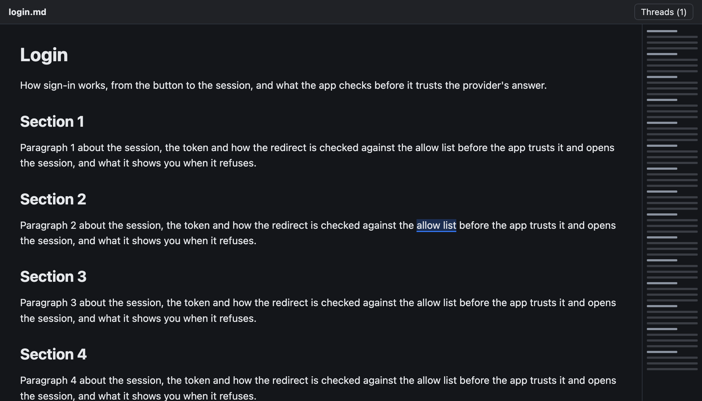
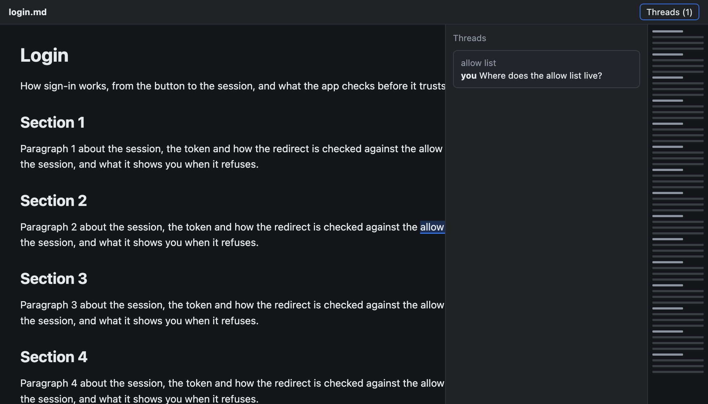

# Comments Overlay

**Status:** built · **Mockup:** [`references/mockups/comments-overlay.html`](../../references/mockups/comments-overlay.html) · **Builds on:** [doc markup](doc-markup.md), [markdown overview](markdown-overview.md), [markdown zoom](markdown-zoom.md) · **Why:** the thread list took its width from the page, so showing or hiding it re-wrapped the text, could hide the overview, and resized a web page

The thread list in a markdown or web pane floats over the page. The page is laid out at the pane's full width whether the list shows or not, so opening, closing or auto-hiding it moves nothing.

| List closed | List open |
|---|---|
|  |  |

## Rules

- **The page ignores the list.** Its width, wrap, margins and scroll are the same with the list open or closed. A web page isn't resized, so it gets no resize event and its own layout stays put.
- **Beside the overview.** The list sits against the overview's left edge, or the pane's right edge when there's no overview. The overview's rule ([markdown overview](markdown-overview.md#2-when-it-shows)) doesn't count the list.
- **Covers what's under it.** While it's open, the list hides the right of the page; closing it (**Threads**) shows that again. Clicks and scrolls over the list go to the list.
- **When it shows** is as before: in a pane at least twice its 280 pt wide, or narrower if you opened it with **Threads**.
- **The comment box stays clear.** A new comment box or thread popover opens to the left of the list, not under it.

## How it's built

| Part | Where |
|---|---|
| The page's frame ignores the panel; the panel is placed over it | `MarkdownPaneView.layout`, `PageMarkup.layout` |
| The overview's rule without the list | `MarkdownOverviewLayout.shown` |
| The box kept clear of the list | `boxOrigin` in `MarkdownPaneComments.swift` and `PageMarkup.swift` |

**Tests:** `swift test`: the overview's rule gives the same answer at every width with or without the list. E2e, in `scripts/e2e-kanna.sh` against a private instance: `markdown_overview` turns comments on and checks the layout width and line breaks don't change, and that a 1000 pt pane keeps both the overview and the list; `page_comments` checks the web view's width doesn't change (`debug.web` returns `page_width`).
