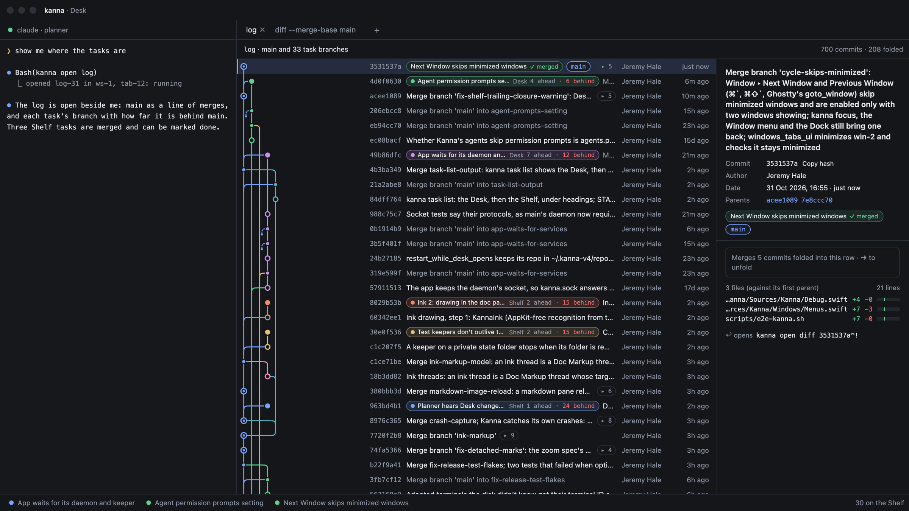
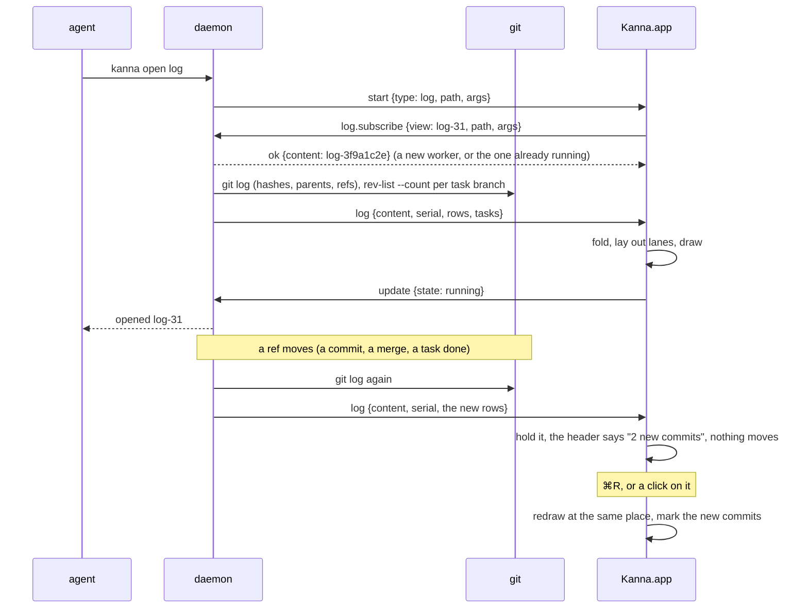
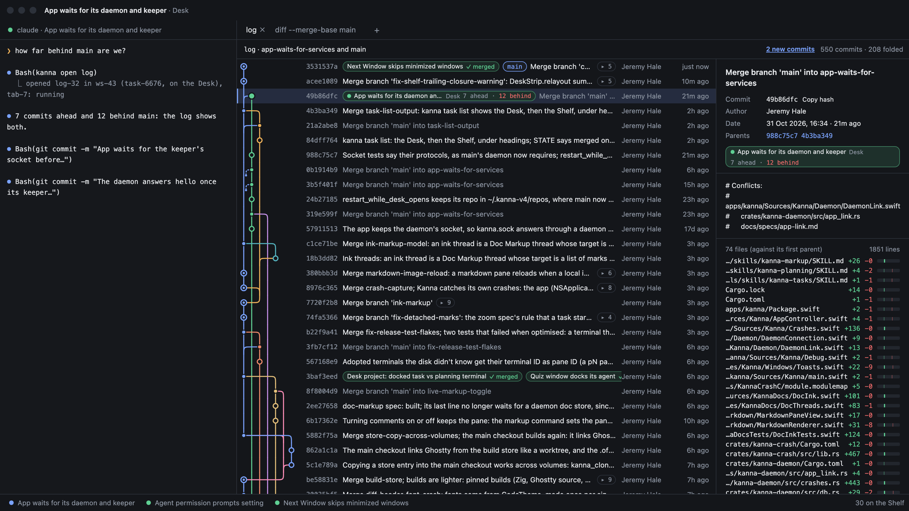
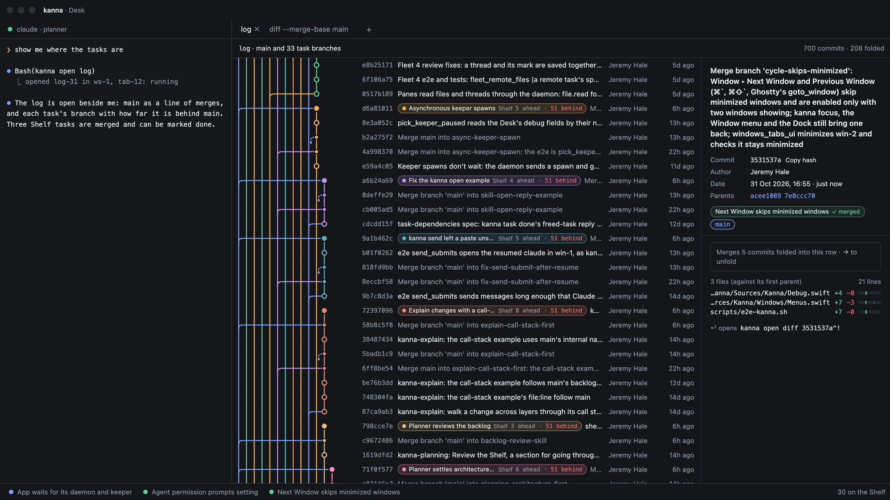
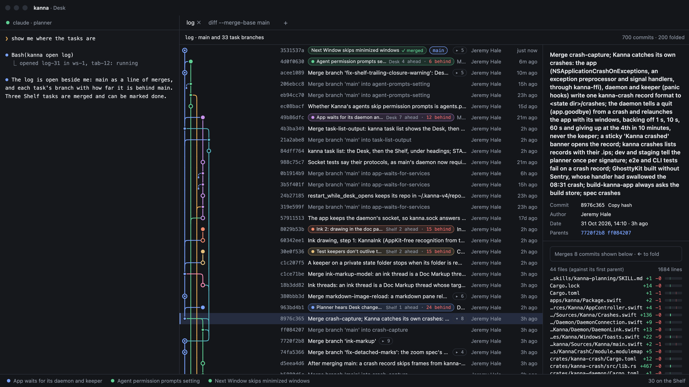
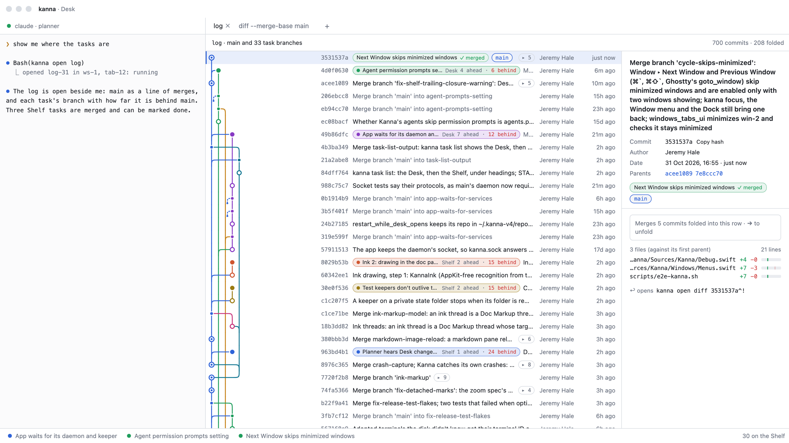
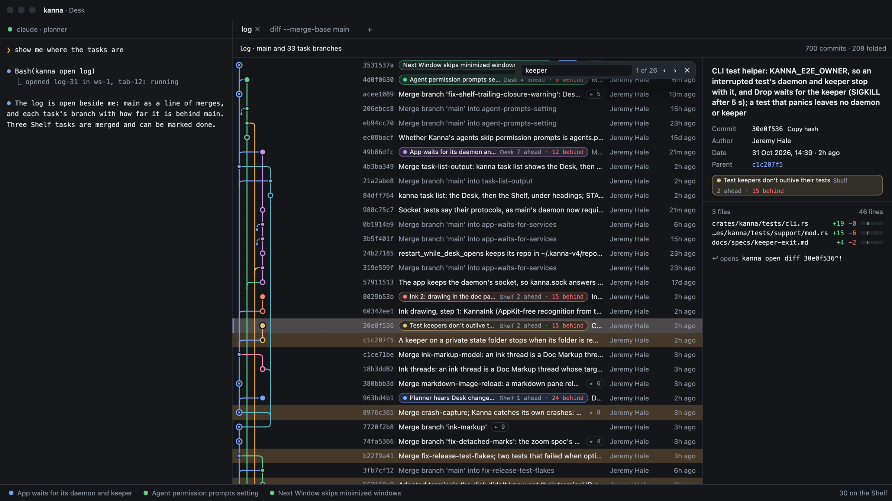
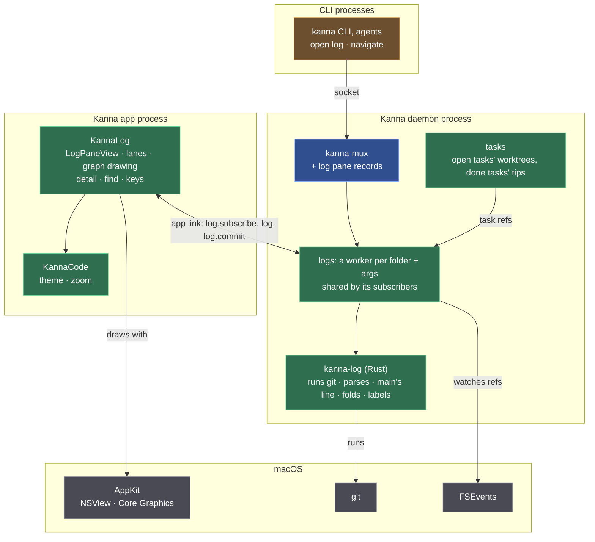

# Commit Graph

**Status:** designed · **Mockup:** [`references/mockups/log.html`](../../references/mockups/log.html) · **Builds on:** [diff viewer](diff-viewer.md), [app panes](app-panes.md), [task list](task-list.md)

A **log pane** shows the repo's history as a graph, natively, as a tab beside the agent. Commits are rows, branches are coloured lanes, merges are curves. A branch that is a task's says which task it is, where the task is (Desk, Shelf) and how far it is ahead of and behind main, or that it's merged. It answers the planner's question "which tasks have landed, and which are behind?" at a glance, and a task's "where is my branch against main?". It holds still while you read, like the diff pane.

## Contents

1. [Opening a log](#1-opening-a-log)
2. [Rows and lanes](#2-rows-and-lanes)
3. [Task labels](#3-task-labels)
4. [Folding](#4-folding)
5. [Rules](#5-rules)
6. [Keys and mouse](#6-keys-and-mouse)
7. [CLI](#7-cli)
8. [How it's built](#8-how-its-built)

## 1. Opening a log

- **`kanna open log [REV...] [-- PATH...]` shows `git log REV...`**, run in the folder it's opened from, with git's revisions and paths.
- **With no revisions, the range depends on where it's run:**

| Run from | Shows |
|---|---|
| a task's worktree | the task's branch (`HEAD`) and main |
| the repo's main checkout (the planner) | main and the branches of the repo's open tasks (Desk and Shelf) |

  **Main** is the branch the repo's main checkout has checked out, as everywhere in Kanna ([task list](task-list.md#3-state)). The default is worked out on every load, so a task made, renamed or done changes what the pane shows.
- It takes `open`'s placement options; from a task's terminal it opens a tab on the task's Desk, as `open diff` does. The tab is named `log`, or `log REV...` when revisions were given.
- **The newest 2,000 commits** of the range, topologically ordered (`--topo-order`: a branch's commits stay together). Older history ends in a dashed stub and the footer says "older commits not shown".

## 2. Rows and lanes

- **A row per commit:** the graph, the short hash (8), its labels, its subject, its author, its age (`6m ago`, `3h ago`, `14d ago`, `5mo ago`). A merge's subject is muted unless it's on main's line, so a branch's own work reads first.
- **Main is lane 0, always:** main's first-parent line is the left edge, straight down. Nothing else uses lane 0.
- **Lanes:** a commit takes the lane that waits for it (the leftmost, when several do: the others curve into it); a commit nobody waits for (a branch tip) takes the leftmost free lane. Its first parent continues its lane; another parent takes the lane already waiting for it, or a new free one. Lanes never shift sideways to close gaps, so a line stays where it is while you scroll; a freed lane is reused by the next tip.
- **A colour per lane run:** a lane gets the next colour of eight when a branch starts in it, and keeps it until it ends; main is the accent colour. The task label on the tip has the lane's colour.
- **Curves, not ASCII:** a line into a merge leaves the node level and bends down into the parent's lane with a quarter-round corner; a line that ends in another lane bends into its node the same way. Lines are 1.8 pt, round-capped.
- **Nodes:** a commit is a ring; a merge a smaller filled dot; a task's unmerged tip a larger filled dot; a folded merge a ring with a dot and its count beside the subject (`▸ 8`).
- **Merges of main into a branch** (`Merge branch 'main' into …`) whose main commit is more than 6 rows below draw as a short dashed hook towards main instead of a lane running all the way down to it: a task that merges main often would otherwise draw a comb of lines across the graph. The detail still names both parents.
- **Too many lanes:** past 16 lanes the spacing narrows (down to 8 pt) so the graph keeps at most about 16 lanes' width.

## 3. Task labels

- **A task's branch is labelled with the task, not the branch:** at its tip, a chip with the task's name, where it is (**Desk** or **Shelf**), and `7 ahead · 12 behind` against main (behind in red, left out when 0). The branch name is the chip's tooltip and is in the detail.
- **Merged:** a task whose branch is in main (`merge-base --is-ancestor`, as [task list](task-list.md#3-state)'s `merged`) has a green **✓ merged** chip on its tip; when that tip is folded into a merge, on the merge. So the tasks that have landed and can be marked done read at a glance.
- **Which tasks:** the repo's open tasks (Desk and Shelf) with a worktree on a branch; and **done** tasks whose branch and tip Kanna recorded when they were done (`kanna task done` saves them in the task's record), so a merge in main still says which task it brought in after the branch is deleted. Tasks done before this was recorded have no label.
- **Other refs:** `main` (accent outline), tags (dashed), remote branches (muted), other local branches (plain). `HEAD` isn't a chip; the detail says it.

## 4. Folding

So that main reads as a line of merges, a branch merged into main's first-parent line is folded into its merge when it has more than 3 commits.

- **A merge's side** is the commits it brought in: reachable from its other parents and not from main's line, and not already brought in by an older merge. A side with a commit that a commit outside it builds on (a task branched from an unmerged branch) doesn't fold.
- **Folded:** the merge row shows `▸ N` and the side's commits aren't drawn; the merge has no line to them.
- **→** (or a click on `▸ N`) unfolds it: its commits appear under it in their own lane, the merge's line curves out to them. **←** folds it again, from the merge or any commit in its side. Unfolded merges are kept with the pane.
- Branches of 3 commits or fewer are drawn as they are, a small loop off main.
- **Find unfolds:** a match inside a folded side unfolds it.

## 5. Rules

- **It holds still while you read.** When a ref moves (a commit, a merge, a rebase, a branch made or deleted, a task done or renamed), the daemon logs again and sends the new rows; the pane keeps showing the old ones, and the header says **N new commits** (or **changed** when commits went away or labels changed), a link. Nothing on screen moves. ⌘R (View › Reload) or a click takes the new rows, keeps the selected commit and scroll position (by hash), and marks the new commits for a moment.
- **A pane with nothing to read takes new rows at once,** as the diff pane: while it waits for its first log, or shows git's error.
- **git failing:** a range git refuses shows git's error in place of the graph; a failure while reading keeps the graph and shows the error in the header, in red, as the diff pane does.
- **Selecting a commit** (a click, `j`/`k`) shows its **detail** on the right: subject and full message, hash (with **Copy hash**), author, date, parents (a click selects one, unfolding if needed), labels, and its files with lines added and removed (a merge's against its first parent). The detail is fetched when selected (`log.commit`), not sent with the rows.
- **↩ or a double-click opens the commit's diff** in a diff pane on the same Desk: `kanna open diff HASH^!` (its changes against its first parent; for a root commit, against the empty tree).
- **⌘C copies the selected commit's full hash;** the context menu has Copy hash and Copy subject.
- **⌘F finds** in subjects and hash prefixes, every commit of the range, folded or not: matching rows are tinted, ↩ and ⇧↩ (or ⌘G, ⇧⌘G) go to the next and previous, the bar says `3 of 26`. Esc closes it.
- **The detail hides when the pane is narrower than 820 pt,** at the default font size (the rows need about 480 pt beside the graph); the selection still works, and ↩ still opens the diff.
- **Zoom** (⌘= ⌘− ⌘0), 9 to 32 pt, kept with the pane; rows and lanes scale with it.
- **Light and dark** follow the app.

## 6. Keys and mouse

| You | Does |
|---|---|
| `j` `k`, ↓ ↑ | next, previous commit |
| `g` `G` | first, last commit |
| → `l`, ← `h` | unfold the selected merge; fold the merge the selection is in |
| ↩, double-click | open the commit's diff in a diff pane |
| ⌘C | copy the selected commit's hash |
| ⌘F, ⌘G, ⇧⌘G, Esc | find subjects and hashes |
| ⌘R, click **N new commits** | take the new rows, at the same place |
| Click a parent in the detail | select it |
| ⌘= ⌘− ⌘0 | font size |

## 7. CLI

| Command | Does |
|---|---|
| `kanna open log [REV...] [-- PATH...] [placement]` | opens a log pane on `git log` of those revisions (the default range when none), in the current folder |
| `kanna navigate PANE log [REV...]` | shows another range in the same pane |
| `kanna raw '{"cmd":"logs"}'` | the logs the daemon watches: content ID, folder, arguments, serial, views |
| `kanna raw '{"cmd":"log.commit","args":{"path":P,"hash":H}}'` | a commit's message and files, as the detail shows them |
| `kanna raw '{"cmd":"debug.log","args":{"pane":"log-31"}}'` | for tests, from the app: the range, the rows as drawn (hash, lane, colour, parents' lanes, labels, folded count, open), lanes, `selected`, `serial`, `stale` (new rows are held), `latest`, `held` (the header's text), `notice`, `error`, `find` and its hits; `keys: "jj~"` presses keys (`~` is ↩), `refresh: true` does what ⌘R does, `find: "keeper"` finds |

The pane's record is `{type: "log", path, args}`, in the saved layout like a diff pane's, and comes back after a relaunch.

## 8. How it's built

| Piece | Where | What's new |
|---|---|---|
| CLI | `crates/kanna` | the `log` kind of `open`, revisions passed through, `navigate` with revisions |
| Pane records | `crates/kanna-mux` | `PaneType::Log` with `path`, `args`, `zoom`; `debug.log` passed to the app |
| Model | `crates/kanna-log` (new crate) | the default range, runs git, parses, main's line, sides and what folds, task labels with ahead and behind; a commit's detail |
| Logs | `crates/kanna-daemon/src/logs.rs` | a worker per folder + arguments, shared by every view: logs, watches the repo's refs, logs again, tells the subscribers; `logs`, `log.commit` |
| Task refs | `crates/kanna-daemon/src/tasks.rs` | the repo's open tasks (id, name, place, worktree) and done tasks' recorded branch and tip, given to the logs on every task change; `task done` records the branch and tip |
| Pane | `apps/kanna/Sources/KannaLog` (new target) | folding, lane layout (`LogLanes`, pure and tested), drawing, detail, find, keys; holds new rows until a refresh |

- **The daemon runs git; the app lays out and draws.** git runs where the repo is, as for diffs. The rows carry what only git knows; the lanes are the app's, since they depend on what's folded, which is the reader's choice.
- **One git call per load** (plus a count per task branch): `git log --topo-order -n 2000 -z --format=%H%x1f%P%x1f%an%x1f%at%x1f%D%x1f%s REV...`, with `--no-color`, `-c log.showSignature=false`, `GIT_OPTIONAL_LOCKS=0`, so the user's config can't change what's parsed. `%D` gives the refs at each commit. Ahead and behind are `git rev-list --left-right --count main...TIP`, one per task branch.
- **What the daemon sends:** `log {content, serial, range, rows: [{hash, parents, author, time, refs, subject, spine, side, fold}], tasks: [{id, name, place, branch, tip, ahead, behind, merged}], more}`. `spine` marks main's first-parent line, `side` names the merge a foldable commit is folded into, `fold` is a merge's foldable count. A commit's labels are the tasks whose `tip` it is; the app moves a folded tip's label to its merge.
- **The detail is asked for** (`log.commit {path, hash}` on the app link, answered off the daemon's loop): `git show -z --format=%B --numstat --diff-merges=first-parent` and `--name-status` for the files' status. Sending every commit's message and files with the rows would be ten times the bytes for the one commit you look at.
- **Following the repo, without polling:** FSEvents on the repo's common git directory (its `refs`, `packed-refs`, `HEAD`, and each worktree's `HEAD` under `worktrees/`); the worker logs again at most once every 200 ms after something there changes. A task change (made, moved, renamed, done) also reloads, since the default range and the labels come from the tasks. A load that gives the same rows and labels isn't sent.
- **Holding, as the diff pane:** the pane keeps the newest log it was sent beside the one it shows and compares them by hash; the header counts the new commits.
- **Lane layout is a pure function** (`LogLanes.layout(rows, open)`): given the rows in order and the unfolded merges, each row's lane, colour, incoming and outgoing lanes and the lines passing through. It's what the mockup does, ported, and what the tests check; drawing only reads it.
- **Drawing:** one `NSView` draws the visible rows in `draw(_:)` (graph paths with `NSBezierPath`, text with the code pane's theme fonts), so a 2,000-row log costs only what's on screen.
- **Not in kmux,** as the diff pane isn't.
- **Checks:** `crates/kanna-log` tests against scratch repos for the parse, the default range (from a task's worktree and from the main checkout), main's line, sides (back-merges, a branch merged twice, an octopus merge, a task branched from another's branch), labels, ahead and behind; `crates/kanna/tests/cli.rs` for `open log` passing revisions and the daemon reloading when a ref moves; `KannaLogTests` for the lane layout (lane 0 is main's, octopus merges, lanes reused, the hook rule, folding); an e2e scenario (`log_pane`) on a private instance with a fixture repo of merges, an octopus merge and a long-lived branch merging main: opens a log, reads `debug.log`, commits and sees `stale` with the rows unchanged, ⌘R and sees the commit arrive at the same selection, unfolds and folds, finds, opens a commit's diff with ↩, relaunches the app; and screenshots in light and dark.
