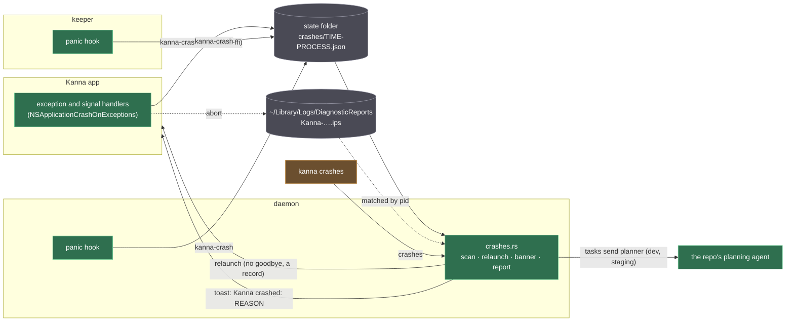
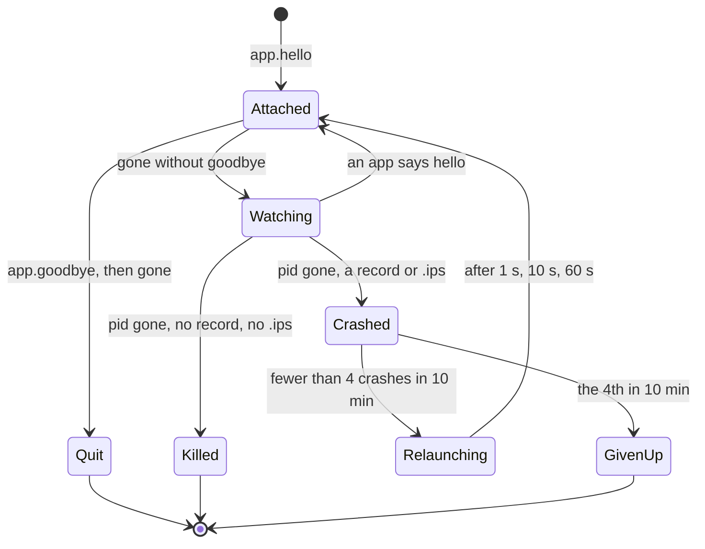
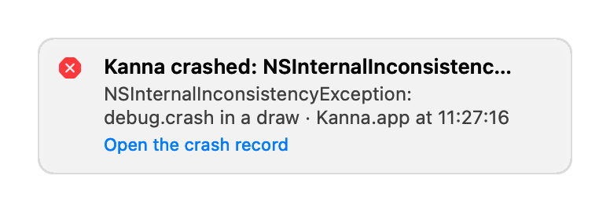

# Crashes

**Status:** built · **Tested:** e2e `crash_app_draw`, `crash_daemon_panic`, `crash_report_unheld` (a bypassing mock Claude planner takes the report unheld); `crates/kanna/tests/cli.rs` (`crashes`); `kanna-crash` unit tests · **Mockup:** [`references/mockups/crashes.html`](../../references/mockups/crashes.html) · **Builds on:** [app link](app-link.md), [toasts](toasts.md), [agent messaging](agent-messaging.md)

Kanna catches its own crashes. Each Kanna process that dies of a bug (the app, the daemon, the keeper) first writes a **crash record** in its state folder; the daemon relaunches a crashed app with its windows, the relaunched app shows a banner, `kanna crashes` lists the records with the matching macOS crash report, and dev and staging builds tell the repo's planning agent about each new kind of crash.

Why: on 2026-10-31 at 08:31:19 the dev app died of an uncaught `NSException` in a draw. AppKit logged it and the process quit: no `.ips`, nobody told, and the user relaunched it by hand.

## Contents

1. [The crash record](#1-the-crash-record)
2. [Capture](#2-capture)
3. [Detect and relaunch](#3-detect-and-relaunch)
4. [Surface](#4-surface)
5. [Report](#5-report)
6. [Tests](#6-tests)
7. [Glossary](#7-glossary)



## 1. The crash record

One JSON file per crash, `<state folder>/crashes/<time>-<process>.json`, such as `crashes/20261031T083119.412Z-app.json`. The time is UTC to the millisecond; the process is `app`, `daemon` or `keeper`. A record is written once, atomically (a temporary file renamed), and never changed.

```json
{
  "version": 1,
  "process": "app",
  "executable": "Kanna",
  "pid": 4242,
  "time": "2026-10-31T08:31:19.412Z",
  "kind": "exception",
  "reason": "NSInternalInconsistencyException: debug.crash in a draw",
  "stack": [{ "image": "Kanna", "symbol": "Kanna.CrashView.draw(__C.CGRect) -> ()", "offset": 112 }],
  "signature": "a41c09e2d7f3b815",
  "build": { "id": "5d1f…", "channel": "dev", "commit": "26e83e2c", "version": "0.1.0" },
  "panes": [{ "id": "term-41", "name": "agent", "type": "term" }]
}
```

| Field | Holds |
|---|---|
| `process`, `executable`, `pid` | which Kanna process (`app`, `daemon`, `keeper`), its executable's name and pid, which find its `.ips` |
| `kind` | `exception` (an uncaught Objective-C exception), `signal` (SIGSEGV, SIGABRT, a Swift trap's SIGTRAP, …), `panic` (Rust) |
| `reason` | `NAME: reason` of an exception, the signal's name, or a panic's message and `file:line` |
| `stack` | the crashing thread's frames, innermost first, symbolised (Swift demangled): `image`, `symbol`, and `offset` or `at` (a Rust `file:line`) |
| `signature` | the first 16 hex digits of SHA-256 over the process and the symbols of the top 5 frames, after the crash machinery (`objc_exception_throw`, `_sigtramp`, `std::panicking`, the handlers themselves) is skipped: the same bug gives the same signature across builds |
| `build` | the build ID (the SHA-256 of the bundle's `kanna-daemon`, as in the [app link](app-link.md#1-the-wire)), channel, commit and version |
| `panes` | the panes open: the app's views, the daemon's panes; the keeper writes none |

**One format, one writer.** The record is made by one Rust crate, `crates/kanna-crash`: the daemon and keeper link it, and the app calls it through `kanna-ffi` (`kanna_crash_write`, a JSON request in, the record's path out). Each process gives it what only it knows (reason, stack, panes, build); the crate adds the time, file name and signature, and reads records back for the daemon and the CLI.

## 2. Capture

| Process | How it catches a crash | Then |
|---|---|---|
| app | `NSApplicationCrashOnExceptions` (registered at launch), so an exception AppKit would log and swallow, in an event or a draw or layer display, ends in `+[NSApplication _crashOnException:]`, which traps (SIGTRAP). An exception preprocessor (`objc_setExceptionPreprocessor`) keeps the last exception thrown, so that SIGTRAP, or a SIGABRT, within 5 s of one is recorded as the exception, with its own stack; `NSSetUncaughtExceptionHandler` and `reportException:` record the others. Handlers for SIGSEGV, SIGBUS, SIGILL, SIGTRAP, SIGFPE and SIGABRT, on an alternate stack, record the rest. A Rust panic in the app's library goes through the same hook as the daemon's. | the default handler runs again: the process dies of the signal and macOS writes its `.ips` |
| daemon | a panic hook | the panic goes on as before: on the main thread the daemon exits, and the app starts another ([app link §4](app-link.md#4-the-app-starts-the-daemon)) |
| keeper | a panic hook | as before; a crash never restarts the keeper |

**GhosttyKit is built without Sentry** (`-Dsentry=false` in `scripts/build-ghosttykit.sh`). Ghostty's own crash reporter starts on a thread of its own from `ghostty_init`, takes over the crash signals, writes a `.ghosttycrash` minidump in `~/.local/state/ghostty/crash` and exits with status 6. That is what happened at 08:31:19: no handler of Kanna's ran and macOS wrote no `.ips`. The build store keys GhosttyKit by that script's hash, so the flag rebuilds it everywhere ([build store](build-store.md)).

Writing a record from a signal handler isn't async-signal-safe; it is best effort, and the `.ips` stays the full evidence.

## 3. Detect and relaunch

**The app says goodbye.** When it quits (⌘Q, SIGTERM, the daemon's `quit`), the app sends `app.goodbye` and waits for it to be written before closing the link. Its `app.hello` carries `relaunch`: its executable, arguments (without `--fresh`) and `KANNA_*` variables.

**The app going away without goodbye** starts a watch on its pid. When the pid is gone, the app **crashed** if a record of that pid is in `crashes/`, or within 5 s a `.ips` of that pid appears (then the daemon writes the record itself, `kind: signal`, from the `.ips`'s exception). With neither (SIGKILL, Force Quit), it was killed: logged, not relaunched. A pid still alive after 30 s only lost its link; another app attaching ends the watch.



- **Relaunch:** the daemon starts the app's executable with its arguments and variables, in a session of its own, output appended to `app.log` in the state folder. The app restores its windows from `app-state.json` and the daemon's layout, as on any launch.
- **Backing off:** the 1st, 2nd and 3rd crash within 10 minutes wait 1 s, 10 s and 60 s; the 4th stops: `kanna-daemon: the app crashed 4 times in 10 minutes; not relaunching it (last: REASON, RECORD)`. Every step is logged with the reason and the record.
- **Never:** while the daemon is shutting down, for an app attached from another machine, or for the keeper.

## 4. Surface

**The banner.** On every `app.hello`, the daemon sends the newest crash record not yet dismissed as a toast that doesn't fade (`sticky`), titled `Kanna crashed: REASON`, with the whole reason, the process, its local time and how many others wait below. Clicking it opens the record in a code pane in a new window; ×, or the click, dismisses it and every older one (`crashes dismiss`).



**`kanna crashes`** (protocol `crashes {action: list|dismiss}`) lists the records, newest first, each with its reason, record, matching `.ips` (the file in `~/Library/Logs/DiagnosticReports` of the process's name whose `pid` is the record's) and stack; `--json` prints them as the daemon gives them, `--all` lists dismissed ones too.

```text
2026-10-31 08:31:19  app (pid 4242, dev 26e83e2c)  NSInternalInconsistencyException: debug.crash in a draw
  record  ~/Library/Application Support/kanna-dev/crashes/20261031T083119.412Z-app.json
  report  ~/Library/Logs/DiagnosticReports/Kanna-2026-10-31-083119.ips
  0  Kanna  Kanna.CrashView.draw(__C.CGRect) -> () + 112
  1  AppKit  -[NSView _drawRect:clip:] + 3012
```

## 5. Report

**Dev and staging builds tell the repo's planning agent** about each new signature, once for the instance's life: a message from `crashes` to `planner` in the build's checkout's repo (`Build::checkout`, as `kanna task send planner` from there), held until a planner runs ([agent messaging](agent-messaging.md)). It says the process, reason, build, record and `.ips` paths, the signature and the top 15 frames. What the planner does with it: the `kanna-planning` skill.

**In the envelope, as the planner's own:** a crash report is Kanna telling you about itself, so it goes out in agent messaging's envelope with `from-mode` the planner's own class, as a message from you, your schedules or the [Desk news](desk-news.md) does ([agent messaging §2](agent-messaging.md#2-delivery)). Without it, a Claude planner that bypasses prompts holds the report for your approval. `crashes` is one of `messages::yours`, so `Tasks::hand_over` gives it the planner's class; `main.rs` wires `Crashes::post` to `Tasks::post` with `messages::CRASHES`.

**`crashes`, not `kanna`:** `kanna` is also the sender of the catch-up messages a stale task gets ([stacked tasks](stacked-tasks.md)), which `Tasks::tell` stores as `prompting` on purpose, and `hand_over` ignores a stored mode for a sender in `messages::yours`. A sender of its own keeps the two apart.

**Release builds keep records locally only** and send nothing: what may leave the Mac, to whom and with what consent is not decided. A policy comes before any sending.

**kanna.db** keeps a row per record seen, `crashes (file, signature, at, dismissed, reported)` ([database](database.md)); the daemon scans `crashes/` when it starts and after each crash it detects.

## 6. Tests

- **Debug commands** (with `KANNA_DEBUG=1`): `debug.crash` makes the app raise an `NSException` in a view's `draw(_:)` on its next display; `debug.panic` panics the daemon's main loop.
- **e2e** `crash_app_draw`: `debug.crash` on a private instance in the background; checks the record (kind, reason, stack, panes), the relaunch, the banner, `kanna crashes` with the `.ips`, and the planner's message. `crash_daemon_panic`: the record, the app starting a daemon again, the banner and the message. `crash_report_unheld`: a mock Claude planner started with `--dangerously-skip-permissions`, in a scratch repo's Desk and `cd`'d into the build's checkout (the planner's repo is its pane's cwd, and a private instance opens only projects in its own `~/.kanna-v4/repos`), gets the `debug.crash` report as a peer message rather than `held peer message`.
- **Every test run fails on a crash:** after each e2e scenario, and when a CLI test's private daemon is dropped, a record in the instance's `crashes/` fails it and is printed. The crash scenarios take away the records (and `.ips`) they made once they've checked them.

## 7. Glossary

| Term | Meaning |
|---|---|
| **Crash record** | Kanna's own JSON account of one crash, in the state folder. |
| **.ips** | The crash report macOS's ReportCrash writes for a process killed by a signal, in `~/Library/Logs/DiagnosticReports`. |
| **Signature** | A short hash of a crash's top frames: which bug it is, whatever the build or time. |
| **Goodbye** | `app.goodbye`, the app's last message when it quits on purpose. |
