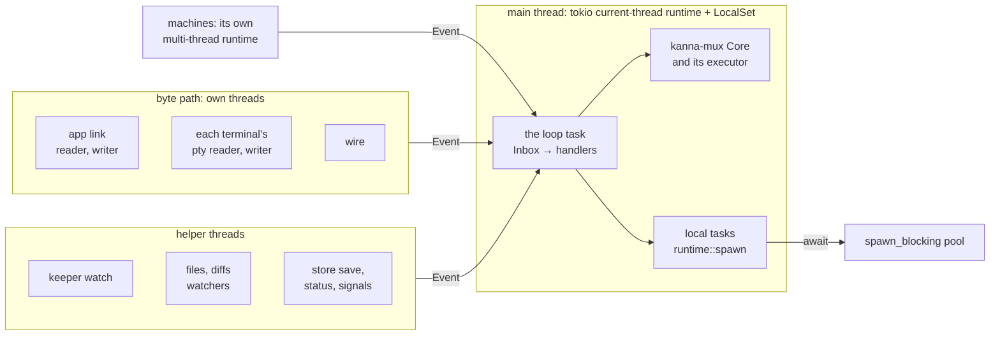

# The Daemon's Runtime

**Status:** step 1 built (the loop runs on the runtime; the slow-event log) · handlers being converted · **Follows:** [input latency](input-latency.md) · **Measured with:** [performance monitoring](performance-monitoring.md)

The daemon keeps all its state on one thread, its **main loop**, the way Node does: one owner, no locks. That only works if nothing on the loop waits. Today a handler that needs git, sqlite3, a file or another program calls it right there, and every request, status change and Desk update behind it waits too: `tasks list` held the loop 1–1.6s while `task_scripts::git_dir` ran git twice per task ([input latency §1](input-latency.md#1-what-was-slow)). Getting off the loop meant a hand-written thread and a result `Event` (`Worktree`, `Branch`, `RulesUpdated`, …), so the easy blocking call kept winning.

So the loop runs on a **tokio runtime** (current-thread, with a `LocalSet`), and a handler that waits **awaits** instead: `tokio::process` for programs, `tokio::fs` or `spawn_blocking` for files and sqlite. While it waits, the loop goes on with other events. A **guard** logs anything that still holds the loop over 20ms, and an e2e keeps the loop's p99 under that.

## Contents

1. [Threads](#1-threads)
2. [Rules](#2-rules)
3. [A handler that waits](#3-a-handler-that-waits)
4. [The guard](#4-the-guard)
5. [What blocks today](#5-what-blocks-today)
6. [Open questions](#6-open-questions)
7. [Glossary](#7-glossary)

## 1. Threads



- **The loop** is one task on the runtime. It takes `Event`s off the `Inbox` (a tokio unbounded channel: any thread sends without blocking) and handles each, as before, then does its chores (saving, the layout, crash ticks, task sweeps).
- **kanna-mux's Core** keeps its own small executor for requests, pumped by the loop (`core.poll`) and woken through `Event::Wake`. Futures it polls run on the runtime's thread, so they may await tokio I/O too.
- **Local tasks** are what a handler spawns to wait (§3). They run on the same thread, between the loop's events, and own `Rc` state like the loop does.
- **The byte path stays on its own threads**: the app link's reader and writer, each pty's reader and writer, and `wire.rs`. A keystroke and its echo never touch the runtime ([input latency §3](input-latency.md#3-the-byte-path)).
- **machines.rs** keeps its own multi-thread runtime for the iroh endpoint: its futures are `Send` and it already talks to the loop through `Event`s.

## 2. Rules

- **State stays on the loop**, in `Rc`/`RefCell`, as now. No `Mutex` is added for daemon state.
- **No `RefCell` borrow across an `.await`.** Copy out what the wait needs, drop the borrow, await, borrow again.
- **No blocking call on the loop or in a local task**: no `std::process::Command`, no `std::fs` beyond a small known file, no sqlite3 subprocess, no sleeps, no blocking sockets. Programs use `tokio::process`; files `tokio::fs`; anything else blocking goes in `spawn_blocking` and is awaited.
- **Recheck after every await.** The task, pane or request may be gone, or changed, by the time the wait ends: look it up again by ID, and answer or drop accordingly.
- **Spawn through `runtime::spawn(name, future)`**, never `spawn_local` directly, so the guard times every poll under that name.
- **A value a view needs but can't wait for** is looked up beside the loop: the view shows what's known, and whoever showed nothing is told when it's found (`projects::identity`, `on_found`). What must have the true answer awaits it (`identity_now`). What the daemon already knows about at its start is looked up before the loop (`prime`).
- **A new hand-written thread plus a result `Event` is no longer how to get off the loop.** The existing ones (`Worktree`, `Branch`, `Posted`, `Finished`, `RulesUpdated`) become local tasks when their handler is converted. The file and diff watchers stay threads: they live as long as a view and wait on `notify`, not on one call.

## 3. A handler that waits

A command answers through its `Responder` whenever it's ready, so a handler that waits spawns a local task and returns at once:

```rust
core.add_command("example", Rc::new(move |args, responder| {
    let tasks = Rc::downgrade(&tasks);
    runtime::spawn("example", async move {
        let out = tokio::process::Command::new("git").args(["rev-parse", "HEAD"]).output().await;
        let Some(tasks) = tasks.upgrade() else { return };
        responder.reply(tasks.after_git(&args, out));
    });
}));
```

A `Responder` dropped without an answer (the daemon stopping with the task still waiting) answers `the command ended without answering`.

## 4. The guard

- **Every event, the chores, and every poll of a local task are timed** (local tasks from the first converted handler on). Over 20ms (`runtime::SLOW`) is logged to `daemon.log` in every build, naming the request or event kind: `kanna-daemon: slow: tasks list from a client held the loop 34ms`. It replaces the 50ms request log ([performance monitoring](performance-monitoring.md)).
- The samples go into `debug.daemon.perf` as before: `loop.<kind>` per event kind, `loop.chores`, and `loop.async` for local tasks' polls.
- **The `loop_latency` e2e** runs a private instance with 40 tasks, lists, picks and shelves them over and over, and fails if any `loop.*` p99 is over 20ms.

## 5. What blocks today

Found by reading every handler and chore (October 2026). Each line is converted in its own commit; the slow-event log on the `loop_latency` run shows none remain.

| What | Reached from | Waits on |
|---|---|---|
| `mint`, `taken` | `tasks new` | `git rev-parse`, per candidate ID |
| `task_scripts::is_linked` | `tasks done`, `stop`, the sweep | `git rev-parse` |
| `opencode_session`, `first_session_since` | `Event::Status` (every one, until a session is found), `tasks start`, `planner start/quit` | `/usr/bin/sqlite3` |
| `latest_codex_session`, `first_codex_session` | the same | reading `~/.codex/sessions` |
| `agents::merge` | `agents status/ask/setup/update` | `git merge-file`, per file |
| `project_import` | `project import` | `git`, `cp -R`, rewriting session files: unbounded |
| `crashes` scan | the crash tick while the app is gone | reading DiagnosticReports |
| the keeper's requests | `close`, exit acks (spawns no longer wait: [async spawns](async-spawns.md)) | a round trip on `keeper.sock` (ms) |
| `Db` | almost every handler | sqlite in-process (ms; up to its 5s busy timeout) |

## 6. Open questions

- **sqlite (`Db`).** One `rusqlite` connection in an `Rc`, called from about 60 places, often inside a handler's synchronous logic and some in transactions. A call is usually under a few ms, but waits up to 5s when another process holds the lock. Making each call `async` reaches into nearly every handler. The better design: the loop keeps what it reads in memory (it mostly does), and writes go to a writer thread in order, unawaited; reads only at startup. Cost: a writer thread, and a read-after-write path for the few reads left.
- **Two executors.** kanna-mux's Core keeps its own executor beside tokio's. Spawning its futures on the `LocalSet` instead would drop `Event::Wake` and `core.poll`, but kanna-mux would depend on tokio, and the CLI and `kanna-layout` use it too. Left as is.

## 7. Glossary

- **Main loop**: the daemon's one thread that owns its state and handles every `Event`.
- **Local task**: a future spawned on the runtime's `LocalSet`; it runs on the main thread and may hold `Rc`s.
- **Event**: a message to the loop from another thread or a finished wait (`main.rs`).
