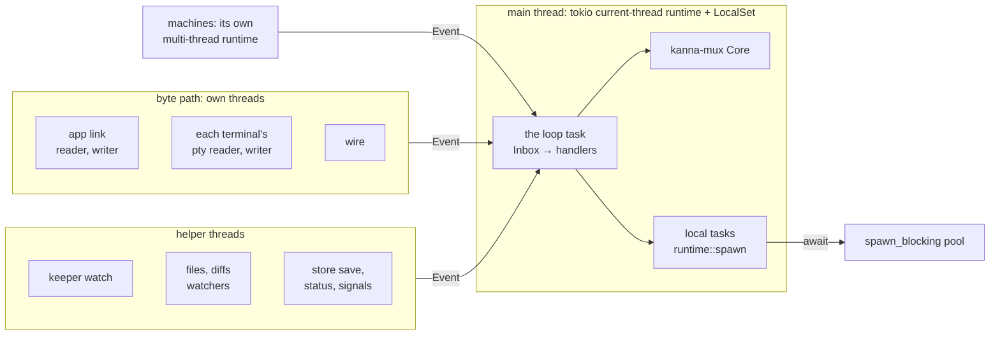

# The Daemon's Runtime

**Status:** built: the loop and its handlers run on tokio; what's left is in [§5](#5-what-still-holds-the-loop) · **Follows:** [input latency](input-latency.md) · **Measured with:** [performance monitoring](performance-monitoring.md)

The daemon keeps all its state on one thread, its **main loop**, the way Node does: one owner, no locks. That only works if nothing on the loop waits. Today a handler that needs git, sqlite3, a file or another program calls it right there, and every request, status change and Desk update behind it waits too: `tasks list` held the loop 1–1.6s while `task_scripts::git_dir` ran git twice per task ([input latency §1](input-latency.md#1-what-was-slow)). Getting off the loop meant a hand-written thread and a result `Event` (`Worktree`, `Branch`, `RulesUpdated`, …), so the easy blocking call kept winning.

So the loop runs on a **tokio runtime** (current-thread, with a `LocalSet`), and a handler that waits **awaits** instead: `tokio::process` for programs, `tokio::fs` or `spawn_blocking` for files and sqlite. While it waits, the loop goes on with other events. A **guard** logs anything that still holds the loop over 20ms, and an e2e keeps the loop's p99 under that.

## Contents

1. [Threads](#1-threads)
2. [Rules](#2-rules)
3. [A handler that waits](#3-a-handler-that-waits)
4. [The guard](#4-the-guard)
5. [What still holds the loop](#5-what-still-holds-the-loop)
6. [Decisions](#6-decisions)
7. [Glossary](#7-glossary)

## 1. Threads



- **The loop** is one task on the runtime. It takes `Event`s off the `Inbox` (a tokio unbounded channel: any thread sends without blocking) and handles each, as before, then does its chores (saving, the layout, crash ticks, task sweeps).
- **kanna-mux's Core** owns the runtime and the `LocalSet`, so a test's Core and the daemon's run the same way, and spawns on them work from before the loop starts until after it ends. Everything Core does runs there, in the order it was asked for, never ahead of what's queued: a request that overtook a queued update would see a pane alive that had exited, and wait for an exit that had already happened. The loop yields once per iteration so ticks keep up with events.
- **Local tasks** are what a handler spawns to wait (§3). They run on the same thread, between the loop's events, and own `Rc` state like the loop does.
- **The byte path stays on its own threads**: the app link's reader and writer, each pty's reader and writer, and `wire.rs`. A keystroke and its echo never touch the runtime ([input latency §3](input-latency.md#3-the-byte-path)).
- **machines.rs** keeps its own multi-thread runtime for the iroh endpoint: its futures are `Send` and it already talks to the loop through `Event`s.

## 2. Rules

- **State stays on the loop**, in `Rc`/`RefCell`, as now. No `Mutex` is added for daemon state.
- **No `RefCell` borrow across an `.await`.** Copy out what the wait needs, drop the borrow, await, borrow again.
- **No blocking call on the loop or in a local task**: no `std::process::Command`, no `std::fs` beyond a small known file, no sqlite3 subprocess, no sleeps, no blocking sockets. Programs use `tokio::process`; files `tokio::fs`; anything else blocking goes in `spawn_blocking` and is awaited.
- **Recheck after every await.** The task, pane or request may be gone, or changed, by the time the wait ends: look it up again by ID, and answer or drop accordingly.
- **Spawn through `runtime::spawn(name, future)`**, never `spawn_local` directly, so the guard times every poll under that name. The daemon enters its `LocalSet` as it starts, so a spawn before the loop waits for it, and one after the loop is dropped.
- **A value a view needs but can't wait for** is looked up beside the loop: the view shows what's known, and whoever showed nothing is told when it's found (`projects::identity`, `on_found`). What must have the true answer awaits it (`identity_now`). What the daemon already knows about at its start is looked up before the loop (`prime`).
- **A new hand-written thread plus a result `Event` is no longer how to get off the loop.** The file and diff watchers stay threads: they live as long as a view and wait on `notify`, not on one call.
- **Stopping doesn't wait for work off the loop.** Core's runtime shuts down in the background, so a teardown script or a copy doesn't hold up the daemon's exit, and what a killed copy left is cleaned up by the next import.
- **A blocking thread has no `LocalSet`:** `runtime::spawn` and what calls it (`projects::identity`) stay on the loop; `identity_off_loop` is the one for elsewhere.

## 3. A handler that waits

A command answers through its `Responder` whenever it's ready, so a handler that waits spawns a local task and returns at once:

```rust
core.add_command("example", Rc::new(move |args, responder| {
    let tasks = Rc::downgrade(&tasks);
    runtime::spawn("example", async move {
        let out = tokio::process::Command::new("git").args(["rev-parse", "HEAD"]).output().await;
        let Some(tasks) = tasks.upgrade() else { return };
        responder.reply(tasks.after_git(&args, out));
    });
}));
```

A `Responder` dropped without an answer (the daemon stopping with the task still waiting) answers `the command ended without answering`.

## 4. The guard

- **Every event, the chores, and every poll of a local task are timed.** Over 20ms (`runtime::SLOW`) is logged to `daemon.log` in every build, naming the request or event kind: `kanna-daemon: slow: tasks list from a client held the loop 34ms`. It replaces the 50ms request log ([performance monitoring](performance-monitoring.md)).
- The samples go into `debug.daemon.perf`: `loop.<kind>` per event kind, `loop.chores`, `loop.async` for local tasks' polls, and `loop`, every hold together (`holds`, and how many were `over` the bound). `tasks.list`, `tasks.view`, `layout.save` and `db.checkpoint` are timed for reading, not bound.
- **The `loop_latency` e2e** runs a private instance with 40 tasks through 20 rounds of list, pick and shelve, then an `agents` merge, a codex task with no session and 400 rollouts, and an import listed beside it. It fails if more than 1% of the loop's holds are over 20ms: the loop's p99, taken over about 2,000 holds, because per kind a few dozen samples make p99 the maximum. Every hold over the bound is printed. Readings (November 2026): 9–15 of about 2,180 holds over 20ms at load 14–17, four runs of four. They're single spikes in work that takes under 1ms at its median (a 40-task list is 0.7ms), so they look like the daemon being scheduled out on a loaded Mac, not blocking calls. It failed under the old per-kind check at load 25.

## 5. What still holds the loop

Everything on the first list (git, session lookups, `agents`, `project import`, the crash record) is off the loop. A task view stats its files and reads them again only when they changed (`stamped.rs`), so a `HEAD`, `.git`, `config` or script record that changes shows on the next view. A 40-task list went from 2.55ms to 0.72ms at the median.

| What | Reached from | Waits on |
|---|---|---|
| the keeper's requests | `close`, exit acks (spawns no longer wait: [async spawns](async-spawns.md)) | a round trip on `keeper.sock` (ms) |
| `Db` | almost every handler | sqlite in-process (under 1ms typically; a write can wait up to its 5s busy timeout) |
| one `git` | `task show` of a done task, a move's `valid_branch` | `rev-parse`, `check-ref-format` |
| `crashes.scan` | the app attaching, `crashes list` | reading Kanna's own crash records |
| `Event::Stacks`, `Sampled`, `Replica`, `Merged`, `Turn` | stacked heads, stats, moves | still a thread and a result `Event`; off the loop already, not converted |

## 6. Decisions

- **sqlite stays on the loop.** There's no general writer thread: writes can't all go unawaited, and `put_with` isn't what spikes ([§6.1](#61-what-holds-up-the-loop-november-2026)). Checkpoints went off the loop instead: its connection never checkpoints (`wal_autocheckpoint=0`), and `kanna.checkpoint`, with a connection of its own opened before `Db::open` returns, so nothing touches the state folder after that, runs a passive checkpoint every 2s. Before, one `layout.save` in 15 hit one and took 50ms; after, none went over 10ms, while one checkpoint took 21ms on its own thread. `put_layout` isn't queued: the checkpoint was its spike, and a queue would have to keep its retry and its order with a done task's transaction.
- **One executor: tokio.** Core's futures run on the `LocalSet`, timed by the guard through `set_timing`, so there's no `Event::Wake`, `core.poll` or `set_wakeup`. Only the daemon runs a `Core` (the CLI and `kanna-layout` use kanna-mux's other parts). `handle_blocking` and `turn` drive Core's own runtime, for tests and after the loop has ended.

### 6.1 What holds up the loop (November 2026)

Temporary timers on a private instance, 40 stopped tasks, `loop_latency` run six times at load 5–11. A per-call figure's p99 and max cover its last 200 samples.

| What | p50 | Worst |
|---|---|---|
| `tasks list` (no sqlite writes) | 3.3–4.7ms | 108ms |
| `tasks.view()`, on each task change | 3.1–3.7ms | 29ms |
| `db.put_with`, the task write | 0.34–0.43ms | 8.4ms |
| `db.put_layout` | 0.3–0.9ms | 23ms, once |
| `terminals.save_if_changed` | 0 | 14ms |

A list or view costs about 80µs per task, nearly all of it file reads in `described` (`branch_of`, `identity`, `script_said`); those parts stayed at or under about 1ms each in what was kept. Polls over 20ms were `tasks list`, `task list`, `task hold` and `task claim`, the last two carrying the shelve or pick continuation (store, then a view) in one poll. So the biggest target is the cost per task of a view, not sqlite.

Why there's no general writer thread:

- **Read-then-write transactions.** `replica.rs` runs 14 `atomically` blocks and `transfer.rs` more; they read a task's authority or a transfer inside the transaction and use the result.
- **Durability before peers.** `store` commits replicated ops, then applies them and lets them sync. Unawaited, peers could hold ops this machine loses, and a failed write can't be undone in memory.
- **Answers.** `put_message`, `start_round`, `answer`, `add_schedule`, `add_revision` and `put_stage` return row IDs, and `store` returns its failure to the client.
- **Order.** The layout saved with a done task could be overwritten by an older queued `put_layout`.
- **History.** Events, messages, runs, stages, samples and quiz rounds are read from disk on demand; keeping them in memory has no bound.

## 7. Glossary

- **Main loop**: the daemon's one thread that owns its state and handles every `Event`.
- **Local task**: a future spawned on the runtime's `LocalSet`; it runs on the main thread and may hold `Rc`s.
- **Event**: a message to the loop from another thread or a finished wait (`main.rs`).
