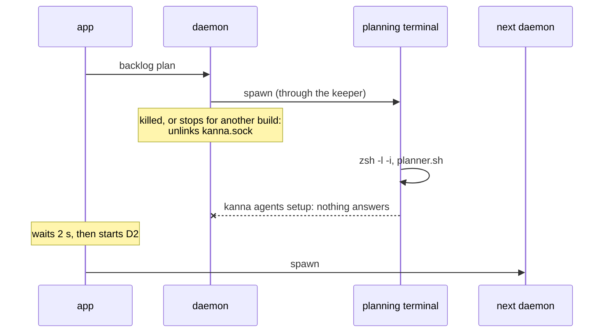
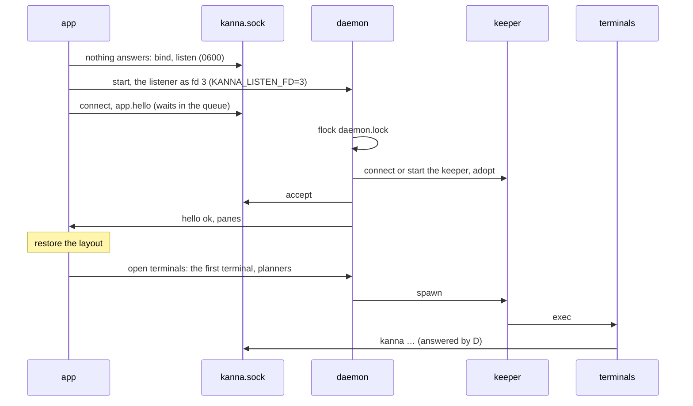
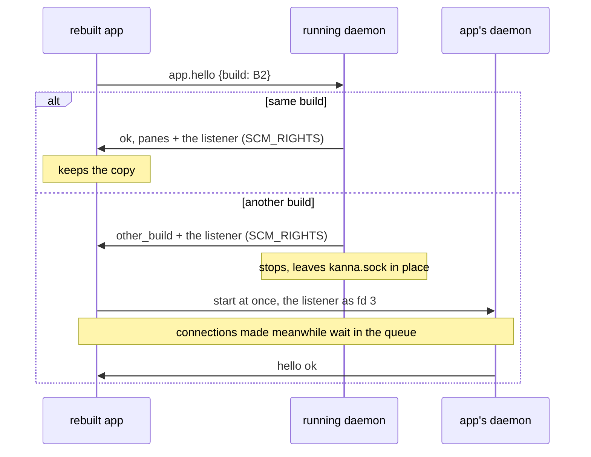
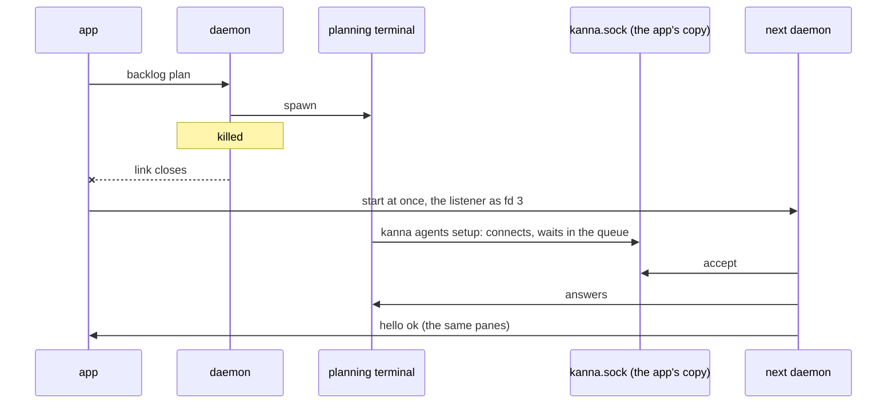

# The App Keeps the Daemon's Socket

**Status:** built (2026-10-14) · **Tests:** `crates/kanna-daemon/tests/restart.rs`, `crates/kanna-mux` (unit), `scripts/e2e-kanna.sh` restart_while_desk_opens · **Builds on:** [the app link](app-link.md), [restarting the daemon](daemon-restart.md), [daemon build](daemon-build.md) · **Why:** a new Desk's planning terminal ran `kanna agents setup --ask` while the app was restarting its daemon and got `kanna: nothing answers on …/kanna.sock`

While Kanna.app runs, `kanna.sock` always answers. The app holds the socket's listening end and hands it to each daemon it starts; a connection made while no daemon runs waits in the socket's queue, and the next daemon answers it. Nothing in a terminal, script or agent retries.

**Done when** a daemon killed while a Desk opens leaves its planning terminal's `kanna agents setup` waiting, not failing, and the planner carries on once the app's next daemon answers (`restart_while_desk_opens`).

## Contents

1. [What went wrong](#1-what-went-wrong)
2. [Startup order](#2-startup-order)
3. [A daemon that's already running](#3-a-daemon-thats-already-running)
4. [Losing the daemon](#4-losing-the-daemon)
5. [How it's built](#5-how-its-built)
6. [Limits](#6-limits)
7. [Rejected](#7-rejected)

## 1. What went wrong

The app already opened no terminal before its daemon answered `app.hello`. The planning terminal started on a daemon that answered, and that daemon then went away (another build, a kill). The terminal kept running in the keeper, its shell reached `kanna`, and for the 2 s the app waited before starting the next daemon, plus that daemon's start, the socket file was gone or refused.

## 2. Startup order

At launch with no daemon, the app makes the socket before it starts anything, so the socket answers from the first moment and every terminal opens after the daemon and keeper do:

- **The app keeps its copy** of the listener as long as it runs, whichever daemon is answering.
- **Nothing is opened before `hello` is accepted:** the first terminal, a Desk's planner and every other request wait for the attach, as before.

## 3. A daemon that's already running

A daemon the app didn't start (a previous launch's, or one started by hand) bound the socket itself. The app's `hello` says `keepsSocket: true`, and the reply hands it a copy of the daemon's listener, attached or refused:

- **A daemon of an older build** sends no listener: the app binds a new socket once nothing answers, as before. That one upgrade has the old gap; every later one doesn't.
- **A daemon whose app holds the socket doesn't unlink it** when it stops: with an app attached, or after refusing one for another build. Otherwise (no app, the app has quit and closed its copy, or a shutdown on purpose such as `kanna instances stop`, after which the app quits rather than starting another) it unlinks it as before, whether it bound the socket or was handed it.

## 4. Losing the daemon

The app starts the next daemon as soon as its link closes, with its copy of the listener. There's no 2 s grace: a daemon started by hand now can't take the socket from the app anyway ([6](#6-limits)).

- **At most one start every 10 s** still holds, so a daemon that can't start doesn't loop; a start that's due later is made then, not dropped, since a queued connection no longer makes the app try again.
- **Clients wait for an answer, not for the socket:** the CLI has no reply timeout, so a `kanna` command made during the restart takes as long as the restart.

## 5. How it's built

| Part | Change |
|---|---|
| `DaemonStarter` (app) | binds `kanna.sock` itself (unlink, bind, listen, 0600) when nothing answers and it holds no listener; starts the daemon with the listener on fd 3 and `KANNA_LISTEN_FD=3`; starts the next one when the link closes, at most one every 10 s |
| `DaemonConnection` (app) | reads with `recvmsg`, so a descriptor on the hello reply is kept; the app swaps it in for the copy it held |
| `kanna-daemon` | takes the listener from `KANNA_LISTEN_FD` (checked to be a Unix stream socket, made close-on-exec, the variable removed so no terminal sees it) instead of binding; sends a copy with its `hello` reply to an app that says `keepsSocket`; on stop, leaves the path when an app holds the socket |
| `SocketServer` (`kanna-mux`) | starts from a listener it's given (`start_with`); `listener()` dups it; `stop_leaving_path()` stops without unlinking |

The fd travels as `SCM_RIGHTS` on the reply line's first byte, as the keeper sends pty masters. The reply line says `"listener": true` when it carries one. A test client that doesn't say `keepsSocket` gets none, and the daemon unlinks the socket when it stops, as before.

## 6. Limits

- **A daemon started by hand while the app holds the socket** finds it answering and exits ("another kmux is already listening"); the app's own daemon serves it. Before, the app restarted it after 2 s anyway.
- **A daemon that crashes leaves `kanna.sock` in place,** whoever bound it, so the app's copy keeps answering. Before using its copy, the app checks that the path still answers; if something removed the file, its copy no longer has a path, so it binds a new socket rather than start a daemon nobody can reach.
- **With the app quit,** nobody holds a spare copy: a daemon that stops then leaves nothing listening, and the CLI starts the app as before.
- **Linux** has no app; its daemon binds the socket itself, as before.

## 7. Rejected

- **Retrying in `kanna` or in `planner.sh`:** every script and agent would need it, and the app would still be racing its own services.
- **The keeper holding the listener:** with no app to start a daemon, connections would wait forever in a socket nobody serves, where today the CLI starts the app; and the keeper would take on the daemon's socket path, which it doesn't otherwise know ([upgrading the keeper](keeper-upgrade.md) carries only its own state).
- **launchd socket activation:** the app starts its daemon itself ([4.5](app-link.md)); a launch agent adds install steps and a second definition of the socket.
- **Only shortening the 2 s grace:** a gap of any length is a race.
