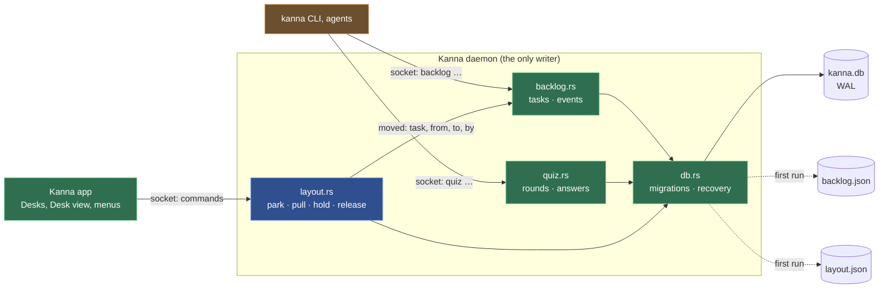
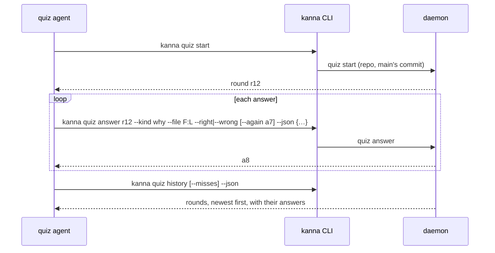

# The Database

**Status:** built · **Builds on:** [Tasks](tasks.md)

**The daemon keeps Kanna's records in one SQLite file, `kanna.db`, in its state folder; nothing else opens it.** Tasks move into it from `backlog.json`, and every change to a task's place or state is written as an event, so Kanna can show what happened over time (the Desk's and the Shelf's history first). The layout (the logical presentation: workspaces, windows, tabs, where each is) is kept beside the tasks ([presentation layers](presentation-layers.md)).

**Stored names are the ones from before the [Desk view rename](desk-view.md#5-internal-names)**, kept so no data or protocol needs migrating:

| Stored | Means now |
|---|---|
| `place = 'backlog'`, the `backlog` command, `backlog.rs`, `backlog.json` | the Shelf |
| `place = 'shelf'` (an old `desk` reads as `shelf`), the app's claim | on the Desk |
| events `shelved` / `deferred` (older `pulled` / `parked`) | moved to the Desk / to the Shelf (made active / left) |
| `parkedAt` | when a task was last active |

**tasks**: one row per task, from made to done.

| Column | Type | Holds |
|---|---|---|
| `id` | text, key | `task-1dfb12c2` ([task IDs](task-ids.md)) |
| `repo` | text | the repo's folder |
| `place` | text | `backlog` (the Shelf), `shelf` (on a Desk; an old `desk` reads as this) or `done` |
| `terminal` | text | its agent's terminal (`term-41`), while it has one |
| `made_at` | real | when it was made |
| `doc` | JSON | name, first message, by, agent, worktree folder, session, its workspace (`ws-3`, [workspace list](workspace-list.md)), … |

**task_events**: one row per change of a task's place or state.

| Column | Type | Holds |
|---|---|---|
| `id` | integer, key | |
| `task` | text → `tasks.id` | |
| `at` | real | when |
| `what` | text | `made`, `started`, `stopped`, `exited`, `shelved`, `deferred`, `renamed`, `messaged`, `done`, `imported` (older rows may say `parked` or `pulled`) |
| `from_place`, `to_place` | text | where it was and went, for a move |
| `by` | text | a pane, `user`, or `daemon` |
| `doc` | JSON | window, exit code, old name, … |

**messages**: one row per message between the user, the planner and tasks ([agent messaging](agent-messaging.md)).

| Column | Type | Holds |
|---|---|---|
| `id` | integer, key | |
| `recipient` | text | a task's ID, or `planner` |
| `repo` | text | the repo, which picks the planner |
| `sender` | text | a task's ID, `planner` or `user` |
| `at` | real | when it was sent |
| `delivered` | real | when it was typed into the recipient's terminal; empty while it waits |
| `text` | text | the message |

**layout**: one row (`id` 1), `doc`: the layout in kmux's state file format, Kanna's version 3 ([workspaces](workspaces.md#5-saved-state)). The daemon writes it half a second after a change and when it stops, and with a task's row when the task is done, in the same transaction, so a done task's workspace doesn't come back. On first run it imports `layout.json` and renames it `layout.json.imported`.

**meta**: `key`, `value`. (It held `next_task`, the counter for the old `t` IDs, until migration 3.)

- **SQLite through `rusqlite` with its bundled SQLite** (`features = ["bundled"]`): one C file compiled by `cc` like the tree-sitter grammars, built for the app's macOS ([deployment target](deployment-target.md)), no server and no system library. WAL mode, `synchronous = NORMAL`, a busy timeout, foreign keys on; file mode 0600 as the rest of the state folder.
- **Columns for what's queried, a JSON doc for the rest.** A table's columns are what Kanna sorts, filters or joins on (a task's ID, repo, place and terminal; an event's task, time, kind, places and who); everything else is a JSON `doc` (a task's name, first message, agent, worktree, session; an event's window or exit code). A new field is a new doc key, with no migration; a key the daemon doesn't know is kept when it updates the row (`json_patch`), so an older Kanna doesn't drop a newer one's fields. A doc field becomes a column, by a migration, when something starts to query it.
- **The daemon is the only writer.** The CLI and agents keep asking the daemon (`backlog …` on its socket), and so does the app. Tests and people read it with `sqlite3 -readonly`.
- **Migration 3 renumbers the tasks** from `t134` to `task-XXXXXXXX`, with their events and blockers ([task IDs](task-ids.md#the-migration)); a migration step is SQL or, like this one, a Rust function.
- **Migrations by a number:** `PRAGMA user_version` is the schema's version; on open the daemon runs each step above it in one transaction. A db from a newer Kanna (a higher version) isn't touched: the daemon moves it aside as `kanna.db.newer` and says so in its log, as settings files from a newer Kanna are skipped.
- **One row per task, for its whole life.** A task keeps its ID ([task IDs](task-ids.md)) from made to done, on the Shelf or a Desk: `place` and `terminal` say where it is and which terminal is its agent (`term-152`); a start gives the agent a new terminal, and the row follows it. `kanna task done` sets `place = done` instead of deleting the row, so its events keep their task. A new ID is random and checked against every row, done ones too, so an ID is never handed out twice.
- **Every change of place or state writes an event,** in the same transaction as the change. The daemon writes the ones it makes: made, started, stopped, shelved, deferred and done from `backlog` commands; exited when an agent's terminal ends without a stop; renamed and done when it sees a task's pane renamed or closed (`kanna task name`, `kanna task done` on the Desk, ⌘W). `by` is the terminal the CLI ran in (`$KANNA_TERMINAL`), else `user`; `daemon` for what it noticed itself. Which task is active and showing the Desk view are each app's and aren't recorded ([each app's Desks](app-desk.md)); a shelved event names the app that claimed the task (`app`).
- **A task the daemon didn't make** (an agent docked by hand) gets an ID the first time it's moved, as it does when it's moved to the Shelf.
- **Reading it:** `backlog events TASK` (an ID, a unique start of one, or the agent's terminal) answers the task's events, oldest first; the Desk's and the Shelf's history builds on it.
- **On first run** the daemon imports `backlog.json` (tasks, the running list, the counter) in one transaction, with a `made` event for each task at its `madeAt`, then renames the file `backlog.json.imported` and never reads it again.
- **Recovery.** On open the daemon runs `PRAGMA quick_check`. A file it can't open or that fails the check is moved aside as `kanna.db.bad-TIME`, with its `-wal`; the daemon then restores the last good copy (`kanna.db.bak`, written with SQLite's backup API at each start once the db checks out) and logs what it did and that changes since that start are lost. With no good copy it imports `backlog.json.imported` if there is one, else starts empty, and says which in its log. A missing `kanna.db` with a `kanna.db.bak` or `backlog.json.imported` beside it is restored the same way. A `backlog.json` found beside a working db (written by an older Kanna run since) adds the tasks the db lacks. A write that fails is logged and the command fails; one after the change has happened (an agent already started) still fails the command, and memory keeps what happened. A db file that can't be made at all is logged and the tasks are kept in memory until the daemon restarts.

**What stays where it is.** Each app's physical state (window frames, text sizes) stays in its own `app-state.json` ([windows](windows.md#2-what-the-app-keeps)). Doc threads stay beside their docs ([doc markup](doc-markup.md)), where an agent reads them. Settings stay JSON files people edit.

## Quiz results

**Built.** Every [quiz](quiz.md) round and answer is kept, so misses can come back in a later round and a round can cover what's new since the last one.

**quiz_rounds**: one row per round.

| Column | Type | Holds |
|---|---|---|
| `id` | integer, key | shown as `r12` |
| `repo` | text | the repo's folder |
| `at` | real | when it started |
| `head` | text | main's commit it asked about |
| `doc` | JSON | commits covered, agent, … |

**quiz_answers**: one row per question answered.

| Column | Type | Holds |
|---|---|---|
| `id` | integer, key | |
| `round` | integer → `quiz_rounds.id` | |
| `at` | real | when it was answered |
| `kind` | text | `architecture`, `drawing`, `behaviour`, `where`, `why`, `bug` |
| `file` | text | the file the question is about, relative to the repo |
| `right` | integer | 1 or 0 |
| `again` | integer → `quiz_answers.id` | the earlier miss this question asked again |
| `doc` | JSON | `line`, `last`, question, choices, the pick, the right choice, explanation, … |

- **The quiz agent writes them** with `kanna quiz start`, `answer` and `history`, through the daemon's `quiz` command (`quiz.rs`) like every other write. This replaces the quiz spec's "nothing is kept" rule and its rejected `kanna quiz` command.
- **One db, shared:** the daemon opens `kanna.db` once at start and hands it to `backlog.rs` (the Shelf) and the quiz.
- **A round** is on the repo's own folder (the main checkout, as a task's `repo`) and main's commit when it starts, which the CLI reads with git; it's shown as `r12`, an answer as `a7`. `--json DOC` is a JSON object kept as the row's doc, with the daemon adding the asking pane (`by`) to a round's.
- **An answer** has a kind (`architecture`, `drawing`, `behaviour`, `where`, `why`, `bug`; the daemon refuses others), the file and lines it's about (`FILE:LINE[-LAST]`, kept relative to the repo, the lines in the doc), and right or wrong.
- **A miss stays a miss until it's asked again:** `history --misses` answers the wrong answers that no later answer names as `again`. A miss asked again and missed is a new miss, standing for the old one. `again` is a column because that query joins on it; an answer from another repo's quiz is refused.
- **`history`** answers this repo's rounds, newest first, each with its commit, doc and answers (with `--misses`, only rounds with misses); the newest round's `head` is where the next round's "what's new" starts.
- **Still no score:** the end of a round says what you knew of these changes; `history` is for the agent picking questions, not a total shown to you.

## Recent projects

**Built.** The projects File → Open Recent and a new Desk's planning terminal list ([recent projects](recent-projects.md)).

**projects**: one row per project, at most 10.

| Column | Type | Holds |
|---|---|---|
| `path` | text, key | the project's folder (the main repo for a worktree) |
| `at` | real | when a Desk last opened on it or moved to it |
| `seq` | integer | the order, highest first |

- **The app writes them** (`projects touch`, through `projects.rs`) whenever one of its Desks' project changes; the eleventh drops the oldest. Listing forgets a folder that's gone; `projects clear` empties the table.

## Planners

**Built.** Each project's planning conversation ([planner resume](planner-resume.md)).

**planners**: one row per project.

| Column | Type | Holds |
|---|---|---|
| `path` | text, key | the project's folder (the main repo for a worktree) |
| `doc` | JSON | `agent`, `session` (null until known), `started` (seconds), `pane` (the planning terminal), `running` (its agent not quit) |

- **The daemon writes them** when a planner starts (`backlog` `planner` `start`) and when its agent quits (`quit`); the next planner on the project reads it. Not in `projects`, which keeps only ten and is cleared with `kanna projects clear`.

## Never import

**Built.** Outside projects whose planner shouldn't offer the import at startup ([project folder](project-folder.md#3-the-offer)).

**never_import**: one row per project.

| Column | Type | Holds |
|---|---|---|
| `path` | text, key | the outside project's folder (the main repo for a worktree) |
| `at` | real | when you answered never |

- **The daemon writes them** (`project` `never`, from `planner.sh`) and reads them (`project` `asked`); importing the project deletes its row.

**Later candidates,** not built: agent session IDs per task over time; agent status history (how long a task waited on you); build timings.

**Checked by** `db.rs`'s tests (a real `backlog.json` imported with every task and the counter; a held task; a change and its event together; unknown doc keys kept; a corrupt, missing or newer db; a `backlog.json` beside the db; a version 1 db taking the quiz tables with its tasks kept; a miss kept until it's asked again; a project's planner kept across a restart), `quiz.rs`'s tests (a round and its answers read back; a bad answer refused), the CLI's tests (`kanna quiz` requests, the history's text), the layout owner's tests (park and pull, a swap, report their moves: the internal moves behind ⌘. and making a task active), e2e `task_history` (import, every event of a task's life with who did it, the app's park (⌘.), a corrupt db at restart) and e2e `quiz_results` (a round recorded, read back after a restart, a miss asked again).

**Why not JSON files and an `events.jsonl`.** Both would work for the first table and one log. The db wins once anything reads history back: the Desk's and the Shelf's history is a query by repo and time, "how long did it wait on me" a join of status changes, and a JSON log means reading the whole file and writing its indexes by hand. A change to a task and its event are one transaction, so they can't disagree after a crash; with two files they can. `backlog.json` is rewritten whole on every change (71 KB today, growing with every first message); a row update is a page or two. Migrations have a number and run in a transaction rather than being guessed from what keys a file has. The cost is one C dependency, compiled in, and a file people can't open in an editor, which the CLI covers. Moving away from JSON is cheap now and dearer with every table.

| | `backlog.json` + `events.jsonl` | `kanna.db` |
|---|---|---|
| Task and its event agree after a crash | no: two files | yes: one transaction |
| Write on each change | the whole file | the changed rows |
| Desk and Shelf history, waiting times | read every line, index by hand | a query with an index |
| Schema changes | infer from keys | numbered migrations |
| Dependency | none | `rusqlite` (bundled SQLite) |
| Readable by hand | any editor | `sqlite3`, `kanna task list` |

A document store (PoloDB, or redb with indexes of our own) was the other option weighed: as flexible as the JSON doc, but younger engines with less crash testing, and Desk and Shelf history would mean secondary indexes kept by hand.
