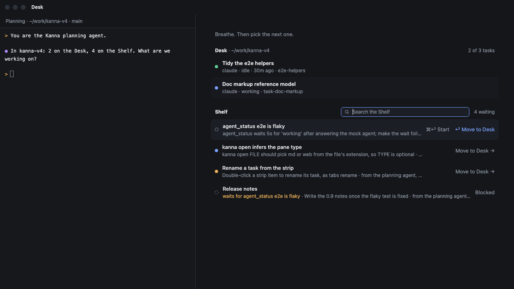
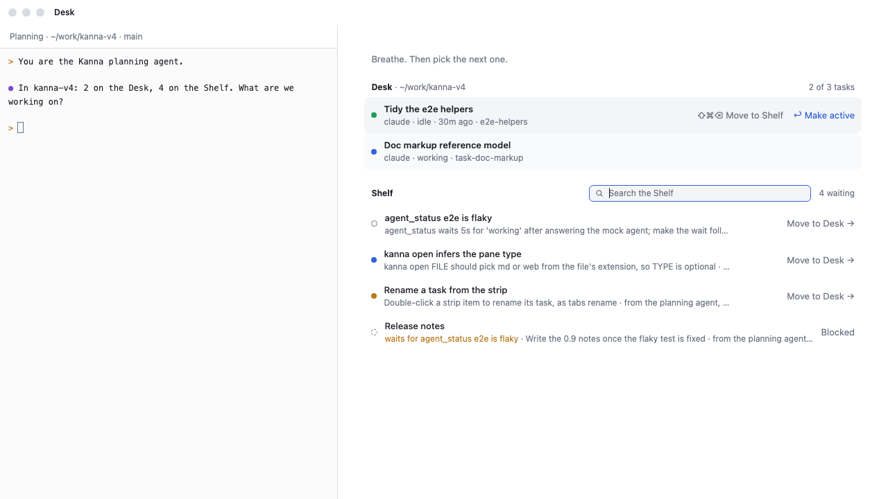
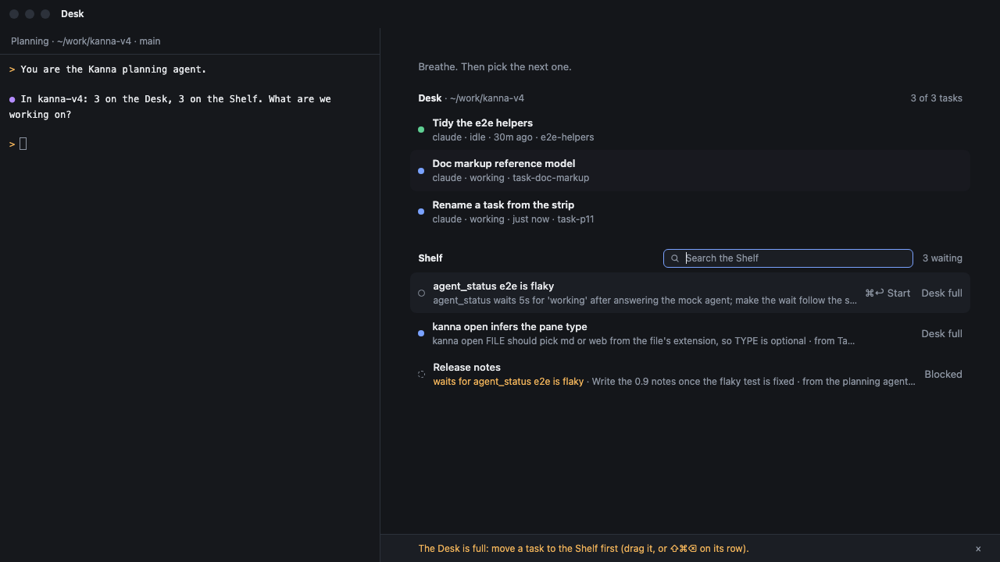
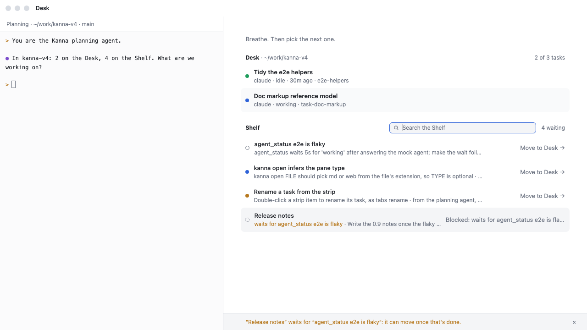
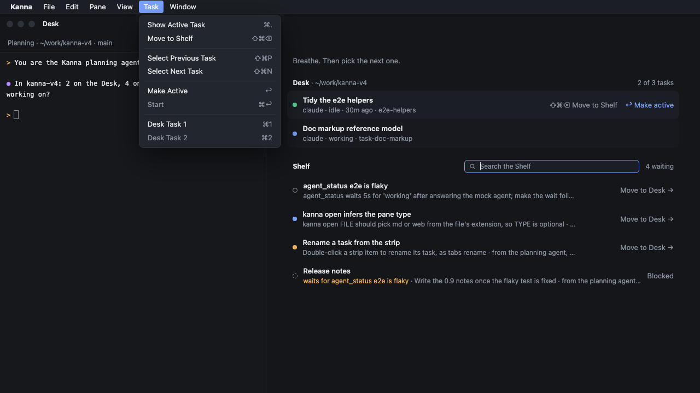
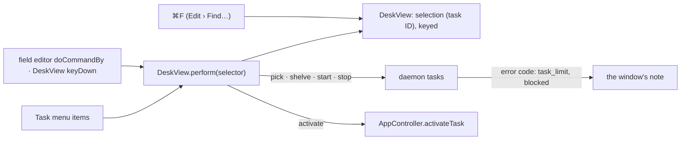

# Desk view keys

**Status:** built · **Mockup:** [`references/mockups/desk-keys.html`](../../references/mockups/desk-keys.html) · **Builds on:** [Desk view](desk-view.md), [Shelf search](shelf-search.md), [Shelf row status](shelf-row-status.md), [Drag a Desk task to the Shelf](desk-row-shelve.md), [tasks](tasks.md)

Picking, shelving and starting tasks in the Desk view work from the keyboard alone. **⌘F** hands the keyboard from the planning terminal to one **selection** that runs over the Desk's rows and then the Shelf's; ↑ ↓ move it (or ⇧⌘P ⇧⌘N, without leaving the letters), ↩ does what clicking the row does, ⇧⌘⌫ moves a Desk task to the Shelf and ⌘↩ starts or stops a Shelf task where it is. **esc** goes back to the terminal.

| The selection on a Shelf row | On a Desk row (light) |
|---|---|
|  |  |

| ↩ on a full Desk | ↩ on a blocked row | The Task menu |
|---|---|---|
|  |  |  |

*(From the mockup: `#picture&keys`, `#light&sel=p3`, `#full&sel=p8&enter`, `#light&sel=p12&enter`, `#menu&sel=p3`.)*

## 1. The keys

| Key | Where | Does |
|---|---|---|
| ⌘F | the Desk view, from the planning terminal too | The selection takes the keyboard: the search field gets the cursor, and the first Shelf row (the first match while searching) is selected; with an empty Shelf, the first Desk row |
| ↑ ↓ | the selection | The previous or next row: the Desk's rows, oldest first, then the Shelf's shown rows; it stops at the ends |
| ⇧⌘P ⇧⌘N | the Desk view, from the planning terminal too | The same as ↑ ↓, with the hands on the letters. From the planning terminal the first press hands the keyboard to the selection, as ⌘F does, and the next ones move it |
| ⌘↑ ⌘↓, Home End | the selection | The first row, the last row |
| ↩ | a Shelf row | Move to Desk, as a click: refused when the Desk is full or the task is blocked, saying why in the note |
| ↩ | a Desk row | Make it active (the active task's row: show it again, as ⌘.) |
| ⇧⌘⌫ | a Desk row | Move to Shelf, as it is, running or stopped, the same as [the drag](desk-row-shelve.md) |
| ⌘↩ | a Shelf row | Start it where it is, or Stop it if it's running; a blocked one is refused. A stopped task with a paused dot ([Shelf row status](shelf-row-status.md)) starts |
| esc | the selection | Clear the search; with nothing typed, back to the planning terminal |

- **Typing still searches.** The search field keeps the cursor, so letters filter the Shelf ([Shelf search](shelf-search.md)) and the selection jumps to the first match. ↑ from the first Shelf row goes on to the Desk's last row, with or without a search.
- **The selection shows only while it has the keyboard,** drawn as a hovered row, its hints showing. Clicking the planning terminal or esc hides it; ⌘F brings it back on the row it was on, if that row still shows.
- **It follows its task.** After ↩ on a Shelf row the selection is on the same task, now on the Desk; after ⇧⌘⌫, on the same task on the Shelf. If the task no longer shows (a search hides it), the row now in its place is selected.
- **The Desk view stays.** Only ↩ on a Desk row leaves it, by showing that task; Move to Desk, Move to Shelf, Start and Stop leave the selection where it is.
- **Notes say why, in the app's words.** "The Desk is full: move a task to the Shelf first (drag it, or ⇧⌘⌫ on its row)." and "“NAME” waits for “OTHER”: it can move once that's done." (start: "it can start"). A click gets the same notes. The note stays in sight along the Desk view's bottom edge ([the Desk view's note](desk-note.md)).
- **No Done key.** Done ends a task for good; it stays with the CLI and the task's agent (Rejected).

## 2. Hints and the menu

- **Rows show their keys** on hover and when selected, as text: only the row itself clicks, since leaving the Desk is [a deliberate gesture](desk-row-shelve.md#why-a-drag-and-only-this-way). A Desk row: "⇧⌘⌫ Move to Shelf" and "⌘1 · Make active →" (selected: "↩ Make active"; the active task: "⌘. · Back to it", selected "↩ Back to it"). A Shelf row: "⌘↩ Start" (or "Stop") and "Move to Desk →" (selected: "↩ Move to Desk"; a full Desk: "Desk full"). A blocked row: "Blocked", and on hover or selected "Blocked: waits for OTHER".
- **Stop or Start follows whether it runs,** not its dot: a paused task keeps its dot ([Shelf row status](shelf-row-status.md)) and its row says Start.
- **Task menu:** Show Desk / Show Active Task ⌘.; **Move to Shelf** (the active task, as before, or the selected Desk row); then **Select Previous Task ⇧⌘P** and **Select Next Task ⇧⌘N**, enabled while the Desk view shows; then **Move to Desk / Make Active / Show Active Task** and **Start / Stop**, named for the selected row and enabled only while the selection has the keyboard; then Desk Task 1, 2 as before.
- **⇧⌘⌫, ↩ and ⌘↩ are on those items only while the selection has the keyboard.** AppKit's menu takes a key equivalent even for a disabled item, so an item that always had ↩ would take Return from every terminal; and from the active task, ⇧⌘⌫ would move it off the Desk with no deliberate step. The items get their keys when the selection takes the keyboard and lose them when it leaves.

## 3. How it's built

- **`DeskView` owns the selection:** a task ID and whether the list has the keyboard (the search field is editing, or, with no field over an empty Shelf, `DeskView` is first responder). Rows are built from it; `selected` on a row is what the search's selection was.
- **One handler for the keys,** `DeskView.perform(_:)`, reached from the search field's `control(_:textView:doCommandBy:)`, from `DeskView`'s own `keyDown` (`interpretKeyEvents`) and from the Task menu items. ⌘↩ is taken in `DeskView.performKeyEquivalent`, which sees the key before the field editor and the menu, and so are ⇧⌘P ⇧⌘N, by their letters, whenever the Desk view shows: the planning terminal has no key equivalents of its own, so they reach it from there too. Their menu items show the keys.
- **Actions go where clicks go:** `onStart` (pick), `onActivate`, and new `onShelve` and `onRun` sending the daemon's `tasks` `shelve`, `start` and `stop`. The app turns the daemon's `task_limit` and `blocked` errors into the notes above, for clicks and keys alike.
- **Start or Stop** goes by the `tasks` notice's `running`, unless the held pane's status says it has exited; the dot is [Shelf row status](shelf-row-status.md)'s.
- **`debug.desk`** reports `search.selection` (the task ID), `search.keyed`, each row's hint and the menu items' titles and keys.

## Rejected

- **A Done key, even with a confirm:** Done is the one move that can't be undone, and it's rare; the agent or `kanna task done` does it.
- **⌘⌫ or ⌫ for Move to Shelf:** both edit the search; ⇧⌘⌫ doesn't.
- **⇧⌘⌫ from the active task, and clickable hints:** each would make leaving the Desk one casual step, which [the drag's reasoning](desk-row-shelve.md#why-a-drag-and-only-this-way) rules out.
- **Other keys on the Desk view without ⌘F:** the planning terminal has the keyboard there, and plain keys and ↩ are its; only ⇧⌘P ⇧⌘N, which no terminal gets, reach the selection from it.
- **⌃P ⌃N, ⌘J ⌘K or J K for up and down:** the agent terminal has the ⌃ letters (Claude Code's and the shell's history and line editing), Ghostty has ⌘J and ⌘K (scroll to the selection, clear the screen), and plain letters type into the search. ⇧⌘P ⇧⌘N are used by neither Kanna nor the agent: ⌘ keys stay with the app, and Kanna has no Ghostty command palette for ⇧⌘P to open.
- **Wrapping from the last row to the first:** the ends stop, as the search's did, so holding ↓ can't lose the place.

## Checked by

e2e `desk_keys`, on a private instance, without a click: ⌘F from the planning terminal selects the first Shelf row; ↓ and ↩ move a Shelf task to the Desk; ↑ to a Desk row and ⇧⌘⌫ move it to the Shelf; ⌘↩ starts and stops a Shelf task where it is; ↩ on a Desk row makes it active; with a full Desk ↩ is refused with its note and nothing moves; a blocked row says why; ⇧⌘P ⇧⌘N move like ↑ ↓, with and without a search, and from the planning terminal take the keyboard on the selection's row; ⌘↑ ⌘↓ go to the ends; esc returns the keyboard to the planning terminal; snapshots light and dark.
