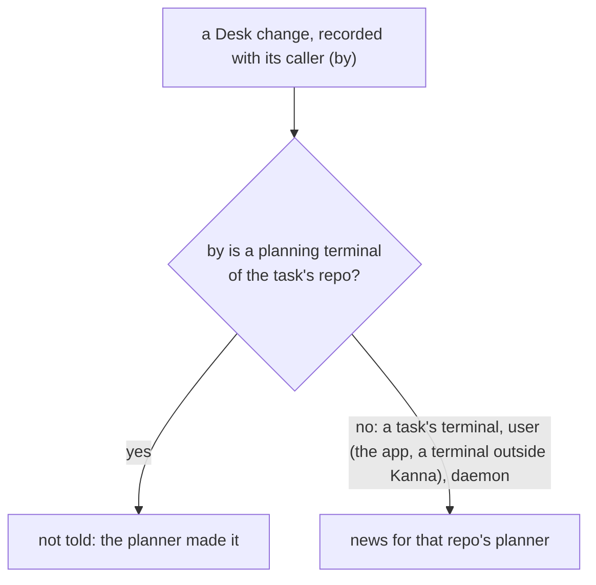
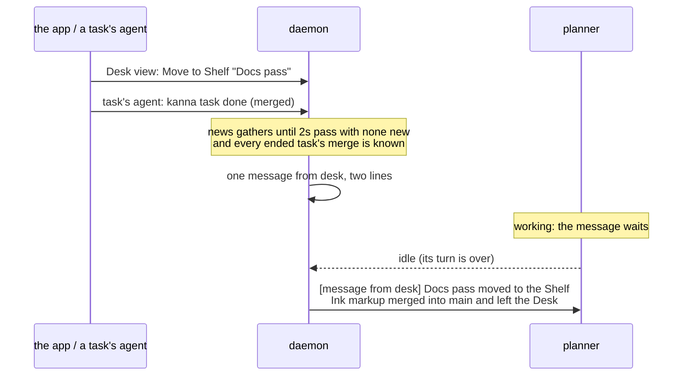

# Desk news for the planner

**Status:** built · **Tested:** e2e `desk_news`, `cargo test -p kanna-daemon` (desk_news, tasks) · **Builds on:** [agent messaging](agent-messaging.md), [the CLI acts on its caller](cli-caller.md), [tasks](tasks.md), [the Desk view](desk-view.md)

The planning agent only learns what's on the Desk when it runs `kanna task list`. Meanwhile the user picks, shelves and activates tasks in the Desk view, and tasks' agents merge and run `kanna task done`, so the planner reports a Desk that's no longer there. Kanna now tells the repo's planner about each Desk change **it didn't make itself**, as an [agent message](agent-messaging.md) from `desk`, one short line per change, batched:

```text
[message from desk] Ink markup with arrows merged into main and left the Desk
Fix login redirect is the active task
```

## Contents

1. [What's told](#1-whats-told)
2. [Who made the change](#2-who-made-the-change)
3. [Batching and delivery](#3-batching-and-delivery)
4. [How it's built](#4-how-its-built)
5. [Glossary](#5-glossary)

## 1. What's told

| Change | Line |
|---|---|
| A Shelf task moved to the Desk | `NAME moved to the Desk` |
| A Desk task moved to the Shelf | `NAME moved to the Shelf` |
| A Desk task ended, its branch merged into main | `NAME merged into main and left the Desk` |
| A Desk task ended, not merged | `NAME ended and left the Desk, not merged into main` |
| A Shelf task ended (taken off), merged / not | `NAME merged into main and left the Shelf` · `NAME was taken off the Shelf` |
| A Desk task made the active one | `NAME is the active task` |

- **Only Desk changes.** A task made, started, stopped or renamed, a Shelf runner's turns, a task's own messages: none of these is news; the planner hears of them as before (`kanna task list`, a task's message).
- **Merged** means the task's branch has commits of its own (its tip isn't the commit it started from, `kanna-base`) and they're all in the repo's checked-out branch (`main`, named as it is). It's decided when the task ends, before its worktree and branch are cleaned up ([task scripts](task-scripts.md)).
- **Names, not IDs,** as the skills ask: a task's name, else its short ID.

## 2. Who made the change

A change is the planner's when the request that made it came from **the planner's terminal**: the caller (`by`, the CLI's `$KANNA_TERMINAL`, as in [the CLI acts on its caller](cli-caller.md)) is a planning terminal of the same repo. Those aren't told back. Everything else is:



| Who | `by` | Told? |
|---|---|---|
| The planner's `kanna task pick/shelve/done/activate` | its terminal (`term-3`) | no |
| A task's agent running `kanna task done` | the task's terminal | yes |
| The Desk view, a toast, the Task menu, ⌘1, a strip click | none, so `user` | yes |
| `kanna task …` in a terminal outside Kanna | none, so `user` | yes |

- **Ending a Desk task keeps its caller:** `kanna task done` ends the agent and closes its pane, and the pane's closing is what records the task done. The daemon remembers who asked, per pane, so the `done` event says `by: term-7` instead of `daemon`; a pane closed with nobody asking is `daemon`.
- **Activation is the app's:** which task is active lives in the app's Desks ([physical layout](physical-layout.md)), so the app tells the daemon each time a Desk's active task changes: `tasks {action: "activated", task: PANE, by?}`, `by` passed on from `kanna task activate`, absent for a click or a key. A task already active, shown again from the Desk view, isn't a change.

## 3. Batching and delivery



- **One message per burst:** news for a repo gathers until 2s pass with nothing new (at most 10s after the first), and until every ended task's merge is decided. Then the lines go out as one message from `desk`, oldest first.
- **Delivered as any message:** it waits while the planner works or asks the user, and goes once its turn is over ([agent messaging §2](agent-messaging.md#2-delivery)). Several still waiting go in one prompt.
- **No planner, no news:** a burst for a repo with no planning terminal running is dropped, not kept: a planner that starts lists the Desk anyway.
- **`kanna task messages`** shows them, from `desk` to `planner`.
- **What the planner does with it:** the `kanna-planning` skill. It trusts the message as the Desk's state now, without listing again, and tells the user only what matters to them.

## 4. How it's built

- **`desk_news.rs`** (daemon): `News` gathers `Item`s (repo, task, name, what, merged, when) and decides when a repo's burst is due (`due`) and its lines (`lines`). Pure, unit-tested.
- **`Tasks::tell_planner`** (`tasks.rs`) is called beside the event it reports: `started` (picked, to the Desk), `shelve`, `take_off` (done from the Shelf), `sweep` (done from the Desk) and `activated`. It skips a change whose `by` is one of the repo's planner panes, and a repo with none.
- **The caller of a Desk task's done:** `done` and `torn_down` put the pane's `by` in `ending` before closing it; `sweep` takes it from there for the `done` event and the news.
- **Merged:** `finish`'s thread decides it first (`task_scripts::merge`, on `task_scripts::merged`: `kanna-base`, `merge-base --is-ancestor`), before teardown and clean-up, and sends `Event::Merged`; a task with no worktree is not merged at once. The `done` item waits for it.
- **Flushing:** `Tasks::tick` posts each due burst with `Tasks::post` (from `desk` to `planner`), the door crash reports use, and wakes again at the next burst's time.
- **The app** (`AppDesk.activateTask`) sends `activated` when it changes a Desk's `active`, with the `by` of the `desk {action: activate}` request that asked; the daemon records an `activated` event on the task.

## 5. Glossary

| Term | Meaning |
|---|---|
| **News** | A Desk change the planner didn't make, waiting to be told |
| **Burst** | A repo's news gathered into one message |
| **Caller** | The Kanna terminal a request came from (`by`), or `user` with none |
| **Merged** | The task's branch has commits of its own, all in the repo's checked-out branch |
