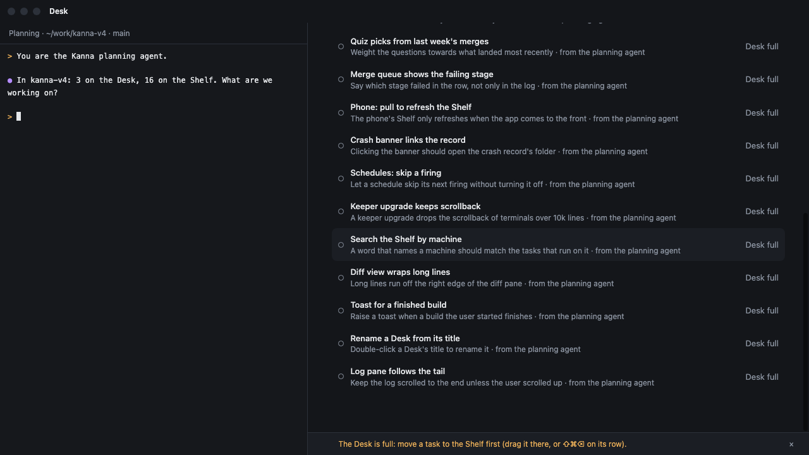

# The Desk view's note

**Status:** built · **Mockup:** [`references/mockups/desk-note.html`](../../references/mockups/desk-note.html) · **Part of:** [Desk view](desk-view.md)

When the Desk view refuses something (the Desk is full, a task is blocked, the daemon said no), it says why in a note. The note is a strip along the bottom edge of the Desk view, outside the scrolled list, so it is in sight however long the Shelf is and wherever the list is scrolled.

*(From the mockup: `#picture&sel=11`. "As it is today" in the mockup shows where the note was before: the last line of the list, under every Shelf row.)*

## Rules

- **One note at a time.** A new refusal replaces the one showing.
- **The list makes room.** While the note shows, the list ends above it, and a row selected with the keys stays in sight ([Desk view keys](desk-keys.md)).
- **It goes with the next thing you do there:** moving a task to the Desk or the Shelf, starting or stopping one, making one active. Its **×** takes it away too.
- **A long note is cut short** with an ellipsis; hovering shows all of it.
- **What it says** belongs to whatever refused: [a full Desk](desk.md#3-the-desks-tasks), [a blocked task](desk-keys.md#1-the-keys). Anything else is the daemon's own message.

## Tests

e2e `desk_shelf`, on a private instance: on a full Desk with 17 Shelf tasks, more than fit the view, the note is inside the Desk view and clear of the list (`debug.desk` `noteShown`); a click on its × (`debug.click` `deskNote`) takes it away.
