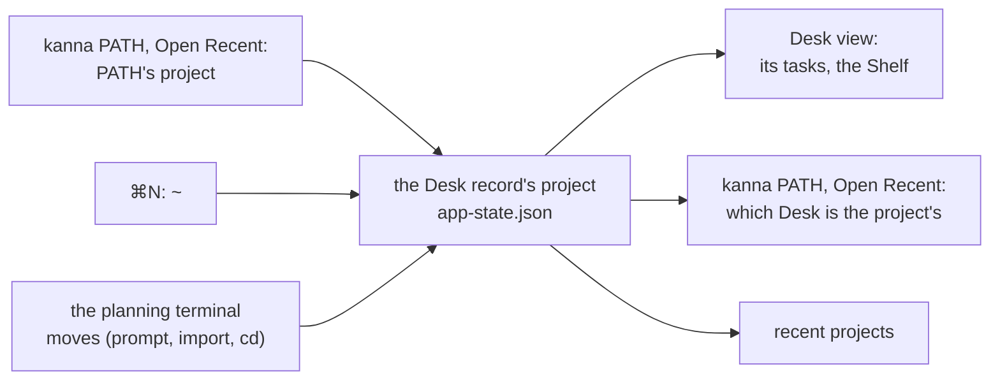

# A Desk's project

**Status:** built (2026-11-01) · **Tests:** `scripts/e2e-kanna.sh` `path_reuses_desk`, `path_last_in_front`, `new_desk` · **Builds on:** [Desk](desk.md), [each app's Desks](app-desk.md), [new Desk](new-desk.md) · **Code:** `deskProject`, `projectDesk`, `deskFor` in `AppDesk.swift`; `deskMoved` in `RecentProjects.swift`

A Desk is a project's window, so everything on it has to agree on which project that is: the Desk view's tasks and Shelf, `kanna PATH`, Open Recent and its planning terminal. One thing decides it: **the planning terminal's project**, saved in the app's Desk record. Tasks never change it, and a task from another project never goes on it.

## Contents

1. [Where it comes from](#1-where-it-comes-from)
2. [Tasks stay on their project's Desk](#2-tasks-stay-on-their-projects-desk)
3. [How it's built](#3-how-its-built)
4. [Rejected](#4-rejected)

## 1. Where it comes from

- **A new Desk takes the folder it opens on:** PATH's project for `kanna PATH` and Open Recent, `~` for ⌘N, the task's project for a Desk opened to show a task ([2](#2-tasks-stay-on-their-projects-desk)). Its planning terminal starts there.
- **The Desk then follows its planning terminal:** when the terminal reports a folder in another project (the `~` prompt's answer, an [import](project-folder.md#3-the-offer), a `cd` after you quit the agent), the Desk record takes that project, and the Desk view, `kanna PATH` and recent projects follow.
- **Saved, so it holds while the terminal has no folder:** before the planning terminal starts, while it's being made again, or while its machine is away, the Desk keeps the project it had, across relaunches too.
- **The task the Desk shows never changes it.**

## 2. Tasks stay on their project's Desk

`kanna task activate`, a click in the Desk view or on a toast, and the Desk's menus all make a task active the same way:

| The Desk asked for (the caller's, or the window clicked) | Goes on |
|---|---|
| on the task's project | that Desk |
| on another project, or none | the task's project's Desk, the one in front last ([desks by project](cli-caller.md#2-desks-by-project)) |
| none on the task's project | a new Desk on the task's project |

- **A task whose folder isn't known yet** (its machine hasn't reported it) goes on the Desk asked for, as before.
- **`kanna task pick`** only claims a task for the app ([each app's Desks](app-desk.md)); it shows on its project's Desk.

## 3. How it's built

- **`deskProject(desk)`** is the Desk record's project as a project root (the main repo for a worktree; a location on another machine as it is). The window's `projectRoot`, the Desk view's tasks, the strip, the menus and `projectDesk` all read it.
- **`render`** passes the planning terminal's project root to `deskMoved`, which saves it in the Desk record, recomposes the windows (so `window.project` and the planner's folder read it) and touches recent projects when it changed.
- **`projectDesk(root)`** is the frontmost Desk whose `deskProject` is `root`: what `kanna PATH` and Open Recent bring forward.
- **`deskFor(task, given, front)`** picks the Desk a task goes on, as in [2](#2-tasks-stay-on-their-projects-desk).

## 4. Rejected

- **The shown task's project first, then the planning terminal's** (before): docking a task from another repo made the Desk that repo's, so `kanna PATH` on the planner's project opened a second Desk while the planner stayed where it was.
- **Saved once, when the Desk opens:** an import moves the planning terminal to the copy, and a `~` Desk moves to the project you pick; both would need exceptions, and a `cd`'d planner would show one project's agent beside another's tasks.
- **A task from another project on a Desk:** the Desk view lists its project's tasks and Shelf, and `kanna task pick` takes from its project's Shelf, so the task would be on a Desk that doesn't list it.
