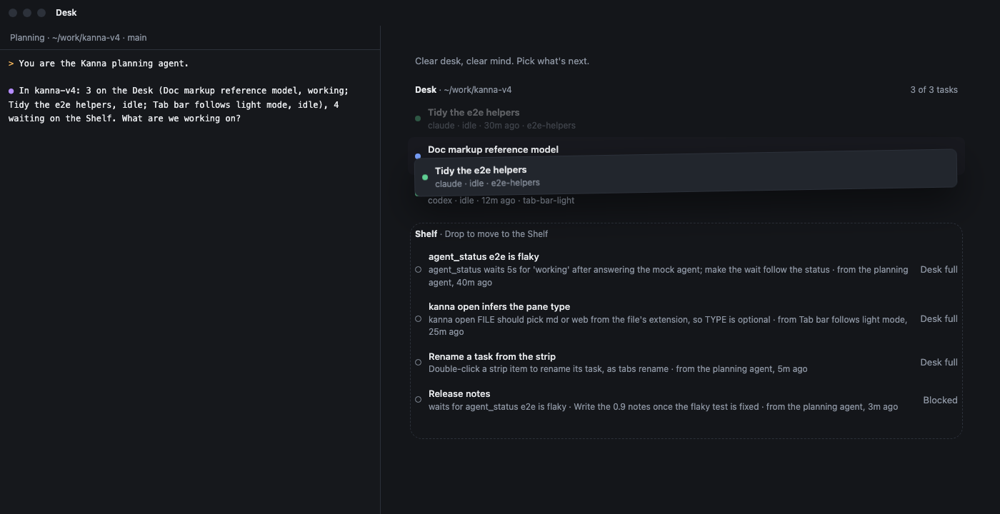
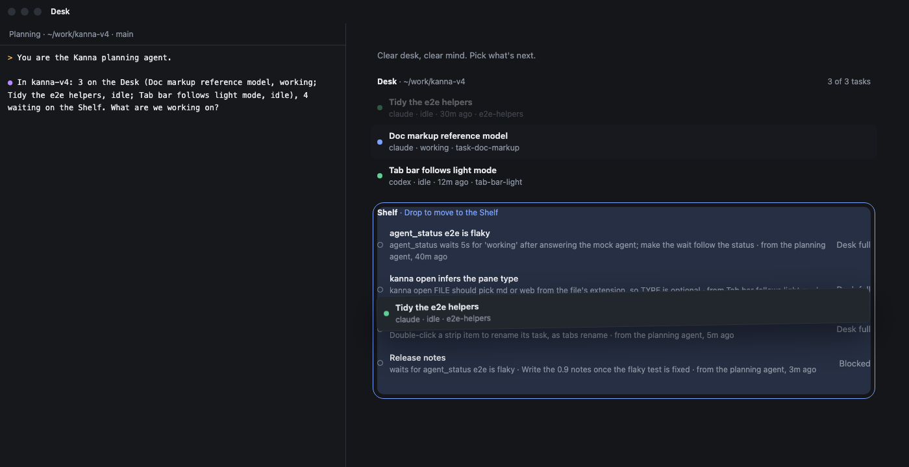

# Drag a Desk task to the Shelf

**Status:** built · **Mockup:** [`references/mockups/desk-row-shelve.html`](../../references/mockups/desk-row-shelve.html) · **Part of:** [Desk view](desk-view.md)

In the Desk view, dragging a Desk task's row onto the Shelf moves that task to the Shelf as it is, running or stopped, the same as `kanna task shelve`. It works on any Desk task, active or not. Before this, the app could only shelve the active task (Task → Move to Shelf).

| Dragging: the row lifts, the Shelf shows where to drop | Over the Shelf: drop to move it |
|---|---|
|  |  |

*(From the mockup: `#picture-desk&drag=p3` and `#picture-desk&drag=p3,over`.)*

## Why a drag, and only this way

Kanna keeps the user's attention on at most three tasks. If tasks were easy to swap on and off the Desk, that limit would mean nothing. So moving a task off the Desk takes a deliberate gesture, a drag, rather than a button that shows up on hover. For the same reason there's no right-click menu, no drag from the Shelf to the Desk, and no swap when the Desk is full: shelve a task first, then Move to Desk.

## Behaviour

- **Pick up.** Press on a Desk row and move more than 4 points. The row stays in its place, dimmed, and a copy of it follows the pointer. The Shelf section (its header, its rows and its empty-state line) gets a faint dashed outline. Its header reads "Shelf · Drop to move to the Shelf", and the search field and count hide until the drag ends.
- **Over the Shelf.** While the pointer is within the Shelf section, plus 6 points around it, the outline turns the accent colour and the section is tinted.
- **Drop.** Letting go over the Shelf sends `tasks` `{action: "shelve", task: PANE}`, the same request as Task → Move to Shelf. The task moves as it is: its agent keeps running or stays stopped, and its tabs stay as they were. If the moved task was the active one, no task is active afterwards and the Desk view keeps showing. A refusal shows in the Desk view's note line.
- **Cancel.** Letting go anywhere else, or pressing esc, puts the row back and moves nothing.
- **A click still makes the task active.** It now activates when the button comes up, not when it goes down, so a press that turns into a drag doesn't activate the task. The row's hover hint ("⌘N · Make active →", "⌘. · Back to it") is unchanged.
- **Scrolling.** When the window is too short to show both, dragging near the edge scrolls the Desk view.

## Interfaces

| Piece | Where | What |
|---|---|---|
| Drag tracking | `Windows/DeskView.swift` `DeskRow` | a tracking loop from `mouseDown`: dragged events move the copy, mouse-up drops, esc cancels; no move past 4 pt is a click |
| Lifted copy, drop zone | `DeskView` | the copy is a snapshot of the row above the scroll view; the zone is the Shelf section's frame from `lay` |
| Shelving | `Windows/Desk.swift` `shelveTask(_:from:)` | sends `tasks` `shelve`; on a refusal, `noted` puts the error in the note line |
| Test hook | `debug.click` `{task, window, drop: "shelf" \| "desk"}` | presses the task's row and drags to the Shelf section, or to the Desk header, with real mouse events |
| e2e | `scripts/e2e-kanna.sh` `drag_to_shelf` | drags a Desk task that isn't active to the Shelf: it moves there still running, and the active task stays active; a drag dropped on the Desk moves nothing |
