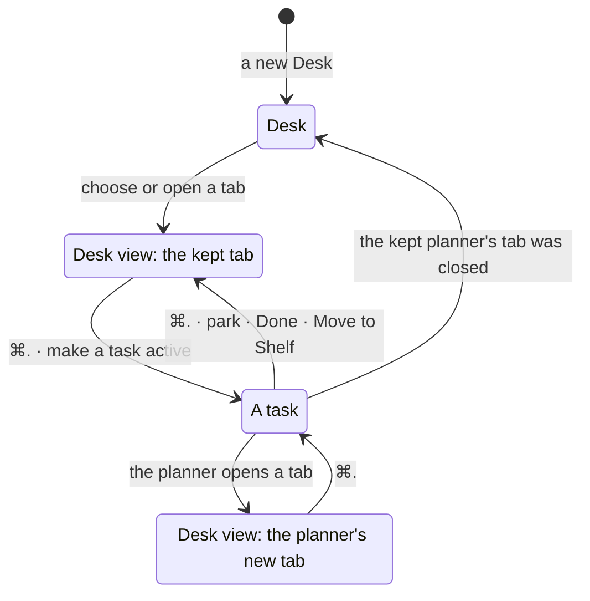

# The Desk view's tab

**Status:** built · **Tested:** e2e `desk_view_tab` · **Changes:** [Desk windows §2](desk-windows.md#2-rules), [machine links §5](machine-links.md#5-paths-the-machines-tab-and-offline) · **Builds on:** [Desk view](desk-view.md), [physical layout](physical-layout.md)

The Desk view keeps its tab while a task shows. ⌘. from the Merge queue tab into a task and back lands on the Merge queue tab again, so a tab you watch stays one key away. Before, every way into the Desk view showed the Desk tab.

## 1. Rules

- **Every way in:** ⌘., the agent header's Desk view button, `kanna task park`, Done and Move to Shelf show the tab the Desk view showed last: a fixed tab (Desk, Machines, Stats, Schedules, Merge queue) or one of the planner's own tabs.
- **Each Desk keeps its own.**
- **The Desk tab is the default** when the Desk view has shown no tab yet, and when the planner's tab it kept was closed while the task showed.
- **A tab the planner opens or chooses while a task shows** is the one the Desk view shows next, as it would be had the Desk view been showing ([Desk windows §2](desk-windows.md#2-rules)).
- **It survives a relaunch,** with the rest of the app's layout: the app opens a Desk view on the tab it showed, and ⌘. from a task that was showing at the relaunch still goes to it.
- **A planner on a machine that's away** keeps its tab: the Desk tab shows until the machine is back, then the kept tab.

## 2. Where it's kept

- **The app keeps it,** per Desk, in `app-state.json` beside the Desk's other fields: `page`, the fixed tab's name, or none while a planner's tab shows, and `tab`, the planner's tab the Desk view last had in front. The daemon keeps which of a planner's tabs is in front, as for any workspace.
- **A file saved before this** has neither field, so its Desks open on the Desk tab once.
- **`WindowController.render`** decides on the way in: no `page` and no `tab` is the Desk tab; a planner's shown tab that differs from `tab`, with `tab` still there, is the planner's new tab; `tab` gone with no `page` is the Desk tab; otherwise `page`.
- **`debug.desk`** reports `shownPage`: the fixed tab showing, or null for a planner's tab.

## 3. Checked by

e2e `desk_view_tab`: a new Desk shows the Desk tab, and ⌘. back to a Desk view that chose none still does; the Merge queue tab comes back after ⌘., after `kanna task park`, after a relaunch in the Desk view and after one in the task; a planner's tab comes back after ⌘. and after a relaunch in the task; closed behind the task, it gives the Desk tab; a tab the planner opens behind a task shows over the Stats tab; Move to Shelf comes back to the Merge queue tab.

## 4. Rejected

- **The Desk tab on every way in** (before): it suited two fixed tabs. With Stats, Schedules and Merge queue, the tab you watch was a click away after every look at a task.
- **Forgetting it at a relaunch:** the rest of the layout comes back, and the Desk tab after every update would be the old rule again.
- **Keeping it in the daemon:** which page a Desk shows is the app's, like the Desk itself ([physical layout](physical-layout.md)); another app's Desk on the same project has its own.
