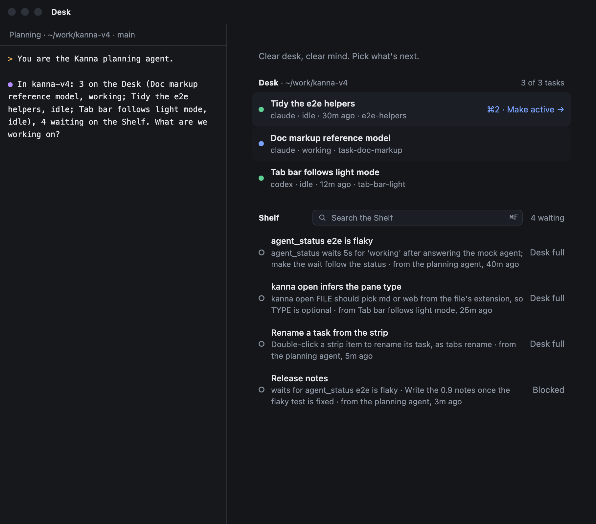
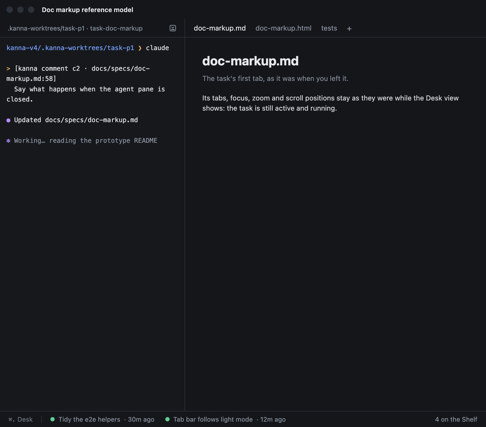
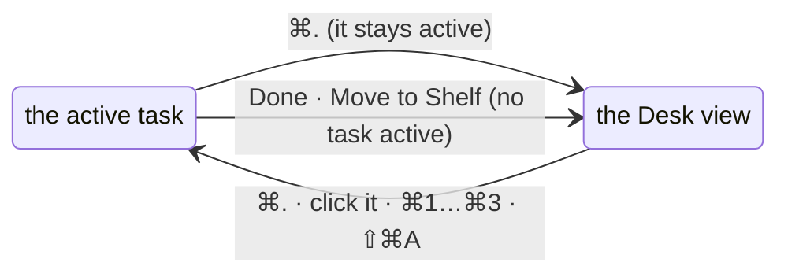

# Desk view

**Status:** built · **Mockup:** [`references/mockups/desk-view.html`](../../references/mockups/desk-view.html) · **Changes:** [desk](desk.md), [tasks](tasks.md), [each app's Desks](app-desk.md) and the specs below

Kanna's task words say where a task is from the user's side. The **Desk** holds up to three of a project's tasks, one of them **active**. The **Shelf** holds the tasks Kanna has brought in that wait, run a few at a time in the background. The **Desk view** shows the planning agent, the Desk's tasks and the Shelf; **⌘.** toggles between it and the active task. Only the names changed, and ⌘., which became a toggle: layouts, limits and what each view shows stayed as they were.

| Desk view | The active task |
|---|---|
|  |  |

*(From the mockup: `#picture-desk&hover=p3` and `#picture`.)*

## Contents

1. [Old and new names](#1-old-and-new-names)
2. [⌘. and "pull back"](#2--and-pull-back)
3. [CLI verbs](#3-cli-verbs)
4. [Where each name appears](#4-where-each-name-appears)
5. [Internal names](#5-internal-names)
6. [Glossary](#6-glossary)

## 1. Old and new names

| Old | New |
|---|---|
| Backlog | Shelf |
| the Shelf (strip and full page), "on the Shelf" | the Desk's tasks, "on the Desk" |
| the empty Desk / Shelf view, title bar "Shelf" | Desk view, title bar "Desk" |
| Park (⌘.), pull / click to swap | ⌘. toggle (`park`); make a task active (`activate`) |
| Move to Shelf / Move to Backlog | Move to Desk / Move to Shelf |
| "Shelf full" | "Desk full" |
| "parked 12m" (strip, rows, `task list`) | "12m ago": since it was last active |
| Pull Shelf Task 1 … 3 (⌘1 … ⌘3) | Desk Task 1 … 3 |
| `backlog.runners` | `shelf.runners` (`backlog.runners` still read) |
| "Desk" (the window, File → New Desk ⌘N) | unchanged |

## 2. ⌘. and "pull back"

- **⌘. toggles.** From the active task it shows the Desk view; the task stays active and running, its tabs, focus and zoom as they were. From the Desk view it shows the active task again. Task menu: **Show Desk** / **Show Active Task** (⌘.), named for where it goes.
- **"Pull back the task parked last" becomes "the active task".** With none active (it was Done or moved to the Shelf), ⌘. makes the Desk's ⌘1 task active: the one left last, or one that needs you. That was the old "task parked last", so the key does what it did.
- **Making a task active** (click, ⌘1 … ⌘3, ⇧⌘A, `kanna task activate`) leaves the one active before on the Desk, not active, as pulling parked it before. It counts as left then, even when the Desk view was showing, so it becomes ⌘1.
- **The Desk's tasks are listed oldest first**, by when each task was made, as the Shelf sorts ([tasks](tasks.md)), in the Desk view and in the strip alike. The active task stays in its place in that order; in the Desk view only its row's highlight marks it. A task that needs you stays in its place too: its status dot shows it, and ⇧⌘A goes to the one that has needed you longest.
- **⌘1 … ⌘3 number the Desk's tasks other than the active one** by recency, not by place: the one left most recently first, one that needs you ahead. A task has the same key in the strip and in the Desk view, so the keys on the rows aren't in numeric order. ⌘1 pressed again goes back to the task you came from; ⌘2 pressed again cycles through all three. (The old empty Desk numbered all three; with one active, the others are ⌘1 and ⌘2, as on the strip.)
- **Hover hints.** A row shows its hint only while hovered: "⌘N · Make active →", or the active task's "⌘. · Back to it". The strip shows a task's key on hover.
- **The strip** starts with a muted "⌘. Desk" that shows the Desk view when clicked, then the Desk's other tasks, oldest first, then "N on the Shelf".
- **The agent header's Park button** stays, with the tooltip "Desk view (⌘.)".
- **The encouraging line** moves on each time the Desk view shows (before: each time the Desk was cleared).
- **Closing a Desk window** leaves its tasks on the Desk, none active (before: it parked its task).
- **How the order is built.** The daemon's `backlog` notice to the app lists the Desk's tasks under `desk` (`id`, `pane`, `madeAt`) beside the Shelf's `tasks`, oldest first, two made in the same second in the order they were made, as the Shelf breaks ties. The app lists rows and strip items in that order and numbers keys from its own record of which task was left last (`KannaWindows/DeskOrder.swift`; tested in `DeskOrderTests`, the daemon's `the_view_lists_the_desk_s_tasks_with_when_each_was_made` and e2e `desk_shelf`). A Desk task the daemon has no record for (a docked pane that isn't a task) goes last.

## 3. CLI verbs

| Old | New | Does |
|---|---|---|
| `kanna task shelve TASK` | `kanna task pick TASK` | Pick a task off the Shelf onto the Desk, starting it if it's stopped; three per project |
| `kanna task defer [TASK]` | `kanna task shelve [TASK]` | Desk → Shelf, as it is, running or stopped |
| `kanna task pull TASK` | `kanna task activate TASK` | Make a Desk task active and show it (relayed to the app) |
| `kanna task park [TASK]` | `kanna task park [TASK]` | ⌘.: show the Desk view of TASK's Desk; TASK stays active |

- **`defer` and `pull` stay as hidden aliases** (not in help or completion), so agents that loaded the old skills mid-conversation, and users' habits, keep working.
- **`shelve` changes meaning**, so it can't be an alias: run on a Shelf task (the old use) it's refused with "TASK is on the Shelf: `kanna task pick TASK` moves it to the Desk", and nothing moves.
- Everything else keeps its name; only the words change: `kanna task new` "added X to the Shelf of REPO", `start` "started X on the Shelf", `done` "took X off the Shelf", `task list`'s WHERE column `Desk` / `Shelf`.

## 4. Where each name appears

| Place | Files | What changes |
|---|---|---|
| App UI | `Windows/Shelf.swift` | strip: "N in backlog" → "N on the Shelf", "parked" → "ago", the "⌘. Desk" hint; Desk view: headers Shelf → Desk and Backlog → Shelf, "Nothing on the Shelf.", "Search the backlog", "No backlog task matches", "Move to Shelf", "Shelf full", "Pull →" → "Make active →", the cheer "Pull a task" |
| | `Windows/Desk.swift`, `WindowController.swift` | Park tooltip; title bar "Shelf" → "Desk"; the fixed tab "Shelf" (beside Machines) → "Desk" |
| | `Windows/Machines.swift` | "keep their places on the Shelf" → "on the Desk" |
| Menus | `Windows/Menus.swift` | Task menu: Park/Unpark → Show Desk / Show Active Task (⌘.), Move to Backlog → Move to Shelf, Pull Shelf Task N → Desk Task N; ⌘. becomes the toggle |
| Toasts | `Windows/Toasts.swift` | none visible; a click makes a Desk task active, or moves a Shelf task to the Desk |
| CLI help | `crates/kanna/src/commands.rs` | `task` summary, usage, notes, examples; `workspace` and `open` notes ("on a Desk, on the Shelf or in the backlog") |
| CLI output | `crates/kanna/src/output.rs` | `task list` WHERE and time; `task` replies (§3); workspace places "on the Shelf" → "on the Desk", "in the backlog" → "on the Shelf" |
| Errors | `crates/kanna-daemon/src/backlog.rs`, `AppDesk.swift`, `lib.rs` | "N tasks on the Shelf: move one to the backlog with `kanna task defer`", "isn't on this app's Shelf", "no backlog task", "isn't a task: … a Desk or the Shelf, or in the backlog" |
| Daemon log | `backlog.rs` | "runs in the backlog", "is on mac's Shelf" |
| Config | `schemas/config.schema.json`, `backlog.rs` `runners()`, `lib.rs` `CONFIG_HELP` | `shelf.runners`, described as the Shelf's; `backlog.runners` stays in the schema marked as the old name and is read when `shelf.runners` isn't set in that file; the planning terminal's description |
| Planner script | `Resources/planner.sh` | nothing user-visible (it sends the internal `backlog` command) |
| Skills | `.agents/kanna-skills`: kanna-tasks (27), kanna-planning (23), kanna-new-project (4), kanna-quiz (1), kanna-explain (1), README (3) | every Shelf/backlog/shelve/park/pull/defer; the planning skill's description. A subtree: push upstream after merge |
| Repo | `AGENTS.md` | "The Desk, Shelf and focus": stays right as words; reread |
| Specs | 52 files (`rg -il 'backlog\|shelf\|park\|pull' docs/specs`) | desk, tasks, app-desk, shelf-runners, shelf-search, menus, settings, cli, planning-agent, task-dependencies, zoom, toasts, workspaces, workspace-list, presenting, machine-*, quiz and the rest the grep finds; screenshots desk.png, desk-empty.png, zoom-desk-*.png, shelf-search*.png, task-blocked.png |
| Spec files | renamed | `backlog-runners.md` → [`shelf-runners.md`](shelf-runners.md), `backlog-search.md` → [`shelf-search.md`](shelf-search.md) (and its pictures), `shelve-latency.md` → [`move-to-desk-latency.md`](move-to-desk-latency.md); links updated |
| Mockups | `desk.html`, `blocked-tasks.html`, `toasts.html`, `task-scripts.html`, `quiz.html`, `doc-markup.html`, `diff.html`, `page-marks.html`, `fleet.html` | their visible words; `desk.html` keeps its own scenes (planner, recent projects) and points to `desk-view.html` for the Desk view |
| e2e | `scripts/e2e-kanna.sh` | the checks of words, and the scenario names: `desk_shelf` → `desk_tasks`, `desk_backlog` → `desk_shelf`, `backlog_and_back` → `shelf_and_back`, `move_to_backlog` → `move_to_shelf`, `task_backlog` → `task_shelf`, `backlog_rename` → `shelf_rename`, `backlog_runners` → `shelf_runners`, `backlog_search` → `shelf_search`, `shelf_times` → `desk_times`, `shelf_zoom` → `desk_zoom`, `shelve_at_once` → `pick_at_once` |
| Not changed | `agent-rules/corpus` (recorded terminals), `README.md` ("git pull") | |

## 5. Internal names

**Kept as they were**, with a mapping (below) in [database](database.md) and [app-desk](app-desk.md). In every one "shelf" would flip meaning (the old Shelf is the new Desk, the old backlog the new Shelf), stored data and the app–daemon protocol would need migrations, and in-flight tasks across nearly every file would conflict, for no change anyone sees.

| Internal (kept) | Means now |
|---|---|
| Rust `Backlog`, `backlog.rs`, the socket command `backlog`, `Place::Backlog`, `Where::Backlog`, DB `tasks.place = 'backlog'` | the Shelf |
| `Place::Shelf`, `Where::Shelf(app)`, `place = 'shelf'`, the app's claim `shelf`, Swift `ShelfTask`, `ShelfStrip`, `ShelfPage` | on the Desk |
| `parkedAt`, Swift `park`, `pullTask`, the `desk` command's `park` / `pull` | last left / show the Desk view, make active |
| `debug.*` keys (`shelf`, `backlog`, `park`), Perf span names | as above |
| `--json` replies: `where: "backlog" \| {"shelf": app}`, `backlog`, `parkedAt` | documented in [cli](cli.md) as the internal names |

New code for the toggle uses the new words (`active`, `deskView`). The better end state is one vocabulary throughout; it's a later task of its own when few tasks are in flight: a DB migration (`backlog` → `shelf`, `shelf` → `desk`; note `Place::parse` already reads an old `desk` as today's Shelf), a protocol version, `--json` fields, then identifiers.

## 6. Glossary

| Term | Meaning |
|---|---|
| **Desk** | A project's window, and the up to three tasks it holds |
| **Active task** | The Desk task shown with its agent and tabs; stays active while the Desk view shows |
| **Desk view** | The planning agent, the Desk's tasks and the Shelf, in the Desk window |
| **Strip** | The line under the active task: ⌘. Desk, the Desk's other tasks, the Shelf's count |
| **Shelf** | A project's tasks Kanna has brought in, waiting; `shelf.runners` of them run at once |
