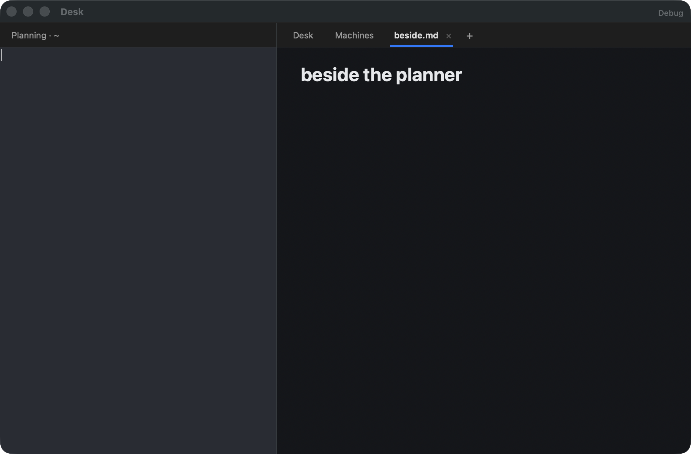
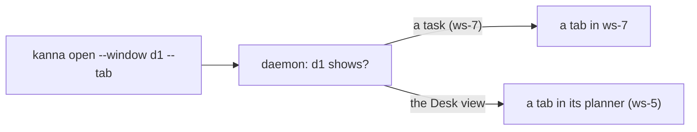
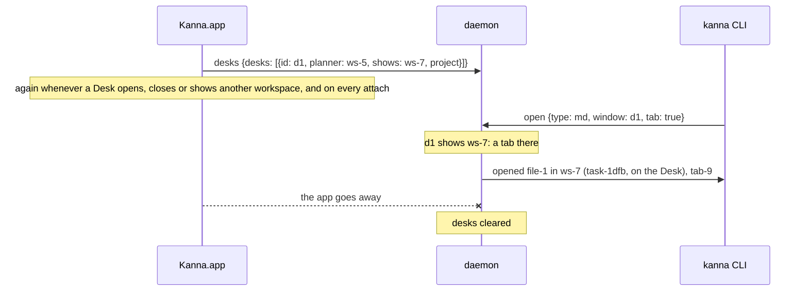

# Desk windows

**Status:** built · **Changes:** [each app's Desks](app-desk.md), [presentation layers](presentation-layers.md), [planning terminal](planning-agent.md), [workspace list](workspace-list.md), [menus](menus.md) · **Related:** [windows](windows.md), [the CLI acts on its caller](cli-caller.md)

A Desk is a window like any other, to the keyboard and to the CLI. ⌘\` and ⇧⌘\` go round every Desk and free window, and the CLI names a Desk's window by its Desk's ID (`d1`) wherever it takes a window: `workspace list --all` lists it, and `open --window d1`, `move-tab --window d1` and `focus --window d1` reach it. A planner's `kanna open … --tab` opens beside it, in its own Desk.

## Contents

1. [How a Desk is named](#1-how-a-desk-is-named)
2. [Rules](#2-rules)
3. [The app tells the daemon its Desks](#3-the-app-tells-the-daemon-its-desks)
4. [⌘\` and ⇧⌘\`](#4--and-)
5. [Checked by](#5-checked-by)
6. [Rejected](#6-rejected)

## 1. How a Desk is named

A Desk's window is `d1`, `d2`, …: its Desk's ID, which the app makes and the CLI already prints (`term-3 is active on d1`). A Desk isn't a logical window (`win-N`): it's the app's, and it shows one workspace at a time, the active task's or, in the Desk view, its planner's. So a command that names `d1` acts on the workspace `d1` shows now.

## 2. Rules

- **`--window d1`** in `open`, `move-tab` and `focus` means the workspace `d1` shows: the active task's, or its planner's in the Desk view. `focus --window d1` brings the Desk forward as `kanna focus` does any window ([physical layout](physical-layout.md)).
- **A planner has tabs.** `kanna open` from a planning terminal opens a tab of its planner's workspace (with `--split`, a split of its shown tab), as from a task's agent; `--window new` still makes a free window. The Desk view shows them in the tab bar beside its Desk and Machines pages.
- **A tab opened or chosen in the Desk view shows;** ⌘. into the Desk view shows the Desk page, and clicking Desk or Machines shows that page until another tab is opened or chosen.
- **`workspace list --all`** lists each Desk under Windows (` d1  Desk on ~/work/app, shows ws-7 (task-1dfb, Fix login)`, or `, the Desk view: ws-5`), names a planner `d1's planner` and a task's workspace `shown in d1`. `--json` adds `desks: [{id, desk, workspace, planner, deskView, project}]`; `windows` stays the daemon's windows.
- **Replies** name the Desk: `opened file-1 in ws-5 (d1's planner), tab-3: running`, `brought d1 forward`.
- **With no app attached there are no Desks:** `--window d1` is `no window "d1"`.

## 3. The app tells the daemon its Desks

The app owns its Desks ([each app's Desks](app-desk.md)); the daemon only learns what each one shows, so it can resolve `d1` and list it.

- **`desks {desks}`** replaces the list; it isn't saved. The app sends it when its Desk records change and after every attach, only to this machine's daemon, with only this machine's workspaces.
- **The layout model keeps it beside its windows** and resolves a window reference to a Desk's workspace before it looks for a `win-N` (`Model::window_holder`).

## 4. ⌘\` and ⇧⌘\`

Next Window ⌘\` and Previous Window ⇧⌘\` go round every Desk and free window that isn't minimized, in the app's window order, Desks first ([windows](windows.md#3-windows-tabs-panes)).

- **Previous Window's key equivalent is `~` with ⌘** (shown ⌘~, typed ⇧⌘\`). As `` ` `` with ⇧⌘, AppKit never matched it in Kanna.app: a ⇧⌘\` press's unmodified character is `~`, so Previous Window never ran, from a Desk or a free window.
- **Who gets the keyboard** after a switch is unchanged: the new key window's focused pane ([windows](windows.md#3-windows-tabs-panes)).

## 5. Checked by

- `desk_window_cycle`: a Desk's planner opens a free window; real ⌘\` and ⇧⌘\` key presses (`debug.key {real: true}`, through `NSApp.sendEvent`, so a shortcut the menu doesn't match fails) move the key window to the Desk and back.
- `desk_window_cli`: `workspace list --all` lists `d1` and its planner; `open md --tab` from the planner opens in its workspace and the Desk view shows it; `open --window d1`, `move-tab --window d1` and `focus --window d1` reach the Desk; `d9` isn't found.
- kanna-mux `a_desk_is_a_window_the_cli_can_name_by_the_workspace_it_shows` and `a_planner_is_a_workspace_with_no_task_whose_opens_are_its_own_tabs`; the CLI's `a_desk_is_listed_as_a_window_and_names_its_planner_and_the_workspace_it_shows`.

## 6. Rejected

- **A `win-N` for each Desk,** made by the daemon: a Desk would have two names, and the daemon would keep, and save, a window that only one app shows.
- **Relaying `--window d1` to the app** for every command: listing and every layout command would wait on the app, and the daemon couldn't resolve it within the command's turn.
- **The Desk view holding no tabs** (before): a planner's `--tab` opened a free window somewhere else, so the planner couldn't show the user a doc beside itself.
