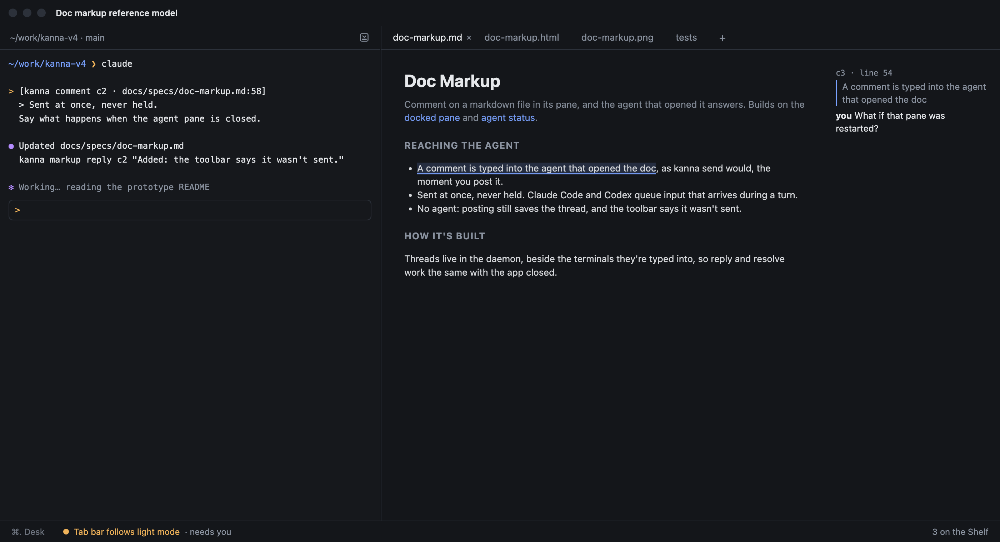
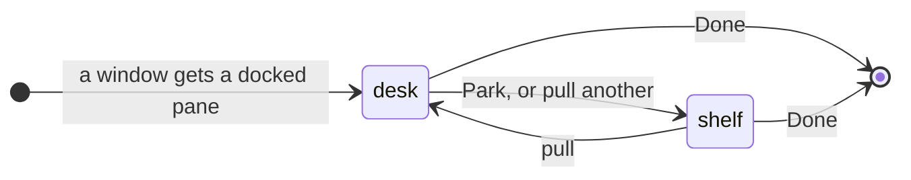
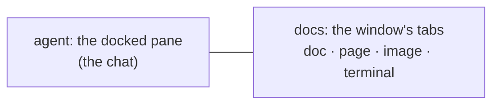
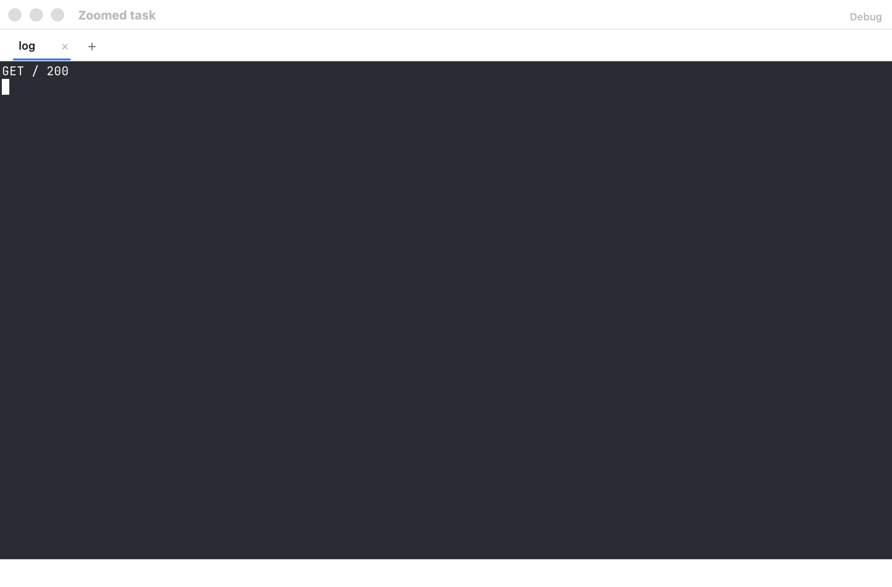
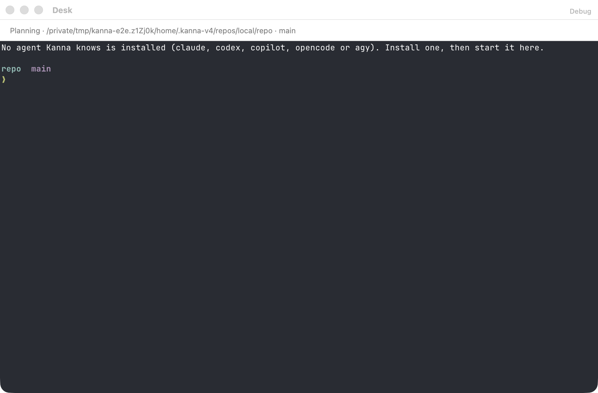
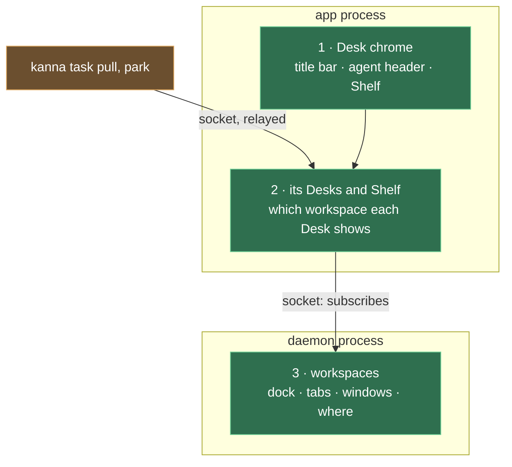

# Desk

**Status:** built; each app's since [each app's Desk and Shelf](app-desk.md) · **Mockup:** [`references/mockups/desk.html`](../../references/mockups/desk.html) · **Builds on:** [docked pane](docked-pane.md), [planning agent](planning-agent.md), [agent status](agent-status.md), [doc markup](doc-markup.md) · **From:** kanna v3's Desk and Shelf (its look), laid out like a chat app's work view: one conversation, tabbed documents beside it

The **Desk** is Kanna's window for working with an agent. It shows one **task**: the agent's terminal docked on the left as the single chat, and everything the task opens (docs, pages, images, other terminals) as tabs on the right. The **Shelf** along the bottom holds every other task, their agents still running, and swaps one in with a click. With no task on it, the Desk belongs to the window's **planning agent**: it's docked on the left, beside the full Shelf, and you make and manage tasks by talking to it.

## Contents

1. [Tasks](#1-tasks)
2. [The Desk](#2-the-desk)
3. [The Shelf](#3-the-shelf)
4. [The planning agent](#4-the-planning-agent)
5. [CLI](#5-cli)
6. [How it's built](#6-how-its-built)
7. [Rejected](#7-rejected)
8. [Open questions](#8-open-questions)
9. [Glossary](#9-glossary)

## 1. Tasks

A task is what a Desk holds: an agent in the window's [docked pane](docked-pane.md), and the window's tabs.

- **A window with a docked pane is a Desk**; its contents are its task. Tasks come from the backlog ([tasks](tasks.md)); File → New Desk (⌘N) opens another Desk window, in `~`, for another project.
- **Its name** is the docked pane's name, else its terminal's title. **Its folder and branch** are the docked pane's working directory and that folder's git branch, shown, never changed.
- **Done** closes the task's panes, ending its agent and terminals.
- **A task belongs to a project**: the git repository its folder is in (else the folder), and a Desk's Shelf shows its project's tasks. Making and naming tasks: [tasks](tasks.md).

## 2. The Desk

- **One task per Desk.** Pulling a task onto a Desk parks the one it held. If the task you pull is already on another Desk, that window comes to the front and nothing moves. Closing a Desk window parks its task.
- **The agent pane** is the agent's terminal, untouched, under a header with Park (pictured above). The header leaves out the task's name (the title bar shows it) and its [status](agent-status.md) (the agent is in view; the Shelf shows the others'). It's the only chat: you talk to the agent there, and doc comments arrive there ([doc markup](doc-markup.md)). Its width is the task's: it comes back with the task, whichever Desk it's pulled onto.
- **Docs are the window's tabs.** Each is an ordinary tab: markdown (with comments), a web page, an image, video or PDF (shown in a web pane), or a terminal (tests, a server), and a tab can hold splits.
  - **What opens a tab:** the agent running `kanna open md|web FILE` from its pane, a markdown link, or **+**.
  - Opening a file that's already open shows its tab.
- **The title bar** (top) shows only the task's title (or Shelf, with no task on the Desk).
- **With no task on it, the Desk shows the planning agent and the Shelf in full** (pictured above) in place of the strip: the agent docked on the left, and on the right the project's tasks (click one to pull it) and backlog, live, under a short encouraging line: a random one when the window opens, the next each time its Desk is cleared (Park, Done or Move to Backlog), each window its own. ⌘F searches the backlog ([backlog search](backlog-search.md)). A blocked backlog task shows what it waits for and can't be moved to the Shelf ([blocked tasks](task-dependencies.md)). Backlog tasks run by themselves, and their rows don't show how far they got ([backlog runners](backlog-runners.md)). It holds no tabs: New Tab and the splits are off, and a pane opened onto it gets a plain window of its own ([planning agent](planning-agent.md#1-when-it-shows)).
- **Plain windows stay** exactly as now, so every kmux behaviour is unchanged.

## 3. The Shelf

- **The project's tasks not on a Desk**, latest parked first (a stack), each with its [agent status](agent-status.md) and how long ago it was parked. **Needs you** moves a task to the front.
- **Each task's time shows beside its name** (pictured above): how long ago it was parked, or needs you, muted, kept current while it's shown. Its ⌘ key shows on hover. When the strip is too narrow, titles truncate first, each in proportion to its length, down to a short floor; then the backlog count gives way; then the times.
- **Click to swap:** the clicked task comes onto this Desk and the current one goes to the Shelf, in one step. **⌘1 … ⌘3** swap in the Shelf's 1st … 3rd task the same way. **⇧⌘A** pulls the task that has needed you longest, and **⌘.** parks, or on an empty Desk pulls back the task parked last. They're in the Task menu.
- **At most three tasks per project on an app's Shelf:** the one on the Desk and two on the Shelf (three on the full Shelf), running or stopped; another app has its own three ([each app's Desk and Shelf](app-desk.md)). Moving a fourth to the Shelf is refused until one goes back to the backlog or is Done; any number run in the backlog ([tasks](tasks.md#5-stop-done-or-back-to-the-backlog)).
- **Parked means hidden, not stopped.** A parked task's terminals keep running in the daemon, and its tabs, the shown one, focus, [zoom](zoom.md#on-a-desk-the-tasks-zoom-and-the-shelfs) and scroll positions come back as they were.
- **The Shelf view has its own zoom.** ⇧⌘↩ on it zooms the planner, and it stays zoomed (or not) whatever the tasks do:

  | Task zoomed | ⌘. | Shelf view, zoomed earlier | ⌘. |
  |---|---|---|---|
  |  | → |  | → back to the task, zoomed |

## 4. The planning agent

With no task on the Desk, the window's planning terminal, where you run your planning agent, is docked on the left beside the full Shelf: [planning agent](planning-agent.md).

## 5. CLI

| Command | Does |
|---|---|
| `kanna task list [QUERY]` | Every task: ID, name, where it is (the Shelf or the backlog), status; QUERY filters by name and first message |
| `kanna task pull ID` | Put a task on the app's front Desk (relayed to the app) |
| `kanna task park [ID]` | Move a task (default: the one on the front Desk) to the Shelf (relayed to the app) |
| `kanna task done ID` | End a task: close its panes |
| `kanna task new`, `start`, `stop`, `shelve`, `defer`, `name` | Make, run, stop, move and name tasks: [tasks](tasks.md#7-cli) |

A task's workspace has an ID of its own (ws-3), and commands take it, the task's ID or the task's docked pane. Run from a task's terminal, `park` and `done` mean that task, and `kanna open` without a placement opens a new tab in the task's workspace, on its Desk or, while it's parked or in the backlog, among its hidden tabs; with `--tab`, `--split` or `--size` it opens there too, never in the front window, and `--window new` opens a window of the task's ([presenting](presenting.md#3-how-its-built), [workspaces](workspaces.md#3-commands-target-and-reply)). `done` leaves its Desk empty.

## 6. How it's built

- **The daemon keeps workspaces** (a task's dock with its width, its tabs, its windows, where it is), saved in `kanna.db` ([layout](layout.md), [workspaces](workspaces.md)). Nothing there knows about Desks.
- **The app keeps its Desks and Shelf** ([each app's Desk and Shelf](app-desk.md)): which workspace each Desk shows, its project and planner, and its Shelf's order. It draws a Desk window from the workspace it shows: the dock on the left, the tabs on the right.
- **Parking** changes only which workspace the Desk shows; the panes keep their IDs, and their terminals never notice. The workspace keeps its focus and zoom, and the planner its own ([zoom](zoom.md#4-how-its-built)).
- **The planning terminal is the Desk's planner**: a workspace with no task, shown on the left only while the Desk shows no task. The app asks the daemon for one (`backlog` `plan`) when a Desk shows no task and has none; the daemon makes its command and opens it with the `planner` placement.
- **`kanna task pull` and `park`** are relayed to the app by the daemon (the `desk` command), which starts the app if it's closed.

## 7. Rejected

- **The planning terminal's alternatives:** [planning agent](planning-agent.md#6-rejected).

## 8. Open questions

1. Making tasks, and what a task is: [tasks](tasks.md).

## 9. Glossary

| Term | Meaning |
|---|---|
| **Task** | What a Desk holds: an agent in its docked pane, and its tabs |
| **Desk** | An app's window for a project, showing one task or its planner |
| **Shelf** | The strip along a Desk's bottom listing the project's tasks that app has out, not on a Desk |
| **Pull / Park** | Put a task on a Desk / take it off, to the Shelf |
| **Agent pane** | The docked pane where the task's agent runs: the Desk's one chat |
| **Planning agent** | The Desk's own agent (its planner), docked beside the full Shelf while no task is on the Desk; not a task |
| **Docs** | The task's tabs: everything it has open besides the agent |
