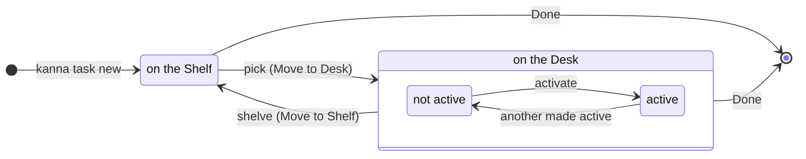
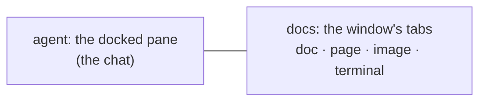
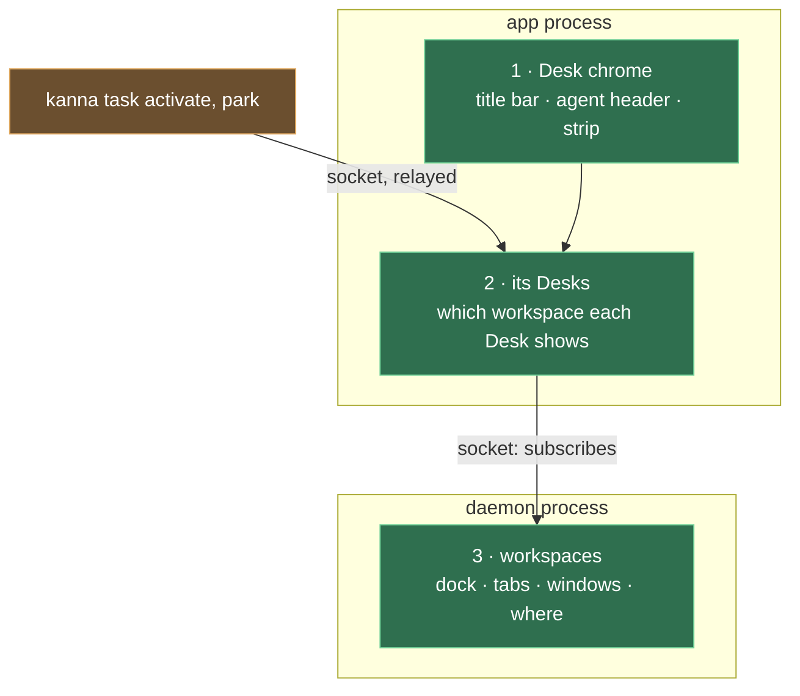

# Desk

**Status:** built; each app's since [each app's Desks](app-desk.md) · **Mockup:** [`references/mockups/desk.html`](../../references/mockups/desk.html) · **Builds on:** [docked pane](docked-pane.md), [planning agent](planning-agent.md), [agent status](agent-status.md), [doc markup](doc-markup.md) · **See also:** [Desk view](desk-view.md) · **From:** kanna v3's Desk and Shelf (its look), laid out like a chat app's work view: one conversation, tabbed documents beside it

The **Desk** is Kanna's window for working with an agent. It holds up to three of a project's **tasks**, one of them **active**: the active task's agent terminal is docked on the left as the single chat, and everything the task opens (docs, pages, images, other terminals) shows as tabs on the right. The **strip** along the bottom lists the Desk's other tasks, their agents still running, and makes one active with a click. **⌘.** toggles to the **Desk view**: the window's **planning agent**, where you make and manage tasks by talking to it, beside the Desk's tasks and the **Shelf** ([Desk view](desk-view.md)).

## Contents

1. [Tasks](#1-tasks)
2. [The active task](#2-the-active-task)
3. [The Desk's tasks](#3-the-desks-tasks)
4. [The Desk view](#4-the-desk-view)
5. [CLI](#5-cli)
6. [How it's built](#6-how-its-built)
7. [Rejected](#7-rejected)
8. [Open questions](#8-open-questions)
9. [Glossary](#9-glossary)

## 1. Tasks

A task is what a Desk holds: an agent in the window's [docked pane](docked-pane.md), and the window's tabs.

- **A window with a docked pane is a Desk**; its contents are its active task. Tasks come from the Shelf ([tasks](tasks.md)); File → New Desk (⌘N) opens another Desk window, in `~`, for another project.
- **⌘. doesn't move a task**: it toggles the window between the active task and the Desk view, and the task stays active ([Desk view §2](desk-view.md#2--and-pull-back)).
- **Its name** is the docked pane's name, else its terminal's title. **Its folder and branch** are the docked pane's working directory and that folder's git branch, shown, never changed.
- **Done** closes the task's panes, ending its agent and terminals.
- **A task belongs to a project**: the git repository its folder is in (else the folder), and a Desk holds only its project's tasks. Making and naming tasks: [tasks](tasks.md).

## 2. The active task

- **One active task per Desk.** Making a task active (click, ⌘1, ⌘2, ⇧⌘A, `kanna task activate`) leaves the one active before on the Desk, not active. If the task is already on another Desk window, that window comes to the front and nothing moves. Closing a Desk window leaves its tasks on the Desk, none active.
- **The agent pane** is the agent's terminal, untouched, under a header with Park (pictured above; it shows the Desk view). The header leaves out the task's name (the title bar shows it) and its [status](agent-status.md) (the agent is in view; the strip shows the others'). It's the only chat: you talk to the agent there, and doc comments arrive there ([doc markup](doc-markup.md)). Its width is the task's: it comes back with the task, whichever Desk it's made active on.
- **Docs are the window's tabs.** Each is an ordinary tab: markdown (with comments), a web page, an image, video or PDF (shown in a web pane), or a terminal (tests, a server), and a tab can hold splits.
  - **What opens a tab:** the agent running `kanna open md|web FILE` from its pane, a markdown link, or **+**.
  - Opening a file that's already open shows its tab.
- **The title bar** (top) shows only the active task's title (or Desk, in the Desk view).
- **Plain windows stay** exactly as now, so every kmux behaviour is unchanged.

## 3. The Desk's tasks

- **The strip lists the Desk's tasks other than the active one**, after a muted "⌘. Desk", oldest first (by when each task was made, as the [Desk view](desk-view.md#2--and-pull-back) lists them), each with its [agent status](agent-status.md) and how long ago it was last active ("12m ago"), then how many are on the Shelf.
- **Each task's time shows beside its name** (pictured above): how long ago it was last active, or needs you, muted, kept current while it's shown. Its ⌘ key shows on hover. When the strip is too narrow, titles truncate first, each in proportion to its length, down to a short floor; then the Shelf's count gives way; then the times.
- **Click to make active:** the clicked task becomes active and the one before stays on the Desk. **⌘1** and **⌘2** make the Desk's other tasks active the same way, numbered by recency, not by place: the one left last first (a stack), **Needs you** ahead, so ⌘1 twice goes back where you were and ⌘2 again cycles through the Desk; ⌘3 does nothing. **⇧⌘A** makes active the task that has needed you longest. They're in the Task menu (Desk Task 1, 2, Task Waiting Longest).
- **At most three tasks per project on an app's Desk,** active or not, running or stopped; another app has its own three ([each app's Desks](app-desk.md)). Moving a fourth to the Desk is refused ("Desk full") until one goes back to the Shelf or is Done; any number run on the Shelf ([tasks](tasks.md#5-stop-done-or-back-to-the-shelf)).
- **Not active means hidden, not stopped.** Its terminals keep running in the daemon, and its tabs, the shown one, focus, [zoom](zoom.md) and scroll positions come back as they were.
- **The Desk view has its own zoom.** ⇧⌘↩ on it zooms the planner, and it stays zoomed (or not) whatever the tasks do:

  | Task zoomed | ⌘. | Desk view, zoomed earlier | ⌘. |
  |---|---|---|---|
  |  | → |  | → back to the task, zoomed |

## 4. The Desk view

The Desk view (pictured in [Desk view](desk-view.md)) shows the window's planning terminal, where you run your planning agent, docked on the left ([planning agent](planning-agent.md)), and on the right the Desk's tasks (oldest first, the active one in its place) above the Shelf, live, under a short encouraging line. What ⌘. does there and how its tasks are numbered: [Desk view §2](desk-view.md#2--and-pull-back).

- **⌘F searches the Shelf** ([Shelf search](shelf-search.md)). A blocked Shelf task shows what it waits for and can't be moved to the Desk ([blocked tasks](task-dependencies.md)). Shelf tasks run by themselves, and their rows don't show how far they got ([Shelf runners](shelf-runners.md)).
- **It holds no tabs but the fixed Desk and Machines** ([machine links §5](machine-links.md#5-paths-the-machines-tab-and-offline)), which the active task doesn't have: New Tab and the splits are off, and a pane opened onto it gets a plain window of its own ([planning agent](planning-agent.md#1-when-it-shows)).

## 5. CLI

| Command | Does |
|---|---|
| `kanna task list [QUERY]` | Every task: ID, name, where it is (Desk or Shelf), status, how long ago it was last active; QUERY filters by name and first message |
| `kanna task activate ID` | Make a Desk task active and show it: on the caller's Desk, else on a Desk on its project, else a new one (relayed to the app; [the CLI acts on its caller](cli-caller.md)) |
| `kanna task park [ID]` | ⌘.: show the Desk view of the task's Desk (default: the caller's own; outside a Kanna terminal ID is needed); the task stays active (relayed to the app) |
| `kanna task done ID` | End a task: close its panes |
| `kanna task new`, `start`, `stop`, `pick`, `shelve`, `name` | Make, run, stop, move and name tasks: [tasks](tasks.md#7-cli) |

A task's workspace has an ID of its own (ws-3), and commands take it, the task's ID or the task's docked pane. Run from a task's terminal, `park` and `done` mean that task, and `kanna open` without a placement opens a new tab in the task's workspace, on its Desk or, while it isn't active or is on the Shelf, among its hidden tabs; with `--tab`, `--split` or `--size` it opens there too, never in the front window, and `--window new` opens a window of the task's ([presenting](presenting.md#3-how-its-built), [workspaces](workspaces.md#3-commands-target-and-reply)). `done` leaves its Desk with no task active.

## 6. How it's built

- **The daemon keeps workspaces** (a task's dock with its width, its tabs, its windows, where it is), saved in `kanna.db` ([layout](layout.md), [workspaces](workspaces.md)). Nothing there knows about Desks.
- **The app keeps its Desks** ([each app's Desks](app-desk.md)): which workspace each Desk shows, its project and planner, its active task and its tasks' order. It draws a Desk window from the workspace it shows: the dock on the left, the tabs on the right.
- **Making a task active, or showing the Desk view,** changes only which workspace the Desk shows; the panes keep their IDs, and their terminals never notice. The workspace keeps its focus and zoom, and the planner its own ([zoom](zoom.md#4-how-its-built)).
- **The planning terminal is the Desk's planner**: a workspace with no task, shown on the left only in the Desk view. The app asks the daemon for one (the internal `backlog` command's `plan`) when a Desk shows the Desk view and has none; the daemon makes its command and opens it with the `planner` placement.
- **`kanna task activate` and `park`** are relayed to the app by the daemon (the `desk` command, whose `pull` and `park` keep their internal names), which starts the app if it's closed.

## 7. Rejected

- **The planning terminal's alternatives:** [planning agent](planning-agent.md#6-rejected).

## 8. Open questions

1. Making tasks, and what a task is: [tasks](tasks.md).

## 9. Glossary

| Term | Meaning |
|---|---|
| **Task** | What a Desk holds: an agent in its docked pane, and its tabs |
| **Desk** | An app's window for a project, and the up to three tasks it holds |
| **Active task** | The Desk task shown with its agent and tabs; stays active while the Desk view shows |
| **Desk view** | The planning agent, the Desk's tasks and the Shelf, in the Desk window ([Desk view](desk-view.md)) |
| **Strip** | The line under the active task: ⌘. Desk, the Desk's other tasks, the Shelf's count |
| **Shelf** | A project's tasks Kanna has brought in, waiting, off the Desk ([tasks](tasks.md#3-the-shelf)) |
| **Agent pane** | The docked pane where the task's agent runs: the Desk's one chat |
| **Planning agent** | The Desk's own agent (its planner), docked in the Desk view; not a task |
| **Docs** | The task's tabs: everything it has open besides the agent |
