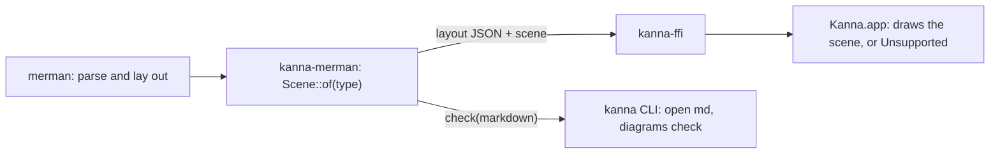

# Diagram check

**Status:** built (2026-10-16) · **Builds on:** [the kanna CLI](cli.md), [commands](commands.md) · **Why:** an agent writes a mermaid diagram and presents the doc without knowing it fails to draw; the user opens it and finds an error

A markdown pane draws ` ```mermaid ` blocks itself, and shows `Diagram error: …` or `Unsupported diagram type: …` in place of one it can't draw. The agent never sees that pane. The diagram check finds the same failures from the CLI, without the app, so the agent hears about them where it works:

- `kanna open md FILE` opens the pane and prints a line for each diagram that won't draw.
- `kanna diagrams check FILE...` checks without opening anything, and exits 1 if any fail.

The check is what the pane does, minus drawing: the same layout call, the same list of types the app draws.

## Contents

1. [What fails](#1-what-fails)
2. [CLI](#2-cli)
3. [One list of drawn types](#3-one-list-of-drawn-types)

## 1. What fails

A diagram is a fenced code block whose info string's first word is `mermaid` (any case), as CommonMark finds it: in lists and quotes too. Each one fails when:

| Failure | Message | The pane shows |
|---|---|---|
| merman can't parse it | `diagram error: MESSAGE` | `Diagram error: MESSAGE` |
| Kanna.app doesn't draw its type | `unsupported diagram type: TYPE (Kanna draws flowchart, sequence, state, class and gitGraph)` | `Unsupported diagram type: TYPE` |

Each failure is reported as `FILE:LINE: message`, LINE being the block's fence line (` ```mermaid `), counted from 1, so `kanna open code FILE:LINE` goes to it.

The check lays diagrams out without measuring text (no fonts), so it can't see labels that overlap or clip. Those are why the skills also say to take `kanna screenshot PANE` and look.

## 2. CLI

```
$ kanna open md docs/specs/plan.md --tab
opened p7 (plan.md) in window w1: running
docs/specs/plan.md:42: unsupported diagram type: er (Kanna draws flowchart, sequence, state, class and gitGraph)

$ kanna diagrams check docs/specs/*.md
docs/specs/plan.md:42: unsupported diagram type: er (Kanna draws …)
docs/specs/plan.md:71: diagram error: Parse error on line 3: …
kanna: 2 of 9 diagrams don't draw

$ kanna diagrams check docs/specs/desk.md
3 diagrams, all draw
```

- **`open md`** still opens the pane, and still exits 0. The failure lines go to stderr. `--json` adds `"diagrams": [{"file", "line", "type", "message"}]` to the reply, empty when all draw. The CLI checks the file on disk before sending the request, so it checks what the agent wrote.
- **`diagrams check FILE...`** prints the failures to stdout, then `N diagrams, all draw`, or `kanna: F of N diagrams don't draw` on stderr. Exit 0 when all draw, 1 when any fail, 2 for a usage error, 4 (`not_found`) for a file it can't read. `--json`: `{"diagrams": N, "failures": [...]}`. It needs no app, daemon or instance.
- It's in `kanna help`, `kanna help diagrams` and `kanna commands`, in the Information group.

## 3. One list of drawn types

Which mermaid types Kanna.app draws is decided in Rust, in `kanna-merman`, and both the app and the CLI read it from there:



- `kanna_merman_layout` adds `"scene"` to its JSON: the kind of drawing the app makes (`flowchart`, `sequence`, `state`, `class`, `gitGraph`), or `null` for a type it doesn't draw. merman's own "Unsupported diagram type" error (a type it wasn't built with) becomes `"scene": null` there too.
- The app draws by `scene`, not by merman's diagram type. A new drawn type is a new `Scene` in Rust and its drawing in Swift.
- `kanna_merman::check(markdown)` is the check: each diagram's line, type and failure, if any.

Fixing what the renderer gets wrong is the backlog task "Diagrams draw what agents write", not this.
