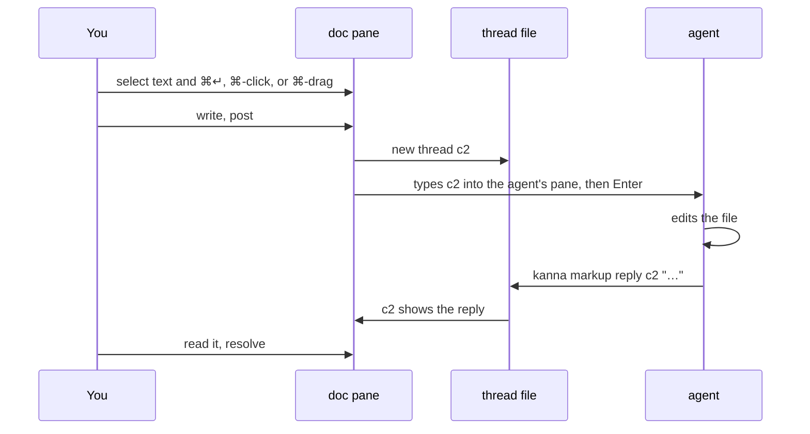
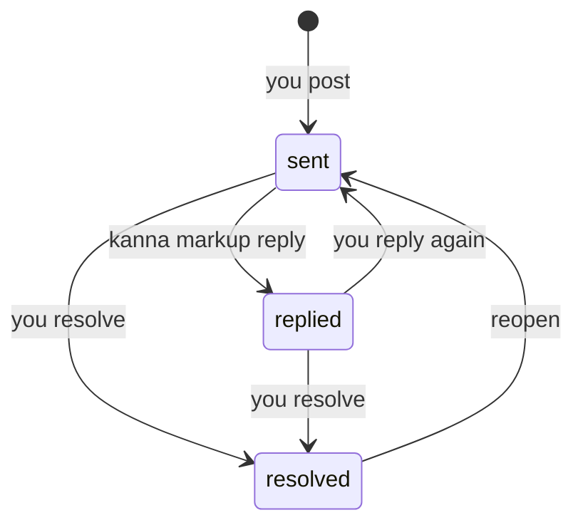
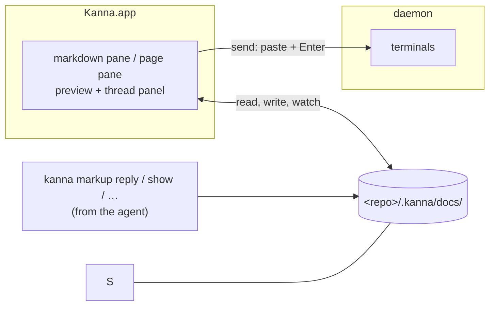

# Doc Markup

**Status:** proposed · **Mockup:** [`references/mockups/doc-markup.html`](../../references/mockups/doc-markup.html) · **Reference model:** [`references/prototypes/doc-markup`](../../references/prototypes/doc-markup/README.md) · **From:** kanna v3 slice 6b, "spec markup"

**Doc markup** lets you comment on a doc in Kanna, a markdown file or an HTML page (a mockup), and have the agent working beside it read, answer and resolve those comments. You review a spec or a mockup with an agent the way you would with a colleague: point at something, say what's wrong, see it fixed.


## Contents

1. [The loop](#1-the-loop)
2. [Rules](#2-rules)
3. [Reaching the agent](#3-reaching-the-agent)
4. [Waiting on the agent](#4-waiting-on-the-agent)
5. [CLI](#5-cli)
6. [How it's built](#6-how-its-built)
7. [Glossary](#7-glossary)

## 1. The loop



General remarks that aren't about something in the doc go straight to the agent's chat, as now.

## 2. Rules

Every doc works the same way; only what you can point at differs.

- **Two kinds of doc.** A markdown file and an HTML page, opened for comments with `kanna markup FILE.md` or `kanna markup FILE.html`.
- **Comments are opt-in.** `kanna open md` and `kanna open web` show the doc alone: no thread list, no marks, ⌘ gestures do nothing. Comments come on or go off in a pane that's already open with `kanna markup PANE` (`--off`) or **Pane ▸ Comments**; turning them off keeps its threads for next time.
- **Preview only.** The pane shows the file and reloads when it changes; you don't edit in it. Comments are the only thing you add.
- **Commenting.** Select text and press ⌘↵, in either kind. ⌘ adds what the kind offers:

| You | In a markdown file | In a page |
|---|---|---|
| Select text, ⌘↵ | that passage | that text |
| ⌘-click | a word (even on a link) | the part of the page under it; holding ⌘ outlines it first |
| ⌘-drag | a box on an image | a box anywhere on the page |
| ⌘-click an image | the whole image | the image, as a part |
| Plain click | follows a link, or opens a thread's mark | uses the page, closing an open thread; a thread's dot opens it |


- **On a page, a mark is a dot.** Each commented part or box shows only a small dot at its top-left corner (grey once resolved), so the page stays as it is and works as it does: clicking the thing uses the page; clicking the dot opens the thread. Pointing at the thing outlines it, dashed; selecting the thread outlines it solid, tinted unless it covers most of the view.

- **Marks stay on what you pointed at.** A passage or selected text is found again by its words and the text around them; a part of a page by its place in the page and its text; a box by where it is on the image or page. They follow edits, reloads and zoom. Anything that can't be found again is kept and marked **detached**, never dropped.
- **A page's view.** A thread on a page remembers which view of it it was on (the part of the URL after `#`), shows its mark only there, and takes you there when you open it from the list.
- **Threads live beside the file, not in it.** A thread has an ID (`c1`, `c2`, … per doc), what it points at, its messages, and whether it's open or resolved.
- **Resolved threads stay marked**, more faintly than open ones, and clicking the mark opens the thread to read or reopen it. The list beside the doc hides them until you ask; resolving can be undone.
- **The thread list** sits on the pane's right; in a pane narrower than twice its width it hides until you press **Threads**.
- **Not committed.** Threads, and the marked-up copies sent to the agent, are stored in `<repo>/.kanna/docs/`. Kanna doesn't commit them or change `.gitignore`; whether a team commits `.kanna/` is its own decision.

## 3. Reaching the agent

**A comment is typed into the agent that opened the doc, as `kanna send` would, the moment you post it.** The same for every agent: Claude, Codex or anything else that reads its terminal.

- **Which pane:** the terminal that ran `kanna markup` for the doc, or the one named by `--to PANE`, shown in the toolbar. `kanna markup PANE --to AGENT` sends a doc's comments somewhere else from then on. Comments turned on from the menu go to the pane's agent if it had one, else nowhere: they're saved, not sent.
- **What's typed:** one paste, then Enter: a header naming the thread, file and line; what you pointed at, as `>` lines; then your words. For a passage that's the passage:

```
[kanna comment c2 · docs/specs/tab-container.md:18]
> the strip scrolls, keeping the active tab in view
Also say what ⌃Tab does when the strip has scrolled.
```

- **Anything you can't quote** (a box, a part of a page, selected text on a page) is named, and comes with a marked-up copy, saved beside the threads, for the agent to look at: the image with the box drawn on it, or a screenshot of the page with the part, text or box boxed in red. On an image:

```
[kanna comment c4 · docs/specs/desk.md:9]
> image desk.png, the box from 5%,20% to 30%,50% (left,top to right,bottom)
> marked up: .kanna/docs/marks/docs__specs__desk.md-c4.png
The agent header needs the branch.
```

- On a page: the view, then the part (its CSS path and text), the selected text (`the text "…" in PATH`) or `a box`, then where it is in page pixels:

```
[kanna comment c1 · references/mockups/desk.html:149]
> the page at #picture,needs, element #win > div:nth-of-type(1) "Kanna Desk · Doc markup reference model"
> box 0,0 to 1220,44 px in a 1220×816 view, scrolled to 0,0
> marked up: .kanna/docs/marks/references__mockups__desk.html-c1.png
Make the title bar quieter.
```

- **Replies you add to a thread** are sent the same way, under the same header.
- **Sent at once, never held.** Claude Code and Codex queue input that arrives during a turn and take it next. If you have unsent text in the agent's prompt, the comment joins it; Kanna doesn't try to detect that (v3 did, and it was never reliable).
- **How to answer is a skill, not part of the message.** The `kanna-markup` skill in kanna-skills, which Kanna installs for every agent once you agree ([agent setup](agent-setup.md)), tells the agent that a `[kanna comment …]` is a review comment, to fix the doc, then answer with `kanna markup reply cN`.
- **The agent replies; you resolve.** An answered thread stays open, so you read the reply beside the doc and resolve it yourself (or reply again). The agent resolves only when you ask.
- **No agent** (the doc has none, or its pane is closed): posting still saves the thread, and the toolbar says it wasn't sent.



## 4. Waiting on the agent

**A thread you've posted or replied to shows what the agent is doing about it** until the reply lands, from the agent's [status](agent-status.md).


| The agent is | The thread shows |
|---|---|
| working (on it or on anything else) | typing dots where the reply will land |
| idle, or its program has exited | Not answered · the agent stopped |
| needs you (asking something in its terminal) | Not answered · the agent is waiting on you |
| none, or sending failed | Not sent · no agent (or why it failed) |

- **Waiting** means open, and the last message is yours. The reply replaces the dots; resolving or the agent's reply ends the wait.
- **Kanna can't tell what the agent is working on**, so the dots show while it works at all; a thread it never answers turns to *not answered* when it stops.
- **One set of dots per thread**: in its card, nowhere else in the list. On a page, a waiting thread's dot holds the dots while the agent works, since the card is out of sight:


- **Reduce Motion** (macOS accessibility) holds the dots still.
- **Cards carry no status labels**: no thread ID, line or *replied* chip; the agent's reply says it. The ✓ at the bottom of a card resolves it.

## 5. CLI

Run in the doc's repo, the doc is found from the thread ID, the docs whose comments come to this pane first; or pass `--doc FILE`.

| Command | Does |
|---|---|
| `kanna markup FILE.md\|FILE.html [--to PANE]` | Open a doc with comments, sent to this pane (or PANE) |
| `kanna markup PANE [--to PANE \| --off]` | Turn comments on or off in a pane already open, or send them elsewhere |
| `kanna markup comments [--all]` | List the threads (open only, unless `--all`) |
| `kanna markup show cN` | One thread: what it points at, line, messages, state |
| `kanna markup reply cN TEXT` | Answer a thread |
| `kanna markup resolve cN` / `reopen cN` | Resolve or reopen a thread |

## 6. How it's built



- **Threads live in files**, `<repo>/.kanna/docs/<path>.json`, one per doc, which the app, `kanna markup comments|show|reply|resolve|reopen` and the reference model all read and write the same way (one format, one lock file), so answering works with the app closed and the pane picks up a reply when the file changes.
- **Sending** uses the daemon's `send`, which delivers the comment as a bracketed paste to an agent that turned bracketed paste on, so a multi-line comment arrives whole, and then presses Return ([kanna send](kanna-send.md)). `kanna markup` passes the pane it runs in (`$KANNA_TERMINAL`, which Kanna sets in every terminal), and the doc remembers it. Comments on or off are the pane's `markup` flag, set by `open` or the `markup` command, which restarts the pane's view as `navigate` does.
- **The app** adds the thread panel, marks and the comment box to a markdown or web pane with comments on, one shared set of views (`KannaDocs`), and gets thread changes over the app link like any other pane update. A page is worked from a script world of its own (`WKContentWorld`), which the page's scripts can't see or call; its marked-up copy is the web view's own screenshot.
- **Stored** in `<repo>/.kanna/docs/`, one file per doc, so threads survive restarts.
- **Built so far:** both panes have the native comment UI, with the [mockup](../../references/mockups/doc-markup.html)'s thread cards and waiting states (e2e `md_comments` drives the markdown pane, `page_comments` a page, and both screenshot it); the panes get the agent's status from the app's `status` notices. Until the daemon's doc store lands, the app reads and writes the reference model's files directly, so the prototype's `kanna-doc reply` and `resolve` (and the skill) work with it unchanged.

## 7. Glossary

| Term | Meaning |
|---|---|
| **Thread** | A comment and its replies, with an ID like `c2` |
| **Doc** | A markdown file or an HTML page shown with its comments |
| **Mark** | What a thread points at, drawn in the doc: a passage, selected text, a part of a page, or a box |
| **Anchor** | What ties a mark to the doc: the quote and the text around it, a part's place and text, or a box's position |
| **Detached** | A thread whose mark can no longer be found in the doc |
| **View** | Which state of a page a thread is on: the part of its URL after `#` |
| **Agent** | The terminal that opened the doc; its comments are typed into it |
| **Waiting** | An open thread whose last message is yours, not yet answered |
