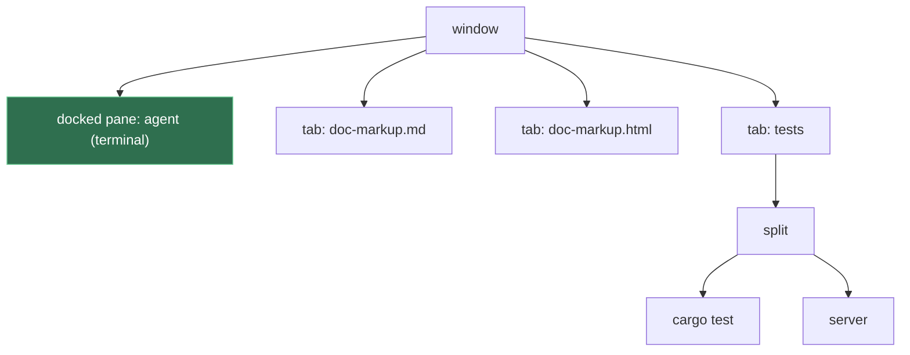

# Docked Pane

**Status:** built (2026-10-10), in kmux and Kanna · **Used by:** [Desk](desk.md) · **Mockup:** the Desk's ([`references/mockups/desk.html`](../../references/mockups/desk.html)), whose agent is a docked pane

A **docked pane** belongs to a window, not to any of its tabs: it sits along the window's left or right edge and stays put while you switch tabs, with the tab bar and the tabs beside it. It's a mux-layer primitive; in Kanna only a task's agent docks ([every task starts on the Shelf](tasks-start-on-the-shelf.md)), with the task's docs as the window's tabs.

## Contents

1. [The window](#1-the-window)
2. [Rules](#2-rules)
3. [Keys and mouse](#3-keys-and-mouse)
4. [CLI](#4-cli)
5. [How it's built](#5-how-its-built)
6. [Glossary](#6-glossary)

## 1. The window

Today every pane is a leaf of some tab's split tree. A docked pane is the one pane that isn't: the window holds it directly, beside its tabs.

The right side needs nothing new: the window's own tabs already are a group of tabs, with renaming, reordering, dragging between windows and every tab command, and a tab can still hold splits.

## 2. Rules

- **One per window**, on the left edge (the default) or the right.
- **Any pane kind:** terminal, web, markdown or iOS. It's an ordinary pane with its ID and name, so `send`, `read`, `navigate` and `restart` work on it unchanged.
- **Width** is a fraction of the window. Default 2/5. `resize` sets it in the layout; dragging its divider sets it in that app only, until the layout's width changes ([windows](windows.md#2-what-the-app-keeps)).
- **With no tabs it fills the window** in Kanna.app, with no tab bar or divider, and a + in its header for New Tab; the first tab brings it back to its width ([tabless dock](tabless-dock.md)).
- **Always shown:** switching tabs leaves it alone. The tab bar spans only the tabs' side (the whole window while a tab's pane is zoomed).
- **It closes only with its window.** Close Pane (⌘W) and `kanna close` don't close it: ⌘W in the docked pane does nothing, and `kanna close` on it fails with `docked: it closes with its window`. If its program exits, it stays on screen as `exited`, and `kanna restart` starts it again. Closing the window's last tab leaves the window with just its docked pane.
- **Stays with its window:** moving or dragging a tab to another window leaves the docked pane where it is.
- **Focus:** Next/Previous Pane go from the docked pane into the shown tab's panes and back. Next/Previous Tab (⇧⌘] and ⇧⌘[, or Ghostty's `goto_tab` previous/next) from the docked pane switch the shown tab and leave focus in the docked pane, so the user flips through the task's tabs while typing to its agent; the shown tab keeps its own last-focused pane for when focus goes there. From a tab's pane they move focus into the new tab. The app asks for this with `command focus {tab, keep: "dock"}`; clicking a tab, ⌘1–9 and `kanna focus` still focus the tab. Zoom on any pane fills the window: a zoomed tab's pane covers the docked pane and fills the window under the tab bar, which then spans the window, a zoomed docked pane covers the tabs and the tab bar, and zooming it again brings both sides back. Zoom is the window's mode ([zoom](zoom.md)).
- **Docking where one is already docked** moves the old one into a new tab, not shown; the new one keeps the window's width.
- **Beside it is not a place:** moving a pane beside the docked pane is refused; dropping a pane on it swaps the two.
- **Frozen:** a [task](tasks.md)'s agent is docked frozen for good, and only a task's agent docks ([every task starts on the Shelf](tasks-start-on-the-shelf.md)). It doesn't move (no `move` of it, edge and window included; no drag, as it has no ⋯ grip; no Move Pane to New Window), and nothing lands on it: no drop, swap or pane beside it, and no `move --dock` into its window. `resize` still sets its width, and it closes with its window.
- **Errors** use the code `docked` for every refusal (close, `arrange` naming it, moving beside it), and `frozen` for a frozen one's.

## 3. Keys and mouse

| Action | Does |
|---|---|
| drag the divider | Resize |

## 4. CLI

| Command | Does |
|---|---|
| `kanna task new`, then `kanna task pick` or `kanna task start` | The only way to a docked pane: the daemon docks the task's agent, frozen, in the task's own workspace ([every task starts on the Shelf](tasks-start-on-the-shelf.md)). `open` has no `--dock` or `--frozen` |
| `kanna move PANE --dock [left\|right]` | Refused for every pane: a task's agent is frozen, and any other pane isn't a task (`not_a_task`), as a docked pane is a running [task](tasks.md)'s agent, in its own workspace, never a window's ([each app's Desks](app-desk.md)) |
| `kanna move PANE --tab` | Undock it into a new tab (kmux's own `move`, now also accepting the docked pane) |
| `kanna resize PANE …` | On the docked pane, sets its width |
| `kanna workspace list` | Shows the workspace's docked pane on its own line: `dock: term-1 (agent)  left 2/5`, with `frozen` after a frozen one |

`kanna arrange` arranges the shown tab, as now; the docked pane isn't part of the expression.

## 5. How it's built

- **Built in kmux first.** kmux is the reference for the mux layer, so docked panes go into kmux (its core, protocol, CLI, views and state file), with new protocol cases for them; Kanna then takes them like everything else from kmux, and passes the same cases.
- **The core** (kmux's, then `kanna-mux`) gains a field: a window's `dock {pane, edge, width, frozen}`, beside its tabs. Frozen came later, in kmux first too, with its own protocol case.
- **No new layout steps.** kmux's protocol already says everything about docking in `open`, `move` and `resize`, and Kanna's layout steps already carry those to the app's model ([layout](layout.md)). The first draft's `window.dock`, `window.undock` and `window.dock_width` are these steps; separate ones would be a second way to say the same thing, with checks of their own to keep in step with kmux's.

| Does | Step |
|---|---|
| a task's start (the daemon's `open {dock, frozen, task}`) | `place {pane, at: {dock, frozen}}`, answered `{window, tab: null, dock}` |
| dock, change edge, undock (`move`) | `command move`, kmux's arguments |
| set the width (`resize`) | `command resize`; the divider is the app's own |
| refuse `close` on it | `location {pane}` first, which answers `dock` for a docked pane |
| close it with its window | `panes-in {window}` lists it |

- **With Kanna.app closed** the daemon has no layout, so it can't know which pane is docked: `move --dock` starts the app (`no_app`), and `close` on a docked terminal closes it; the app then drops it from the window when it attaches, as any pane that's gone.
- **The app** splits the window's content view: the docked pane's view on its edge, the tab bar and the shown tab beside it. The model's `view` gives each window its `dock {pane, type, edge, width}`; with the docked pane zoomed, `root` is empty and the docked pane fills the window; with a tab's pane zoomed, `root` is that pane and the app hides the docked pane and lays the tab bar across the window above it; with no tabs, the docked pane fills the window ([tabless dock](tabless-dock.md)). The divider drag is a layout-only action, `command resize` on the app's own model, as focus is.
- **Saved** in the saved layout on the window; a file without one loads as before, and a dock whose pane the daemon no longer has is dropped on attach.
- **kmux parity** holds: both have docked panes, and a window without one behaves as before in both.
- **Checked by** kmux's dock protocol cases but the three that dock a pane that isn't docked (Kanna's own test of `move --dock` stands in for them), run three ways as all of kmux's ([layout](layout.md)), the layout owner's tests (drawing, saving, a dock whose pane is gone), the CLI's tests against kmux's own, and `docked_pane` of `scripts/e2e-kanna.sh`: `open --dock` refused, a task picked onto the Desk, ⇧⌘[ and ⇧⌘], `close` refused, ⌘W, focus, zoom of the docked pane (no tab bar) and of a tab's pane (it fills the window under the tab bar, through clicks on tabs), `move --dock right` refused as frozen, the divider, moving a tab away, `move --dock` refused for a pane that isn't docked, a swap and a drag either way refused, a window with only its docked pane, and the layout across a relaunch, with screenshots; and `dock_keeps_focus_through_tabs`: on a Desk, ⇧⌘] and ⇧⌘[ from the docked pane switch the tab while keys still reach the agent, and from a tab's pane focus follows.

## 6. Glossary

| Term | Meaning |
|---|---|
| **Docked pane** | A window's one pane outside its tabs, along its left or right edge |
| **Tabs' side** | The rest of the window: the tab bar and the shown tab |
