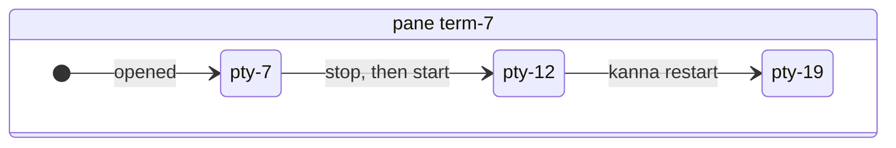
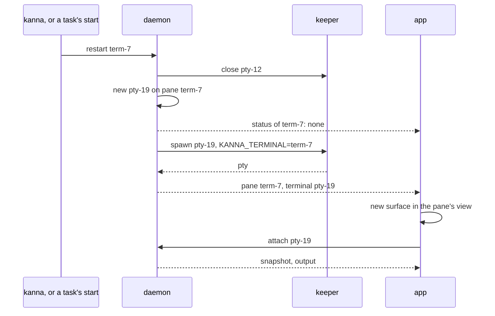

# Durable Panes

**Status:** built · **Builds on:** [presentation layers](presentation-layers.md#3-ids), [tasks](tasks.md#5-stop-done-or-back-to-the-shelf), [restarting the daemon](daemon-restart.md) · **Related:** [doc markup](doc-markup.md#3-reaching-the-agent)

A pane keeps its ID for as long as it exists, on this machine. Each start gives it a new pty, with an ID of its own, behind that pane ID, so whatever points at the pane keeps working: a doc's comment target, a task's record, a tab in the layout, a message.

It used to change with each run: a restart renamed the pane to the new terminal's ID, and the daemon followed the rename through the layout and the tasks. The app's own copy of a doc's target wasn't told. A task stopped by a Shelf runner and picked for the Desk came back as `term-1215`, its page still sent to `term-1207`, and the comment failed with `no pane "term-1207"`.

## Contents

1. [Pane and pty](#1-pane-and-pty)
2. [What each side keys on](#2-what-each-side-keys-on)
3. [A new pty](#3-a-new-pty)
4. [Comment targets](#4-comment-targets)
5. [Across machines](#5-across-machines)
6. [Tested by](#6-tested-by)
7. [Glossary](#7-glossary)

## 1. Pane and pty

- **Pane ID:** `Pane.id`, fixed when the pane opens, gone when it closes. Stop, start, resume, `kanna restart`, Move to Desk and Move to Shelf all keep it.
- **Pty ID:** `Pane.terminal`, a new `pty-N` for each start, the first included. Ptys count on their own, and a pty ID never repeats. A stop ends the pty: the program goes, and the daemon keeps its last screen until the next start.
- **Finding a pane:** a command names a pane by its ID or its name. A pty ID names no pane. Only `--json`'s `terminal` field shows one.
- **Older ptys:** one already in the keeper when this came in is `term-N`, the same as its pane, until it next starts.

## 2. What each side keys on

| Side | Keys on | Holds |
|---|---|---|
| Layout, tasks, messages, statuses, doc targets, `sizes`, the CLI | pane ID | tabs, focus, a task's `terminal` column, `pane.agent`, a thread file's `agent` |
| `$KANNA_TERMINAL` | pane ID | the caller a command acts for, so an agent's own ID outlasts its run |
| Keeper | pty ID | each pty, as its session `id` |
| Daemon's terminals, detector, screens | pty ID | `live`, `watches`, `<pty>.snap`, the `terminals` table's `id` |
| App link | pty ID | `attach`, `input`, `output`, `resize`, `snapshot`, `grid`, `exited` |
| App | pane ID for its views, and a map from pane to pty | `PaneViews.running`, `terminalIDs` |

- **Between them:** a pane's `terminal` field goes from pane to pty, `Terminal.pane` from pty to pane. The tasks' lookups of an agent's program go through that field to reach the detector.
- **On disk:** each row of `kanna.db`'s `terminals` table keeps both, so a daemon restart takes the keeper's pty back behind its pane ([terminal records](terminal-records.md)). A `kanna.db.bak` restore is only as new as the last daemon start, so ptys started since then lose that link and come back as new panes ([recovery](terminal-records.md#5-recovery)).

## 3. A new pty

A new pty inherits nothing from the old one but its pane's size and place. The two can exist together: the keeper closes a pty still starting only once its spawn answers. So every pty has its own ID, and each message to the keeper and the app names it, which keeps the old one's output off the new surface.

- **In the daemon:** a new `Feed`, so no scrollback or modes. Output, exits and statuses of the old pty carry its ID and serial, and are dropped.
- **In the app:** a pane record with a new `terminal` replaces the surface in the pane's view (`PaneViews.renew`), and the keyboard stays if it was there.
- **Readiness:** `core.on_new_run` tells the tasks to forget the old pty's readiness for messages, and the app that the old status is gone.

## 4. Comment targets

- **A target stays valid:** a doc's `agent` is a pane ID, so it survives every stop and start. A comment posted while the task is stopped waits, or wakes a Shelf task, as a message does ([doc markup](doc-markup.md#3-reaching-the-agent)).
- **One repair:** the first daemon with durable panes looks once, after restoring, for docs whose target is a pane that's gone (the `comment_targets_repaired` key in `kanna.db`'s `meta`). A doc pane in a task's workspace or worktree goes to that task's current pane, and so do thread files in the worktree's `.kanna/docs/`. Any other doc stays as it is.
- **A closed pane:** a task whose agent's pane was closed gets a new pane when it starts ([tasks](tasks.md#5-stop-done-or-back-to-the-shelf)), with a new ID, and docs pointing at the old one aren't moved. Their comments fail with `no pane`, and `kanna markup DOC --to PANE` points them again.

## 5. Across machines

A task moved to another machine gets a new pane there, and the IDs of panes on the two machines are unrelated ([machine tasks](machine-tasks.md)). A comment target that survives a move would need to name the task's ID, which doesn't change.

## 6. Tested by

- e2e `task_pane_keeps_comments`: a task opens a page, a Shelf runner stops it, it moves to the Desk and resumes, and a comment posted from the app arrives, with the pane ID checked before and after; a comment posted while it's stopped on the Desk waits and arrives on start; the pty comes back from the keeper behind the same pane across a daemon restart, and a comment still arrives.
- e2e `task_pane_stop_start`: stop then start on the Desk and on the Shelf keep both the agent's and a side terminal's pane IDs, the Move to Desk and Move to Shelf too; the app's surface has neither the old pty's scrollback nor its bracketed paste.
- `crates/kanna-daemon/tests/restart.rs`: `a_pane_keeps_its_id_and_its_new_run_across_a_daemon_restart`, after SIGTERM and SIGKILL. `store.rs`, `pane.rs` and `tasks.rs` unit tests: records with two IDs, the pty counter, the one repair.

## 7. Glossary

| Term | Meaning |
|---|---|
| **Pane** | The place in a tab or dock that shows content, known by its ID |
| **Pty** | One program started in a terminal pane, from spawn to exit, held by the keeper; `pty-N` |
| **Comment target** | The pane a doc's comments go to: `agent` on the doc's pane and in its thread file |
