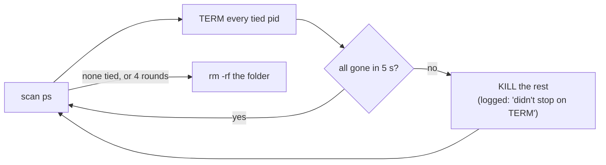

# E2E Cleanup

**Status:** built (2026-10-19) · **Part of:** [the build plan's scenarios](../plans/mux-build.md) · **Related:** [instances](instances.md), [codex app-server](codex-app-server.md), [the keeper](../keeper.md), [restarting the daemon](daemon-restart.md)

`scripts/e2e-kanna.sh` gives each scenario a private Kanna in a state folder of its own (`/tmp/kanna-e2e.XXXXXX`). Each run stops everything it started, whether it passes, fails, is interrupted or hangs. Before it starts, it also stops whatever earlier runs that were SIGKILLed left behind. Several agents run e2e at once, so a run never touches another live run's processes.

## Contents

1. [What a folder ties together](#1-what-a-folder-ties-together)
2. [Stopping](#2-stopping)
3. [Ownership and the sweep](#3-ownership-and-the-sweep)
4. [Kanna on SIGTERM](#4-kanna-on-sigterm)
5. [Checked by](#5-checked-by)

## 1. What a folder ties together

A process belongs to a state folder if the folder's path (or a path inside it) is in its arguments, or is the value of `KANNA_STATE_DIR`, `KANNA_SOCKET`, `KANNA_AGENTS_HOME` or `HOME` in its environment (`ps -E`). `/private/tmp/` counts as `/tmp/`. That covers:

| Process | How it's tied |
|---|---|
| the runner's daemon and app, and their keeper | `KANNA_STATE_DIR`, `KANNA_SOCKET`; the keeper's `--state-dir` |
| an instance the CLI starts in a scenario (`open -a … --env KANNA_SOCKET=…`), from any build path (`target/` or the volume it links to) | `KANNA_SOCKET` in `home/Library/Application Support/kanna-dev*`, `HOME` |
| shells, agents, mock agents, `kanna` CLI calls | `KANNA_SOCKET` set by the daemon or the runner |
| `codex app-server`, including one whose socket moved to `/tmp/kanna-UID` | `--listen unix:///tmp/kanna-e2e.X/codex/…`, or `KANNA_SOCKET` |

Never stopped, whatever they mention: any `e2e-kanna.sh` (this run, its scenario's subshell, other runs), the process doing the stopping and its parents, and anything in `/Applications/Kanna.app`. A `PWD` inside a folder doesn't tie a process, so a shell you `cd`'d there is safe. Processes are found and signalled by PID only, never by `pkill` patterns.

**Runs are unsandboxed.** Claude Code's and Codex's sandboxes block `ps`, signals and Unix sockets, and Claude Code's blocks writing to `/tmp`. In a sandbox the runner couldn't start an instance, and couldn't see or stop one either. It checks that it can list and signal its own process before anything else, and exits 2 with "run it unsandboxed" if it can't.

## 2. Stopping

`stop_tied PATH…` does the stopping. It scans again after each round because a stopped daemon can be started again by its app. Zombies count as gone. Callers:

- **Between scenarios and on exit** (`cleanup`): the scenario's subshell (TERM, then KILL after 2 s), then everything tied to `$KANNA_STATE_DIR`, then the folder is removed.
- **Inside scenarios:** `stop_folder DIR` (an instance's folder) and `stop_agents` (`agents/` and `codex/`). `stop_app` and `stop_daemon` stop the one PID the runner started: TERM, then KILL (logged) if it's still there after 5 s.

How a run ends:

| End | What runs `cleanup` |
|---|---|
| passes or fails | `trap cleanup EXIT` |
| ctrl+c, SIGTERM, SIGHUP | `trap 'exit 130' INT` (143 TERM, 129 HUP), then the EXIT trap |
| a scenario hangs | each scenario runs in a background subshell; after `$KANNA_E2E_TIMEOUT` s (600) it fails with "didn't finish", and the next `cleanup` stops it |
| the runner is SIGKILLed (an agent's tool timeout) | nothing: the next run's sweep, which also stops the scenario's subshell, left running |

## 3. Ownership and the sweep

**A run owns its folder:** `new_state_dir` writes the runner's PID (`$$`) to `e2e-kanna.pid` in each folder right after `mktemp`. A folder is owned while that PID is alive and its command is an `e2e-kanna.sh`.

**Its scenario's subshell** is recorded too, in `e2e-scenario.pid`. A SIGKILLed runner leaves that subshell running the scenario on its own (ppid 1). The sweep stops it (TERM, then KILL after 2 s) before the folder's other processes. It does so only if that PID is still an orphaned `e2e-kanna.sh`.

**The sweep** (`stop_tied --orphans`) runs once, before the run's first folder. It looks at every `/tmp/kanna-e2e.XXXXXX` folder that exists, and every one a process mentions, even if that folder is gone. It stops what is tied to a folder and removes the folder when:

| `e2e-kanna.pid` | The folder is |
|---|---|
| names a live `e2e-kanna.sh` | **kept** (another run is using it) |
| names anything else, or is unreadable | swept |
| is missing, and the folder exists and changed in the last hour | **kept** (a run of a runner from before this rule; scenarios take minutes) |
| is missing, and the folder is older or gone | swept |

The sweep prints a line for each folder whose processes it stops, and one for each process that needed KILL.

## 4. Kanna on SIGTERM

A Kanna process quits on SIGTERM even when its main loop is stuck. Each one asks its normal shutdown to run, and also sets `alarm(5)`, so SIGALRM ends it 5 s later if that shutdown hasn't:

| Process | On SIGTERM, SIGINT (and SIGHUP for the app and daemon) |
|---|---|
| app | a C handler for the signal only calls `alarm(5)`, so it runs even when the main thread is stuck; the main queue's signal source calls `NSApp.terminate`, which saves `app-state.json`. A second source on a global queue made the app exit 6 without saving, so the alarm isn't armed that way |
| daemon | its signal thread sets `alarm(5)` and wakes the main loop to stop ([stopping](daemon-restart.md#2-stopping)) |
| keeper | its handler sets `alarm(5)` and the loop stops ([keeper](../keeper.md)) |
| `kanna-daemon --codex-remote` | SIGTERMs its `codex app-server` and TUI, SIGKILLs whichever is left after 5 s, exits ([codex app-server](codex-app-server.md)) |

Each sets SIGALRM to its default action and unblocks it at start, whatever it inherited.

## 5. Checked by

`crates/kanna-daemon/tests/codex_remote.rs`, with a fake `codex` whose app-server ignores SIGTERM and SIGHUP:
- the `--codex-remote` helper exits on SIGHUP (129) and SIGTERM (143) and leaves neither child;
- a helper whose shell is SIGKILLed and whose terminal (a pty) is closed exits within 10 s, using under 1 s of CPU, and stops its children;
- an orphaned helper running codex on its own (no terminal, parent gone) uses no CPU while it waits and quits when it alone gets SIGTERM.

By hand, on 2026-10-19: a full run; a run interrupted with ctrl+c; a run SIGKILLed partway and then another run. After each, `ps -axo command | grep kanna-e2e` showed nothing from them.
