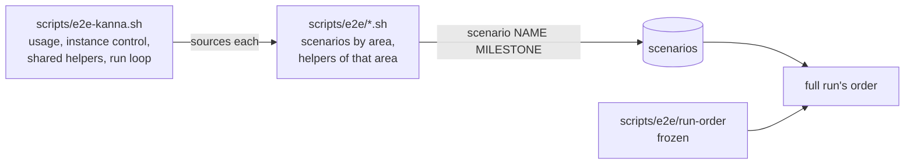

# E2e scenarios

**Status:** built · **Tests:** `scripts/e2e-kanna.sh` itself · **Builds on:** [e2e cleanup](e2e-cleanup.md), [the build plan](../plans/mux-build.md)

The end-to-end scenarios live in one file per area under `scripts/e2e/`, and `scripts/e2e-kanna.sh` keeps the runner and the helpers more than one area uses. Parallel tasks add scenarios all the time, so a new scenario touches only its area's file: nothing lists the area files or the scenarios.

## Adding a scenario

Put a function `NAME()` in the area's file, with `scenario NAME MILESTONE` on the line above it, as [the plan](../plans/mux-build.md) says. That is the whole change. A new area is a new `scripts/e2e/AREA.sh`: the runner sources every `*.sh` there.

| File | Scenarios |
|---|---|
| `lifecycle.sh` | the daemon, keeper and app starting, stopping, restarting, upgrading and crashing; instances |
| `cli.sh` | CLI commands, the caller, shell completion, `screenshot` |
| `windows.sh` | windows, tabs, splits, arranging and dragging panes, chrome, toasts |
| `terminal.sh` | what a terminal does: colours, title, clipboard, mouse, fonts, links, `send key` |
| `markdown.sh` | the markdown pane: diff, overview, zoom, images, diagrams |
| `comments.sh` | comments and markup on docs, pages and code |
| `panes.sh` | the other panes: web, iOS, code, file, diff, log, tours, serial |
| `desk.sh` | the Desk, its window and docked pane, opening a project by path, recent projects |
| `tasks.sh` | the Shelf and a task's life: start, stop, pick, restart, events, stacking, runners, scripts |
| `agents.sh` | agents and planners, real and mock: status, sending, messages, resuming |
| `perf.sh` | speed bounds |
| `stats.sh` | the Stats tab and the quiz |
| `automation.sh` | schedules and pipelines |
| `machines.sh` | remote machines and project import |

## Rules

- **Files only define.** An area file holds functions, `scenario` lines and the variables its functions read. Sourcing it starts nothing.
- **Helpers.** A helper used by one area's scenarios lives in that area's file; one used by two areas moves to `scripts/e2e-kanna.sh`. A scenario can call any helper, wherever it is, since every file is sourced before anything runs.
- **Full-run order.** `run-order` holds the 125 scenarios that existed when the script was split, in the order they ran, and a full run takes those first. Every other scenario follows, by area file in name order, then by its place in the file. Nobody edits `run-order`: a name in it that no longer exists is skipped. `scripts/e2e-kanna.sh NAME…` runs in the order given.
- **Failure lines.** `$LINENO` in a scenario's messages counts lines of its area's file.

## Rejected

- **A sort key on each `scenario` line:** it numbers scenarios, which [the plan](../plans/mux-build.md) rules out so that parallel tasks can't collide.
- **Area order alone:** areas are interleaved in the old order, so a full run would change. Each scenario has a fresh instance and depends on no other, so this is what's left if `run-order` and `in_run_order` are ever deleted: only the sequence of a full run changes.
