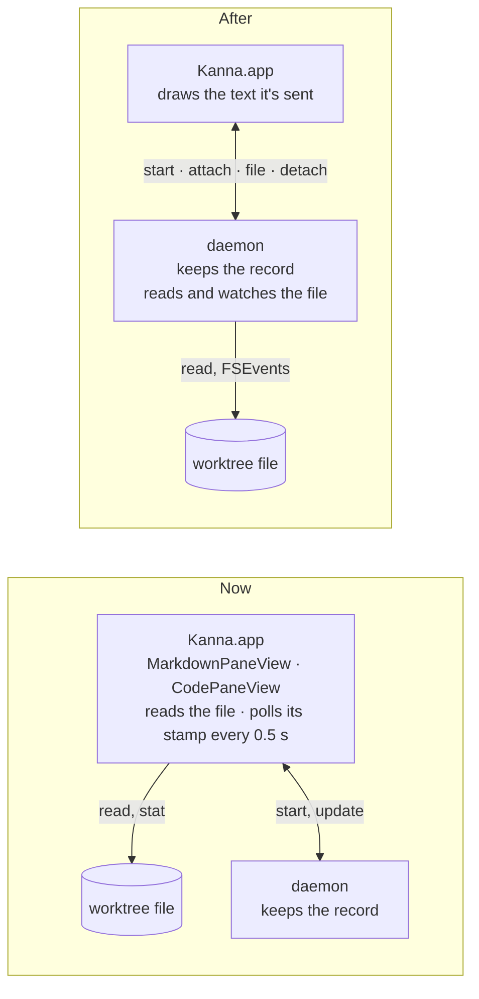
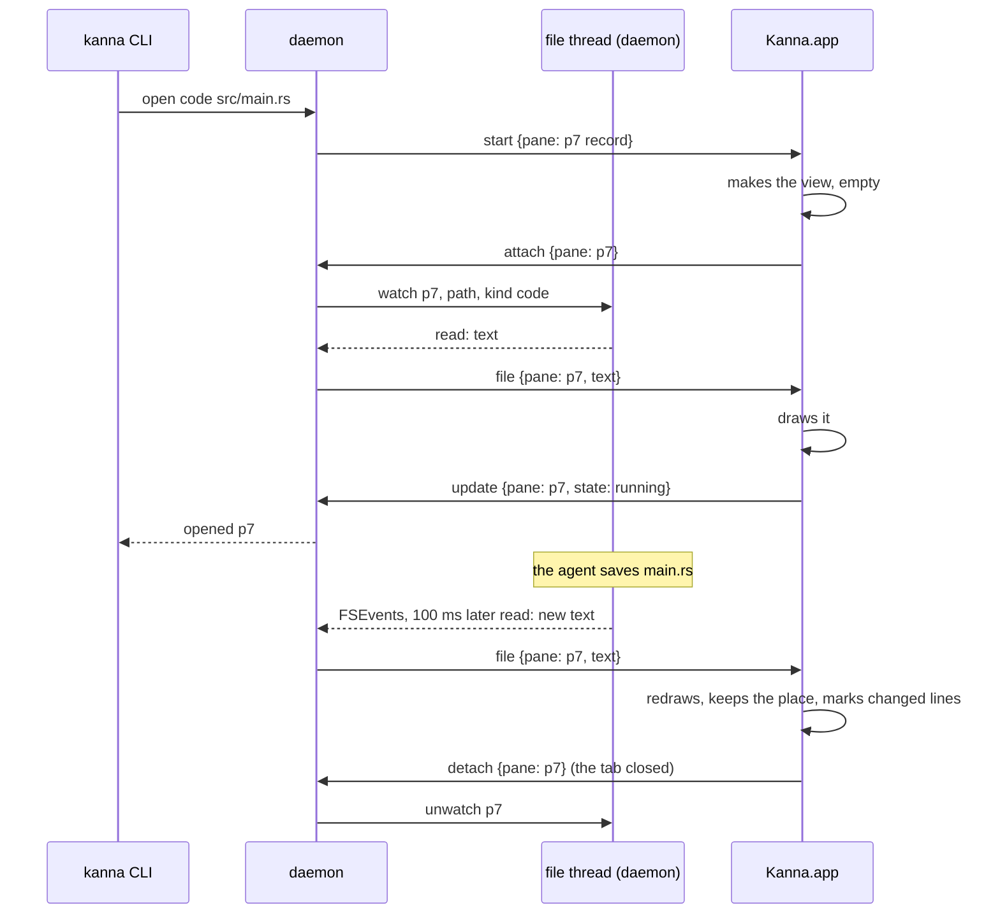

# File Panes Read by the Daemon

**Status:** proposed · **Builds on:** [the app link](app-link.md), [app panes](app-panes.md) · **Related:** [code viewer](code-viewer.md), [diff viewer](diff-viewer.md)

A markdown or code pane shows a file of the worktree. The **daemon** reads that file, watches it, and sends its text to the app; the app only draws it. The app no longer opens, stats or polls the file.

**Why:** the daemon runs where the worktrees are; the app may not. A remote app (planned: Kanna.app on another machine than the daemon) can only show what comes over the app link. The diff pane settled the pattern: the daemon runs git and watches the worktree, the app draws. This applies it to markdown and code panes.

## Contents

1. [Before and after](#1-before-and-after)
2. [Messages](#2-messages)
3. [Rules](#3-rules)
4. [How it's built](#4-how-its-built)
5. [Not in this change](#5-not-in-this-change)
6. [Glossary](#6-glossary)

## 1. Before and after

## 2. Messages

Additions to the [app link](app-link.md#2-messages):

| Message | From | What it says |
|---|---|---|
| `attach {pane}` | app | as for a terminal: I show this pane. For a markdown or code pane, the daemon starts watching its file and sends `file` |
| `detach {pane}` | app | I no longer show it; the daemon stops watching |
| `file {pane, path, text}` | daemon | the file's whole text, after `attach` and whenever it changes |
| `file {pane, path, error: {code, message}}` | daemon | it can't be shown: `missing`, `folder`, `binary` (code panes only), `too_big` |

- `path` is the record's path, made absolute by the daemon (`~` and relative paths, as the app did). A pane that moves to another file (`navigate`) gets a new `start`, so a new `attach`.
- One watch per pane, even when two panes show the same file; each gets its own `file`.

## 3. Rules

- **Starting.** The app makes the view on `start` (or from `layout.json` after a relaunch) and attaches it. The first `file` decides the state: text → `running`, an error → `failed` with its message ("No such file: PATH", "PATH is a folder, not a file", "PATH isn't a text file"). `open` waits for that, as now.
- **Following the file, without polling.** The daemon watches the file's folder with FSEvents, so an editor that saves by writing a new file and renaming it over the old one is seen. Events are gathered for 100 ms, then the file is read; `file` is sent only when the text differs from what that pane was last sent.
- **A deleted file** keeps its last text in the pane, as now; when it's back, its text is sent. A file missing at `attach` fails the pane, and its text is sent if it appears later (a code pane then shows it, as now).
- **The app's side is unchanged:** a code pane keeps its scroll and marks the lines that changed; a markdown pane keeps its reading position and holds the newest text while a comment is being written, applying it when the box closes.
- **Size.** A file over 8 MiB fails with `too_big` ("PATH is too big to show, over 8 MiB"), so a message stays well under the app link's 16 MiB line limit. **[New]** Today the app reads any size.
- **Text** is read as UTF-8, invalid bytes replaced, as the app does now. A code pane's file with a NUL in its first 8 KiB is `binary`.
- **The app reconnects** (a daemon restart): it says hello and attaches its markdown and code panes again, as its terminals, and gets each file's text afresh. While it's disconnected the views keep what they show.
- **The app goes away:** its panes leave the daemon's table and their watches end.

## 4. How it's built

| Piece | Where | What's new |
|---|---|---|
| File thread | `crates/kanna-daemon/src/files.rs` (new) | owns a `notify` watcher (FSEvents on macOS) and does the reads off the main loop; takes `watch {pane, path, kind}` and `unwatch {pane}`, sends `Event::File {pane, result}` |
| App link | `crates/kanna-daemon/src/app_link.rs` | `attach`/`detach` of a markdown or code pane watch and unwatch; `Event::File` becomes a `file` message; watches end with the pane or the app |
| App | `apps/kanna/Sources/Kanna/Daemon/DaemonLink.swift`, `Panes/Contents.swift` | attaches markdown and code panes, hands `file` to the view, reports `running`/`failed` from the first one |
| Views | `MarkdownPaneView`, `CodePaneView` | `show(text:)` and `show(failure:)` instead of reading; no timer, no `FileManager`; `CodeFile.read` goes |

- **Why `attach`, not a new request:** it's what the app already says for a view it shows, with the same lifetime (a relaunch, a reconnect, a closed tab); the daemon already keeps the set of attached panes.
- **Why the whole text, not a patch:** files are small, the app diffs lines itself for the change marks, and a lost message can't leave the app out of step.
- **Why `notify`:** the same crate the [diff pane](diff-viewer.md) uses for the worktree; FSEvents on macOS, inotify on Linux, where the daemon runs too.
- **Checks:** `crates/kanna-daemon/tests/panes.rs`: attach sends the text; a write, a rename over the file, a delete and a recreate; detach stops; errors. e2e `file_panes` in `scripts/e2e-kanna.sh`: opens a markdown and a code pane, edits both files (in place and by renaming over), sees the change, deletes and recreates, survives a daemon restart and a relaunch; a missing file fails `open`.

## 5. Not in this change

The panes touch the filesystem in other places too. Each is its own backlog task, done the same way:

- **Images** in a markdown pane (`MarkdownRenderer.imageAttachment`).
- **Following a link** to another file (`MarkdownPaneView.action` checks the target's type).
- **Comments' store** next to a doc (`DocStore`, [doc markup](doc-markup.md)).
- **Markdown diff mode** (branch `markdown-diff-mode`) running git in the app.

## 6. Glossary

| Term | Meaning |
|---|---|
| **remote app** | Kanna.app on another machine than the daemon and the worktrees, linked over the network (planned) |
| **FSEvents** | macOS's file-change notices for a folder, which the `notify` crate wraps |
| **file thread** | the daemon's thread that watches and reads files, so the main loop never waits on the disk |
