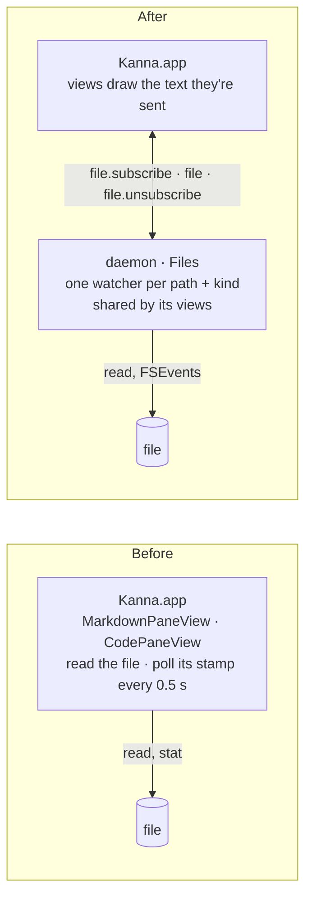
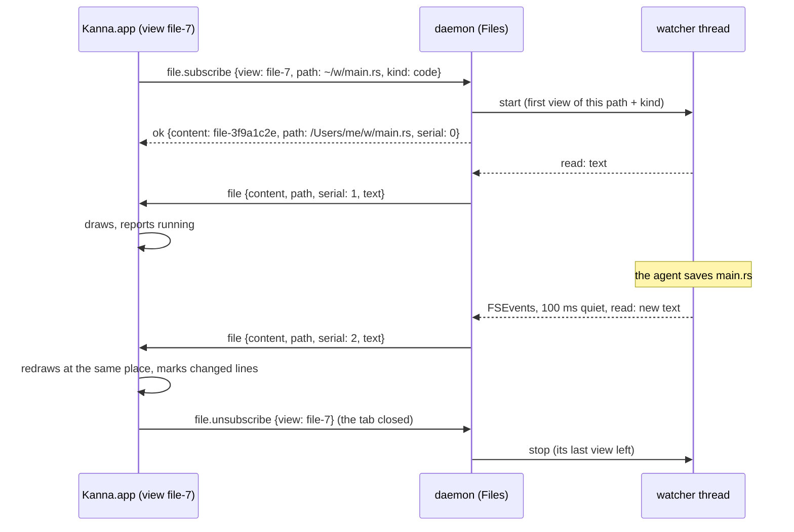

# File Panes Read by the Daemon

**Status:** built · **Builds on:** [presentation layers](presentation-layers.md#4-content), [the app link](app-link.md) · **Model:** [diff viewer](diff-viewer.md#5-how-its-built) (`crates/kanna-daemon/src/diffs.rs`) · **Related:** [code viewer](code-viewer.md), [app panes](app-panes.md)

A markdown or code pane shows a file. The **daemon** reads that file, watches it, and sends its text to every view subscribed to it; the app only draws. The app's views no longer open, stat or poll the file.

**Why:** files are work, and work lives in the daemon, which runs headless where the worktrees are ([presentation layers](presentation-layers.md)). An app on another machine (planned) can only show what comes over its link. Diffs settled the pattern; files follow it.

## Contents

1. [Before and after](#1-before-and-after)
2. [Messages](#2-messages)
3. [Rules](#3-rules)
4. [How it's built](#4-how-its-built)
5. [Not in this change](#5-not-in-this-change)
6. [Glossary](#6-glossary)

## 1. Before and after

## 2. Messages

On the [app link](app-link.md#2-messages), as diffs have:

| Message | From | What it says |
|---|---|---|
| `file.subscribe {view, path, kind}` (with an `id`) | app | show me this file: `path` as the pane's record has it, `kind` `md` or `code`. The reply has the file's `content` ID, its absolute `path` and the latest `serial`, with `text` or `error` once the file has been read |
| `file.unsubscribe {view}` | app | that view is gone |
| `file {content, path, serial, text}` | daemon | the file's whole text, to every app with a view subscribed, first and after every change |
| `file {content, path, serial, error: {code, message}}` | daemon | it can't be shown: `missing`, `folder`, `binary` (code only), `too_big` |
| `files` | any client | the watches: `id`, `path`, `kind`, `views`, `serial` (for tests and `kanna raw`) |

- **Keyed by the file, never the pane.** The content ID is made from the kind and the absolute path (`file-3f9a1c2e`), so every view of `main.rs` as code shares one watcher, however many tabs or apps show it; the same path as markdown is another. `view` is only the app's handle for unsubscribing; the daemon prefixes it with the app's connection.
- **The daemon resolves the path:** `~` and a relative path are against the daemon's home, as the app did before.

## 3. Rules

- **Starting.** The app makes the view on `start` (or after a relaunch) and subscribes. The first `text` makes the pane `running`; an `error` makes it `failed` with the message ("No such file: PATH", "PATH is a folder, not a markdown file" or "…not a file", "PATH isn't a text file"). `open` waits for that, as before. Text arriving later for a failed pane makes it `running`.
- **Following the file, without polling.** The watcher watches the file's folder (the real one, symlinks resolved) with FSEvents, so an editor that saves by writing a new file and renaming it over the old one is seen. Changes are gathered for 100 ms, then the file is read; `file` goes out only when the read differs from the last one.
- **A deleted file** keeps its last text in every view; when it's back, its text is sent. A file missing at subscribe fails the pane, and its text is sent once it appears (even in a folder made after).
- **The views' side is as before:** a code pane keeps its scroll and marks the lines that changed; a markdown pane keeps its reading position and holds the newest text while a comment is being written, applying it when the box closes.
- **Size.** A file over 8 MiB fails with `too_big` ("PATH is too big to show, over 8 MiB"), well under the app link's 16 MiB line. Before, the app read any size.
- **Text** is UTF-8, invalid bytes replaced. A code file with a NUL in its first 8 KiB is `binary`; a markdown file is shown anyway.
- **Headless, like diffs.** The daemon keeps the latest read for as long as anyone is subscribed, and stops the watcher when the last view leaves, or its app does; no grace period. An app subscribes again on every (re)connect, so a restarted daemon reads and watches again at once. While disconnected the views keep what they show.

## 4. How it's built

| Piece | Where | What it does |
|---|---|---|
| Files | `crates/kanna-daemon/src/files.rs` | the watches by content ID, the views of each, the latest read and its serial; `subscribe`, `unsubscribe`, `leave` (an app gone), `loaded`; the `files` command |
| Watcher | the same file, a thread per watch | reads off the main loop, FSEvents through `notify`, re-watches as folders appear or the file's real folder moves; sends `Event::File` |
| App link | `crates/kanna-daemon/src/app_link.rs` | `file.subscribe` and `file.unsubscribe` beside `diff.*`; `file` to the app with a view of it |
| App | `apps/kanna/Sources/Kanna/Panes/Contents.swift`, `Daemon/DaemonLink.swift` | subscribes markdown and code panes, keeps the newest `file` per content, hands it to the views, reports `running` or `failed` |
| Views | `MarkdownPaneView.show(text:)`, `CodePaneView.show(text:)`, `show(failure:)` | draw what they're given; no timer on the file, no `FileManager` for it |

- **Why whole text, not a patch:** files are small, the code pane diffs lines itself for its marks, and a lost message can't leave a view out of step.
- **Checks:** `files.rs` tests (shared watchers, kinds, errors, a deleted file, a real watcher through `/tmp`'s symlink, deleted and made again); `crates/kanna/tests/cli.rs` (a fake app subscribes: written in place, renamed over, deleted, made again, a second view, a file that appears in a new folder, a refusal, the watchers gone with the app); e2e `file_panes` (a markdown and a code pane follow edits, renames over, a delete and a recreate, a daemon restart and a relaunch; closing a pane stops its watcher; a missing file fails `open`), with `code_pane`, `web_md_ios_panes`, `md_comments`, `code_tour` and `docked_pane` unchanged.

## 5. Not in this change

The markdown pane still touches the filesystem in a few places; each moves to the daemon the same way, in Machines 4 (task-4053):

- **Images** in a markdown pane (`MarkdownRenderer.imageAttachment`).
- **Following a link** to another file (`MarkdownPaneView.action` checks the target's type).
- **Comments' store** next to a doc (`DocStore`, [doc markup](doc-markup.md)), still polled by the markdown pane.
- **`app.snap`** (`AppCommands.swift`), which reads a file to snap a comment to its scope.
- **Page comments** (`PageMarkup`, [doc markup](doc-markup.md)), which read a local page's HTML and stamp.
- **A doc's diff** ([markdown diff](markdown-diff.md)): the pane runs `git merge-base` and `git show` in the file's folder for the base, every 2 s, and a range's two versions.

## 6. Glossary

| Term | Meaning |
|---|---|
| **watch** | the daemon's record of one file it watches: its path and kind, its views, its latest read |
| **view** | one app's subscription to a file, for one of its panes |
| **serial** | a watch's count of reads that differed; an app keeps the highest it has seen |
| **FSEvents** | macOS's file-change notices for a folder, which the `notify` crate wraps |
