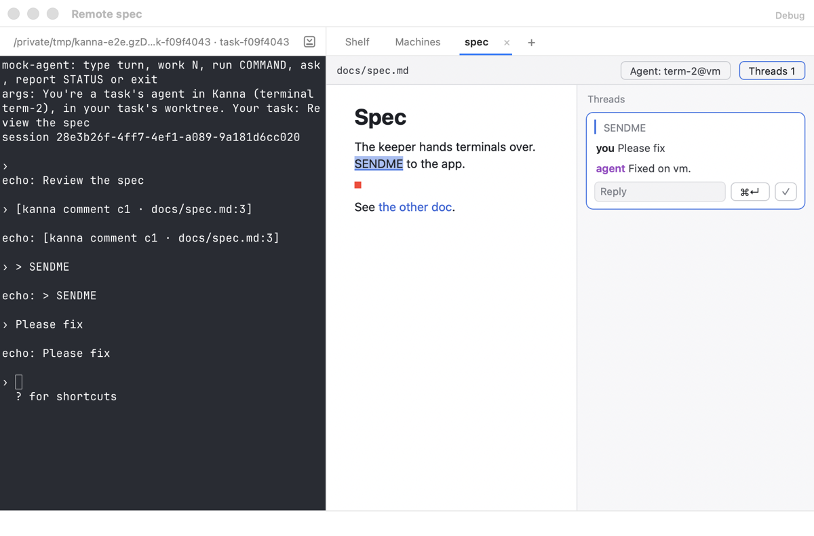
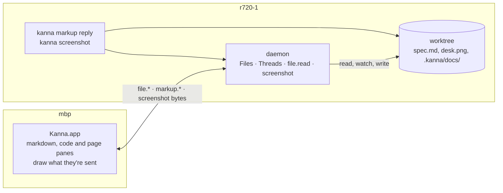

# Files and Threads through the Daemon

**Status:** built (Machines 4) · **Part of:** [Machines §7](machines.md#7-terminals-and-panes) · **Builds on:** [file panes](file-panes.md), [one link per machine](machine-links.md) · **Related:** [doc markup](doc-markup.md), [markdown diff](markdown-diff.md)

Everything a markdown, code or page pane shows comes over its machine's app link: the file's text, its images, the files its links point at, its comment threads, its diff base. Kanna.app reads nothing of a pane's from its own disk, for a task on this Mac or on another machine alike, so a remote task's spec, code, images and threads show and work as a local one's do. `kanna screenshot` gets the picture back from the app as bytes, and the daemon writes the file where the agent asked, on the agent's machine.

## 1. What moved

| What the app did itself | Now |
|---|---|
| Loaded a markdown image with `NSImage(contentsOf:)` | `file.read {path, data: true}`; the pane draws the alt text until the bytes come, then the image |
| Stat'ed a link's target to choose between showing it and revealing it | `file.read {path}` gives its real path and type; revealing in Finder is only for this Mac's files |
| Read, wrote and polled `<repo>/.kanna/docs/<doc>.json` | `markup.subscribe` and `markup` notices; `markup.post`, `markup.edit`, `markup.agent` |
| Wrote a page's or image's marked-up copy into `.kanna/docs/marks/` | `markup.post {…, mark}` with the PNG; the daemon writes it |
| Polled a page's file stamp and read its HTML for a comment's line | the page's file is subscribed like a markdown pane's; a change reloads the page |
| Ran `git merge-base` and `git show` for a doc's diff every 2 s | `file.subscribe {kind: md, diff: REF}`; the daemon sends the base with the text and checks the merge base every 2 s |
| `app.snap` read the code file to snap a comment to its scope | the daemon sends the file's `text` with `app.snap`, so it answers for any machine |
| `screenshot` wrote the PNG where the CLI asked | the app returns `png`; the daemon names and writes the file |

## 2. Messages

On the [app link](app-link.md#2-messages). Requests name the pane as `view` (or the screenshot's `pane`), so the app routes them to the pane's machine ([machine links §3](machine-links.md#3-ids-and-routing)).

| Message | From | What it says |
|---|---|---|
| `file.read {view, path, data?}` | app | `path` resolved on the daemon's machine (`~`, symlinks); reply `{path, type: file\|folder\|other, size}`, with `data` (base64) when asked for a file. Refusals: `not_found`, `not_local` (an automount or network path), `too_big` (over 8 MiB) |
| `file.subscribe {view, path, kind: md, diff: REF}` | app | as [file panes](file-panes.md#2-messages), plus the comparison: `base {commit, text?}` against REF's merge base, `old` (text or null) for a range `A..B` (then `text` is B's), or `diff_error` |
| `markup.subscribe {view, path}` | app | show me this doc's threads. Reply and every change after: `markup {content, path, name, serial, record}`, `name` being the doc's path in its repo, `record` the thread file (empty if there's none) |
| `markup.unsubscribe {view}` | app | that view is gone |
| `markup.post {view, path, thread, mark?}` | app | a new thread: the daemon gives it the next ID, saves `mark` (base64 PNG) as its marked-up copy and sets `thread.mark`. Reply `{thread, record}`, `thread` being its ID |
| `markup.edit {view, path, id, state?, status?, error?, line?, message?}` | app | change a thread, adding `message` to it. Reply `{record}` |
| `markup.agent {view, path, agent}` | app | the doc's comments go to `agent`. Reply `{record}` |
| `threads` | any client | the thread watches, as `files` lists file watches |
| `app.snap {path, line, last?, text}` | daemon | the file's text comes with the request |
| `screenshot {pane\|window\|from}` | daemon | reply `{png, window, pane?, width, height}`; the daemon writes `png` to `path`, or to a new `kanna-NAME-STAMP.png` in `dir`, and answers the CLI with `path` |

- **Threads are watched like files.** A thread watch is keyed by its doc (`file-…` from the doc's path and the kind `threads`), shared by every view of that doc, and follows the thread file with the same watcher, so a `kanna markup reply` on the doc's machine reaches every pane showing it. The reply to an edit carries the new record, so the pane that made it redraws at once.
- **The agent's ID is qualified like any other.** `record.agent` is an ID field, so `term-41` on r720-1 reaches the app as `term-41@r720-1`, and a comment is sent to that pane through its link.
- **One writer per doc.** The daemon writes thread files with `kanna-threads`, the same lock and format as the CLI's `kanna markup reply`, so the two never overwrite each other.

## 3. Rules

- **Images** load from the daemon on every render of new text; a pane keeps the last bytes per path and redraws only when they change, so an edited image shows and an unchanged one doesn't flicker. A failed read draws the alt text, as a missing file did.
- **What counts as local** is the daemon's to decide: on macOS a path is refused before it is touched if it passes through an automount root (`/net`, `/Network`, `/home`, also under `/private` and `/System/Volumes/Data`) or lands on a filesystem that isn't local, as the renderer refused before; symlinks are followed by hand, at most 32. Linux has no automount roots.
- **Links.** A link to a markdown file shows it in the pane (`navigate`); to anything else, on this Mac, reveals it in Finder; on another machine, does nothing.
- **Screenshots** over 11 MiB of PNG are refused by the app (`too_big`): in base64 with its reply that stays under the link's 16 MiB line. `--force` replaces a file; without it an existing file is refused, as before.
- **Offline.** A pane on a machine that isn't linked keeps what it shows. A comment posted there isn't saved: the toolbar says *Not saved* and why, and the comment has to be written again once the machine is back.

## 4. How it's built

| Piece | Where |
|---|---|
| Watches of files and of threads, the diff base | `crates/kanna-daemon/src/files.rs` (`Kind::Threads`, `diff`), one `Files` for each |
| `file.read`, `markup.*` | `crates/kanna-daemon/src/reads.rs`, on `kanna-threads` |
| Screenshot files | `crates/kanna-daemon/src/screenshot.rs`; the app's `Screenshot.swift` returns the PNG |
| `app.snap` with text | `crates/kanna-mux/src/core.rs`, `tour.rs`; the app's `AppCommands.swift` |
| The app's side | `Contents.swift` (`DaemonThreads`, `file.read`), `MarkdownPaneView` (`readFile`, `threads`), `PageMarkupView`, `KannaDocs/DocThreads.swift` (the record and its helpers, no file access) |

**Checks:** `files.rs` (a doc's threads watched beside it, the base and a range), `reads.rs` (real paths and types, automount refusals, posting, editing and marks as the CLI keeps them) and `screenshot.rs` tests; `crates/kanna/tests/cli.rs` (a fake app reads an image, subscribes to threads, posts one, sees `kanna markup reply`, resolves; screenshots written by the daemon); e2e `machine_remote_files`, a second daemon over iroh loopback: a remote task's spec shows vm's image, a comment posted in the app is saved on vm and typed into vm's agent, `kanna markup reply` on vm shows in the app, `kanna screenshot` from vm's agent is written on vm (and refused over a file without `--force`), a link opens the other doc, the spec against `main` shows its change, the code shows, and `kanna comment` on vm's code is snapped by the app. `md_comments`, `page_comments`, `markdown_diff`, `file_panes`, `code_pane`, `code_tour`, `code_tour_steps`, `screenshot`, `web_md_ios_panes` and `machine_remote_task` pass unchanged.

## 5. Not in this change

- **Web pages of another machine** need port tunnels ([Machines 5](machines-build-order.md)); until then a remote task's web pane is refused as before, so page comments are this Mac's only.
- **A Desk's branch** for a folder on this Mac is still read from `.git/HEAD` by the app; a remote checkout's branch comes with its folder notices ([machine links §8](machine-links.md#8-limits)).
