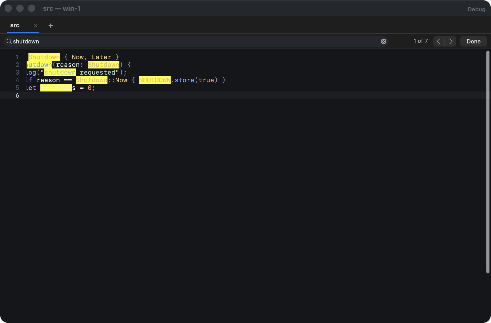
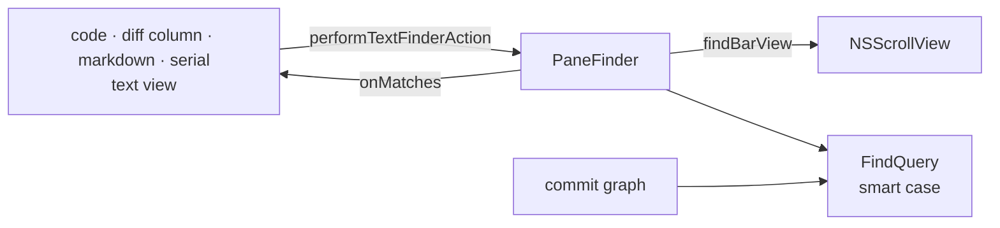

# Find bar

**Status:** built

Every pane that finds in text (code, diff, markdown, serial monitor) has the same find bar, and the commit graph uses the same rule in its own bar. Kanna draws the bar itself and matches the text itself, so a search behaves the same everywhere.

## Rules

- **Smart case:** a search with no capital ignores case; one with a capital matches case exactly. `shutdown` finds `Shutdown`, `shutdown` and `SHUTDOWN`; `Shutdown` finds only `Shutdown`.
- **Literal:** the search is the text as typed: no patterns, no whole-word option. Matches don't overlap.
- **⌘F** shows the bar above the content and selects its text; typing marks every match and scrolls to the first one at or after the selection. The bar says `3 of 26`, or `no match`.
- **↩ and ⇧↩ in the bar, ⌘G and ⇧⌘G anywhere in the pane, and the bar's arrows** select the next and previous match, wrapping round. With the bar hidden, ⌘G still steps with the last search.
- **⌘E** uses the selection as the search.
- **Esc or Done** hides the bar, clears the marks and gives the keyboard back to the text. Showing or hiding the bar doesn't move what's on screen.
- **The text changing** (a file reloaded, a zoom, serial output arriving) runs the search again without scrolling.
- **The commit graph** keeps its own bar ([commit graph](commit-graph.md)) but matches subjects by the same rule; hash prefixes match whatever the case.

## Design

- **`FindQuery`** (`KannaOverview`) is the rule: `ranges(in:)` for a text, `matches(_:)` for a yes or no.
- **`PaneFinder`** (`KannaOverview`) replaces AppKit's `NSTextFinder`: it owns the bar, puts it in the pane's scroll view as its `findBarView`, keeps the matches and the current one, and calls `onMatches` when they change. Each pane draws its matches and marks them in its [overview](overview.md); the serial monitor marks them as background colour.
- **Why not `NSTextFinder`:** it keeps its case option in its own bar's menu, ignores the find pasteboard's options once it's shown, and has no way to choose case per search, so the spec's rule can't be had from it.
- **Debug:** `debug.code` reports `find_bar` and `find_matches`; `debug.diff` reports them per column.
- **Checks:** `swift test` (`FindQueryTests`: counts for `Shutdown`, `shutdown`, `SHUTDOWN` on a fixed file, and the bar's count and stepping); e2e `code_find_case` finds `Shutdown` (3) and `shutdown` (7) in a fixed file in a code pane and closes the bar with Esc; `diff_pane` and `markdown_overview` find through the bar.
