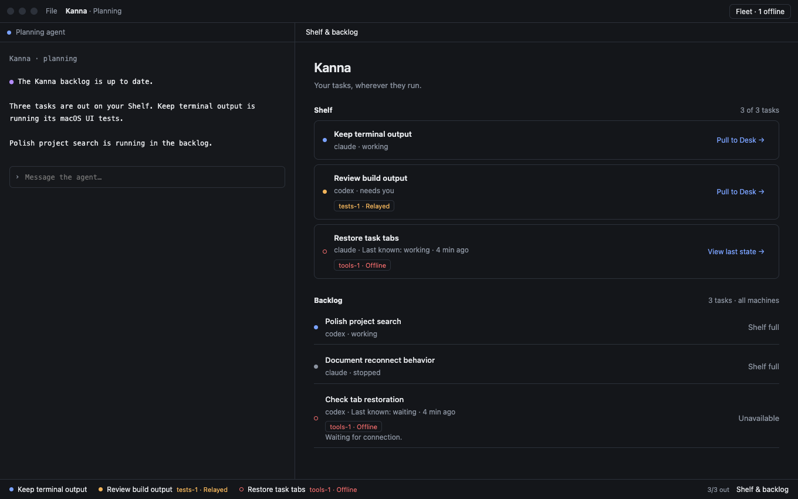
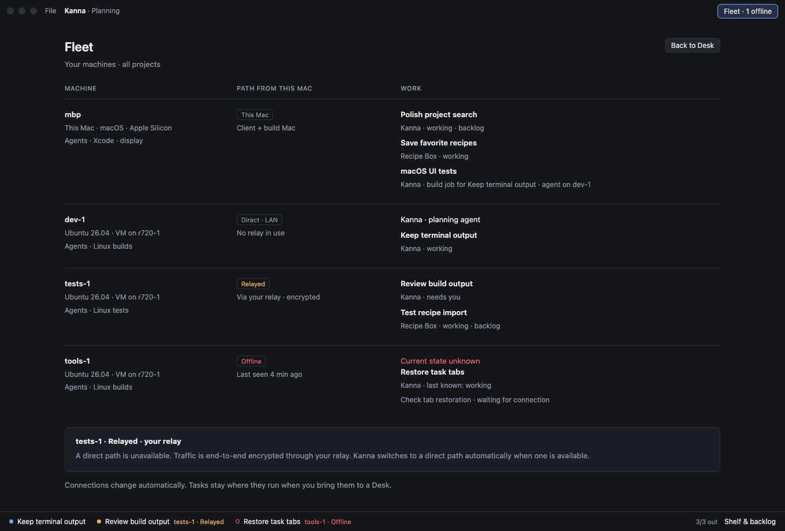
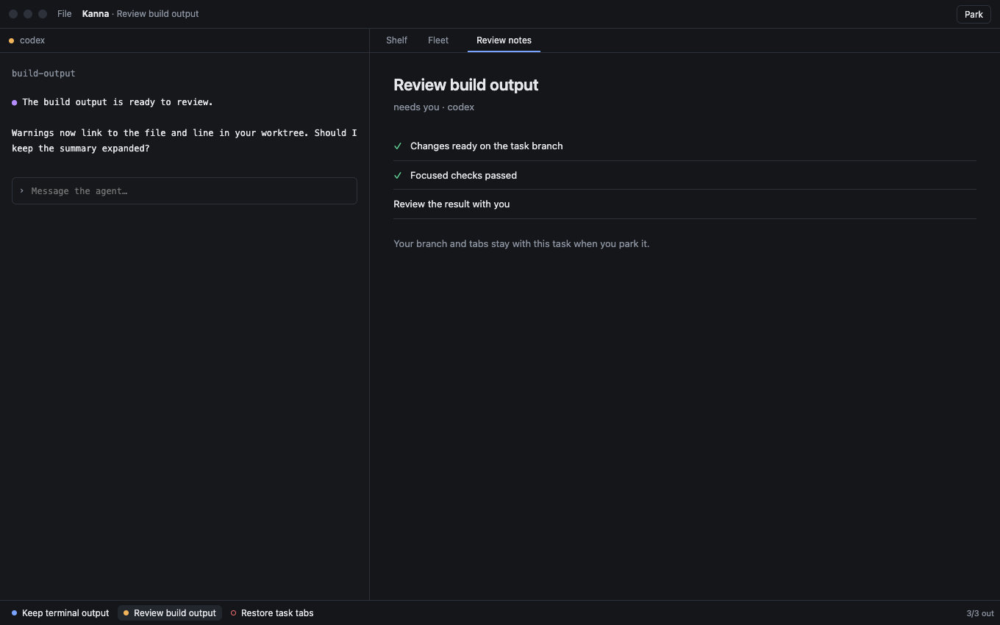
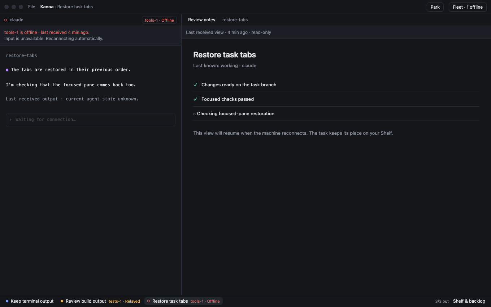

# Fleet: Desks Across Machines

**Status:** model ready for user review; product planned · **Part of:** [Fleet §6](fleet.md#6-one-app-several-machines) · **Model:** [fleet.html](../../references/mockups/fleet.html) · **Run and scope:** [README](../../references/mockups/fleet/README.md) · **Before:** Fleet 3

A Desk belongs to a project. Pulling a task changes what the app shows, while its agent and jobs keep running where they are. The model follows the existing [Desk](../../references/mockups/desk.html) style.

## 1. Project, Shelf and backlog

- **A Desk is on a project,** whichever machines its tasks run on. A project is known across machines by its remote URL or first commit ([tasks §4](fleet-tasks.md#4-repos-and-credentials)). Its planning terminal runs on a machine that has the project, placed like a task, and its backlog page lists the project's tasks from every machine. The new-Desk prompt and Open Recent show projects, not paths on a machine. Opening an already-open project brings its existing Desk forward.
- **The Shelf stays the app's:** claims in its order, three per project including the task on the Desk, keyed by (machine, task) in `app-state.json`. Pulling and parking preserve claims, order and ownership. A card shows its host machine only when that machine is relayed or offline.
- **Claim records name the device:** `claimed by: mbp` (the hello's `client`) replaces `mac` in the protocol. This is internal bookkeeping, not a label in the UI: users work on tasks without tracking the claiming device or execution machine. Runners leave claimed tasks alone, as today.
- **Toasts** held while no app was attached arrive when the app connects, so five servers' finished tasks show up when you open the lid. Toast delivery is outside this model; use the [toast reference](../../references/mockups/toasts.html) for its presentation.
- A task can use several machines: the model's **Keep terminal output** agent runs on `dev-1`, and its macOS UI test job runs on `mbp`. The Mac is this build Mac; no mini is assumed. Fleet lists the agent and job separately, without creating another task or claim.

## 2. Fleet and paths

Fleet is app-wide: each peer's path **from this Mac**, capabilities and work across projects. A host such as r720-1 is context for a VM, not an additional peer. The relay is a path, not a task-running machine.

Each row distinguishes **This Mac**, **Direct · LAN**, **Direct · internet**, **Relayed**, and **Offline**. Clicking a path opens its explanation. The task's exceptional-path badge opens Fleet with that same peer's details. Returning to the Desk preserves the selected task. Fleet offers no machine picker or manual path switch; the switches above the window are model controls only.

A relay-to-direct transition removes the task's host badge automatically. It does not move the task, replace its workspace, or create a second Desk. A direct internet path is not labeled LAN or relayed. Example paths and work in the screenshots are fixtures, not measurements or a report of deployed machines.

## 3. Relayed and offline tasks

A relayed task remains interactive. Its host and path are visible beside the agent and on its Shelf card. Connectivity is separate from the agent's working / needs-you state.

An offline machine's task remains on the Shelf. **View last state** opens its last received workspace; output and task state are explicitly stale and input is disabled. There is no implicit restart, transfer or typed-input queue. The user can still park it and work on another task. An offline owner's backlog tasks wait for that owner ([tasks §2](fleet-tasks.md#2-owners-and-grants)).

On reconnection, the same task and panes become interactive again. The claim, Shelf order and Desk selection survive. Each pane is keyed by (machine, content ID); the model deliberately gives its three claimed tasks the same daemon-local terminal ID to expose accidental cross-machine reuse.

## 4. What Fleet 3 should copy

Compare the product against these scenes and transitions, using the model's fixture names and the same viewport (1360 × 850; Fleet page 1360 × 920). The model's URL fragments make each starting scene repeatable.

| Scene / action | Expected result |
|---|---|
| Default / `#picture` | One Kanna Desk, three claims across three peers; one merged project backlog; no machine picker or claim-device labels |
| File → New Desk / Open Recent → Kanna twice | Existing project Desk comes forward; its task selection survives; no duplicate Desk |
| Open Recipe Box, then Kanna | Separate project Desks with their own Shelf and selection; names, not clone paths |
| Pull **Keep terminal output** then **Review build output** | Correct agent and tabs despite matching terminal IDs; task input cannot leak between peers |
| `#picture,fleet` | Per-peer path and work; Linux agent plus its Mac job; last-known offline work labeled |
| `#picture,relay-task`, click its path | Usable relay task; Fleet explains that peer; Back to Desk returns to that task |
| `#picture,offline-task` | Retained claim and last view; stale labels; disabled input; other tasks remain available |
| Mixed paths → All on LAN | Exceptional badges disappear; input returns; task, owner, claim count and order unchanged |
| Internet direct | Direct internet path in Fleet; no host badge on the connected task card |
| Remote offline | Remote planner and remote task input disabled; local tasks and local Fleet work remain available |

**What the model exposed:** a connection failure is not an agent stop. Reusing a plain “working” card during disconnection falsely claims fresh knowledge; clearing the card loses the app's claim. Keep the card and explicitly age its state. Similarly, a build job's machine is not necessarily the agent's machine, so Fleet must list work by role without multiplying tasks.

**Limits:** fixed fixture data and timestamps; in-memory views and text input; no real link, peer discovery, repo-identity normalization, disk persistence, background work, transfer, pairing or toast queue. The model switches between project windows inside one HTML page. Fleet 3 must prove those real boundaries separately; this model establishes the presentation and state transitions, not network performance.
