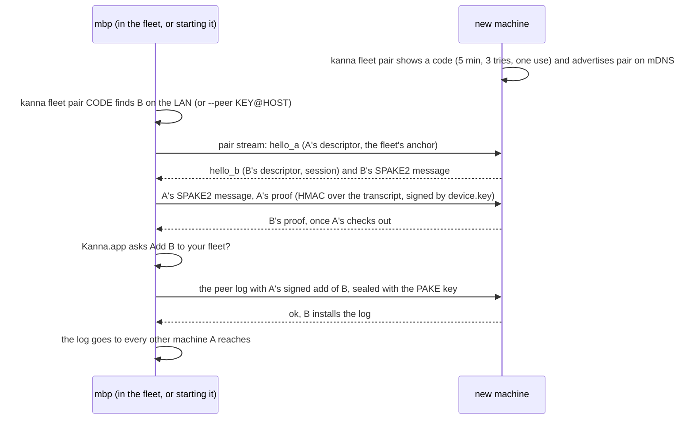

# Fleet: Identity and Pairing

**Status:** built in slice 2 (`crates/kanna-net`, the daemon's `fleet` command), except the app's own endpoint key (slice 3) · **Part of:** [fleet](fleet.md) · **Cloud:** [enrollment by token](kanna-cloud.md#4-enrollment-by-token), [hosted peers](kanna-cloud.md#8-threat-model) · **Model:** [fleet-pairing](../../references/prototypes/fleet-pairing/README.md)

How one of your machines knows another is yours, with no account and no server. The rule, here and in [Kanna Cloud](kanna-cloud.md): **trust comes from your devices, never from a server.**

## Contents

1. [Keys](#1-keys)
2. [Pairing](#2-pairing)
3. [The peer log](#3-the-peer-log)
4. [Risks](#4-risks)
5. [Interfaces](#5-interfaces)

## 1. Keys

| Key | Held by | Is |
|---|---|---|
| `device.key` (Ed25519 in hex, `0600`, in the instance's state folder, [instances](instances.md); made on first start) | the daemon | the device's signing key and the daemon's iroh endpoint ID |
| the app's endpoint key | Kanna.app, made at first launch | its own iroh endpoint, with a **certificate** from `device.key`: `{key, device, sig}` |

- **Why two:** an iroh endpoint *is* its key, so the daemon and the app can't share one. The relay would register only the latest, and the daemon would drop off while the app is open.
- **A remote daemon accepts** an endpoint whose certificate chains to a device in its peer log. The certificate is in the app's hello.
- **The CLI has no endpoint:** `kanna --host NAME` asks the local daemon to dial NAME and forwards the command, so a short-lived process never registers with a relay.

## 2. Pairing

A **PAKE** over a one-time code authenticates both keys directly between the two devices. You are the only party: no server takes part. (Kanna Cloud reuses it with a token instead of a typed code: [enrollment](kanna-cloud.md#4-enrollment-by-token).)

The exchange copies the [model](../../references/prototypes/fleet-pairing/README.md): SPAKE2 (the `spake2` crate's Ed25519 group) with both hellos as its identities, then explicit confirmation both ways, each an HMAC under a key derived with HKDF from the shared secret plus a device-key signature over the whole transcript. iroh's handshake already proves each side's endpoint key; each side also checks that the hello's key is the one it is connected to. The add is signed only after both proofs and the gesture, and only if the log would accept it, so an `identity_mismatch` is caught before the app asks.

- **Who starts the fleet:** a machine with no peer log that pairs another becomes the fleet's anchor: its descriptor is the log's root, and the fleet ID is that descriptor's hash. The new machine must have no log (`already_paired`); it learns the anchor only from the sealed handoff.
- **One session takes the code:** the first exchange that proves the code uses it up; any other session still running is refused (`code_used`). The inviter keeps the add before it hands the log over, so if the newcomer never gets it, the newcomer is still unpaired and pairs again with a new code (same name, same key: no conflict).
- **Every machine on the LAN is tried:** a candidate that refuses before the code is proven (unreachable, wrong code, no offer, expired, used up) doesn't stop the search.
- **The gesture:** the daemon asks Kanna.app (`app.fleet.confirm`), which shows a sheet naming the machine, its key and addresses; it waits two minutes. With no app attached the add is refused (`gesture_required`): a headless server joins a fleet, it never adds to one.
- **Finding the newcomer:** while a code is open, the daemon advertises `pair` in its mDNS record (service `kanna`); `kanna fleet pair CODE` tries each machine on the LAN that advertises it. From another network, `--peer KEY@HOST[:PORT]` names it; `kanna fleet pair` prints that line with each of its addresses. iroh's mDNS listens only on a machine's default interface, so a machine whose LAN isn't its default route (a VM with a second NIC) is paired with `--peer`.
- **macOS Local Network privacy:** macOS refuses LAN traffic (`EHOSTUNREACH`) and Bonjour to a process whose app hasn't been allowed on the local network. The daemon is Kanna.app's helper, so Kanna.app declares `NSLocalNetworkUsageDescription` and `NSBonjourServices` (`_kanna._udp`), and macOS asks once. A daemon started from elsewhere (a terminal, a test) gets its terminal's permission; loopback is never refused.
- **Not trust on first use:** v2's enrollment trusted whatever key it was first handed, so its introducer could put its own key in once. Here both sides prove the code.
- **Signing a peer takes a gesture in the app,** never a command alone (§4).

## 3. The peer log

The peers are a **signed log**, not a record that replicates by last writer wins. It is replicated to every peer.

| Entry | Valid when |
|---|---|
| `add {name, key, capabilities, relay, addrs}` | signed by a device trusted at that point in the log |
| `revoke {key}` | signed by any trusted device; it beats any later `add` of that key |

- **An add counts only through a chain of adds from the anchor,** and an add signed by a key that is later revoked counts only if the revocation saw it (it is among the revocation's ancestors). So a stolen key that pretends it never saw its revocation can't admit a new key on that stale branch, and a key it admitted there can't admit another. Revocations always count, so two devices revoking each other both end up revoked.
- **A revoked key can never re-add itself,** or be re-added under another name; a new key has to be paired.
- **A name that comes back with another key** is refused (`identity_mismatch`, as in v2).
- **Two devices revoking each other** (a stolen laptop forging timestamps) both end up revoked. You re-pair from a third device, or from the one you still hold, with a code.
- **Addresses:** an entry carries the peer's relay URL and last-known addresses. `kanna fleet addr NAME HOST` adds one by hand, so a user with a VPN reaches a machine from away for free.
- **Stored** in `kanna.db`'s `fleet` table, one JSON document: the machine's name, its UDP port, the anchor, every entry, and the addresses given by hand. The daemon checks every entry's signature on load and on sync; if the saved log doesn't verify, the fleet is off on that machine (`broken`) and the document is left as it was.
- **Sync:** each new connection between two machines swaps logs first (`fleet.sync` on a control stream), whatever it was opened for (a command, a ping). A sync that fails is reported, so `revoke` lists only the machines that took it. A pairing or a revocation is sent at once to every trusted machine that answers; one that's offline hears it when it next connects to any of them.
- **Admission:** a stream from a key the log doesn't trust is refused before anything runs: `unpaired`, or `revoked`. It is checked again before every request on a control stream, so a revocation also ends streams already open. A machine won't dial a key it has revoked itself.
- **Revoking needs no gesture:** a revocation only shuts a machine out. A prompt-injected agent could revoke peers, which re-pairing undoes, but never add one.
- **Hand-given addresses aren't signed:** `kanna fleet addr` keeps its addresses on that machine alone. An address only says where to try; the key proves who answers.

## 4. Risks

- **An agent can read `device.key`:** every machine runs its agents as the daemon's user. A prompt-injected agent could sign a peer into the fleet. Every machine in a self-hosted fleet is yours, so that's the same trust the user already gives the agent, but two defences are cheap: signing needs a gesture in the app (§2), and agent setup adds the state folder's keys to each agent's sandbox deny list.
- **A machine that runs your agent sees your code.** End-to-end encryption protects what passes through a relay, not what runs on a host.
- **A stolen key can still revoke on a stale branch:** those revocations stand (they must, for mutual revocation), so a thief can shut honest machines out until they re-pair. It can't let anything in.
- **On machines someone else runs,** the operator can sign with `device.key` too: that's Kanna Cloud's threat model ([Cloud §8](kanna-cloud.md#8-threat-model)).

## 5. Interfaces

| CLI | Does |
|---|---|
| `kanna fleet [status]` | this machine's name, key and UDP port; each machine in the fleet with its path (`direct`, `relay`, or not connected), revoked or conflicting; machines on the LAN waiting to pair |
| `kanna fleet pair` | on a new machine: shows a code, then waits until a machine in the fleet adds it (or the code expires) |
| `kanna fleet pair CODE [--peer KEY[@HOST[:PORT]]]` | on a machine in the fleet, or the one that starts it: adds the machine showing CODE, after Kanna.app confirms |
| `kanna fleet name NAME` | names this machine before it's paired (default: its host name's first label) |
| `kanna fleet ping MACHINE` | connects, opens one stream of each kind, and reports the path and round trip |
| `kanna fleet addr MACHINE HOST[:PORT]` | another address to try for a machine (port 7470 if none) |
| `kanna fleet revoke MACHINE` | revokes a machine for good and tells the others |
| `kanna --host MACHINE COMMAND …` (or `KANNA_HOST`) | runs COMMAND on that machine: its name, or its key |

A MACHINE is a name in the log or a 64-digit key. The daemon's `fleet` command takes the same actions (`status`, `name`, `offer`, `wait`, `pair`, `ping`, `sync`, `addr`, `revoke`, `call`); `call {host, cmd, args}` is what `--host` sends, and its reply is the remote daemon's reply. Error codes: `unpaired`, `revoked`, `identity_mismatch`, `unreachable`, `not_found`, `gesture_required`, `pake_confirmation_failed`, `code_expired`, `rate_limited`, `already_paired`, `broken`.

**Port:** the endpoint binds the UDP port it used last (kept in the `fleet` document), else 7470, else any free port. `KANNA_FLEET_PORT` overrides it, and `KANNA_FLEET_MDNS=0` turns LAN discovery off; tests set both, so test daemons never advertise on the LAN.

**Tested** (October 2026): `crates/kanna-net` ports the model's scenarios (log and pairing) and pairs real endpoints on loopback, refusing an unpaired and a revoked key on every stream kind; `crates/kanna/tests/fleet.rs` pairs two daemons through the CLI with a stand-in app confirming, runs `kanna --host` commands, and is refused when unpaired or revoked. Between this Mac and an Ubuntu 26.04 lima VM (vzNAT, `scripts/server-setup.sh`): `kanna fleet pair CODE --peer …` from the Mac, `kanna --host vm task list` matching the VM's own list (also after `systemctl --user restart kanna-daemon` there), `kanna fleet ping vm` direct with all six stream kinds, and an unpaired Mac daemon refused (`unpaired`). The Mac reached the VM through lima's loopback forward of UDP 7470, since the test daemon had no Local Network permission (above); `fleet ping` then moved to the direct path. Kanna.app's confirmation sheet was built, not clicked: the tests answer `app.fleet.confirm` themselves.
