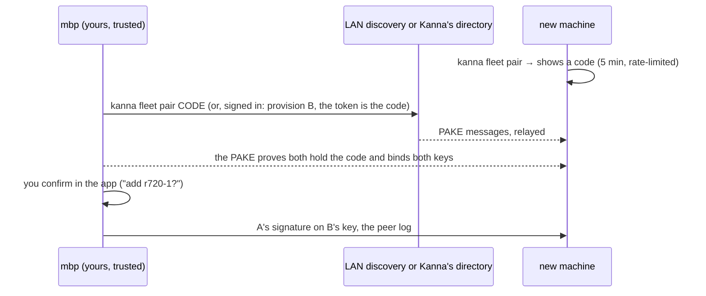

# Fleet: Identity and Pairing

**Status:** planned · **Part of:** [fleet](fleet.md)

How one of your machines knows another is yours, with no account (free, on the LAN) and with one (Cloud). The rule in both cases: **trust comes from your devices, never from a server.** Kanna's directory can withhold entries but can't forge one.

## Contents

1. [Keys](#1-keys)
2. [Pairing](#2-pairing)
3. [The peer log](#3-the-peer-log)
4. [Risks](#4-risks)

## 1. Keys

| Key | Held by | Is |
|---|---|---|
| `device.key` (Ed25519, `0600`, in the instance's state folder, [instances](instances.md)) | the daemon | the device's signing key and the daemon's iroh endpoint ID |
| the app's endpoint key | Kanna.app, made at first launch | its own iroh endpoint, with a **certificate** from `device.key`: `{key, device, sig}` |

- **Why two:** an iroh endpoint *is* its key, so the daemon and the app can't share one. The relay would register only the latest, and the daemon would drop off while the app is open.
- **A remote daemon accepts** an endpoint whose certificate chains to a device in its peer log. The certificate is in the app's hello.
- **The CLI has no endpoint:** `kanna --host NAME` asks the local daemon to dial NAME and forwards the command, so a short-lived process never registers with a relay.

## 2. Pairing

One mechanism serves both tiers: a **PAKE** over a one-time code authenticates both keys directly between the two devices. In Cloud, the directory only carries the PAKE's messages.

- **Local (free):** B announces "pairing open" on the LAN, and A finds it with iroh's local discovery.
- **Cloud:** you provision B from the signed-in app. The token Kanna puts in B's setup is the code, so you type nothing. The directory relays the PAKE and never sees the code, so it can't put its own key in B's place. v2's enrollment trusted whatever key it was first handed (trust on first use), so its introducer could do that once.
- **Signing a peer takes a gesture in the app,** never a command alone (§4).
- **Upgrading from Local to Cloud** publishes the log you already have; nothing is paired again.

## 3. The peer log

The peers are a **signed log**, not a record that replicates by last writer wins. It is replicated to every peer and to the directory in Cloud.

| Entry | Valid when |
|---|---|
| `add {name, key, capabilities, relay, addrs}` | signed by a device trusted at that point in the log |
| `revoke {key}` | signed by any trusted device; it beats any later `add` of that key |

- **A revoked key can never re-add itself,** or be re-added under another name; a new key has to be paired.
- **A name that comes back with another key** is refused (`identity_mismatch`, as in v2).
- **Two devices revoking each other** (a stolen laptop forging timestamps) both end up revoked. You re-pair from a third device, or from the one you still hold, with a code.
- **Addresses:** an entry carries the peer's relay URL and last-known addresses. `kanna fleet addr NAME HOST` adds one by hand, so a user with a VPN reaches a machine from away for free.
- **Stored** in `kanna.db`; the daemon checks every entry's signature on load and on sync.

## 4. Risks

- **An agent can read `device.key`:** every machine runs its agents as the daemon's user. A prompt-injected agent could sign a peer into the fleet. For a single tenant that's the same trust the user already gives the agent, but two defences are cheap: signing needs a gesture in the app (§2), and agent setup adds the state folder's keys to each agent's sandbox deny list.
- **A machine that runs your agent sees your code,** whoever operates it. End-to-end encryption protects what passes through relays and the directory, not what runs on a host.
- **Kanna-run machines hold several tenants:** VMs that each belong to one user on Linux, and a macOS user per tenant on build Macs ([build Macs](build-macs.md#1-rules)). The peer log is per user, and one user's devices never see another's.
