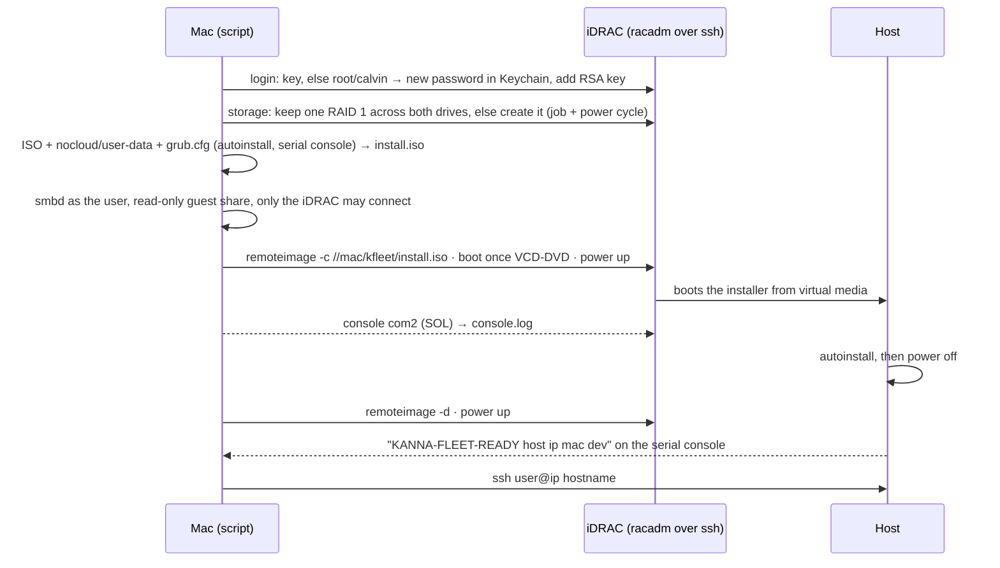

# Fleet provisioning

**Part of:** [Kanna Cloud §3](kanna-cloud.md#3-provisioning)

`scripts/fleet/provision-idrac.sh` takes a Dell PowerEdge (Kanna Cloud's R720s) from powered off to Ubuntu Server you can ssh into, through its iDRAC alone: no monitor, no USB stick, no PXE server. It runs on the operator's Mac. Making users' VMs on the host is the next step ([Cloud §3](kanna-cloud.md#3-provisioning)).

```sh
scripts/fleet/provision-idrac.sh --idrac 172.16.0.2 --hostname r720-1 --wifi-ssid SSID
```

## Contents

1. [What it does](#what-it-does)
2. [What you do by hand](#what-you-do-by-hand)
3. [Credentials](#credentials)
4. [Choices and why](#choices-and-why)
5. [The first server](#the-first-server)

## What it does



| Step | Skipped when |
|---|---|
| iDRAC password and key | key login already works |
| RAID 1 | the controller has one RAID 1 volume, Online |
| Install | the host recorded in `~/Library/Application Support/kanna-fleet/NAME.env` answers ssh as NAME (`--reinstall` forces it) |

- **Install:** Ubuntu Server 26.04.1, minimized, OpenSSH, offline from the ISO (`apt: fallback: offline-install`), the whole volume (`layout: direct`), the user with your key, no password, passwordless sudo, `ssh_pwauth: false`. The kernel console is `tty0` and `ttyS0` (the iDRAC's SOL port) in the installer and on the host.
- **Network (netplan):** every `en*` port and the first `wl*` device with DHCP and the MAC as DHCP client ID; Ethernet at route metric 100 beats Wi-Fi at 600, so it takes over when a cable is plugged in. Both optional, so boot never waits on them. networkd can't match Wi-Fi by pattern, only by name, and a USB dongle's name is `wlx` + its MAC, so the config carries `@WIFI_IFACE@` and an early command in the installer replaces it in `/autoinstall.yaml` with the `wl*` device it finds, before the network is applied.
- **Finding the host:** a oneshot unit, `kanna-fleet-report`, prints the default route's address and MAC to `ttyS0` at every boot, or `KANNA-FLEET-NONET` with `ip -br link` and `lsusb` when there is no network. The script reads it from the serial console it records in `~/Library/Caches/kanna-fleet/NAME/console.log`.
- **Cleanup on exit, success or not:** stops smbd and the console, detaches the virtual media, deletes `install.iso` (it holds the Wi-Fi password) and masks the password in `console.log`.
- **Erasing:** it asks you to type the hostname before powering off or erasing, unless `--yes`. `--check` only prints the iDRAC, storage and power state.

## What you do by hand

| When | What |
|---|---|
| Once per Mac | `brew install samba xorriso`; turn off macOS File Sharing while it runs (it needs port 445) |
| Once per Wi-Fi | `security add-generic-password -s "kanna-fleet wifi" -a SSID -w` (prompts for the password) |
| Per server | cable the iDRAC's port, find its address (the router's lease list, or the LCD); back up the Keychain item `kanna-fleet idrac NAME` |
| After | reserve the reported MAC in the router's DHCP; add `Host NAME` / `HostName IP` to `~/.ssh/config` (nothing on the LAN resolves the name); plug Ethernet into port 1 when there is one |

## Credentials

| Secret | Where |
|---|---|
| iDRAC root password | Keychain, service `kanna-fleet idrac NAME`, account `root`: 20 random letters and digits (iDRAC 7's limit) |
| iDRAC ssh key | `~/.ssh/kanna-fleet-idrac`: RSA 4096, no passphrase; iDRAC 7 rejects ed25519 |
| Host login | your `~/.ssh/id_ed25519.pub` (`--pubkey`) |
| Wi-Fi password | Keychain (`kanna-fleet wifi`, account SSID) and the host's `/etc/netplan`; never the repo |

## Choices and why

- **racadm over ssh, not Redfish:** iDRAC 7 2.61's Redfish has no `VirtualMedia.InsertMedia` and needs the password on every call; racadm does storage, boot, power and virtual media with the key alone. One racadm command per ssh call: the iDRAC shell rejects `;`.
- **SMB, not NFS:** both need a server on the Mac. macOS's own nfsd and File Sharing need root and a Mac account; Homebrew's Samba runs as you on port 445 (macOS lets any user bind a privileged port on the wildcard address, not on one address). Impacket's smbserver was tried: the iDRAC's SMB2 client closes the connection after negotiating.
- **One ISO, not ISO + seed disk:** the iDRAC mounts one remote image. `xorriso … -boot_image any replay` adds `/nocloud` and a new `grub.cfg` and keeps both boot records (BIOS and UEFI), in seconds.
- **The serial console, not mDNS or an ARP scan:** the host's address on Wi-Fi is the router's choice; the console needs no network and also shows why the install stopped.
- **`shutdown: poweroff`:** the script sees the install finish as power off, and detaches the media before the first boot from disk.

## The first server

`r720-1`: iDRAC 7 2.61.60.60 at 172.16.0.2 on its dedicated port, BIOS 2.7.0 (BIOS boot mode), 2 × Xeon E5-2690, 238 GiB, PERC H710 Mini with two 1.2 TB SAS drives in RAID 1 (the volume was already there and kept). No host Ethernet yet; Wi-Fi through a USB dongle: a Realtek RTL8811CU (USB `0bda:c811`, 802.11ac), driven by the kernel's own `rtw88_8821cu`, interface `wlxe0d768301a7a`. LOM port 1's MAC is D4:AE:52:A1:4C:B2.

Installed 2026-10-21: Ubuntu 26.04.1, kernel 7.0.0-30, at 172.16.0.105 over Wi-Fi, MAC e0:d7:68:30:1a:7a (the one to reserve). The run took 22 minutes: 7 for POST and the installer's boot, 15 for the install, 5 for the first boot to report.

When an install stops, the serial console offers a root shell ("An error occurred. Press enter to start a shell"): reach it with `ssh -t -i ~/.ssh/kanna-fleet-idrac root@IDRAC console com2` (end with `Ctrl-\`) once the script has stopped.
