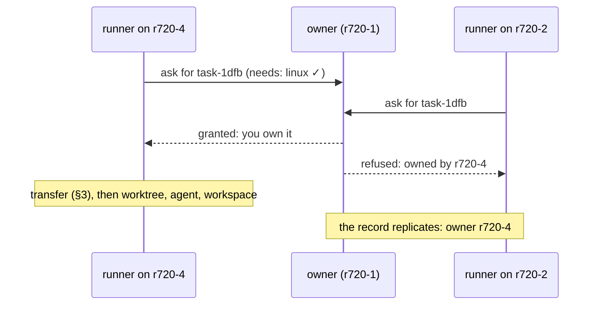
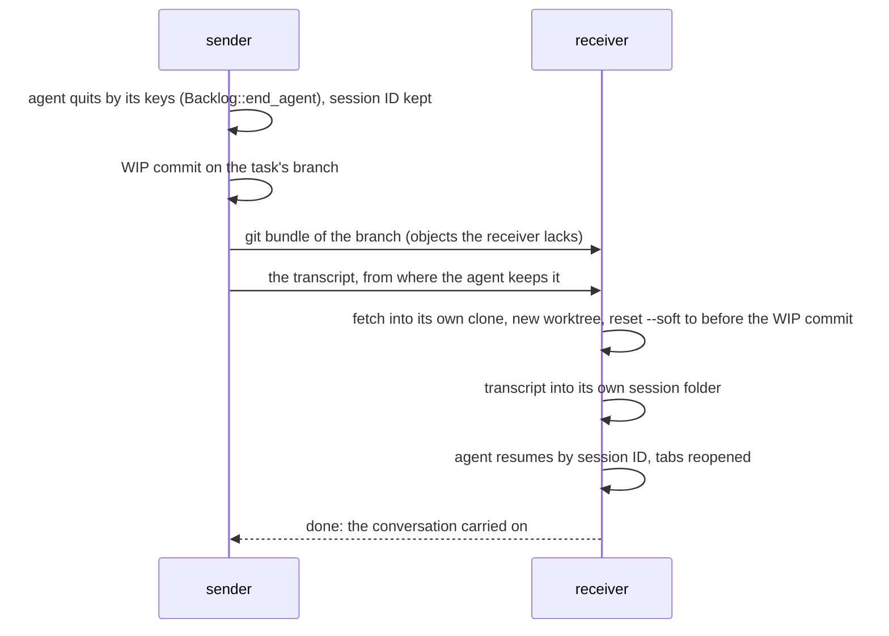

# Fleet: Tasks Across Machines

**Status:** planned · **Part of:** [fleet](fleet.md) · **Builds on:** [backlog runners](backlog-runners.md), [tasks](tasks.md), [each app's Desk and Shelf](app-desk.md)

Where a task runs when you have several machines: one backlog replicated to all of them, exactly one machine allowed to start each task, and tasks moving between any two daemons at a boundary. All of it works on the LAN with no account; Cloud adds an always-on copy.

## Contents

1. [The replicated backlog](#1-the-replicated-backlog)
2. [Owners and grants](#2-owners-and-grants)
3. [Transfer](#3-transfer)
4. [Repos and credentials](#4-repos-and-credentials)

## 1. The replicated backlog

Every one of your daemons holds every task's record, synced peer to peer over iroh, LAN first. In Cloud, the service keeps one more copy, encrypted with your keys, so a task you add on a closed laptop still reaches the servers.

| Part | Consistency |
|---|---|
| A task's record: name, first message, agent, `after`, `needs`, state, owner | eventual: last writer wins per field, ordered by a hybrid logical clock ("oldest first") |
| Who runs it: the **owner** | one machine; changes only by a grant from the owner (§2) |

Slice 10 picks the store (iroh-docs, Automerge or Loro) and says why.

## 2. Owners and grants

- **A task starts on its owner,** at first the machine where it was made.
- **Asking:** a runner with free slots and the right capabilities (`needs: xcode`) asks the owner for the oldest task waiting. The owner grants it to exactly one runner, and that runner becomes the owner.
- **Two meanings, two words:** "ask" and "grant" are between machines. A **claim** stays what it is in [app-desk](app-desk.md): an app having a task out on its Shelf, now named by its device (`claimed by: mbp`).
- **An offline owner's tasks wait.** Leases that expire would allow a double start, so add them only if waiting hurts.
- **Task IDs** stay random 32 bits ([task IDs](task-ids.md)). Apps key views by (machine, ID), and an ID that collides with one in the replica is refused when the task is made.

## 3. Transfer

A task moves between any two daemons, Macs included, at a boundary: not started, or stopped at a turn's end.

- **No push needed:** the branch travels as a git bundle over the link, so repos without a remote work too, and WIP commits never reach origin.
- **The dirty tree comes back:** `reset --soft` leaves the agent's uncommitted work as it left it, staged.
- **Any path:** the receiver uses its own clone and worktree paths. Agents resume by session ID from any path: checked 2026-10-21 with Claude Code 2.1.305 and Codex 0.163, and v2 relied on it.
- **Durable:** each step is recorded on both ends and resumes after either side restarts. The sender keeps the task until the receiver says done.
- **v2's lessons:** copy the transcript from where the agent really keeps it (v2 copied a lock file and lost the transcript without noticing), never move a running agent, and test that the conversation carries on, not only that the transfer "completed".

## 4. Repos and credentials

- **Clones** live wherever a machine likes (`~/repos/<name>` on servers). A repo is identified across machines by its remote URL, or, for one with no remote, by the ID of its first commit.
- **Git credentials** are per machine: a deploy key or `gh auth login` with a fine-grained token on each VM. Your personal key never leaves the Mac.
- **Agent logins** are set up when a machine enrolls ([fleet §9](fleet.md#9-server-setup-and-updates)).
