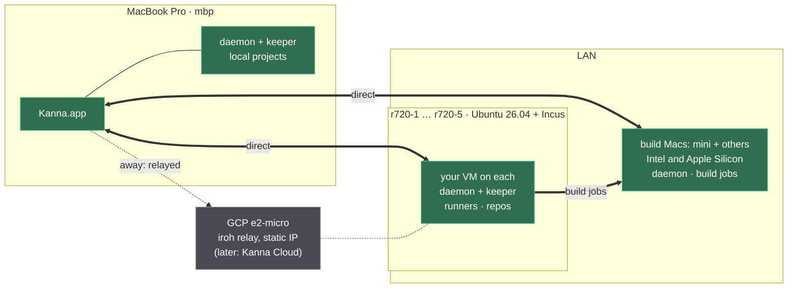

# Fleet: Kanna Across Machines

**Status:** planned · **Parts:** [identity and pairing](fleet-identity.md), [tasks across machines](fleet-tasks.md), [build Macs](build-macs.md), [provisioning a server](fleet-provisioning.md), [agent sign-in](agent-sign-in.md) · **Builds on:** [architecture](architecture.md), [app link](app-link.md), [each app's Desk and Shelf](app-desk.md), [backlog runners](backlog-runners.md) · **Research:** [fleet](../research/fleet.md), [scenarios](../research/multi-machine-and-people.md), [xcodebuild shim](../research/xcodebuild-shim.md)

One person's Kanna runs on several machines: a MacBook Pro as the client, Linux servers that run tasks, Macs that build, and a relay for when the LAN isn't there. The same software later becomes **Kanna Cloud**, a cheap private cloud rented to users, who bring their own machines, rent Kanna's, or both. Kanna develops any project, not only Kanna.

The first milestone is the user as the only tenant on their own machines, built with the network and enrollment code a customer would use. Accounts, other tenants and billing come after it.

## Contents

1. [Rules](#1-rules)
2. [Machines and roles](#2-machines-and-roles)
3. [Reach: LAN first, relay second](#3-reach-lan-first-relay-second)
4. [Identity and pairing](#4-identity-and-pairing)
5. [The app link over the network](#5-the-app-link-over-the-network)
6. [One app, several machines](#6-one-app-several-machines)
7. [Terminals and panes](#7-terminals-and-panes)
8. [Where tasks run](#8-where-tasks-run)
9. [Server setup and updates](#9-server-setup-and-updates)
10. [Build order](#10-build-order)
11. [Rejected](#11-rejected)
12. [Glossary](#12-glossary)

## 1. Rules

- **You work on projects, not machines.** Kanna decides where a task's work runs (§2), and one task can use several machines at once. The app shows a machine only where it matters: a slow path, an offline machine, the fleet page.
- **LAN first.** Machines connect directly whenever they can. A relay is only for when you're away or the LAN fails, and the app shows which path each machine is on.
- **Free unless it needs infrastructure.** Whatever works on the LAN with no server of Kanna's is free, as long as being free doesn't make it worse. A MacBook and a mini pair with no account and get everything except reach from away. Trust never depends on an account.
- **Cloud is cheap, about $5 a month,** and covers only what needs Kanna's servers: reach from away, mobile access away from the LAN, push notifications, the always-on backlog copy, automatic enrollment.
- **End to end.** Relays and Kanna's own service carry only ciphertext and can't add a device. A machine that runs your agent sees your code, whoever operates it.
- **Every daemon can send and receive tasks**, Macs included, at a boundary: not started, or stopped at a turn's end.
- **Versions are compatible, not identical.** Daemons and apps of different releases work together over a range of protocol versions, so machines update on their own schedule.
- **Bring your own key.** Agents run on each user's own Claude or Codex subscription or API key, signed in on each machine with as little typing as the agent allows ([agent sign-in](agent-sign-in.md)).

## 2. Machines and roles

Every machine runs the same daemon and keeper. They differ in what each is for, advertised as **capabilities**: OS, architecture, cores, RAM, Xcode versions, simulators, display.



| Machine | Role | Peer |
|---|---|---|
| `mbp` | the client; still a Kanna machine for local projects | yes |
| R720 hosts | run one VM per user (Incus) | no: each user's VM is the peer |
| build Macs | `xcodebuild` and Simulator jobs for Linux tasks; Mac tasks too | yes ([build Macs](build-macs.md)) |
| GCP e2-micro | an iroh relay at a stable IP; later Kanna Cloud's directory | no |

**Placement: where work goes.**

- **Each project has a home machine,** where its backlog is worked and its planning agent runs. Kanna picks one when the project is added (an always-on machine with the project's capabilities: a user's VM, or the mini for someone with only a MacBook and a mini), and the fleet page can change it. A project with no other machine is at home on the MBP, as today.
- **Other machines help** when they have free slots and the capabilities a task `needs:` ([tasks §2](fleet-tasks.md#2-owners-and-grants)).
- **Steps go where they can run.** A step that needs another machine's capability goes there as a **job**: `xcodebuild` through the shim, an e2e suite with `kanna build -- scripts/e2e.sh` on a Mac with a display, while Linux VMs do the agent work ([build Macs](build-macs.md)).
- **Taking a task to the Desk doesn't move it.** It stays where it runs and is shown over the link. To try a Mac or iOS app it built, the `.app` is fetched to the MBP ([build Macs §5](build-macs.md#5-ios-for-remote-tasks)).

## 3. Reach: LAN first, relay second

Networking is built into the daemon with **[iroh](https://github.com/n0-computer/iroh)** (Rust). An iroh endpoint *is* an Ed25519 key: you dial a key, not an address.

1. **On the LAN:** machines find each other with iroh's local discovery and connect directly at wire speed.
2. **Away, with a relay:** a relay is iroh's meeting point for hole punching. iroh connects directly through NAT when it can, and otherwise sends the traffic through the relay, which forwards QUIC it can't read.
3. **Away, with an address:** `kanna fleet addr NAME HOST` dials a peer at an address you give it, such as one on a VPN you already have. That's free, with no relay ([identity §3](fleet-identity.md#3-the-peer-log)).

**Local turns off iroh's defaults,** which use n0's public relays and DNS discovery. Kanna then depends on no third party's terms, and reach from away is either your own relay, your own address, or Cloud.

| | **Local** (free, no account) | **Cloud** (about $5 a month) |
|---|---|---|
| Discovery | LAN | Kanna's directory, anywhere |
| Away from the LAN | your own `iroh-relay` (the user's GCP e2-micro runs one) or an address you give (a VPN) | Kanna's relays |
| Pairing | a one-time code per new machine | automatic once you're signed in |
| Phone (after the first milestone) | on the LAN | anywhere, with push notifications |
| Backlog | replicated among your machines | plus an always-on encrypted copy |
| Remote Desks, terminals, panes, port tunnels, transfer, build Macs | all of it | the same, from away too |

**Most traffic never touches Kanna's servers:** iroh connects directly whenever it can, and moves a connection to a direct path by itself as soon as one exists, so using the LAN takes no action from the user.

Each machine's row in the app shows its path (direct on the LAN, direct over the internet, or relayed), so LAN-first can be seen, not just assumed.

## 4. Identity and pairing

In short ([detail](fleet-identity.md)):

- **The daemon has `device.key`**, an Ed25519 key that is its iroh endpoint and signs for the device. The app has its own endpoint key, certified by `device.key`. The CLI goes through the local daemon.
- **Pairing** is a PAKE over a one-time code, run directly between the two devices. On the LAN you type the code. In Cloud, provisioning puts the token in the new machine's setup, and the directory only relays the exchange, so it can't put its own key in.
- **The peers form a signed log**, replicated to every peer. A revocation beats any later add, and a name that comes back with another key is refused. Signing a peer takes a gesture in the app.

## 5. The app link over the network

A remote link is an iroh connection to the daemon's endpoint. Its first stream carries the [app link](app-link.md)'s JSON lines unchanged: snapshot, output, input, resize, layout, diffs, toasts, `debug.*`. Bulk transfers get **streams of their own** on the same connection (`file.read`, screenshot bytes, port tunnels, worktree syncs, transfers), so a keystroke never waits behind 20 MB.


| | Local daemon | Remote daemon |
|---|---|---|
| Transport | unix socket | iroh, through `kanna-net` in `kanna-ffi` for the app |
| Version check | binary hash; another build is replaced ([daemon build](daemon-build.md)) | the highest protocol both support; `other_protocol` only when there is none |
| Who starts it | the app; on a Mac that serves the fleet, launchd | systemd (Linux), launchd (Macs) |
| Apps | one (`app_attached`) | one; lifting the limit is its own slice, needed before the phone |

- **One link per machine.** Every view is keyed by (machine, content ID), since `term-41` exists on every daemon.
- **The CLI:** `kanna --host NAME` (or `KANNA_HOST`) sends any command to that machine: the local daemon dials it and forwards the command. Inside a remote terminal nothing changes: the CLI there uses its own unix socket.
- **A Mac that serves the fleet** (a build Mac, or a Mac whose tasks you reach from elsewhere) runs its daemon from launchd (`kanna fleet serve`), pointed at the installed app's `Contents/Helpers/kanna-daemon`: a LaunchAgent on a Mac you use, and on a build Mac a LaunchDaemon running as its service user ([build Macs §1](build-macs.md#1-rules)). The app's replace rule still holds: on `other_build` the daemon exits, and launchd starts it again from the updated bundle.
- **Streams:** one ALPN, `kanna/1`. Each stream opens with a header line naming its kind (`control`, `file`, `port`, `sync`, `job`, `transfer`), and its bytes follow.

## 6. One app, several machines

- **A Desk is on a project,** whichever machines its tasks run on. A project is known across machines by its remote URL or first commit ([tasks §4](fleet-tasks.md#4-repos-and-credentials)). Its planning terminal runs on the project's home machine, and its backlog page lists the project's tasks from every machine. The new-Desk prompt and Open Recent show projects, not paths on a machine.
- **The Shelf stays the app's:** claims in its order, three per project, keyed by (machine, task) in `app-state.json`. A card shows its machine only when that machine is relayed or offline.
- **Claims name the device:** `claimed by: mbp` (the hello's `client`) replaces `mac`. Runners leave claimed tasks alone, as today.
- **Toasts** held while no app was attached arrive when the app connects, so five servers' finished tasks show up when you open the lid.
- **What it looks like** (the fleet page with each machine's path and the projects at home there, a card on a relayed machine) is drawn in slice 3's mockup, `references/mockups/fleet.html`.

## 7. Terminals and panes

**Terminals keep the byte stream** of snapshot plus output. v2's lag came from its units, not the stream: whole scrollbacks re-sent on every reconnect, base64 through one Node loop, and a resize loop in the viewer ([research §2.5](../research/fleet.md#25-terminal-latency)).

- **Bounded snapshots:** `attach {scrollback: N}` sends the screen and a page; older scrollback comes on demand.
- **Reconnect by offset:** `output` carries a running byte offset, and `attach {from}` replays only the gap.
- **The 16 / 64 MiB limits stay**, and resizing stays the daemon's.
- **Local echo** (mosh-style prediction) is decided after slice 8 measures echo delay through the relay.

| Content | Remote task |
|---|---|
| Terminal, diff | over the link already |
| Markdown, code | through the daemon (task e044); images and relative links with `file.read` |
| Doc markup threads | `markup.*` through the daemon |
| `kanna screenshot` | bytes come back over a stream; the daemon writes the file where the agent asked |
| Web | **port tunnel:** the dev server stays on the server's loopback; the app listens on `127.0.0.1:LOCAL` and carries each connection over a stream. The origin stays localhost; bodies are never rewritten. |
| iOS | the MBP runs the Simulator from the `.app` a build Mac made ([build Macs](build-macs.md#5-ios-for-remote-tasks)) |

## 8. Where tasks run

In short ([detail](fleet-tasks.md)):

- **The backlog is replicated** to every one of your daemons, eventually consistent, ordered oldest first by a hybrid logical clock. Cloud adds an always-on encrypted copy.
- **Each task has one owner.** A runner elsewhere with free slots and the right capabilities asks for it, and the owner grants it to exactly one.
- **Transfer** moves a task between any two daemons at a boundary. The branch goes as a git bundle over the link, the transcript is copied, and the agent resumes by session ID at the receiver's own paths.

## 9. Server setup and updates

- **R720 host:** installed from bare metal through its iDRAC ([provisioning](fleet-provisioning.md); r720-1 runs Ubuntu 26.04.1). Then Incus, with one VM per user (Ubuntu 26.04) bridged onto the LAN, so peers reach it directly. A task never gets its own VM by default.
- **In the VM:** the user's account with `loginctl enable-linger`; git, build tools and Node for the agent CLIs; Kanna at `/opt/kanna/<commit>`, with `current` a symlink; state in `~/.local/share/kanna-prod/`. `scripts/server-setup.sh` does all of this and can be re-run safely. A VM starts from the stock Ubuntu cloud image, and setup installs the latest Kanna release, so there's no image per version.
- **The daemon unit:** the keeper stays the daemon's child, as on the Mac, so `KillMode=process`, or a restart kills every shell:

  ```ini
  # ~/.config/systemd/user/kanna-daemon.service
  [Service]
  Environment=KANNA_SOCKET=%h/.local/share/kanna-prod/kanna.sock
  Environment=KANNA_KEEPER=/opt/kanna/current/kanna-keeper
  ExecStart=/opt/kanna/current/kanna-daemon
  Restart=always
  KillMode=process
  [Install]
  WantedBy=default.target
  ```

- **Enrolling** pairs the VM (§4), sets up its git credentials ([tasks §4](fleet-tasks.md#4-repos-and-credentials)), then signs it in to your agents ([agent sign-in](agent-sign-in.md)): a subscription login run on the VM with its URL opened where you are, or a token or API key from your secrets.
- **Updates:** `scripts/release.sh` also builds a Linux tarball (x86_64, `baseline` CPU for the R720s' Ivy Bridge). A daemon updates itself when a newer release is out (fetched from a peer that has it, or the release site): it switches `current`, runs `kanna-keeper --upgrade` ([keeper upgrade](keeper-upgrade.md)) and restarts; terminals survive ([restarting](daemon-restart.md)). `kanna fleet update` does it now, everywhere. No order is needed while versions overlap.

## 10. Build order

Each slice is one agent's task and leaves `main` releasable. The tasks' first messages predate the decisions above; where a slice below differs from its task, this spec wins (**Changed**). **Test rig:** two daemons are two instances on one Mac ([instances](instances.md)) or an instance on this Mac and r720-1 (installed, Ubuntu 26.04.1).

| # | Task | Slice | After |
|---|---|---|---|
| 1 | Fleet 1: Kanna on Linux, headless | Daemon, keeper and CLI build and run on Linux x86_64. `server-setup.sh` and the unit (§9). A real agent runs a task with runners; terminals survive a daemon restart. **Changed:** Ubuntu 26.04, on r720-1 (an Incus VM there, or the host until slice 9). | — |
| 2 | Fleet 2: TCP listener and pairing | **Changed, renamed "iroh endpoint and pairing":** confirm iroh's version and stability first. Then: the endpoint in the daemon with `device.key`, iroh's defaults off, LAN discovery, `kanna fleet pair` with a PAKE, the signed peer log, `identity_mismatch`, revocation, `kanna fleet addr`, `kanna --host` through the local daemon, daemon-to-daemon connections, and the stream convention (§5). No `KANNA_LISTEN`, `fleet.json` or signed hello. Done: `kanna --host r720-1 task list` from the Mac; an unpaired key is refused; a stream of each kind opens between two daemons. | 1 |
| 3 | Fleet 3: The app connects to a remote daemon | A link per machine through `kanna-net`, with the app's certified endpoint key; `app.hello` with `client`, `cert`, `protocols`, `commit`; `other_protocol`; views keyed by (machine, ID); Desks on a project, with the planner on its home machine; the fleet page and path indicator; `references/mockups/fleet.html`. **Changed:** iroh, not TCP; no machine picker or per-machine Desks (§2, placement). | 2, e044 |
| 4 | Fleet 4: Files and threads through the daemon | `file.read`, `markup.*`, screenshot bytes (§7). Unchanged. | 3 |
| 5 | Fleet 5: Port tunnels for web panes | `port.open`, a `port` stream per tunnelled connection. **Changed:** streams on the one connection, not a second connection. | 3 |
| 6 | Fleet 6: Fleet update | The Linux tarball, `/opt/kanna/<commit>`, `kanna fleet update`, the app's `other_protocol` message. **Changed:** daemons update themselves; a range of protocols, not one, so mixed versions work. | 1, 2 |
| 7 | Fleet 7: xcodebuild redirect to the Mac mini | The shim's first version ([build Macs §6](build-macs.md#6-build-order)). **Changed:** worktree sync over a `sync` stream, not rsync over ssh; a durable supervisor from the start; jobs as the owner on this MBP, then as a job user on the mini; mapped diagnostics; `kanna build -- SCRIPT`. | 2 |
| 8 | Fleet 8: Remote terminals measured | Bounded snapshots, reconnect by offset, an echo-delay table from the LAN and through the relay. **Changed:** also sets up `iroh-relay` on the GCP e2-micro. | 3 |
| 9 | *(new: needs a task)* Fleet 9: Provisioning | After [provisioning](fleet-provisioning.md) installs the host: Incus, `kanna fleet provision` (a user's VM made, set up and enrolled), git credentials on enrollment (§9), and [agent sign-in](agent-sign-in.md). | 6 |
| 10 | Fleet 10: A home per repo | **Changed, renamed "A replicated backlog":** [tasks §1–2](fleet-tasks.md): every daemon holds every record (iroh-docs, Automerge or Loro: choose and say why), hybrid-clock order, owners that grant, `needs:` against capabilities, each project's home machine. Done: two daemons share a backlog; two runners asking at once and an owner going away are tested. The task waits for 6 and 3; it needs only 3. | 3 |
| 11 | Fleet 11: Teleport between Linux machines | **Changed, renamed "Task transfer":** [tasks §3](fleet-tasks.md#3-transfer): between any daemons, Mac included; a git bundle over the link, not a push; no `/kanna/repos`; resume by session ID; durable on both ends. Done: a stopped claude task and a stopped codex task each move between two machines with different home folders and carry on their conversation. | 10 |
| 12 | Fleet 12: Build jobs and iOS from remote tasks | **Changed:** a job queue across a pool of build Macs matched by capability (arch, macOS, Xcode), slots, Simulator leases, a job user per Mac behind a root launcher, the `.app` fetched to the MBP (no ssh to replace). | 7, 5 |

**After the first milestone, not yet tasks:** Kanna Cloud's account, directory and relays (provisioning by token, the encrypted backlog copy, push); more than one app per daemon, then the phone; Kanna-run machines for other tenants (job users per tenant, billing).

## 11. Rejected

- **Tailscale or Headscale underneath:** customers would need a Tailscale account, or Kanna would run Headscale for them. Either way, sign-in and pairing, the product's front door, would be someone else's design.
- **A TCP listener with Kanna's own signed hello** (the research's plan): that relied on a WireGuard mesh for reach. iroh gives reach and encryption in one piece.
- **The local daemon proxying the app's remote links:** it would put the MBP's daemon in every keystroke's path and make one app link carry several daemons. The CLI goes through it only because a short-lived process shouldn't register with a relay.
- **n0's public relays by default:** free reach from away, but on a third party's terms and capacity.
- **A fixed `/kanna/repos` path:** it needs root on users' Macs, and agents resume by ID from any path anyway.

## 12. Glossary

| Term | Meaning |
|---|---|
| **Peer** | One machine's Kanna, known by its device key: the MBP, a user's VM, a build Mac |
| **iroh** | A Rust library for direct, encrypted QUIC connections between keys, with hole punching and relays |
| **Relay** | A server that forwards encrypted packets between peers that can't connect directly |
| **PAKE** | Password-authenticated key exchange: proves both sides typed the same short code, without sending it |
| **Home machine** | Where a project's backlog is worked and its planning agent runs, unless a task needs another machine |
| **Job** | One step of a task (a build, an e2e suite) run on another machine that has the capability |
| **Owner** | The machine that starts a task's agent, so it never starts twice; it can grant that to a runner that asks |
| **Hybrid logical clock** | A timestamp that stays ordered across machines whose clocks drift |
| **Local / Cloud** | Kanna free with no account (LAN, your own relay) / with an account for about $5 a month (directory, Kanna's relays, phone away, push, backlog copy) |
