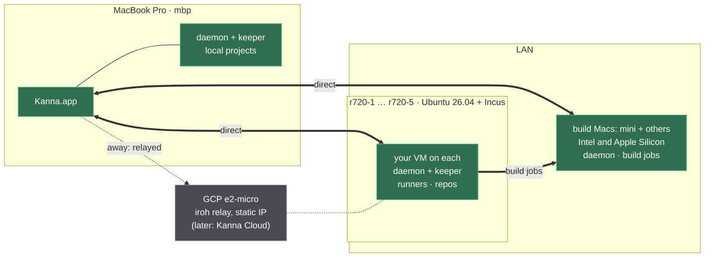
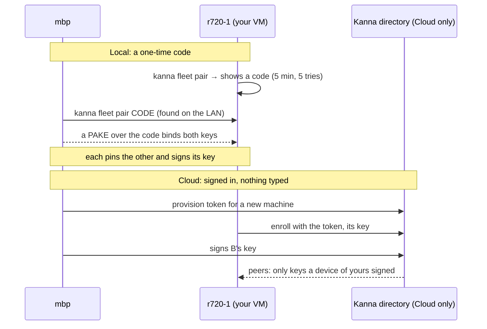
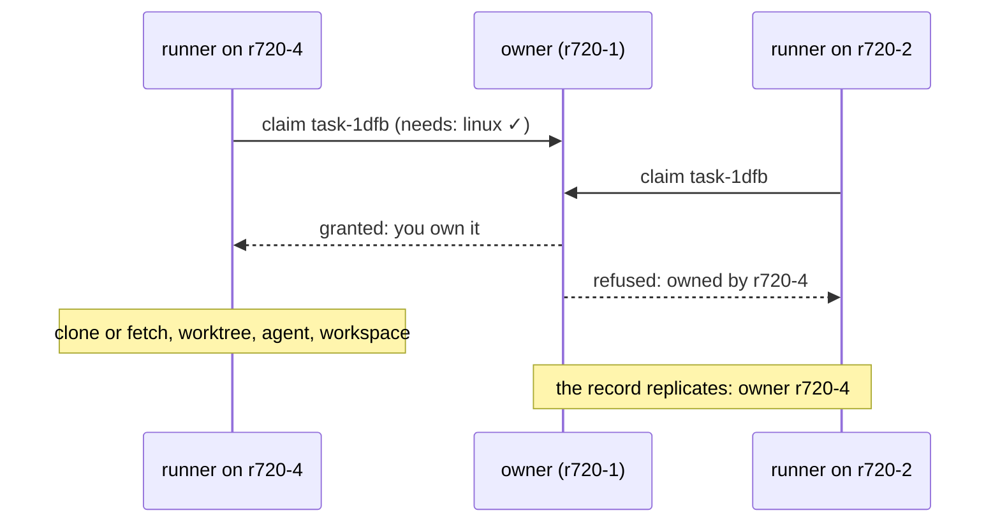

# Fleet: Kanna Across Machines

**Status:** planned · **Builds on:** [architecture](architecture.md), [app link](app-link.md), [each app's Desk and Shelf](app-desk.md), [backlog runners](backlog-runners.md) · **Research:** [fleet](../research/fleet.md), [scenarios](../research/multi-machine-and-people.md), [xcodebuild shim](../research/xcodebuild-shim.md) · **Related:** [build Macs](build-macs.md)

One person's Kanna runs on several machines: a MacBook Pro as the client, Linux servers that run tasks, Macs that build, and a relay for when the LAN isn't there. The same software later becomes **Kanna Cloud**, a cheap private cloud rented to users, who bring their own machines, rent Kanna's, or both. Kanna develops any project, not only Kanna.

The first milestone is the user as the only tenant on their own machines, built with the network and enrollment code a customer would use. Accounts, other tenants and billing come after it.

## Contents

1. [Rules](#1-rules)
2. [Machines and roles](#2-machines-and-roles)
3. [Reach: LAN first, relay second](#3-reach-lan-first-relay-second)
4. [Identity and pairing](#4-identity-and-pairing)
5. [The app link over the network](#5-the-app-link-over-the-network)
6. [One app, several machines](#6-one-app-several-machines)
7. [Terminals and panes](#7-terminals-and-panes)
8. [Where tasks run](#8-where-tasks-run)
9. [Server setup and updates](#9-server-setup-and-updates)
10. [Build order](#10-build-order)
11. [Rejected](#11-rejected)
12. [Glossary](#12-glossary)

## 1. Rules

- **A task lives on exactly one machine**, with its worktree, agent, terminals and workspace. The app shows machines; it never owns work.
- **LAN first.** Machines connect directly whenever they can. A relay is only for when you're away or the LAN fails, and the app shows which path each machine is on.
- **Free unless it needs infrastructure.** Whatever works on the LAN with no server of Kanna's is free, as long as being free doesn't make it worse. A MacBook and a mini pair with no account and get everything except reach from away. Trust never depends on an account.
- **Cloud is cheap, about $5 a month,** and covers only what needs Kanna's servers: reach from away, mobile access away from the LAN, push notifications, the always-on backlog copy, automatic enrollment. Its infrastructure has to cost Kanna well under that per user (§3). Kanna-run machines are priced separately.
- **End to end.** Relays and Kanna's own service carry only ciphertext and can't add a device. A machine that runs your agent sees your code, whoever operates it.
- **Every daemon can send and receive tasks**, Macs included, at a boundary: not started, or stopped at a turn's end.
- **One commit everywhere.** The machines of a fleet run the same protocol. A mismatch is reported, never worked around.
- **Bring your own key.** Agents run on each user's own Claude or Codex login or API key.

## 2. Machines and roles

Every machine runs the same daemon and keeper. They differ in what each is for, advertised as **capabilities**: OS, architecture, cores, RAM, Xcode versions, simulators, display.



| Machine | Role | Peer |
|---|---|---|
| `mbp` | the client; still a Kanna machine for local projects | yes |
| R720 hosts | run one VM per user (Incus) | no: each user's VM is the peer |
| build Macs | `xcodebuild` and Simulator jobs for Linux tasks; Mac tasks too | yes ([build Macs](build-macs.md)) |
| GCP e2-micro | an iroh relay at a stable IP; later Kanna Cloud's directory | no |

## 3. Reach: LAN first, relay second

Networking is built into the daemon with **[iroh](https://github.com/n0-computer/iroh)** (Rust). An iroh endpoint *is* an Ed25519 key: you dial a key, not an address.

1. **On the LAN:** machines find each other with iroh's local discovery and connect directly at wire speed.
2. **Elsewhere:** iroh hole-punches through NAT when it can.
3. **Otherwise:** traffic goes through a relay, as QUIC encrypted with keys only the peers hold. The relay forwards bytes it can't read.

| | **Local** (free, no account) | **Cloud** (about $5 a month) |
|---|---|---|
| Discovery | LAN | Kanna's directory, anywhere |
| Away from the LAN | none, unless you run your own `iroh-relay` (the user's GCP e2-micro runs one) | Kanna's relays |
| Pairing | a one-time code per new machine | automatic once you're signed in |
| Phone | on the LAN | anywhere, with push notifications |
| Backlog | replicated among your machines | plus an always-on encrypted copy |
| Remote Desks, terminals, panes, port tunnels, transfer, build Macs | all of it | the same, from away too |

**Keeping Cloud under $5:** most traffic never touches Kanna's servers, because iroh connects directly whenever it can. What does reach them is small: device metadata, encrypted backlog records, relayed keystrokes. Relayed bulk transfers (port tunnels, build syncs) are capped per user, and the app suggests getting onto the LAN when it is near the cap. Nothing runs per user on Kanna's side: no VM, no process.

Each machine's row in the app shows its path (direct on the LAN, direct over the internet, or relayed), so LAN-first can be seen, not just assumed.

## 4. Identity and pairing



- **One key per device:** the daemon, app and CLI of one machine share `device.key` (Ed25519, `0600`) in the instance's state folder ([instances](instances.md)). It is also the iroh endpoint ID.
- **Peers** are kept in `kanna.db`: name, key, capabilities, who signed it, when it was added. A daemon accepts a connection only from a key in its peers.
- **A key gets in two ways:** by pairing with a code, or by being signed by a device that's already trusted. The peer list replicates like the backlog (§8), so pairing with one machine introduces it to all of them.
- **Never re-trusted:** a name that comes back with another key is refused (`identity_mismatch`), as in v2. `kanna fleet remove NAME` signs a revocation that every peer applies.
- **The directory publishes, never trusts:** it holds the entries your devices signed, and can withhold them but never forge them. Upgrading from Local to Cloud publishes the keys your devices have already signed, so nothing is paired again.

## 5. The app link over the network

A remote link is an iroh connection to the daemon's endpoint. Its first stream carries the [app link](app-link.md)'s JSON lines unchanged: snapshot, output, input, resize, layout, diffs, toasts, `debug.*`. Bulk transfers get **streams of their own** on the same connection (`file.read`, screenshot bytes, port tunnels, worktree syncs, transfers), so a keystroke never waits behind 20 MB.

```mermaid
sequenceDiagram
    participant A as Kanna.app (mbp)
    participant D as daemon on r720-1
    A->>D: connect (iroh: the key is the identity)
    A->>D: app.hello {pid, app, client: "mbp", protocol: 4, commit}
    alt protocol differs
        D-->>A: ok: false, other_protocol {mine: 3, commit}
        Note over A: "r720-1 runs d7cb…: kanna fleet update"; the daemon keeps running
    else same
        D-->>A: ok, daemon {machine, commit, capabilities}, panes, layout
    end
```

| | Local daemon | Remote daemon |
|---|---|---|
| Transport | unix socket | iroh, through `kanna-net` in `kanna-ffi` for the app |
| Version check | binary hash; another build is replaced ([daemon build](daemon-build.md)) | `protocol` integer, exact match; `other_protocol`, the commit named |
| Who starts it | the app | systemd (Linux), a LaunchAgent (build Macs) |
| Apps | one (`app_attached`) | one; lifting the limit is its own slice |

- **One link per machine.** Every view is keyed by (machine, content ID), since `term-41` exists on every daemon.
- **The CLI:** `kanna --host NAME` (or `KANNA_HOST`) sends any command to that machine over iroh with the device key. Inside a remote terminal nothing changes: the CLI there uses its own unix socket.

## 6. One app, several machines

- **A Desk is on (machine, project).** Its title names both (`app · r720-1`). Its planning terminal runs on that machine, where the code is. Its backlog page lists that project's tasks. The new-Desk prompt and Open Recent show `r720-1:~/repos/app`.
- **The Shelf stays the app's:** claims in its order, keyed by (machine, task) in `app-state.json`, three per (machine, project), each card showing its machine.
- **Claims name the device:** `claimed by: mbp` (the hello's `client`) replaces `mac`. Runners leave claimed tasks alone, as today.
- **Toasts** held while no app was attached arrive when the app connects, so five servers' finished tasks show up when you open the lid.
- **What it looks like** (machine badges, path indicators, the machine picker) is drawn in slice 3's mockup, `references/mockups/fleet.html`.

## 7. Terminals and panes

**Terminals keep the byte stream** of snapshot plus output. v2's lag came from its units, not the stream: whole scrollbacks re-sent on every reconnect, base64 through one Node loop, and a resize loop in the viewer ([research §2.5](../research/fleet.md#25-terminal-latency)).

- **Bounded snapshots:** `attach {scrollback: N}` sends the screen and a page; older scrollback comes on demand.
- **Reconnect by offset:** `output` carries a running byte offset, and `attach {from}` replays only the gap.
- **The 16 / 64 MiB limits stay**, and resizing stays the daemon's.
- **Local echo** (mosh-style prediction) is decided after slice 8 measures echo delay through the relay.

| Content | Remote task |
|---|---|
| Terminal, diff | over the link already |
| Markdown, code | through the daemon (task e044); images and relative links with `file.read` |
| Doc markup threads | `markup.*` through the daemon |
| `kanna screenshot` | bytes come back over a stream; the daemon writes the file where the agent asked |
| Web | **port tunnel:** the dev server stays on the server's loopback; the app listens on `127.0.0.1:LOCAL` and carries each connection over a stream. The origin stays localhost; bodies are never rewritten. |
| iOS | the MBP runs the Simulator from the `.app` a build Mac made ([build Macs](build-macs.md#5-ios-for-remote-tasks)) |

## 8. Where tasks run

**The backlog is replicated:** every one of your daemons holds every task's record, synced peer to peer over iroh, LAN first. In Cloud, the service keeps one more copy, encrypted with your keys, so a task added on a closed laptop still reaches the servers.

| Part | Consistency |
|---|---|
| A task's record: name, first message, agent, `after`, `needs`, state, owner | eventual: last writer wins per field; ordered by a hybrid logical clock ("oldest first") |
| Who runs it: the **owner** | one machine; changes only by a claim the owner grants |



- **A task starts on its owner,** first the machine where it was made. A runner with free slots and the right capabilities (`needs: xcode`) asks the owner for the oldest task waiting. The owner grants it to exactly one runner, which becomes the new owner.
- **An offline owner's tasks wait.** Leases that expire would allow a double start, so add them only if waiting hurts.
- **Repos:** a machine keeps clones wherever it likes (`~/repos/<name>` on servers). A repo is identified across machines by its remote URL.
- **Transfer** moves a task between any two daemons at a boundary:
  1. The agent quits by its keys (`Backlog::end_agent`).
  2. Work in progress is committed and pushed.
  3. The receiver fetches the branch into its own worktree.
  4. The transcript is copied into the receiver's agent session folder.
  5. The agent resumes by its session ID.

  Agents resume by ID from any path: checked 2026-10-21 with Claude Code 2.1.305 and Codex 0.163, and v2 relied on it. The steps form a durable queue on both ends. v2's lessons apply: copy the transcript from where the agent really keeps it, and test that the conversation carries on, not only that the transfer "completed".
- **Task IDs** stay random 32 bits ([task IDs](task-ids.md)). Views are keyed by (machine, ID), and an ID that collides is refused when the task is made.

## 9. Server setup and updates

- **R720 host:** Ubuntu 26.04 LTS and Incus, with one VM per user (Ubuntu 26.04) bridged onto the LAN, so peers reach it directly. A task never gets its own VM by default.
- **In the VM:** the user's account with `loginctl enable-linger`; git, build tools and Node for the agent CLIs; Kanna at `/opt/kanna/<commit>`, with `current` a symlink; state in `~/.local/share/kanna-prod/`. `scripts/server-setup.sh` does all of this and can be re-run safely.
- **The daemon unit:** the keeper stays the daemon's child, as on the Mac, so `KillMode=process`, or a restart kills every shell:

  ```ini
  # ~/.config/systemd/user/kanna-daemon.service
  [Service]
  Environment=KANNA_SOCKET=%h/.local/share/kanna-prod/kanna.sock
  Environment=KANNA_KEEPER=/opt/kanna/current/kanna-keeper
  ExecStart=/opt/kanna/current/kanna-daemon
  Restart=always
  KillMode=process
  [Install]
  WantedBy=default.target
  ```

- **Enrolling** pairs the VM (§4), then checks each agent's login there. For one that's missing, Kanna either runs its login in a terminal on the VM and opens the sign-in URL in the Mac's browser, or installs a long-lived token (`claude setup-token`) or an API key from your encrypted secrets. Refresh tokens are never copied between machines: they rotate, so two machines sharing one would sign each other out.
- **Updates:** `scripts/release.sh` also builds a Linux tarball (x86_64, `baseline` CPU for the R720s' Ivy Bridge). `kanna fleet update` copies it to every peer, switches `current`, runs `kanna-keeper --upgrade` ([keeper upgrade](keeper-upgrade.md)) and restarts the daemon; terminals survive ([restarting](daemon-restart.md)). Servers update first, then the app.

## 10. Build order

Each slice is one agent's task and leaves `main` releasable. The tasks' first messages predate the decisions above; where a slice below differs from its task, this spec wins (**Changed**).

| # | Task | Slice | After |
|---|---|---|---|
| 1 | Fleet 1: Kanna on Linux, headless | Daemon, keeper and CLI build and run on Linux x86_64. `server-setup.sh` and the unit (§9). A real agent runs a task with runners; terminals survive a daemon restart. **Changed:** Ubuntu 26.04, inside an Incus VM. | — |
| 2 | Fleet 2: TCP listener and pairing | **Changed, renamed "iroh endpoint and pairing":** confirm iroh's version and stability first. Then: the endpoint in the daemon, `device.key`, LAN discovery, `kanna fleet pair` with a PAKE, `peers` in `kanna.db`, `identity_mismatch`, revocation, `kanna --host`. No `KANNA_LISTEN`, `fleet.json` or signed hello. Done: `kanna --host vm task list` from the Mac; an unpaired key is refused. | 1 |
| 3 | Fleet 3: The app connects to a remote daemon | A link per machine through `kanna-net`; `app.hello` with `protocol`, `commit`, `client`; `other_protocol`; views keyed by (machine, ID); Desks on (machine, project) with their planners there; Shelf badges; the path indicator; `references/mockups/fleet.html`. **Changed:** iroh, not TCP. | 2, e044 |
| 4 | Fleet 4: Files and threads through the daemon | `file.read`, `markup.*`, screenshot bytes (§7). Unchanged. | 3 |
| 5 | Fleet 5: Port tunnels for web panes | `port.open`; a QUIC stream per tunnelled connection. **Changed:** streams on the one connection, not a second connection. | 3 |
| 6 | Fleet 6: Fleet update | The Linux tarball, `/opt/kanna/<commit>`, `kanna fleet update`, the app's `other_protocol` message. Unchanged. | 1, 2 |
| 7 | Fleet 7: xcodebuild redirect to the Mac mini | The shim's first version ([build Macs](build-macs.md)). **Changed:** worktree sync over the daemon link, not rsync over ssh; a small durable supervisor on the Mac from the start; jobs as a dedicated macOS user; mapped diagnostics; `kanna build -- SCRIPT`. | 2 |
| 8 | Fleet 8: Remote terminals measured | Bounded snapshots, reconnect by offset, an echo-delay table from the LAN and through the relay. **Changed:** also sets up `iroh-relay` on the GCP e2-micro. | 3 |
| 9 | *(new: needs a task)* Fleet 9: Provisioning | The R720 host's Incus setup, `kanna fleet provision` (a user's VM made, set up and enrolled), agent sign-in on enrollment (§9). | 6 |
| 10 | Fleet 10: A home per repo | **Changed, renamed "A replicated backlog":** every daemon holds every record (iroh-docs, Automerge or Loro: choose and say why), hybrid-clock order, owners, claims the owner grants, `needs:` against capabilities, the peer list replicated the same way. Done: two daemons share a backlog; a claim race and an owner going away are tested. | 3 |
| 11 | Fleet 11: Teleport between Linux machines | **Changed, renamed "Task transfer":** between any daemons, Mac included; no `/kanna/repos`; the receiver uses its own paths and resumes by session ID (§8); a durable queue; tested across two machines with different home folders. | 10 |
| 12 | Fleet 12: Build jobs and iOS from remote tasks | **Changed:** a job queue across a pool of build Macs matched by capability (arch, macOS, Xcode), Simulator leases, the `.app` fetched to the MBP (no ssh to replace). | 7, 5 |

**After the first milestone, not yet tasks:** Kanna Cloud's account, directory and relays (automatic enrollment, the encrypted backlog copy); Kanna-run machines for other tenants (a macOS user per tenant on build Macs, billing); more than one app per daemon; the iOS client.

## 11. Rejected

- **Tailscale or Headscale underneath:** customers would need a Tailscale account, or Kanna would run Headscale for them. Either way, sign-in and pairing, the product's front door, would be someone else's design. Tailscale was fine for one person; Kanna Cloud needs its own.
- **A TCP listener with Kanna's own signed hello** (the research's plan): a WireGuard mesh gave it reach. Without one, iroh gives reach and encryption in one piece.
- **The local daemon proxying remote links:** it puts the MBP's daemon in every remote path and makes the app link carry several daemons. One link per machine keeps every hello and version check simple.
- **A fixed `/kanna/repos` path** to keep agent session paths equal: it needs root on users' Macs, and agents resume by ID anyway.
- **v2's shape:** Bonjour, Noise inside WebSockets, a Node relay with Firebase, two trust stores. That was about 20,000 lines for reach and trust ([research §1](../research/fleet.md#1-what-v2-did-keep-avoid)).

## 12. Glossary

| Term | Meaning |
|---|---|
| **Peer** | One machine's Kanna, known by its device key: the MBP, a user's VM, a build Mac |
| **iroh** | A Rust library for direct, encrypted QUIC connections between keys, with hole punching and relays |
| **Relay** | A server that forwards encrypted packets between peers that can't connect directly |
| **PAKE** | Password-authenticated key exchange: proves both sides typed the same short code, without sending it |
| **Owner** | The one machine allowed to run a task, or to grant it to a runner elsewhere |
| **Hybrid logical clock** | A timestamp that stays ordered across machines whose clocks drift |
| **Local / Cloud** | Kanna free with no account (LAN, your own relay) / with an account for about $5 a month (directory, Kanna's relays, phone away, push, backlog copy); Kanna-run machines on top |
