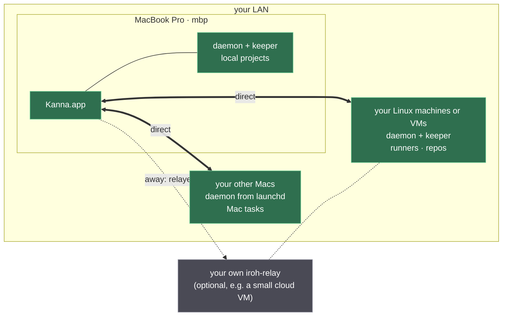
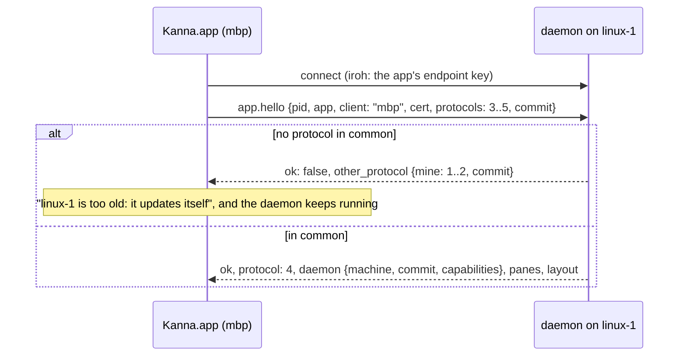

# Fleet: Kanna Across Machines

**Status:** planned · **Parts:** [identity and pairing](fleet-identity.md), [tasks across machines](fleet-tasks.md), [desks across machines](fleet-app.md), [setting up a Linux machine](fleet-server-setup.md), [agent sign-in](agent-sign-in.md), [build order](fleet-build-order.md) · **Hosted:** [Kanna Cloud](kanna-cloud.md) · **Builds on:** [architecture](architecture.md), [app link](app-link.md), [each app's Desk and Shelf](app-desk.md), [backlog runners](backlog-runners.md) · **Research:** [fleet](../research/fleet.md)

One person's Kanna runs on several machines they own: a MacBook Pro as the client, Linux machines and other Macs that run tasks, and, when they want reach from away, a relay of their own. This is the **self-hosted fleet**: free, open source, with no account and no server of Kanna's. Kanna develops any project, not only Kanna.

**Kanna Cloud** ([its spec](kanna-cloud.md)) is a separate product on the same core: VMs Kanna runs for you on its own servers, Kanna's directory and relays, and build Macs. This spec is the shared core and the self-hosted fleet; Cloud's parts are only linked from here.

**The first milestone is the self-hosted fleet:** the user's own machines on the LAN, reached from away through their own relay or a fixed address. It has one tenant, so it needs no tenant isolation, and it has no build Macs.

## Contents

1. [Rules](#1-rules)
2. [Machines and roles](#2-machines-and-roles)
3. [Reach: LAN first, relay second](#3-reach-lan-first-relay-second)
4. [Identity and pairing](#4-identity-and-pairing)
5. [The app link over the network](#5-the-app-link-over-the-network)
6. [One app, several machines](#6-one-app-several-machines)
7. [Terminals and panes](#7-terminals-and-panes)
8. [Where tasks run](#8-where-tasks-run)
9. [Server setup and updates](#9-server-setup-and-updates)
10. [Build order](#10-build-order)
11. [Open questions](#11-open-questions)
12. [Rejected](#12-rejected)
13. [Glossary](#13-glossary)

## 1. Rules

- **You work on projects, not machines.** Kanna decides where a task runs (§2). The app shows a machine only where it matters: a slow path, an offline machine, the fleet page.
- **LAN first.** Machines connect directly whenever they can. A relay is only for when you're away or the LAN fails, and the app shows which path each machine is on.
- **Self-hosting is free and complete.** Everything here, your own relay included, is open source and needs no account. Trust never depends on an account or a server.
- **One tenant.** Every machine in a self-hosted fleet is yours and runs only your work, so the fleet's boundary is the peer log, not a sandbox between users.
- **End to end.** A relay carries only ciphertext and can't add a device.
- **Every daemon can send and receive tasks**, Macs included, at a boundary: not started, or stopped at a turn's end.
- **Versions are compatible, not identical.** Daemons and apps of different releases work together over a range of protocol versions, so machines update on their own schedule.
- **Bring your own key.** Agents run on your own Claude or Codex subscription or API key. An account is added once and every machine can use it ([agent sign-in](agent-sign-in.md)).

## 2. Machines and roles

Every machine runs the same daemon and keeper. They differ in what each is for, advertised as **capabilities**: OS, architecture, cores, RAM, Xcode versions, display.

| Machine | Role | Peer |
|---|---|---|
| `mbp` | the client; still a Kanna machine for local projects | yes |
| your Linux machines | run tasks: a box under the desk, a VM on it, a rented server | yes ([setup](fleet-server-setup.md)) |
| your other Macs | run tasks that need macOS, whole | yes |
| your relay | an `iroh-relay` at a stable address, for reach from away | no |

**Placement: where work goes.**

- **Placement is a policy, not a place.** By default, any machine with free slots and the capabilities a task `needs:` asks for the oldest waiting task, so a mini and ten Linux boxes share one backlog without a scheduler ([tasks §2](fleet-tasks.md#2-owners-and-grants)). Preferences narrow who asks (e2e on the mini, this project's agents on those machines).
- **A task runs whole on one machine.** A task that needs macOS goes to a Mac. Sending one step of a Linux task (an `xcodebuild`) to a Mac is a build Mac's job, which is Kanna Cloud's ([build Macs](build-macs.md)).
- **Taking a task to the Desk doesn't move it.** It stays where it runs and is shown over the link.

## 3. Reach: LAN first, relay second

Networking is built into the daemon with **[iroh](https://github.com/n0-computer/iroh)** (Rust). An iroh endpoint *is* an Ed25519 key: you dial a key, not an address.

1. **On the LAN:** machines find each other with iroh's local discovery and connect directly at wire speed.
2. **Away, with your relay:** a relay is iroh's meeting point for hole punching. iroh connects directly through NAT when it can, and otherwise sends the traffic through the relay, which forwards QUIC it can't read. You run `iroh-relay` on any machine with a stable address and name it in the fleet's settings.
3. **Away, with an address:** `kanna fleet addr NAME HOST` dials a peer at an address you give it, such as one on a VPN you already have ([identity §3](fleet-identity.md#3-the-peer-log)).

**iroh's defaults are off,** which use n0's public relays and DNS discovery, so the fleet depends on no third party's terms. iroh moves a connection to a direct path by itself as soon as one exists, so using the LAN takes no action from the user. Each machine's row in the app shows its path (direct on the LAN, direct over the internet, or relayed). Kanna Cloud adds a directory and Kanna's relays ([Cloud §5](kanna-cloud.md#5-directory-and-relays)).

## 4. Identity and pairing

In short ([detail](fleet-identity.md)):

- **The daemon has `device.key`**, an Ed25519 key that is its iroh endpoint and signs for the device. The app has its own endpoint key, certified by `device.key`. The CLI goes through the local daemon.
- **Pairing** is a PAKE over a one-time code you type, run directly between your two devices. You are the only party: no server takes part.
- **The peers form a signed log**, replicated to every peer. A revocation beats any later add, and a name that comes back with another key is refused. Signing a peer takes a gesture in the app.

## 5. The app link over the network

A remote link is an iroh connection to the daemon's endpoint. Its first stream carries the [app link](app-link.md)'s JSON lines unchanged: snapshot, output, input, resize, layout, diffs, toasts, `debug.*`. Bulk transfers get **streams of their own** on the same connection (`file.read`, screenshot bytes, port tunnels, transfers), so a keystroke never waits behind 20 MB.

| | Local daemon | Remote daemon |
|---|---|---|
| Transport | unix socket | iroh, through `kanna-net` in `kanna-ffi` for the app |
| Version check | binary hash; another build is replaced ([daemon build](daemon-build.md)) | the highest protocol both support; `other_protocol` only when there is none |
| Who starts it | the app; on a Mac that serves the fleet, launchd | systemd (Linux), launchd (Macs) |
| Apps | one (`app_attached`) | one; lifting the limit is its own slice, needed before the phone |

- **One link per machine.** Every view is keyed by (machine, content ID), since `term-41` exists on every daemon.
- **The CLI:** `kanna --host NAME` (or `KANNA_HOST`) sends any command to that machine: the local daemon dials it and forwards the command as `fleet call` over a control stream, and the reply is the remote daemon's own. Inside a remote terminal nothing changes: the CLI there uses its own unix socket. Commands that read local files (`diagrams`, doc comments) still run on this machine.
- **A Mac that serves the fleet** (a Mac whose tasks you reach from elsewhere) runs its daemon from launchd (`kanna fleet serve`), a LaunchAgent pointed at the installed app's `Contents/Helpers/kanna-daemon`. The app's replace rule still holds: on `other_build` the daemon exits, and launchd starts it again from the updated bundle.
- **Streams:** one ALPN, `kanna/1`. Each stream opens with a header line naming its kind (`control`, `file`, `port`, `sync`, `job`, `transfer`), answered by `{ok: true, kind, name}` or a refusal (`unpaired`, `revoked`, `unknown_stream`), and its bytes follow. A `control` stream carries JSON-line requests and replies, as on the unix socket. A seventh kind, `pair`, is the only one an unknown key may open ([identity §2](fleet-identity.md#2-pairing)). Until their slices, `file`, `port`, `sync`, `job` and `transfer` are acknowledged and closed; `sync` and `job` are Cloud's build-Mac streams.

## 6. One app, several machines

See [Desks across machines](fleet-app.md) for project identity, the app's Shelf and claims, and the [Fleet mockup](../../references/mockups/fleet.html) with screenshots and the Fleet 3 comparison cases.

## 7. Terminals and panes

**Terminals keep the byte stream** of snapshot plus output. v2's lag came from its units, not the stream: whole scrollbacks re-sent on every reconnect, base64 through one Node loop, and a resize loop in the viewer ([research §2.5](../research/fleet.md#25-terminal-latency)).

- **Bounded snapshots:** `attach {scrollback: N}` sends the screen and a page; older scrollback comes on demand.
- **Reconnect by offset:** `output` carries a running byte offset, and `attach {from}` replays only the gap.
- **The 16 / 64 MiB limits stay**, and resizing stays the daemon's.
- **Local echo** (mosh-style prediction) is decided after slice 8 measures echo delay through the relay.

| Content | Remote task |
|---|---|
| Terminal, diff | over the link already |
| Markdown, code | through the daemon ([file panes](file-panes.md)); images and relative links with `file.read` |
| Doc markup threads | `markup.*` through the daemon |
| `kanna screenshot` | bytes come back over a stream; the daemon writes the file where the agent asked |
| Web | **port tunnel:** the dev server stays on the machine's loopback; the app listens on `127.0.0.1:LOCAL` and carries each connection over a stream. The origin stays localhost; bodies are never rewritten. |

## 8. Where tasks run

In short ([detail](fleet-tasks.md)):

- **The backlog is replicated** to every one of your daemons, eventually consistent, ordered oldest first by a hybrid logical clock.
- **Each task has one owner.** A runner elsewhere with free slots and the right capabilities asks for it, and the owner grants it to exactly one.
- **Transfer** moves a task between any two daemons at a boundary. The branch goes as a git bundle over the link, the transcript is copied, and the agent resumes by session ID at the receiver's own paths.

## 9. Server setup and updates

A Linux machine is set up with `scripts/server-setup.sh` and a systemd user unit, and daemons update themselves from a peer or the release site ([setting up a Linux machine](fleet-server-setup.md)). Making VMs on Kanna's servers is Cloud's ([provisioning](kanna-cloud.md#3-provisioning)).

## 10. Build order

[Models first, then the self-hosted fleet's slices, then Cloud's](fleet-build-order.md).

## 11. Open questions

- **The user's GCP e2-micro** runs the relay slice 8 measures through. **Proposed:** it is the user's own self-hosted relay, the example of "your own relay"; Kanna Cloud's relays are a separate deployment.

## 12. Rejected

- **Tailscale or Headscale underneath:** users would need a Tailscale account, or Kanna would run Headscale for them. Either way, sign-in and pairing, the product's front door, would be someone else's design.
- **A TCP listener with Kanna's own signed hello** (the research's plan): that relied on a WireGuard mesh for reach. iroh gives reach and encryption in one piece.
- **The local daemon proxying the app's remote links:** it would put the MBP's daemon in every keystroke's path and make one app link carry several daemons. The CLI goes through it only because a short-lived process shouldn't register with a relay.
- **n0's public relays by default:** free reach from away, but on a third party's terms and capacity.
- **A fixed `/kanna/repos` path:** it needs root on users' Macs, and agents resume by ID from any path anyway.

## 13. Glossary

| Term | Meaning |
|---|---|
| **Peer** | One machine's Kanna, known by its device key: the MBP, a Linux machine, a Mac |
| **iroh** | A Rust library for direct, encrypted QUIC connections between keys, with hole punching and relays |
| **ALPN** | Application-Layer Protocol Negotiation: the name a connection asks for when it opens (`kanna/1`), so both ends agree what protocol it speaks before any data flows |
| **Relay** | A server that forwards encrypted packets between peers that can't connect directly |
| **PAKE** | Password-authenticated key exchange: proves both sides typed the same short code, without sending it |
| **Owner** | The machine that starts a task's agent, so it never starts twice; it can grant that to a runner that asks |
| **Hybrid logical clock** | A timestamp that stays ordered across machines whose clocks drift |
| **Self-hosted fleet** | Kanna on your own machines, free, with no account: LAN, your own relay or a fixed address |
| **Kanna Cloud** | Kanna's hosted service on the same software: Kanna-run VMs, directory and relays, build Macs ([spec](kanna-cloud.md)) |
