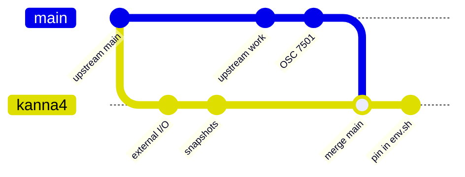

# Ghostty Fork

**Status:** decided (2026-10-16) · **Part of:** [the app link](../kanna-spec.md#45-the-app-link) · **Pinned in:** `scripts/env.sh` (`KANNA_GHOSTTY_COMMIT`)

Kanna builds both Ghosttys it uses, libghostty-vt in the daemon and GhosttyKit in the app, from the `kanna4` branch of [jemdiggity/ghostty](https://github.com/jemdiggity/ghostty/tree/kanna4): Ghostty's `main` plus Kanna's own commits (external I/O, snapshots). Kanna follows upstream by **merging Ghostty's `main` into `kanna4`**, never by cherry-picking what it needs, so `kanna4` stays upstream plus a short list of Kanna commits.

## Contents

1. [Following upstream](#1-following-upstream)
2. [Rules](#2-rules)
3. [Why](#3-why)

## 1. Following upstream



```sh
git -C ~/work/ghostty fetch upstream main
git -C ~/work/ghostty worktree add ../ghostty-merge -b kanna4-merge kanna4
git -C ~/work/ghostty-merge merge upstream/main     # resolve, then zig build test-lib-vt and zig build test
# in kanna-v4: KANNA_GHOSTTY_COMMIT=<the merge> in scripts/env.sh, then
GHOSTTY_SOURCE_DIR=~/work/ghostty-merge scripts/build.sh
cargo test, scripts/e2e-kanna.sh
git -C ~/work/ghostty push origin kanna4-merge:kanna4
```

## 2. Rules

- **Merge, don't cherry-pick:** one merge of `main` brings the change Kanna wants with everything it was built on, and the next merge doesn't conflict with a copy of it.
- **A merge that doesn't build is fixed in the merge commit,** so every `kanna4` commit builds. Where upstream adds a field Kanna's own code must fill (a snapshot load's stream handler, say), the merge fills it as upstream's own code does.
- **Zig follows Ghostty:** `KANNA_ZIG_VERSION` and its four SHA256s in `scripts/env.sh` match the merge's `minimum_zig_version` in `build.zig.zon`, moved in the same Kanna commit as the pin. Ghostty 1.4 needs Zig 0.17.
- **Push only after Kanna passes** against the merge: `cargo test` and the e2e scenarios, since a new Ghostty changes every terminal. `kanna4` only moves forward (no force-push): a pinned commit must stay fetchable.
- **Kanna's commits on `kanna4` are for Kanna;** what upstream should have goes upstream as a Ghostty PR.
- **`zig build test` on a Mac without Xcode's package access** fails only at Ghostty's own macOS app (xcodebuild), which Kanna doesn't build; the Zig tests are what count.

## 3. Why

The protocols Kanna reads (OSC 9;4 progress, [OSC 7501 program status](agent-status.md#4-the-agents-own-report-osc-7501)) and fixes to the terminal keep landing in Ghostty's `main`. A cherry-pick brings one without what it builds on (OSC 7501 needed hand edits around the XTCHECKSUM options `kanna4` lacked), and every one makes the next merge harder. Following `main` keeps `kanna4` easy to rebase onto, and Kanna on the Ghostty everyone else tests.
