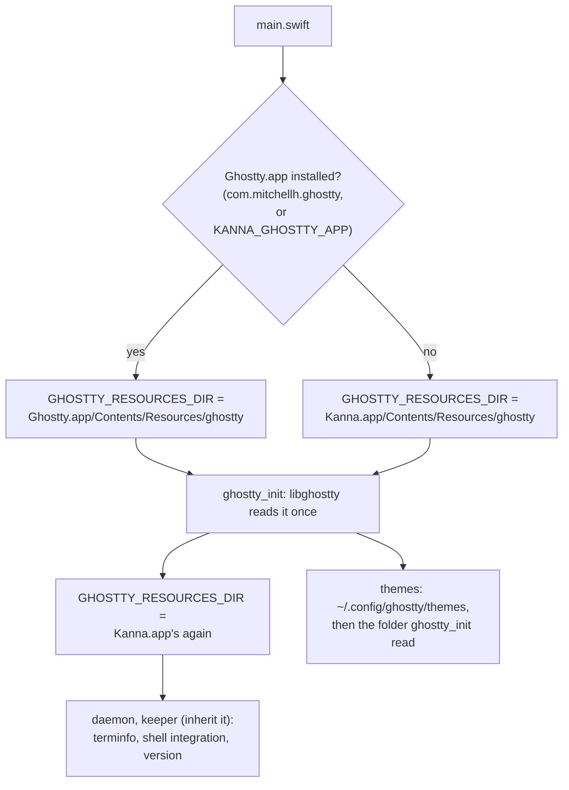

# Ghostty's Resources

**Status:** built · **Builds on:** [terminal behaviour](terminal.md#2-the-config), [the keeper](../keeper.md) · **Reference:** Ghostty.app's `Contents/Resources`

A Ghostty config names themes by name (`theme = light:GitHub Light Default,dark:GitHub Dark Default`), and Ghostty finds them in its resources folder, next to its terminfo and shell integration. Kanna.app ships a small resources folder of its own and uses an installed Ghostty's themes when there is one, so a config that works in Ghostty works in Kanna.

## 1. What Kanna.app ships

From the GhosttyKit build in the build store (`scripts/build-ghosttykit.sh` copies them out of Ghostty's `zig-out/share` into the entry's `share/`, and `scripts/build-kanna-app.sh` copies that into the app), laid out as in Ghostty.app:

```
Kanna.app/Contents/Resources/
├── ghostty/
│   ├── shell-integration/   bash, zsh, fish, elvish, nushell
│   └── themes/              GitHub Light Default, GitHub Dark Default,
│                            Catppuccin Latte, Catppuccin Mocha
├── terminfo/                xterm-ghostty, compiled (78/ and x/)
└── ghostty-version          e.g. 1.4.1-dev+4e28443, for TERM_PROGRAM_VERSION
```

- **Four themes, not Ghostty's ~820.** Ghostty's themes are the iTerm2-Color-Schemes collection: MIT as a collection, but each theme keeps its author's licence, and most have none on record (its `licenses.yml`: about 220 with an open licence, 580 unknown, 18 not redistributable). Kanna ships two common light/dark pairs, all MIT. Every other theme comes from an installed Ghostty, or from the user's own themes folder.
- **Terminfo and shell integration are always Kanna's own**, from the same Ghostty commit as the GhosttyKit it links, so `TERM=xterm-ghostty` and the integration scripts match the terminal that draws them.

## 2. Where each part is found



- **libghostty reads its resources folder once, in `ghostty_init`**, from `GHOSTTY_RESOURCES_DIR` (GhosttyKit is a release build), else by looking above the executable for `Contents/Resources/terminfo`. Kanna sets the variable just before `ghostty_init` and sets it back to its own folder just after, so the app's themes can come from Ghostty.app while the daemon and keeper it starts get Kanna's terminfo and shell integration.
- **A theme is looked up as Ghostty does:** `$XDG_CONFIG_HOME/ghostty/themes` (or `~/.config/ghostty/themes`) first, then the resources folder's `themes`. An absolute path is read as it is.
- **Ghostty.app is found by its bundle ID** through Launch Services, so it can be anywhere. `KANNA_GHOSTTY_APP` names one instead, or `none` for none; the e2e tests use it.
- **The keeper** finds the resources from `GHOSTTY_RESOURCES_DIR`'s parent, as before ([keeper](../keeper.md)), so shells get `TERM=xterm-ghostty`, `TERMINFO`, Ghostty's shell integration (chained in front of Kanna's zsh integration, which hands `ZDOTDIR` back) and `TERM_PROGRAM_VERSION`.

## 3. Config diagnostics

Each time the app loads the config (at launch and on `reload_config`) it logs Ghostty's diagnostics (`ghostty_config_diagnostics_count`, `ghostty_config_get_diagnostic`), one line each, to the app's stderr (`app.log` when the daemon or a test started it) and to `os_log` (subsystem `dev.kanna.app`, category `ghostty-config`):

```
kanna: Ghostty config: theme "Dracula" not found, tried path "…/Kanna.app/Contents/Resources/ghostty/themes/Dracula"
kanna: Ghostty config: Kanna ships only these themes: Catppuccin Latte, …; install Ghostty to use all of its themes, or put the theme's file in ~/.config/ghostty/themes
```

The second line is added only when no Ghostty.app was found. A theme that isn't found leaves Ghostty's default colours, as in Ghostty.

## 4. Decided

| Decision | Chosen | Why |
|---|---|---|
| Which themes ship | four, MIT: the GitHub and Catppuccin light/dark pairs | most of Ghostty's themes have no licence on record; size isn't the reason (all of them are 440 KB) |
| Other themes | an installed Ghostty.app's | the user who names Ghostty's themes usually has Ghostty; nothing to copy or keep in step |
| Terminfo and shell integration | Kanna's own, never Ghostty.app's | they must match the libghostty that draws, not whichever Ghostty is installed |
| Where they come from | the GhosttyKit store entry, from Ghostty's own build | one build of Ghostty for the library and its resources |

## 5. Checked by

`scripts/e2e-kanna.sh` `terminal_colours`: with only the scenario's own config (`KANNA_GHOSTTY_CONFIG`) and a private `XDG_CONFIG_HOME` with no themes folder, `theme = light:GitHub Light Default,dark:GitHub Dark Default` gives `#ffffff` in light and `#0d1117` in dark from Kanna's themes (`KANNA_GHOSTTY_APP=none`) and logs no diagnostic; with Ghostty.app installed, `light:iTerm2 Solarized Light,dark:Dracula` gives `#fdf6e3` and `#282a36` from its themes; with none, `theme = Dracula` logs that it wasn't found and which themes Kanna ships.
