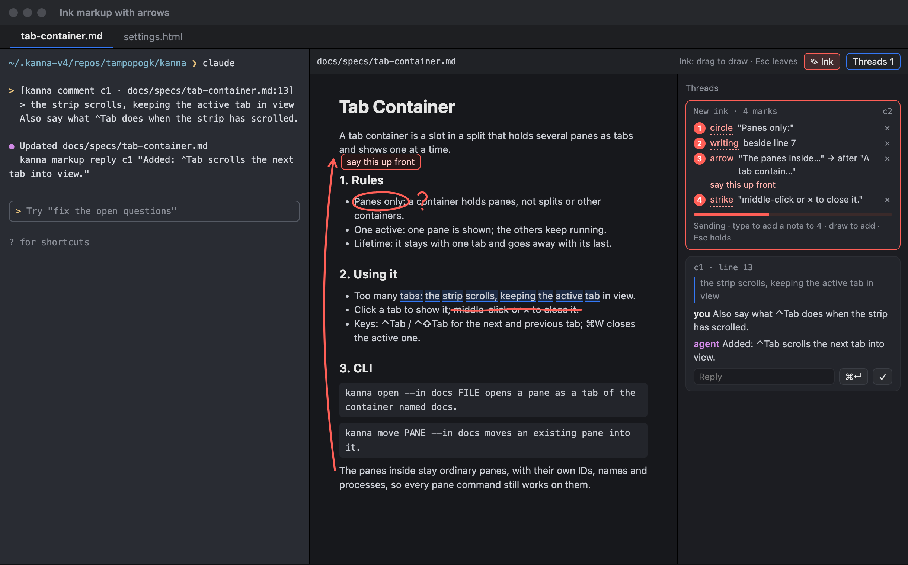
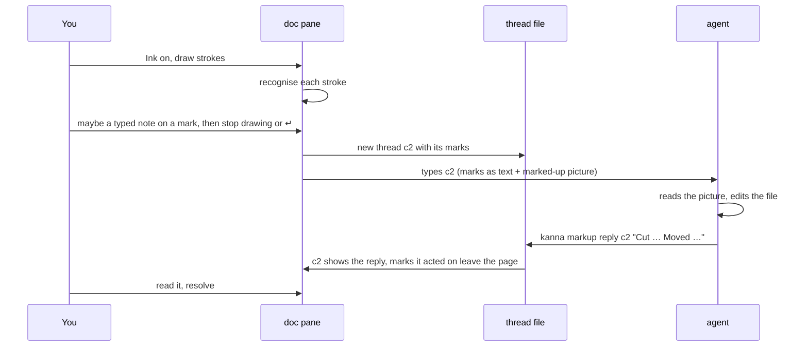
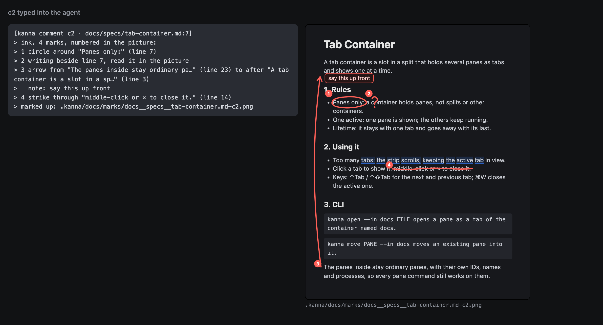
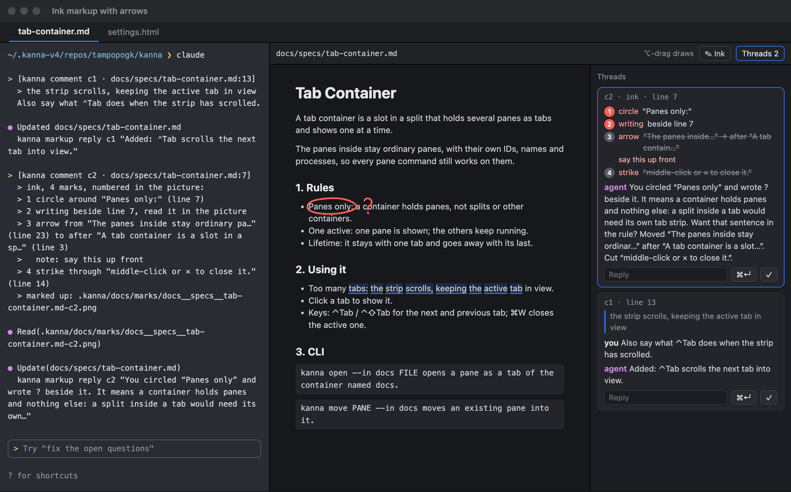
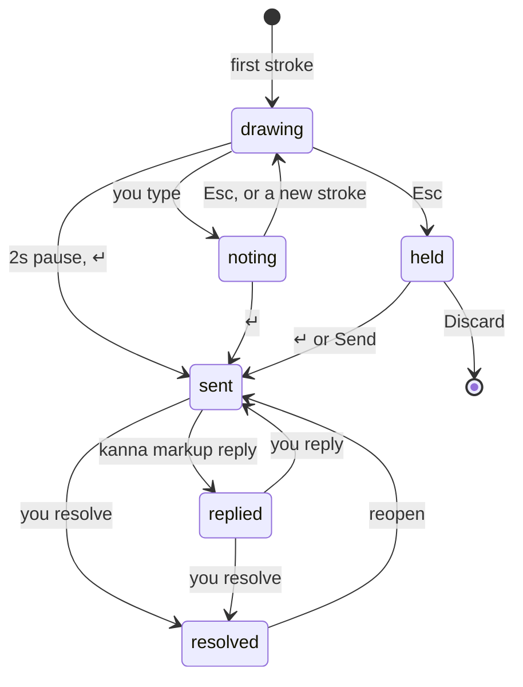
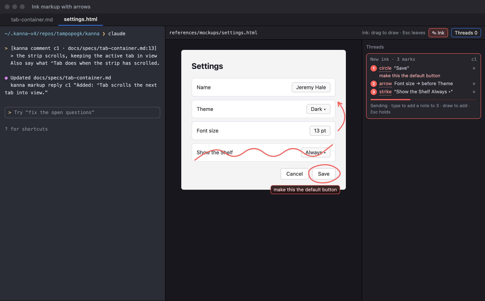

# Ink Markup

**Status:** proposed; the thread format, its message and the anchor check are built, drawing isn't yet · **Mockup:** [`references/mockups/ink-markup.html`](../../references/mockups/ink-markup.html) · **Builds on:** [Doc Markup](doc-markup.md)

**Ink markup** lets you draw on a doc in Kanna (circle a word, strike out a sentence, cross out a part, draw an arrow from a paragraph to where it belongs, scribble a note in the margin) and have the agent beside it work out what the marks mean and make the changes. It is another way to post a [Doc Markup](doc-markup.md) thread: the same agent, the same reply and resolve. Today it's the Mac with a mouse or trackpad; the design carries over to an iPad with Apple Pencil.



## Contents

1. [The loop](#1-the-loop)
2. [Drawing](#2-drawing)
3. [What the agent gets](#3-what-the-agent-gets)
4. [After it's sent](#4-after-its-sent)
5. [iPad and Pencil](#5-ipad-and-pencil)
6. [How it's built](#6-how-its-built)
7. [Glossary](#7-glossary)

## 1. The loop



## 2. Drawing

- **Where:** markdown files and HTML pages with comments on ([Doc Markup](doc-markup.md#2-rules)): they already anchor marks to text and parts of a page. Terminals, the diff viewer and code panes come later, once ink anchors to their lines.
- **Ink mode:** the **Ink** button in the pane's toolbar turns it on; then dragging draws and the page doesn't respond to the pointer. ⌥-drag draws one stroke without it. Esc turns it off.
- **One pen.** No palette: you draw, and Kanna recognises each stroke, keeps it as you drew it. Each mark is listed in the **New ink** card, where clicking its kind corrects it and × removes it.

| You draw | Recognised as | It points at |
|---|---|---|
| A closed loop | **circle** | the words or part inside it |
| A line under words | **underline** | those words |
| A line through words, or a zigzag over them | **strike** | those words |
| An X: two straight strokes crossing, or one stroke crossing itself | **cross** | the words or part under it |
| A line or curve, with or without a head | **arrow** | from what's at its start to before or after what's at its tip |
| Anything else, in a run of strokes | **writing** | the nearest block; read from the picture |

- An arrow drawn without a head gets one, pointing the way you drew it; a small V near an arrow's tip is taken as its head.
- **Sent when you stop.** Strokes collect in a **New ink** card at the top of the thread list. When you stop drawing for 2s, the card counts down and posts them all as one thread; drawing again adds to the batch and restarts it.
  - **⌥-drag:** the countdown waits while ⌥ is held, so you can draw several strokes, and starts when you let go.
  - **A note on a mark:** type straight after drawing it, with no click. The note shows on the doc beside the mark and in the card; clicking a mark in the card puts the note on that one instead. Typing stops the countdown, ↵ sends, Esc ends the note and restarts it, and drawing again keeps it.
  - **Esc** (not in a note) holds the batch: it waits for ↵ or **Send**, or **Discard**. ⌘Z undoes the last stroke.

## 3. What the agent gets

Both a picture and words: the picture shows what you meant (the gesture, your writing), the words say where it is in the source.



- **The message** is a Doc Markup comment: one `>` line per mark, numbered as in the picture, each followed by its note if it has one.

```
[kanna comment c2 · docs/specs/tab-container.md:7]
> ink, 4 marks, numbered in the picture:
> 1 circle around "Panes only:" (line 7)
> 2 writing beside line 7, read it in the picture
> 3 arrow from "The panes inside stay ordinary pa…" (line 23) to after "A tab container is a slot in a sp…" (line 3)
>   note: say this up front
> 4 strike through "middle-click or × to close it." (line 14)
> marked up: .kanna/docs/marks/docs__specs__tab-container.md-c2.png
```

- **On a page**, marks name parts by CSS path and text with a box in page pixels, as [page comments](doc-markup.md#3-reaching-the-agent) do.
- **The picture** is the pane as shown, with the ink and the notes drawn on and each mark numbered as in the message, saved beside the threads (as `kanna screenshot` takes it). The numbers are only in the picture, to tie its strokes to the lines; the doc shows the ink alone.
- **What marks mean is a skill.** The `kanna-markup` skill gives the conventions (strike or cross: cut it; arrow: move it there; circle or underline: this, see the note or writing; writing: read it from the picture) and tells the agent to answer mark by mark, naming what each touched and how it read it, so a misread shows in the reply.

## 4. After it's sent





- **Ink stays on what it touched**, the way a comment's mark does: each stroke is kept relative to the block or part under it, so it follows edits, reloads and zoom.
- **Marks the agent acted on leave the page.** When the text or part under a mark changes, its ink goes; the thread keeps the picture as sent, so you can still see what you drew.
- **Resolving clears the rest.** A resolved thread's ink is hidden, and shows faintly when you open the thread from **Show resolved**.
- **Erasing:** before sending, ⌘Z or ×; Esc then Discard drops the batch. After, ink goes with its thread: resolve it.
- **The thread card** shows the numbered list of marks in place of a quote ([threads UI](doc-markup.md#2-rules)), not the picture: the ink is on the doc beside it.



## 5. iPad and Pencil

| | Mac | iPad |
|---|---|---|
| Draw | Ink on, or ⌥-drag | Pencil always draws; fingers scroll and click |
| Undo | ⌘Z | double-tap the Pencil |
| Stroke | points | points, with pressure and tilt kept |
| Recognition, anchors, numbering, message, picture, thread | same | same |

Only the input differs, so the recognition, the anchors and the thread format are one shared piece, ready for the iOS app (task-05a7, "Kanna for iOS").

## 6. How it's built

- **A thread with marks.** An ink thread is a Doc Markup thread whose target is a list of marks instead of a quote; each mark has its kind, its strokes (points relative to the block or part it's anchored to) and what it points at. The same thread file, CLI and skill.
- **In the thread file** it's an `ink` object on the thread; the thread keeps `quote: ""`, so Kannas that don't know ink still read the file, and its `line` is its first mark's. A mark's number is its place in `marks`:

```json
{ "id": "c2", "quote": "", "line": 7, "state": "open", "status": "sent", "messages": [],
  "mark": ".kanna/docs/marks/docs__specs__tab-container.md-c2.png",
  "ink": { "marks": [
    { "kind": "circle", "strokes": [[[2, 1], [80, 0], [84, 14], [1, 16], [2, 1]]],
      "anchor": { "line": 7, "text": "Panes only: a container holds panes, not splits or other containers." },
      "words": "Panes only:" },
    { "kind": "arrow", "strokes": [[[-12, 4], [-30, -200], [-10, -390]]],
      "anchor": { "line": 23, "text": "The panes inside stay ordinary panes, with their own IDs, …" },
      "to": { "line": 3, "text": "A tab container is a slot in a split that holds several panes …" }, "side": "after",
      "note": "say this up front" } ] } }
```

| Field | Is |
|---|---|
| `view` | On a page only: the view (`#…`), its size and scroll, as a page comment has; a markdown thread has none |
| `kind` | `circle`, `underline`, `strike`, `cross`, `arrow` or `writing`; an unknown kind reads as `writing` |
| `strokes` | Each stroke's points, relative to the anchor's top-left: points at 100% zoom in markdown, CSS pixels on a page |
| `anchor` | The block (markdown: its first `line` and plain `text`) or part (page: also its CSS `selector` and `box` in page pixels) the strokes are kept on: an arrow's start, else the block of the words it covers, else the one nearest the strokes' middle. It's also what the mark points at |
| `words` | The words a circle, underline, strike or cross covers, in the anchor; none when it's around nothing |
| `to`, `side` | An arrow's tip: the block or part, and `before` or `after` it |
| `tip` | An arrow's tip, as an index into its first stroke, when its head was drawn as a V |
| `note` | The note typed on the mark |

- **The message** is made from these fields alone (`DocStore.message`, `DocInk.lines`; the CLI's `kanna markup show` prints the same lines), so it reads the same after a restart. A page mark around nothing gives its box as the strokes' bounds in page pixels.
- **Whether a mark stays** (`DocInk.stays`) is a pure check against the doc's blocks as they are now, in order: a markdown block by its text (the one nearest the mark's line when several match), a page part by its CSS path and text. A mark stays while its anchor is there unchanged; an arrow also needs its tip's block there, and goes once its start sits `side` of it (the move was made). A block that only moved keeps its marks, which follow it. Shared with the iOS app, so it uses no AppKit.
- **Recognition runs where you draw** (the app, later the iPad), from the stroke alone plus what's under it; the kind you correct wins.
- **The picture** is the pane's own capture with the ink layer on, the same as [`kanna screenshot`](screenshot.md).
- **Not yet decided:** whether the thread store moves to the daemon first (task-4053), which this would follow.

## 7. Glossary

| Term | Meaning |
|---|---|
| **Ink** | Strokes drawn on a doc |
| **Stroke** | One drag of the pointer or Pencil |
| **Mark** | One or more strokes recognised as one thing (a circle, an arrow with its head, a word of writing), numbered |
| **Batch** | The marks drawn before you send; they become one thread |
| **Picture** | The pane as shown with the batch's ink and numbers, sent with the message |
