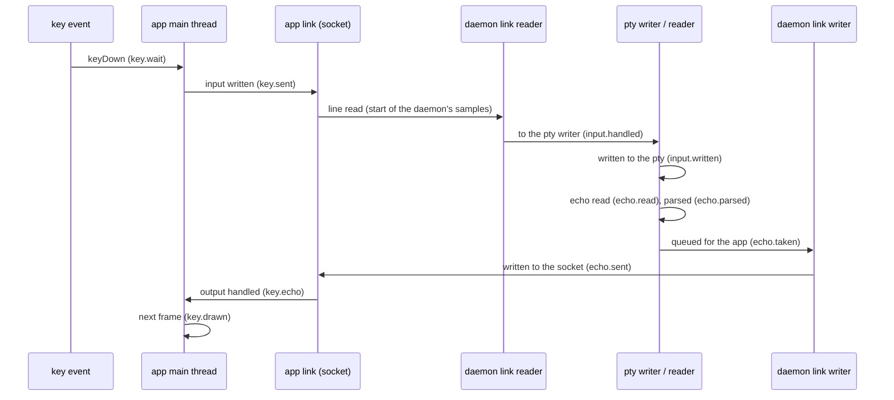
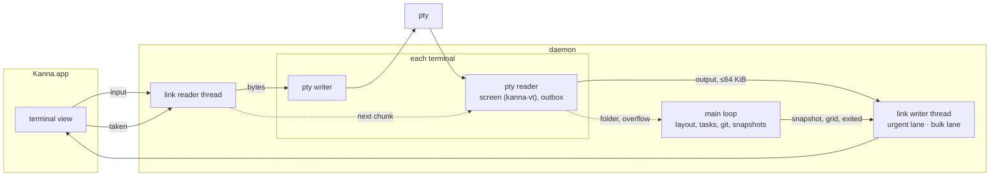

# Input Latency

**Status:** built · **Changes:** [app link](app-link.md), [terminal](terminal.md) · **Measured with:** [performance monitoring](performance-monitoring.md)

A key typed in a terminal reaches its program, and the program's echo is drawn, **without waiting on anything else Kanna is doing**: not the daemon's main loop (task lists, git, the Desk, status rules, messages), and not other terminals' output, shown or hidden. Before, both directions went through the daemon's one main loop and the app link's one queue, so typing froze for as long as either was busy: about a second whenever an agent ran `kanna task list`, and for seconds behind a pane flooding output.

## Contents

1. [What was slow](#1-what-was-slow)
2. [Measuring a keystroke](#2-measuring-a-keystroke)
3. [The byte path](#3-the-byte-path)
4. [The app link, protocol 3](#4-the-app-link-protocol-3)
5. [Readings](#5-readings)
6. [Tested](#6-tested)
7. [Glossary](#7-glossary)

## 1. What was slow

Two causes, found by measuring the whole trip of a keystroke (§2) on a private instance, and by reading the dev Kanna's `daemon.log` and sampling its daemon:

- **The daemon's main loop stalled for a second at a time.** `tasks list`, `new`, `pick` and `shelve` took 0.5–2s each, 20–60 times an hour (agents list their tasks often). A sample of the daemon during one showed nearly all of it in `task_scripts::git_dir`, which ran `git rev-parse --absolute-git-dir` twice per task, to find its setup and teardown records. Every keystroke went through that loop on its way to the pty, and its echo came back through it.
- **An echo queued behind other terminals' output.** The app link was one queue: when a pane printed faster than the app took it, the queue grew to 16 MiB (and the app read up to 8 MiB ahead), and a keystroke's echo waited behind all of it. One `yes` beside the typed pane put the echo 0.26s (p50) to 12s (p95) behind; four in hidden tabs, 14s.

The keeper is in neither: it hands the daemon each pty and is out of the byte path ([architecture](architecture.md)). CPU contention barely mattered: with twelve CPU burners on a machine already at load 40, an echo was drawn in 2.3ms (p95).

## 2. Measuring a keystroke

Each stage is a sample in `debug.perf` (the app's, [performance monitoring](performance-monitoring.md)) or `debug.daemon.perf` (the daemon's, debug builds). The app's are timed from the key event; the daemon's from reading the `input` line off the app link.

- **The echo** is the first output read from the pty after the keystroke was written to it, and on the app the first `output` for that terminal after the key; a key whose echo doesn't come within 1s is dropped (`key.lost`).
- **The main loop** is timed too: `loop.chores` (each turn's housekeeping) and `loop.EVENT` per kind of event (`loop.output`, `loop.request`, `loop.app.message`, …), so a stall shows which work held it.
- **e2e `task_list_speed`:** 40 stopped tasks with worktrees; `kanna task list` answers within 300ms (1330ms before the fix).
- **e2e `typing_latency`** types 60 keys into `cat` with `debug.type` while other panes load the instance, then prints every stage's p50/p95/p99. Its knobs: `KANNA_LATENCY_FLOODS` (`yes` panes beside it, default 1), `_HIDDEN` (`yes` in hidden tabs, 4), `_AGENTS` (panes redrawing 40 lines at 30 fps, 0), `_CPU` (CPU burners, 0), `_KEYS`, `_BOUND`.

## 3. The byte path

- **Input:** the app link's reader thread hands `input` straight to the terminal's pty writer. The main loop never sees it.
- **Output:** each terminal's pty reader feeds its screen and outbox, and sends the outbox to the app itself, as a chunk of at most 64 KiB. It tells the main loop only what's the main loop's: a new folder (OSC 7), or an outbox that overflowed.
- **One chunk in flight per terminal:** the next waits for the app's `taken`; until then output gathers in the outbox.
- **The pty waits for a slow app:** while a shown terminal has a chunk in flight and 1 MiB waiting, its reader stops reading the pty, as a terminal emulator does, so the program writes only as fast as the app draws. It waits at most 1s for a `taken`, then reads on; past 4 MiB the outbox **overflows** and the app gets a snapshot once it takes the chunk it has. A terminal the app doesn't show is never held: the daemon keeps its screen current and sends nothing.
- **The echo goes first:** the link writer has two lanes. A chunk carrying a keystroke's echo goes in the urgent lane, written before other terminals' queued output, unless its own terminal already has something queued (a snapshot, a grid), so a terminal's messages are never reordered.
- **In order with the output:** a snapshot and its `grid`, a `grid` after a resize, and `exited` are queued under the lock the reader feeds the screen with; `grid` and `exited` go after whatever output is still waiting.
- **`task_scripts::git_dir`** reads the worktree's `.git` (a folder, or a file naming it) instead of running git.

## 4. The app link, protocol 3

`kanna_build::PROTOCOLS` is `[2, 3]` (and the app's `Protocols.mine`). Protocol 3 adds one message: the app sends `taken {terminal}` after each `output` once the terminal's surface has taken it (or at once, for a terminal it has no view of). In protocol 2 the daemon sends output as it comes, unacknowledged, with the 16 MiB catch-up rule ([app link](app-link.md#3-rules)); an app or remote machine of protocol 2 keeps working.

## 5. Readings

`typing_latency`, 60 keys, on a MacBook running a dozen agents and their builds (load 13–45). `key.drawn` in ms, p50 / p95 / p99:

| Load in the instance | Before | After |
|---|---|---|
| none | 1.5 / 5.4 / 11.8 | 0.3 / 0.5 / 5.3 |
| 6 panes redrawing at 30 fps | 0.6 / 2.0 / 28 | 0.2 / 0.4 / 5.4 |
| 12 CPU burners | 0.8 / 2.3 / 6.6 | 0.5 / 1.7 / 5.7 |
| `yes` beside it | 155 / 11 860 / 12 744 | 6.3 / 7.8 / 9.7 |
| 4 × `yes` in hidden tabs | no answer (echo 14s behind) | 6.6 / 23.6 / 29 |
| `yes` beside it and 4 in hidden tabs (the e2e) | — | 6.1 / 7.5 / 12.8 |
| all of the above at once | — | 10.8 / 77 / 120 |

`tasks list` on the dev Kanna (about 40 tasks) held the main loop 1.1–1.6s; in a 1ms sample of one, 875 of its 908 samples were in the two git calls per task that `git_dir` no longer makes, which leaves about 33ms. e2e `task_list_speed` reproduces it on a private instance: with 40 stopped tasks that have worktrees, `kanna task list` took 1330ms with the old `git_dir` and takes at most 10ms (4ms on the main loop) now.

## 6. Tested

- **e2e `typing_latency`** (defaults: one `yes` beside the typed pane, four in hidden tabs): at least 54 of 60 keys drawn, and `key.drawn` p95 within `KANNA_LATENCY_BOUND` (100ms).
- **`app_link.rs`:** an echo isn't held behind another terminal's flood with an app that never acks it; a stalled app gets one chunk of a flood, nothing more until its `taken`, then a snapshot and output again, and the daemon stays under 150 MB; a protocol-2 app still falls behind and catches up as before; a replica fed every `output` and `grid` misses nothing and repeats nothing.
- **Unit:** the outbox's lanes (an echo goes ahead of other terminals' output, never its own); a feed's chunks, overflow and snapshot; `git_dir` agrees with git for a repo and a linked worktree; the daemon's percentiles.

## 7. Glossary

| Term | Meaning |
|---|---|
| **Echo** | What a program writes back for a keystroke: the character, or the redrawn line. |
| **Outbox** | A terminal's output read from the pty and not yet sent to the app. |
| **Chunk** | One `output` message: at most 64 KiB of a terminal's outbox. |
| **`taken`** | The app's acknowledgement that a terminal's surface took its last chunk. |
| **Held** | A pty the daemon has stopped reading until the app takes the chunk it has. |
| **Lane** | One of the link writer's two queues: urgent (echoes) and bulk (everything else). |
