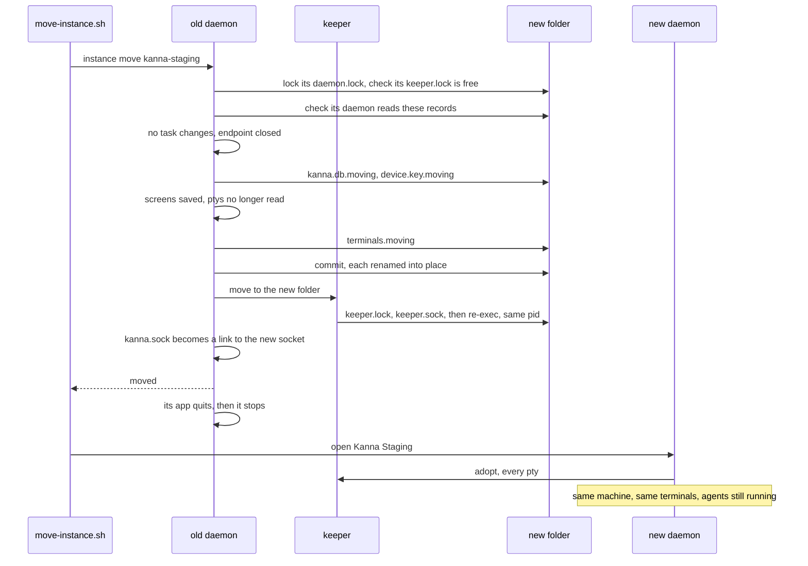

# Moving a Kanna to Another Instance

**Status:** built (`crates/kanna-daemon/src/instance_move.rs`, `tasks/instance.rs`; the keeper's `move` in `crates/kanna-keeper/src/server.rs`; `scripts/move-instance.sh`) · **Tested:** `crates/kanna/tests/instance_move.rs` (a refused, a failed and a finished move between two daemons, agents running throughout), the unit tests in `instance_move.rs`, `a_move_takes_every_session_to_another_folder_on_the_same_pid` in `crates/kanna-keeper/tests/keeper.rs` · **Builds on:** [instances](instances.md), [build channels](build-channels.md), [the database](database.md), [upgrading the keeper](keeper-upgrade.md), [tasks across machines](machine-tasks.md) · **Why:** the user works in Kanna Staging now, not the main checkout's dev build (decided with the user, 2026-11-08, [build channels §1](build-channels.md#1-what-each-build-is)), and their Shelf, their running agents and terminals, and their machine's pairing have to come with them

A Kanna's work lives in its instance folder: `kanna-dev` on the MacBook Pro, `~/kanna-phone-dev/state` on the Studio. `scripts/move-instance.sh TO` moves all of it to another instance folder on the same Mac, live: every task, its history and messages, the schedules, the phone's chat and quiz, the layout, the machine itself, and the keeper with every terminal it holds. Agents keep running through the move, mid-turn or not; the planning terminal and scratch shells come too. The new instance is the same machine to every paired one. The old one then starts empty, as a Kanna for trying a change.

It's a developer's tool, not a user feature: users have one Kanna ([build channels](build-channels.md)). The `kanna` CLI has no command for it; the script sends the daemon's `instance` request with `kanna raw`.

## Contents

1. [Why the whole instance moves](#1-why-the-whole-instance-moves)
2. [Moving](#2-moving)
3. [What moves](#3-what-moves)
4. [The terminals' old socket](#4-the-terminals-old-socket)
5. [Nothing lost halfway](#5-nothing-lost-halfway)
6. [After the move](#6-after-the-move)
7. [Interfaces](#7-interfaces)
8. [The two moves](#8-the-two-moves)
9. [Limits](#9-limits)

## 1. Why the whole instance moves

Three designs were weighed.

| | Per task, as a transfer between machines ([task transfer](task-transfer.md)) | The records only: agents quit and resume | The whole instance, live (chosen) |
|---|---|---|---|
| How | pair the two instances as two machines, then `kanna task move` each task | copy the records and the key; each agent quits at its turn's end and resumes with `claude --resume` in the new Kanna | copy the records and the key, and hand the keeper, with every terminal, to the new folder |
| A running agent | a new agent from a handoff; the conversation is lost | waits for its turn to end, quits, resumes | keeps running, mid-turn included |
| A waiting task | refused (`not_started`) | moves as it is | moves as it is |
| A Desk task | refused (`on_desk`) | onto the Shelf | stays on the Desk |
| The planning terminal, shells | stay | stay with the old keeper; reopened by hand | move |
| The Studio's pairing with the Mac | a third machine, paired again | kept: same key | kept: same key |
| Cost | a handoff turn per task | up to 10 minutes of waiting; every agent restarted | a keeper re-exec into the new folder, and a symlink for the terminals' old socket (§4) |

On one machine the instances share everything a transfer exists to carry: the clone, the worktrees, the branches, the agents' conversations in `~/.claude` and `~/.codex`. What separates them is the instance folder, and the keeper that holds the terminals. The keeper can already become another program without its children noticing ([keeper upgrade](keeper-upgrade.md)); becoming the same program in another folder is the same step. And the machine key is what makes the records mean anything to other machines: each task's record in the replicated Shelf is written by a device key, and each grant is held by one ([tasks §1–2](machine-tasks.md#1-the-replicated-shelf)), so it moves with them.

## 2. Moving

```sh
scripts/move-instance.sh kanna-staging --dry-run
scripts/move-instance.sh kanna-staging
```

It runs in a terminal of the instance being left (its `KANNA_SOCKET` names it), takes the folder to move to by its name in the application support folder or by its path, and opens the receiving Kanna once the move is done (`--serve` runs the receiving build's served daemon instead, for a Mac without the app open, as the Studio).



- **The receiving daemon isn't running.** The mover holds the folder's `daemon.lock` from the check to the commit, so it can't start in the middle; a running one refuses the move (`running`: quit Kanna Staging, or stop its served daemon, first).
- **The receiving keeper isn't running.** Its `keeper.lock` is free: a keeper with no terminals stops by itself a minute after its daemon. One that still holds terminals refuses the move (`not_empty`): two keepers don't merge.
- **The receiving folder is a Kanna's.** Its `instance.json` names the daemon that writes it (`daemon`, written at every start), so open the receiving Kanna once before the move (`unknown` otherwise).
- **The receiving build reads these records.** The mover runs that `kanna-daemon --schema` and refuses when it's below this database's `user_version` (`older`: update it first). An older daemon would otherwise move the records aside as `kanna.db.newer`.
- **Nothing changes during the move.** No task is made, started, stopped or moved once it begins (`moving_instance`), the Shelf runners take none, and a task moving to another machine refuses it (`transferring`). Agents run on; what they print waits in the kernel's pty buffers until the new daemon reads it.
- **The endpoint closes before the key is copied,** so the two never run as the same machine at once.

## 3. What moves

| Part | In the receiving instance |
|---|---|
| `kanna.db`: tasks, Shelf and Desk, task_events, messages, schedules and firings, notes, `said`, `phone_chat`, quiz, samples, runs, projects, planners, layout, record_ops, authority, `machines` | all of it, as it was, copied with SQLite's backup API into `kanna.db.moving` |
| `device.key` | the same: the same machine |
| `terminals/`: each terminal's record and its screen | copied after the old daemon has saved the screens and stopped reading |
| `app-state.json`, `app.key`: the app's Desk windows and its client key | copied when there |
| The keeper: its process, every pty, their pids and exit codes | handed over: it re-execs into the new folder ([§2](#2-moving)) |

The copy gets a `meta.moved_from` (`id`, `from`, `to`, `at`).

**What stays:**

- **Agent accounts.** Their secrets are in the Keychain under the old folder's path, for the old build ([agent sign-in §4](agent-sign-in.md#4-keeping-and-removing-secrets)), and the new build can't read them without a dialog, which the daemon never shows. The dry run lists them; each is added again in the new Kanna (`kanna accounts add`). On a Mac whose `claude` and `codex` are signed in, agents use those logins first anyway.
- **The old folder's `shell/`**, which the moved shells were started with: it stays where they read it.
- **The receiver's own records,** if it had any, go aside as `kanna.db.before-move-TIME` (and `terminals.before-move-TIME`, …): the move doesn't merge two Kannas, and a receiver with tasks on its Shelf or Desk refuses it (`not_empty`).

## 4. The terminals' old socket

A running process's environment can't change, and every moved terminal has `KANNA_SOCKET=<old folder>/kanna.sock`. So the move leaves a symlink there, to the new daemon's socket: a Unix socket's `connect` follows it, and every `kanna` in a moved terminal, an agent's hooks included, reaches the new Kanna. The other variables need nothing: `KANNA_TERMINAL` is a pane ID, which moves with the keeper; `KANNA_INSTANCE` isn't read when `KANNA_SOCKET` is set; `PATH`'s `kanna` is the old build's, which stays on disk and speaks the same protocol.

The old folder's own Kanna, started again, never takes that path while it's a symlink: its socket is `kanna.own.sock` instead. The CLI, the app and the daemon all find an instance's socket the same way (`kanna_build::instance_socket`, `AppController.instanceSocket`): `kanna.sock` unless it's a symlink, then `kanna.own.sock`. A daemon told to bind a symlink (`KANNA_SOCKET` set to it) binds `kanna.own.sock` beside it. So Kanna Dev, rebuilt and started in `kanna-dev` after the move, never takes over the Staging terminals' path. The link stays until it's removed by hand; nothing else depends on it.

The mover links it to `<new folder>/kanna.sock`. The receiving daemon, at its first start, links it to the socket it really binds, when that's elsewhere (a `KANNA_SOCKET` of its own).

In the seconds between the old daemon stopping and the new one starting, the link leads nowhere, and a `kanna` call in a moved terminal finds no daemon: it starts its build's app as it always does, on the old path, which binds `kanna.own.sock`; the call itself waits on the link, and goes through once the new daemon is up.

## 5. Nothing lost halfway

The commit renames `kanna.db.moving`, `terminals.moving` and the app's files into place in the receiving folder, and installs the key, after the receiver's own are put aside. The keeper moves right after. The rule that settles every interruption: **the keeper goes where the records are.**

| Stops | Then |
|---|---|
| before the commit (a refusal, a failed copy, the daemon killed) | the receiver is as it was, but for `*.moving` files its daemon deletes at start. The old instance deletes its `moving.json` and restarts as it was: its terminals never left its keeper, and the new daemon takes them back as after any restart |
| after the commit, before the keeper moved | the records are in the receiver, the keeper still in the old folder. Whichever daemon starts first moves it: the old one sees its own move in the receiver's `meta.moved_from` (its `moving.json` has the same ID) and asks its keeper to move there before it retires; the receiver sees `moved_from` naming the old folder and asks the keeper there to come |
| after the keeper moved | done, but for the socket link, which the receiver makes at start if it's missing |

The old instance never deletes its records: on its next start it puts them aside (`kanna.db.moved-TIME`, `terminals.moved-TIME`), so a move can be undone by hand.

## 6. After the move

**The old daemon** replies, asks its app to quit, and stops once the app has (or after 10 seconds). The app quits because it would otherwise reach the new daemon through the link at its old socket and attach to it. It starts again when its app is opened, or at once from launchd for a served daemon, and at that start it retires: it says `moved to kanna-staging`, puts its `kanna.db` (with `-wal`, `-shm`, `.bak`), `terminals/`, `app-state.json` and `device.key` aside as `…moved-TIME`, and begins as a new Kanna with an empty Shelf and a key of its own, unpaired, keeping only the old records' recent projects and `never_import`, on `kanna.own.sock` (§4). That's what the main checkout's dev build is for now: trying a change before it ships.

**The new daemon,** on its first start: deletes stale `*.moving` files, opens the records, takes the keeper if it's still in the old folder (§5), comes up as the same machine (its peers reach it at its key; addresses are found again on the LAN or through the relay), and takes every terminal back from the keeper as after a daemon restart: the same panes in the same windows, on the Desk and the Shelf as they were. If the keeper is another build, it's upgraded in place as usual ([keeper upgrade](keeper-upgrade.md)).

## 7. Interfaces

| Interface | Does |
|---|---|
| `scripts/move-instance.sh TO [--dry-run] [--serve]` | sends `{cmd: "instance", args: {action: "move", to, dry}}` with `kanna raw` to `KANNA_SOCKET`'s daemon and prints the plan or the result; then opens the receiving app (`open -b BUNDLE`, from TO's `instance.json`), or with `--serve` runs its `kanna machine serve` |
| daemon `instance {action: "move", to, dry}` | TO is a folder name in the application support folder (`kanna-staging`) or a path. Replies the plan (`from`, `to`, `folder`, `tasks: {waiting, started, desk}`, `terminals`, `accounts`, `records`, `refused`); a real move adds `moved`, `id` and `warnings` (the keeper or the link that didn't move, which §5 finishes) |
| keeper `{op: "move", dir}` | the keeper takes DIR's `keeper.lock` and socket, writes its pid and log there, and re-execs itself with `--state-dir DIR`, keeping its pid, children, ptys and connections; it lets go of the old folder's lock and removes its socket and pid file. Refused if DIR's lock is held |
| `kanna-daemon --schema` | prints the highest records version this daemon reads |
| `kanna_build::instance_socket(folder)` | `kanna.sock`, or `kanna.own.sock` while `kanna.sock` is a symlink |

Errors: `same` (TO is this instance), `unknown` (TO isn't there, or its `instance.json` names no daemon), `running`, `older`, `not_empty`, `transferring`, `failed` (the copy or the commit failed: nothing moved). While a move is under way, other changes get `moving_instance`.

## 8. The two moves

**This MacBook Pro:** from kanna-dev to kanna-staging.

1. A staging release with this move is published, and Kanna Staging updated to it ([release §the staging channel](release.md#the-staging-channel)). Kanna Dev is rebuilt from the same main and restarted, so the old daemon can move.
2. Open Kanna Staging once, so its folder says which build it is, then quit it.
3. Back up `kanna-dev/kanna.db` and `device.key` to a dated folder.
4. In a Kanna Dev terminal: `scripts/move-instance.sh kanna-staging --dry-run`, then without `--dry-run`. Kanna Staging opens with everything in it.
5. Kanna Dev quits by itself. Opened again, it's an empty Kanna on `kanna-dev/kanna.own.sock`.

**The Studio:** its Kanna is a headless dev daemon in `~/kanna-phone-dev` under launchd (`dev.kanna.phone-dev.daemon`), with `KANNA_STATE_DIR=~/kanna-phone-dev/state`.

1. Install Kanna Staging (v4) in `/Applications`, replacing Kanna v3's; open it once and quit it.
2. Update the phone-dev daemon to a build with this move, and restart it (its keeper and terminals stay).
3. Back up `~/kanna-phone-dev/state/kanna.db` and `device.key`.
4. From one of its terminals: `scripts/move-instance.sh "$HOME/Library/Application Support/kanna-staging" --serve --dry-run`, then without `--dry-run`. The script runs the staging build's `kanna machine serve`: launchd runs the staging daemon as `dev.kanna.app.staging.daemon`, with the Studio's key and every terminal.
5. `launchctl bootout gui/$(id -u)/dev.kanna.phone-dev.daemon` and remove its plist, so the old daemon doesn't start again.

Each daemon is updated by Sparkle with its app: open Kanna Staging on the Studio now and then, or after a release, and the served daemon follows the app's build ([machines §5](machines.md)).

## 9. Limits

- One machine: the folders are on the same disk, and the worktrees and agent conversations are shared. Between machines a task moves by [transfer](task-transfer.md).
- Not a merge: the receiver must have no live tasks and no running keeper.
- Agent accounts don't move (§3).
- The moved terminals keep the old build's `kanna` on their `PATH` and the old folder's `shell/` until they end; new terminals get the new build's.
