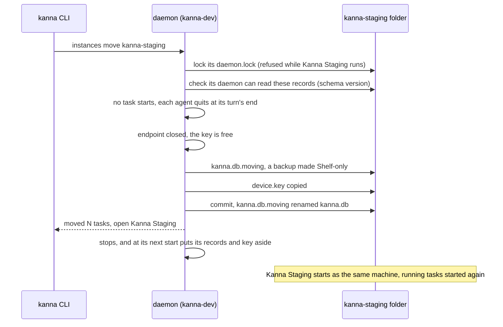

# Moving a Kanna to Another Instance

**Status:** built · **Tested:** `crates/kanna/tests/instance_move.rs` (two private instances: a waiting, a started and a Desk task; a move that fails halfway, then one that doesn't), `instance_move.rs`'s unit tests (the copy, the commit, both halves of recovery) · **Builds on:** [instances](instances.md), [build channels](build-channels.md), [the database](database.md), [tasks across machines](machine-tasks.md) · **Why:** the user works in Kanna Staging now, not the main checkout's dev build (decided with the user, 2026-11-08, [build channels §1](build-channels.md#1-what-each-build-is)), and their Shelf, its history and their machine's pairing have to come with them

A Kanna's work lives in its instance folder: `kanna-dev` on the MacBook Pro, `~/kanna-phone-dev/state` on the Studio. `kanna instances move TO` moves that work to another instance folder on the same machine in one step: every task, its history and messages, the schedules, the phone's chat and quiz, and the machine itself, so the new instance is the same machine to every paired one. The old instance then starts empty, as a Kanna for trying a change.

## Contents

1. [Why the whole instance moves](#1-why-the-whole-instance-moves)
2. [Moving](#2-moving)
3. [What moves](#3-what-moves)
4. [Nothing lost halfway](#4-nothing-lost-halfway)
5. [After the move](#5-after-the-move)
6. [Interfaces](#6-interfaces)
7. [The two moves](#7-the-two-moves)
8. [Limits](#8-limits)

## 1. Why the whole instance moves

Two designs were weighed.

| | Per task, as a transfer between machines ([task transfer](task-transfer.md)) | The whole instance, its identity included (chosen) |
|---|---|---|
| How | pair kanna-dev and kanna-staging as two machines, then `kanna task move` each task | one command copies the instance's records and its machine key to the new folder |
| A started task | a new agent from a handoff; the conversation is lost | the same worktree, branch and conversation: `claude --resume` at the same path |
| A waiting task | refused (`not_started`): it moves only by a runner taking it | moves as it is: first message, `after`, `on`, birth |
| A Desk task | refused (`on_desk`) | onto the Shelf |
| History, messages, notes, schedules, the phone's chat and quiz | stay behind | move |
| The Studio's pairing with the Mac | a third machine, paired again by code; the old one stays in every peer's list | kept: the new instance has the old one's key, so it's the same machine |
| Cost | a handoff turn per task; two of the same Mac on the Shelf | the old instance stops being that machine, and is left empty |

On one machine the instances share everything a transfer exists to carry: the clone, the worktrees, the branches and the agents' conversations in `~/.claude` and `~/.codex`. What separates them is only the instance folder, so moving the folder's records is the whole move. And the machine key is what makes the records mean anything to other machines: each task's record in the replicated Shelf is written by a device key, and each grant is held by one ([tasks §1–2](machine-tasks.md#1-the-replicated-shelf)). A new key would leave every task owned by a machine that no longer runs.

## 2. Moving

```sh
kanna instances move kanna-staging --dry-run
kanna instances move kanna-staging
```

It runs in the instance being left (from its terminals, plain `kanna` reaches it), and takes the folder to move to, by its name in the application support folder or by its path.



- **The receiving folder is a Kanna's.** Its `instance.json` names the daemon that writes it (`daemon`, written at every start), so open the receiving Kanna once before the move (`unknown` otherwise).
- **The receiving daemon isn't running.** The mover holds the folder's `daemon.lock` from the check to the commit, so it can't start in the middle; a running one refuses the move (`running`: quit Kanna Staging, or stop its served daemon, first). Its keeper may run: its terminals and its layout are kept (§3).
- **The receiving build must read these records.** The mover runs that `kanna-daemon --schema` and refuses when that's below this database's `user_version` (`older`: Kanna Staging 4.1.1-staging.1 reads records up to version 26, these are 27; update it first). An older daemon would otherwise move the records aside as `kanna.db.newer`.
- **Turns end first.** No task starts, stops, moves or is made once the move begins (`moving_instance`; the move's own stops pass), the Shelf runners take none, and a task moving to another machine refuses the move (`transferring`). Each running agent quits at its turn's end as a transfer's does (`Tasks::end_agent`), keeping its session ID, and its terminals hang up. One in the middle of a turn is waited for, up to 10 minutes (`busy` after that, with the tasks still working, and everything as it was).
- **The endpoint closes before the key is copied,** so the two never run as the same machine at once.

## 3. What moves

The move copies `kanna.db` with SQLite's backup API into `kanna.db.moving` in the receiving folder, then changes the copy in one transaction:

| Part | In the receiving instance |
|---|---|
| Waiting tasks | as they were: name, first message, agent, `after`, `on`, birth, owner |
| Started tasks | on the Shelf, stopped, with their worktree, branch and session; those whose agent was running when the move began start again when the receiver first starts (`meta.moved_from.resume`) |
| Desk tasks | on the Shelf as above |
| Every task | no terminal and no workspace: those were the old keeper's |
| task_events, messages (delivered or waiting), schedules and their firings, notes, `said`, `phone_chat`, quiz, samples, runs, recent projects, planners, `never_import` | as they were |
| record_ops, authority, `machines` (this machine, its peers, the relay and its token) | as they were, with `device.key`: the same machine |
| layout, crashes | the receiver's own, if it had any |
| planners | their sessions, without a pane: the receiver's planning terminal resumes the planning conversation |

Each task gets a `moved` event, from where it was (`shelf` or `desk`) to `shelf`, its doc naming both folders; a started task is stopped `moved from kanna-dev`. The copy gets a `meta.moved_from` (`id`, `from`, `to`, `at`, `resume`).

**What stays:**

- **Agent accounts.** Their secrets are in the Keychain under the old folder's path, for the old build ([agent sign-in §4](agent-sign-in.md#4-keeping-and-removing-secrets)), and the new build can't read them without a dialog, which the daemon never shows. The dry run lists them; each is added again in the new Kanna (`kanna accounts add`). On a Mac whose `claude` and `codex` are signed in, agents use those logins first anyway. Accounts another machine supplied come again from it.
- **Terminals.** The old keeper keeps every terminal that isn't a task agent's: the planning terminal, scratch shells. The user moves their own planning terminal by opening the project in the new Kanna.
- **The receiver's own records,** if it had any: its `kanna.db` is kept as `kanna.db.before-move-TIME`. A receiver with tasks on its Shelf or Desk refuses the move (`not_empty`): the move doesn't merge two Shelves.

## 4. Nothing lost halfway

Before anything is copied, the old instance writes `moving.json` (the move's ID and TO) in its own folder. The commit is one rename: `kanna.db.moving` to `kanna.db` in the receiving folder, after the receiver's own `kanna.db` is copied aside and its `-wal` and `-shm` removed. The key goes first to `device.key.moving` and is installed right after the rename, or by the receiver's daemon at start if the mover stopped in between.

| Stops | Then |
|---|---|
| before the rename (a refusal, a failed copy, the daemon killed) | the receiver is as it was, but for a `kanna.db.moving` its daemon deletes at start. The old instance deletes its `moving.json` and restarts as it was: its endpoint opens again, and the agents it quit start again (it noted them as `meta.move_resume` before quitting them). Killed instead, it does the same at its next start, finding its own move nowhere in the receiver |
| after the rename, before the old instance stops | the receiver has everything. At start the old instance reads the receiver's `meta.moved_from.id`, sees its own move there (its `moving.json` has the same ID), and retires (§5) |
| after both | done |

The old instance never deletes its records: on its next start it puts them aside (`kanna.db.moved-TIME`), so a move can be undone by hand.

## 5. After the move

**The old instance** replies, then stops its daemon (its keeper and the terminals that aren't agents' stay). The app, or launchd for a served daemon, starts it again, and at that start it retires: it says `moved to kanna-staging`, puts its `kanna.db` (with `-wal`, `-shm`, `.bak`) and `device.key` aside as `…moved-TIME`, and begins as a new Kanna with an empty Shelf and a key of its own, unpaired, keeping only the old records' layout, recent projects and `never_import`. That's what the main checkout's dev build is for now: trying a change before it ships.

**The new instance,** on its first start: deletes a stale `kanna.db.moving`, opens the records, comes up as the same machine (its peers reach it at its key; addresses are found again on the LAN or through the relay), and starts again the tasks in `resume`, each with `claude --resume SESSION` (or `codex resume`) in its own worktree, on the Shelf. They count against `shelf.runners` as any start does.

## 6. Interfaces

| Command | Does |
|---|---|
| `kanna instances move TO [--dry-run]` | `instance {action: "move", to, dry}` to the instance being left (`KANNA_SOCKET`'s); TO is a folder name in the application support folder (`kanna-staging`) or a path. Replies the plan (`from`, `to`, `tasks: {waiting, started, desk}`, `quit`, `busy`, `accounts`, `refused`) and `moved: {waiting, started, desk}`, `resume`; `--dry-run` replies the same plan with nothing changed: what moves, which agents would quit, what stays, and every reason it would be refused |
| `kanna-daemon --schema` | prints the highest records version this daemon reads |

Errors: `same` (TO is this instance), `unknown` (TO isn't there, or its `instance.json` names no daemon), `running`, `older`, `not_empty`, `transferring`, `busy`, `failed` (the copy or the commit failed: nothing moved). While a move is under way, other changes get `moving_instance`.

In the receiver, set `KANNA_MOVE_TURN_WAIT` (seconds) to change the 10 minutes a turn is waited for.

## 7. The two moves

**This MacBook Pro:** from kanna-dev to kanna-staging.

1. A staging release is published and Kanna Staging updated to it ([release §the staging channel](release.md#the-staging-channel)). Open it once, so its folder says which build it is, then quit it.
2. In Kanna Dev's planning terminal: `kanna instances move kanna-staging --dry-run`, then without `--dry-run`.
3. Kanna Dev's daemon stops; quit Kanna Dev before it starts again, so the planning conversation is resumed in only one place.
4. Open Kanna Staging and its projects: the planning terminal resumes the planning conversation, and the tasks whose agents ran start again on the Shelf.

**The Studio:** its Kanna is a headless dev daemon in `~/kanna-phone-dev` under launchd (`dev.kanna.phone-dev.daemon`), with `KANNA_STATE_DIR=~/kanna-phone-dev/state`.

1. Install Kanna Staging (v4) in `/Applications`, replacing Kanna v3's.
2. Open Kanna Staging once and quit it. From a terminal of the old daemon: `kanna instances move "$HOME/Library/Application Support/kanna-staging" --dry-run`, then without.
3. `launchctl bootout gui/$(id -u)/dev.kanna.phone-dev.daemon` and remove its plist (its keeper and terminals stay until you end them).
4. `"/Applications/Kanna Staging.app/Contents/Helpers/kanna" machine serve`: launchd runs the staging daemon as `dev.kanna.app.staging.daemon`. It has the Studio's key, so the Mac reaches it as before.

Each daemon is updated by Sparkle with its app: open Kanna Staging on the Studio now and then, or after a release, and the served daemon follows the app's build ([machines §5](machines.md)).

## 8. Limits

- One machine: the folders are on the same disk, and the worktrees and agent conversations are shared. Between machines a task moves by [transfer](task-transfer.md).
- Not a merge: the receiver must have no live tasks.
- Agent accounts don't move (§3).
- A task whose agent ran starts again on the Shelf, not on the Desk: the receiving Kanna has no window of its own yet. Pick it again.
- The old keeper's terminals don't move, and the receiver's layout starts from its own.
