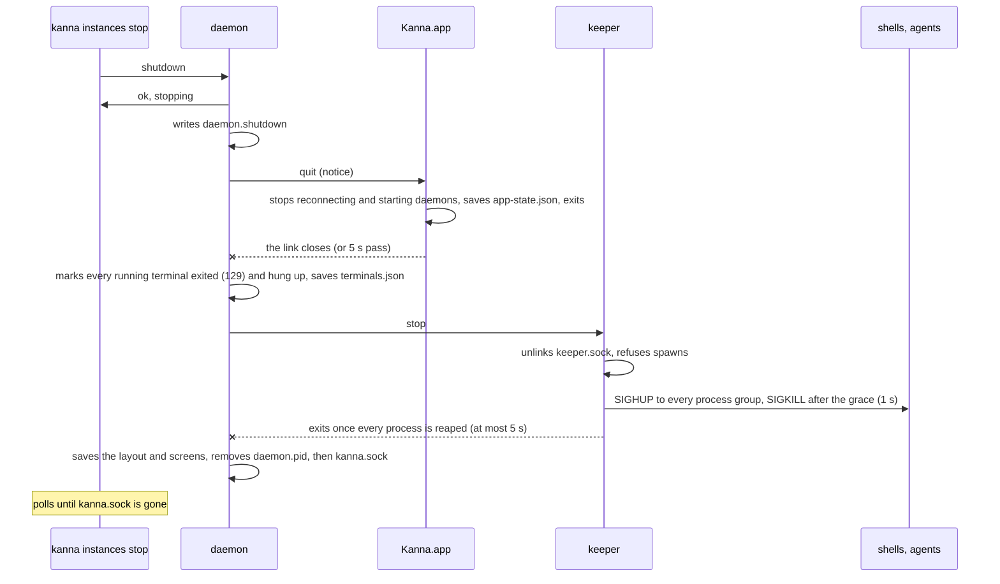

# Stopping an Instance

**Status:** built (2026-10-20) · **Builds on:** [instances](instances.md), [the app link](app-link.md), [the keeper](../keeper.md), [restarting the daemon](daemon-restart.md) · **Related:** [e2e cleanup](e2e-cleanup.md)

`kanna instances stop` quits a whole Kanna instance cooperatively: its Kanna.app saves its windows and quits, its terminals are hung up, its keeper exits, and its daemon exits last. Before this, a signal was the only way to stop one, and stopping the daemon left the keeper and every terminal running ([restarting the daemon](daemon-restart.md)). The same shutdown runs when the process named by `KANNA_E2E_OWNER` exits, so a test run that is SIGKILLed still takes its instances with it.

## Contents

1. [The command](#1-the-command)
2. [The shutdown, in order](#2-the-shutdown-in-order)
3. [A deliberate stop or a crash](#3-a-deliberate-stop-or-a-crash)
4. [The lifeline](#4-the-lifeline)
5. [Races](#5-races)
6. [Checked by](#6-checked-by)
7. [Glossary](#7-glossary)

## 1. The command

`kanna [--instance NAME] instances stop [--json]` goes to the instance a command would go to ([which instance](instances.md#2-which-instance-a-command-goes-to)), beside `instances prune`. It never starts an app.

| Situation | Prints | Exit |
|---|---|---|
| nothing answers | `NAME (SOCKET) isn't running` | 0 |
| the daemon took `shutdown` and its socket went within 20 s | `stopped NAME (SOCKET)` | 0 |
| the socket is still there after 20 s | `asked NAME (SOCKET) to stop, but its socket is still there after 20s` | 1 |
| an older daemon with no `shutdown` | its error | as any failed command |

`--json` prints `{instance, socket, stopped}`. On the wire it is the request `{"cmd": "shutdown"}`, which replies `{"ok": true, "stopping": true, "pid"}` as soon as the shutdown has begun. The caller waits for the socket to go, and the daemon removes it last, so a socket that's gone means the app, keeper and terminals are gone too.

## 2. The shutdown, in order

- **While it stops**, every other request gets `stopping`, and an `app.hello` is refused with `stopping`. The backlog stops ticking, so no task starts.
- **Terminals are hung up, not dropped.** Each running terminal is recorded `exited` (code 129, SIGHUP's) and `hungUp`, as `kanna task stop` leaves a task's terminals. The next daemon restores them as exited panes with their screens, and a task's hung-up terminals start again when the task does ([tasks](tasks.md)). The daemon keeps reading every pty until the keeper is gone, because on macOS a process can't finish exiting while output it wrote is still unread.
- **The keeper's `stop`** is a new op in [its protocol](../keeper.md#3-protocol). It needs no version bump: an older keeper answers `unknown op`, and the daemon then stops without it.
- **Limits:** the app gets 5 s to quit, then the daemon closes its link and carries on. The keeper exits after 5 s even if a process is still dying, and the daemon waits up to 8 s for it. Nothing in the shutdown waits on the network: the agent-rules updater thread is abandoned, not joined.
- **The next start** restores the app's windows from `app-state.json` and the layout from `kanna.db`, as after any quit.

## 3. A deliberate stop or a crash

An app whose daemon goes away starts a new one after 2 s ([the app starts the daemon](app-link.md#4-the-app-starts-the-daemon)). That must keep happening when a daemon crashes or is killed, and must not happen after a stop. The daemon says which it is: before a stop it sends the app a `quit` notice, which a crash never sends.

| The app hears | It does |
|---|---|
| `quit` | marks its daemon starter as quitting (it starts no daemon from then on), stops its connection's reconnect loop, and calls `NSApp.terminate`, which saves `app-state.json` as any quit does |
| its link closing, with no `quit` | as before: reconnects, and starts a daemon once nothing has answered for 2 s |

An app that predates `quit` logs it as an unknown message and stays running. The daemon goes on after 5 s, and that app then starts a new daemon, as it would after a crash.

## 4. The lifeline

When `KANNA_E2E_OWNER=PID` is set, the daemon runs the same shutdown when that process exits, however it exits (SIGKILL too). A thread waits on kqueue for `EVFILT_PROC`/`NOTE_EXIT` on the PID. Elsewhere it checks `kill(PID, 0)` every 500 ms. A daemon whose owner is already gone when it starts exits 0 before it takes its folder.

The variable reaches every process that could keep an instance alive:

| Who | How it gets it |
|---|---|
| a daemon the runner starts | its environment |
| a daemon the app starts | the app passes `KANNA_E2E_OWNER` through to the daemons it starts |
| an app the CLI starts with `open` | the CLI adds `--env KANNA_E2E_OWNER=…` |
| shells and agents | inherited from the daemon, so a CLI in a terminal passes it on |

**The app watches it too** (a `DispatchSource` for the process's exit), and quits as on `quit`. Without that, an app started after its owner died would start a daemon every 10 s, and each daemon would exit at once. Keepers need nothing: they follow their daemon.

The variable is for tests. It's never set in a user's Kanna.

## 5. Races

| Race | What happens |
|---|---|
| A CLI command arrives during a stop | `stopping`. With nothing listening afterwards, it starts the app as usual (unless `KANNA_SOCKET` is set) |
| An app connects during a stop | its hello is refused with `stopping`. Once the socket is gone it starts a daemon, as a freshly launched app does |
| A daemon was waiting for `daemon.lock` while the holder shut down | it exits 0 without starting. The stopping daemon writes `daemon.shutdown`, and any daemon that starts normally removes it, so finding it after a wait means the daemon it waited on was stopped on purpose (seen in `daemon_restart`: the runner's daemon was queued behind one the app had started) |
| The app sees the link close before it has handled `quit` | the 2 s grace before it starts a daemon covers it. `quit` stops the starter first |
| `shutdown` sent twice | the second gets `ok` too. The shutdown is already under way |

## 6. Checked by

- `crates/kanna-daemon/tests/shutdown.rs`: a shutdown sends the app `quit`, refuses requests and hellos while it runs, ends the terminal and keeper, removes `daemon.pid` and then the socket, and leaves the terminal `exited` and `hungUp` for the next daemon. A daemon whose owner is SIGKILLed shuts down even though its app ignores `quit`, and one whose owner is already gone doesn't start. A daemon queued on the lock during a shutdown doesn't start.
- `crates/kanna-keeper/tests/keeper.rs` (`stop_closes_every_pty_and_exits_once_they_are_gone`).
- `crates/kanna/tests/cli.rs` (`instances_stop_quits_the_app_and_waits_for_the_daemon_to_go`).
- `instances` and `app_starts_daemon` of `scripts/e2e-kanna.sh` (a killed daemon is still replaced by its app), and every scenario's cleanup ([e2e cleanup](e2e-cleanup.md)).

## 7. Glossary

| Term | Meaning |
|---|---|
| **Hung up** | A terminal whose process was ended by SIGHUP from Kanna (a task stop or an instance stop). It's kept as an exited pane and starts again with its task. |
| **Owner** | The process named by `KANNA_E2E_OWNER`, normally an e2e runner. |
| **Lifeline** | The watch on the owner that shuts the instance down when it exits. |
