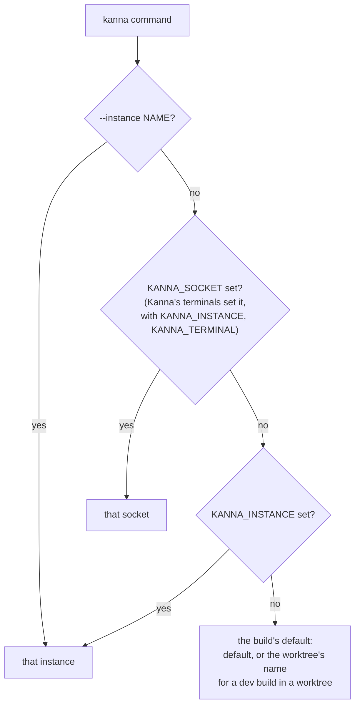

# Instances

**Status:** built · **Builds on:** [the kanna CLI](cli.md), [restarting the daemon](daemon-restart.md) · **Related:** [build channels](build-channels.md)

Instances are a tool for developing and testing Kanna (dev builds, e2e runs, `kanna --instance`), not a user feature: the app offers none, and a user works on another project in a Desk (File → New Desk, `kanna PATH`). A Kanna instance is a whole Kanna: a daemon, its keeper, its terminals, a Kanna.app and its saved layout, all in one folder, since a daemon holds a lock on its folder and keeps its keeper, terminals and the app's `layout.json` there.

## 1. The folders

In the application support folder (`$XDG_DATA_HOME` or `~/.local/share` on Linux), named for the build's channel ([build channels](build-channels.md)). kmux puts every instance's socket in one folder instead; Kanna can't, as two daemons can't share a folder.

```text
~/Library/Application Support/
├── kanna-dev/            the default instance (of a dev build)
│   ├── kanna.sock        its daemon (socket, daemon.lock, daemon.pid, daemon.log)
│   ├── keeper.sock …     its keeper
│   ├── terminals/        its terminals (daemon-restart.md)
│   ├── kanna.db          its tasks, their history and the layout (database.md), with kanna.db.bak
│   ├── app-state.json    its app's windows and text sizes (windows.md)
│   └── instance.json     the build its daemon is: channel, app, checkout, worktree
├── kanna-dev-work/       the instance named work, the same inside
├── kanna-dev-task-3f9a1c2e/  the default instance of the dev build in worktree task-3f9a1c2e
└── kanna-prod/           production's default instance (staging's: kanna-staging)
```

An instance's socket path (`kanna-dev-work/kanna.sock`) is short enough for a Unix socket's 104 bytes with a 32-character name.

## 2. Which instance a command goes to

As kmux, the first of:



A name is in the build's channel. Names are kmux's: letters, digits, `-` and `_`, up to 32; anything else is bad usage. So kanna run in a pane reaches that pane's Kanna.

## 3. Rules

- **Starting one:** `kanna --instance work open` with nothing answering starts Kanna.app with `KANNA_SOCKET` set to `kanna-dev-work/kanna.sock`; the app keeps its layout in that folder and starts the daemon there ([layout](layout.md#5-the-cli-starts-the-app)).
- **The daemon names itself** from its folder (`kanna-dev-NAME`, `kanna-prod-NAME` or `kanna-staging-NAME` is NAME; anything else, such as a test's private folder, is `default`), reports it in `capabilities`, sets `KANNA_INSTANCE` in its terminals, and writes `instance.json` there.
- **`kanna instances`** lists the folders of every channel whose daemon answers, with each one's channel, windows, panes and (for a dev build in a worktree) worktree, `*` marking the one this shell's commands go to; `--json` as kmux, with `channel` and `worktree` added.
- **`kanna instances stop`** quits an instance: its app, daemon, keeper and terminals ([stopping an instance](instance-stop.md)).
- **`kanna instances prune`** deletes the folders whose `instance.json` names a worktree that's gone, unless the daemon answers or the keeper runs.
- **Why not a `kanna` folder:** the kmux-branded Kanna.app that came before used `kanna/kanna.sock`, and Kanna v3 uses `Kanna` (the same folder on a case-insensitive disk), and either may still be running. The channels' folders and bundle IDs are in one place, `crates/kanna-build`, which the CLI and the daemon use and whose `kanna-build` binary writes the app's Info.plist.
- **Checked by** `instances` of `scripts/e2e-kanna.sh` (an instance started by `--instance` and listed by `instances`) and the CLI's tests ([CLI](cli.md#6-checked-by)).
