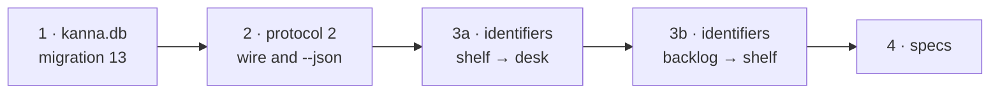

# Internal names

**Status:** built (2026-10-30) · **Follows:** [Desk view](desk-view.md) · **Changes:** [database](database.md), [each app's Desks](app-desk.md), [workspaces](workspaces.md), [CLI](cli.md), [your machines](machines.md) · **Decided with the user:** 2026-10-30

The [Desk view](desk-view.md) rename changed only what users see. Inside, "shelf" still meant the Desk and "backlog" meant the Shelf, so every name had to be translated. Now the code, `kanna.db`, the app–daemon protocol, `--json`, `debug.*` keys and Perf spans all use the same words as the UI: one vocabulary.

## Contents

1. [The names](#1-the-names)
2. [The order it was done in](#2-the-order-it-was-done-in)
3. [Older data](#3-older-data)
4. [Older peers](#4-older-peers)
5. [Tests](#5-tests)

## 1. The names

| Was | Is | Means |
|---|---|---|
| `tasks.place = 'shelf'`, `Place::Shelf`, `Where::Shelf(app)`, `where: {"shelf": app}` | `'desk'`, `Place::Desk`, `Where::Desk(app)`, `{"desk": app}` | on an app's Desk (its claim) |
| `tasks.place = 'backlog'`, `Place::Backlog`, `Where::Backlog`, `where: "backlog"` | `'shelf'`, `Place::Shelf`, `Where::Shelf`, `"shelf"` | on the Shelf |
| socket command `backlog`, Rust `Backlog` in `backlog.rs` | `tasks`, `Tasks` in `tasks.rs` | the daemon's task service: every task action, Desk and Shelf |
| actions `shelve`, `defer`; `desk` command's `pull` | `pick`, `shelve`; `activate` | as the CLI verbs: Shelf → Desk, Desk → Shelf, make active |
| notice `backlog {tasks, desk}`; `list` reply `{tasks, out}` | notice `tasks {shelf, desk}`; reply `{shelf, desk}` | the Shelf's tasks and the Desk's |
| `open {backlog: true}` | `open {shelf: true}` | dock a task's agent on the Shelf |
| `parkedAt`, `parked_at` | `leftAt`, `left_at` | when a task was last active |
| events `shelved`, `deferred`, `pulled`, `parked` | `picked`, `shelved`, `activated`, `left` | moved to the Desk, to the Shelf; made active, left |
| `kanna task list --json`'s `backlog` | `shelf` | the Shelf's tasks |
| Swift `ShelfTask`, `ShelfStrip`, `ShelfItem`, `ShelfPage` (`Shelf.swift`), `ShelfRow` | `DeskTask`, `DeskStrip`, `DeskStripItem`, `DeskView` (`DeskView.swift`), `DeskRow` | the Desk's tasks, the strip, the Desk view |
| Swift `BacklogTask`, `BacklogRow`, `backlog` | `ShelfTask`, `ShelfRow`, `shelf` | the Shelf's tasks |
| Swift `park(desk:)`, `pullTask`, `parkTask` | `showDeskView(desk:)`, `activateTask`, `toggleDeskView` | ⌘. and making a task active |
| `debug.desk` `shelf`, `backlog`, `scroll.backlog` | `tasks`, `shelf`, `scroll.shelf` | |
| `debug.click {shelf}`, `{backlog}`, `{park}` | `{task}`, `{shelf}`, `{deskView}` | a Desk task's card, a Shelf row, the agent header's Desk view button |
| Perf `click.shelve.*`, `click.pull.*`, `ShelfPage.lay`, category `shelf` | `click.pick.*`, `click.activate.*`, `DeskView.lay`, `desk` | |
| `app-state.json` `shelf: [{workspace, parkedAt}]` | `deskTasks: [{workspace, leftAt}]` | the app's Desk tasks, last left first |

**Kept:** the CLI verb `kanna task park` and the `desk` command's `park` (the user-visible verb); `backlog.json` (the file an older Kanna wrote, imported once); the config key `backlog.runners`, still read when `shelf.runners` isn't set; kmux's v1 debug state (`debug.saveState`'s `parked`).

## 2. The order it was done in

"shelf" flips meaning, so no commit holds both meanings: each step builds and passes its tests, and the Desk's names moved off "shelf" before the Shelf's took it.

## 3. Older data

- **`kanna.db`**: migration 13 renames `tasks.place` and the events' `from_place` and `to_place` (`shelf` → `desk`, `backlog` → `shelf`) and the event names, in one statement each, so no row is read twice. A db from before migration 6 (where `desk` meant the Desk) goes `desk` → `shelf` → `desk`, so it ends right. `Place::parse` reads only the new names. The `place` check still allows `backlog`; changing a check means rebuilding the table, for nothing.
- **The saved layout** is version 4. A version 1–3 layout is read through an upgrade pass when the daemon opens it (`saved::upgrade`): `where: "shelf"` (versions 1–2: the Desk) and `{"shelf": app}` become `{"desk": app}`, an old `{"desk": window}` becomes `{"desk": "mac"}`, `"backlog"` becomes `"shelf"`, and `parkedAt` becomes `leftAt`. The version decides, since `"shelf"` meant the Desk before 4 and means the Shelf from 4.
- **`app-state.json`**: the app reads `deskTasks`, else an older file's `shelf` with `parkedAt`, and writes `deskTasks`.

## 4. Older peers

The protocol range is now `[2, 2]` (`kanna_build::PROTOCOLS`, `Protocols.mine`). Locally the app, daemon and CLI are one build, so nothing changes for them. A Kanna of protocol 1 on another machine is refused with `other_protocol` and shows as Offline with "runs an older Kanna"; `kanna machine update` reaches it across protocols ([updates §6](machine-update.md#6-protocols)). Speaking 1 and 2 would have meant translating every renamed command, notice and field at the link, in Rust and Swift, for the few days until each machine updates; decided with the user not to.

## 5. Tests

- **Unit:** `db.rs` `a_db_from_before_the_desk_and_shelf_names_moves_each_task_and_event_to_the_place_it_was_in` (and the version 2 renumber test, ending on the new names); `owner.rs` `a_version_3_layout_s_old_place_names_read_as_the_desk_and_the_shelf`; the protocol tests in `app_link.rs` and `machine.rs` with `PROTOCOLS`.
- **e2e:** the scenarios touching the Desk, the Shelf, tasks and `--json` (`desk_tasks`, `desk_shelf`, `task_shelf`, `move_to_shelf`, `shelf_and_back`, `task_history`, `shelf_runners`, `perf_intervals`, `codex_task`, `pick_at_once`, `toasts`) read the new keys.
