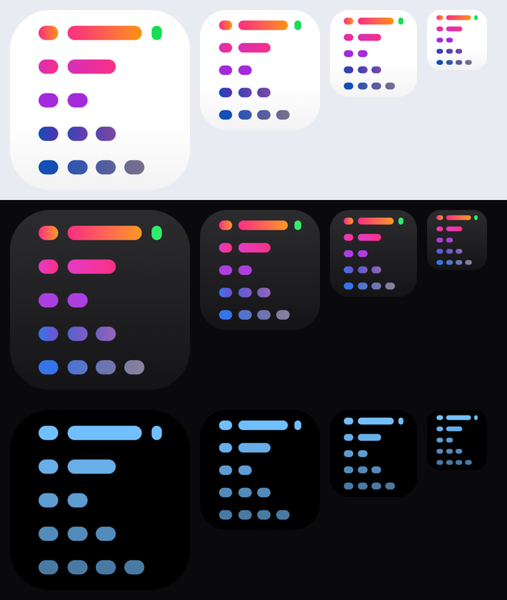

# iPhone app icon

**Status:** built · **Source:** [`assets/ios-icon`](../../assets/ios-icon) · **Builds on:** [Kanna on the Phone](mobile-app.md)

The iPhone app uses the Mac icon's art, redrawn as a full-bleed square that iOS rounds off itself, with the light, dark and tinted versions iOS picks between on the home screen.



## The art

- **Redrawn, not scaled.** `assets/Kanna.icns` tops out at 512 px, with hard-edged pills and the tile only 422 px across, so scaling it to 1024 would be upscaling. Its art is fourteen pills, so the SVGs in `assets/ios-icon` redraw them from measurements. They keep the Mac's coordinates: `viewBox="45 45 422 422"` is the Mac's tile.
- **Full bleed.** No rounded corners, border, shadow or transparency: iOS applies the mask, and the tile fills the square.
- **Light** has the Mac's colours and its pale fade at the foot of the tile.
- **Dark** is the same pills on a dark grey gradient, with every colour lifted to at least 56% lightness: the Mac's navy rows are too dark to read there.
- **Tinted** is grey pills on black. iOS tints by brightness, so each row is a step darker, as the Mac's rows fade down the mark.

## Building it

`apps/kanna-ios/Kanna/Assets.xcassets/AppIcon.appiconset` holds one 1024 px opaque PNG per version, and `project.yml` names it with `ASSETCATALOG_COMPILER_APPICON_NAME`. iOS 26 scales them to every size.

After changing an SVG:

```sh
swiftc -o "$TMPDIR/build-ios-icon" scripts/build-ios-icon.swift
"$TMPDIR/build-ios-icon" assets/ios-icon apps/kanna-ios/Kanna/Assets.xcassets/AppIcon.appiconset
```
