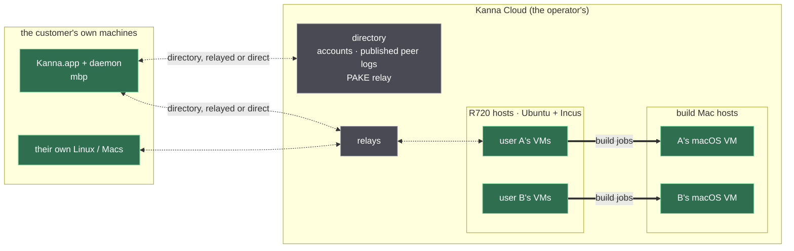
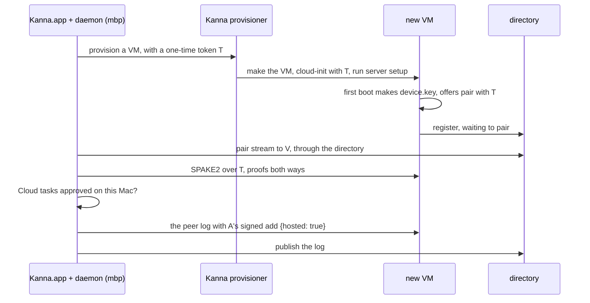

# Kanna Cloud

**Status:** planned; enrollment by token and the `hosted` mark built (slice 9), provisioning being split into Kanna's internal `kanna-cloud` · **Beside:** [the customer's own machines](machines.md) · **Parts:** [installing a host](cloud-provisioning.md), [how Kanna provisions](cloud-vms.md), [build Macs](build-macs.md), [build Mac isolation](build-mac-isolation.md) · **Order:** [build order](machines-build-order.md#kanna-cloud)

**Kanna Cloud is Kanna's product:** a paid service that runs work for its customers on Kanna's servers. A customer uses it from Kanna itself (the app and the `kanna` CLI), signed in to a Cloud account. **They see only tasks:** any task can run on the cloud instead of on one of their machines, and Kanna provisions whatever it runs on. Hosts, VMs and their records are Kanna's internal business, run with Kanna's own tool, `kanna-cloud`, which no customer installs.

**It runs on Kanna's infrastructure, not on [the customer's own machines](machines.md).** Those are the machines the customer decided to trust and that belong to them, in their signed peer log; nothing Kanna runs ever joins them. A Cloud task runs on a VM of Kanna's, which the customer never sees, names or manages, and their Kanna reaches it through Kanna Cloud, signed in with their account. Pairing machines and moving tasks between them is free and needs no Cloud account.

**The problem it solves.** Kanna's agents run on the customer's own machines, which limits them three ways:

- **Capacity:** a laptop runs a few agents at once before it slows down, while a Shelf can hold far more work than that. Cloud can work through it with tens or hundreds of agents at once.
- **Availability:** a task stops when the laptop sleeps, closes or leaves the network; work queued on the Shelf waits for it.
- **Setup:** running a server of their own means buying it, installing Kanna, keeping it secure and updated, and giving it git and agent credentials by hand; building Apple code from Linux needs a Mac besides.

Kanna Cloud removes all three for a price. Its main use is **working through the customer's Shelf** with as many agents as the Shelf has tasks, with the laptop closed (§5). A single task sent to the cloud also runs at once, on a clean machine of its own, whether their laptop is open or not, with Apple builds on Kanna's Macs. They manage nothing but the task.

It is open source like the rest of Kanna. **A self-hosted Kanna Cloud is the same software run by someone else**: whoever runs it is the operator, and everything below about Kanna as operator applies to them.

## Contents

1. [Rules](#1-rules)
2. [What a customer gets](#2-what-a-customer-gets)
3. [Keys a customer gives Cloud](#3-keys-a-customer-gives-cloud)
4. [How Kanna runs it](#4-how-kanna-runs-it)
5. [Cloud tasks](#5-cloud-tasks)
6. [Enrollment](#6-enrollment)
7. [Directory and relays](#7-directory-and-relays)
8. [Build Macs](#8-build-macs)
9. [Agent sign-in on Kanna-run machines](#9-agent-sign-in-on-kanna-run-machines)
10. [Threat model](#10-threat-model)
11. [Open questions](#11-open-questions)
12. [Glossary](#12-glossary)

## 1. Rules

- **Customers see tasks, not machines.** No customer command reaches a host, names a VM or asks for a machine. Making, setting up and destroying VMs is Kanna's (`kanna-cloud`, and later the provisioning service behind accounts).
- **A VM never holds two customers.** Each is one customer's, from creation to destruction, and is never handed to another.
- **The operator can see the customer's code.** A machine that runs a customer's agent sees their code, their agent's credentials and its transcripts, whoever operates it. End-to-end encryption protects only what passes through the directory and relays.
- **Trust still comes from the customer's devices.** Cloud can withhold but never forge; adding a machine to theirs takes a signature from one of their own devices and a gesture in the app.
- **Kanna-run machines can't change the customer's machines.** A VM Kanna runs is marked `hosted` in their peer log; its key admits and revokes no one but itself (§10).
- **Tenants are isolated by VMs,** Linux and macOS alike, with the network enforced on the host. Host accounts are never the boundary.
- **Cloud covers only what needs servers:** Cloud tasks, the directory and relays, build Macs, and later the phone away from the LAN, push and an always-on Shelf copy. Everything else is the customer's own machines', and free.

## 2. What a customer gets

| Offer | The customer does | Kanna does | The customer sees |
|---|---|---|---|
| **Cloud tasks** | `kanna task new … --cloud`, or moves a task there (`kanna task move TASK --cloud`) | makes a VM for that task alone, runs it there, destroys the VM when the task is done (§5) | the task, on their Desk or Shelf like any other; never the VM |
| **Directory and relays** | signs their machines in to their account | publishes their peer log, carries pairing, relays traffic (§7) | their machines finding each other anywhere |
| **Build Macs** | runs a task (on the cloud or a Linux machine of theirs) that builds Apple code | runs the build on a macOS VM of theirs (§8) | `xcodebuild` working as if local |

## 3. Keys a customer gives Cloud

| Key | For | Where it lives | Who can read it |
|---|---|---|---|
| **Cloud account key** | authenticates their Kanna to the service: requests, billing | the Mac's Keychain; the service keeps a hash | the customer |
| **Git access: none by default** | — | the VM gets the repo as a git bundle from the customer's Kanna and hands back branches the same way (§5); it never holds a credential for the customer's git host | — |
| **Git access, opt-in** | fetching new commits, pushing finished branches and opening pull requests with the laptop closed | a GitHub App installed on chosen repos; its tokens go only to the project's **cloud planner** (§5), never to a task's VM | the planner's VM, so the operator |
| **Agent account** | the agent runs on their own Claude or Codex usage | supplied as to any of their machines ([agent sign-in](agent-sign-in.md)); a Codex ChatGPT login stays on their Mac and the VM gets short-lived tokens | the VM, so the operator, for a setup token or API key (§9) |

Kanna never holds the customer's GitHub sign-in, and by default no Cloud VM can push anywhere: the customer's own Kanna fetches a task's branch and pushes it, as for a task on any of their machines.

### Joining and billing

No web app of Kanna's own: a customer joins from Kanna and pays on a payment provider's page.

- **`kanna cloud join EMAIL`** (and the same from the app's menu): Kanna sends a code to the address, the customer types it, and the account exists. Their Kanna makes the account key there and keeps it in the Mac's Keychain; the service keeps its hash. Another Mac of theirs joins the same account by the same command, or is given the key by a machine already on it.
- **Billing:** the first time it's needed (`kanna cloud join` on a paid plan, or the first Cloud task), Kanna opens the payment provider's hosted checkout page in the browser (Stripe Checkout, say) to take card details; nothing about payment passes through Kanna. `kanna cloud billing` opens the provider's own customer portal for invoices, cards and cancelling.
- **`kanna cloud`** shows the account, its plan and what it's used this month; `kanna cloud leave` closes the account, after its tasks are done or stopped.

## 4. How Kanna runs it

| Piece | Runs on | Is |
|---|---|---|
| Tenant VMs | a backend: R720 hosts with Incus now, AWS or GCP later | the Linux VM one Cloud task runs on |
| Provisioning service | Kanna's servers | accounts and account keys; takes requests, makes and releases VMs on hosts (before it exists, `kanna-cloud` by hand) |
| Directory | Kanna's servers | each account's published peer log, relay URLs and addresses; carries PAKE messages |
| Relays | Kanna's servers | `iroh-relay`, the same as one a customer runs themselves |
| Build Macs | Kanna's Macs | tenant-exclusive macOS VMs that run Linux tasks' Apple builds |

**Provisioning, internal** ([how Kanna provisions](cloud-vms.md)):

**Where VMs run is a backend, not the design.** The first backend is Incus on Dell R720s, bought because they are the cheapest yen per GB of RAM; later ones are likely AWS or GCP. `kanna-cloud` hides which: it makes, sets up and destroys a VM for a task, and each backend does that its own way (Incus on a host, or the provider's API). What the rest of Cloud relies on is the same for all of them: a fresh Linux VM per task, isolated as below, destroyed with its disks when the task is done. On a provider, the isolation is its VPC, security groups and per-VM disks instead of the host's bridge and ACL.

**Kanna's public edge** (proposed) is the GCP e2-micro that already runs `relay.kanna.build`: the relay, and later the provisioning service's public endpoint. Nothing is forwarded inbound to the R720s. Each host, and each task's VM, dials out (to the relay, and the host to the service over an iroh link of its own), so the R720s stay behind the home router with no open port. Relayed traffic is terminal and diff streams, which are small, and GCP bills it as egress; a task's git and package traffic goes straight from the VM to the internet, never through the micro. If the relay gets busy, or a customer's Kanna can't punch through to a VM, a larger relay or one per region comes before any forwarding.

With the R720 backend:

1. **A host:** `scripts/cloud/provision-idrac.sh` installs Ubuntu Server on an R720 through its iDRAC ([installing a host](cloud-provisioning.md)); `kanna-cloud setup-host` adds Incus, the tenant bridge, its ACL and profile, and the pool.
2. **A VM:** `kanna-cloud provision` makes an Incus VM (Ubuntu 26.04, stock cloud image) for one Cloud task, runs [server setup](machine-setup.md) in it, and has it wait to be enrolled with the request's token (§6).
3. **Releasing** destroys it with its disks, snapshots, logs and network state; nothing of it is reused (§10).

- **Networking, on any backend:** a tenant VM reaches the internet and relays, never another tenant's VM, the host's or provider's management or Kanna's LAN; enforced outside the VM (on the host, or by the provider's network), IPv4 and IPv6. Customers reach their VMs through iroh: direct when it can punch through, else relayed.
- **Before the service exists** the customer's request and Kanna's answer are passed by hand: sending a task to the cloud prints a request (its token), Kanna runs `kanna-cloud provision --request …`, and gives back the VM's key, which the customer's Kanna enrolls and moves the task to. The service carries the same two messages later.

## 5. Cloud tasks

**Being reconsidered** (review c2): this section and §6 still enroll the task's VM into the customer's peer log; they are rewritten once the link to Kanna Cloud below is agreed.

A task the customer sends to Cloud runs on a VM made for it alone, which they never see.

- **The VM joins their machines,** enrolled by token (§6) and marked `hosted` and `task`, so the existing links, Shelf records and [task transfer](task-transfer.md) carry the task there and its work back. The app doesn't list it in the Machines tab, and `kanna machine list` leaves it out; the task shows where it is as `cloud`.
- **The task's repo** reaches the VM as a git bundle, the way [task transfer](task-transfer.md) already carries a task's branch (no clone on the VM's own credentials): the commits the task needs, less what the VM already has. The work comes back the same way, as local branches in a bundle, which the customer's Kanna fetches into its clone.
- **Done, stopped for good or moved off:** the VM's work is transferred back as a bundle, the customer's Kanna revokes its key, and Kanna destroys the VM.
- **The gesture:** a Cloud task asks once, when the customer first sends tasks to Cloud from a Mac, not per task: the app approves `task` VMs made for this account's requests, which the account key authenticates (§11).

### The Shelf in the cloud

The main use of Cloud: the customer's Shelf is worked through on the cloud, many tasks at once, whether their laptop is open or not.

- **Cloud holds a copy of the Shelf** for each account that turns it on: every waiting task with its first message, project, agent and `--after` dependencies, kept in step with the customer's machines. A task added or changed on a machine reaches it, and its state comes back. It's a replica like any other machine's ([tasks §1–2](machine-tasks.md)), held by the service, not by a peer in the customer's log.
- **Cloud is a Shelf runner** with a limit the customer sets (`shelf.cloud`, tasks at once) instead of `shelf.runners`: it starts waiting tasks oldest first, unblocked ones only, each on its own VM.
- **Which tasks:** those sent with `--cloud`, and, when the customer turns it on, every waiting task their own machines haven't started within a delay. A task can be kept off the cloud (`--local`).
- **With the laptop closed** nothing needs it: Cloud has the task, a copy of the repo and the agent account (below). A task that needs the customer stops and waits, as on the Desk. When it's done, its branch waits on the service as a bundle, and the customer's machines fetch it, and see the task done, when they next sync.
- **What Cloud must hold for that,** which the open-laptop path didn't: a copy of each project's repo, which the customer's machines keep up to date with bundles as they sync (so Cloud never needs git access to fetch it), and the agent account (a Claude setup token or API key; a Codex ChatGPT login needs its holder on the service instead of the Mac). The operator could read both, as it can read everything on the VMs (§1).
- **The cloud planner holds the project's git access** (when the customer opts in, §3), and nothing else does. It fetches from the git host and sends tasks bundles, takes their finished branches back as bundles, and pushes them or opens pull requests. Task VMs stay without credentials, so prompt-injecting one of hundreds of task agents can't push; the one agent that can is the planner, which also holds the Shelf.
- **The planner goes with it** (proposed): a project whose Shelf runs on the cloud can have its planning agent run there too, on a VM of its own that stays up while the cloud Shelf is on. The customer's Desk shows that planner as it shows one on another machine today ([links §4](machine-links.md#4-projects-desks-and-claims)): the app attaches to it when open, and it keeps steering the Shelf (planning, answering tasks' messages, unblocking) when the laptop is closed. There is still one planner per project, on the laptop or on the cloud, never both.
- **Messages across the cloud and the customer's machines:** today a message is a row in one daemon's `kanna.db`, delivered by that daemon to an agent it runs ([agent messaging](agent-messaging.md)). With tasks spread over machines and the cloud, a message becomes a record in the replicated Shelf, addressed to a task ID or the project's planner, not to a daemon. Whichever machine runs the recipient (a customer's machine, a task's VM, the planner's VM) delivers it at the end of the recipient's turn, as now, and marks it delivered for everyone. A message to a task or planner that no one is running waits in the Shelf, and it wakes a stopped task wherever the task runs.
- **Scale:** hundreds of tasks at once is hundreds of VMs, so the backend matters (§4): a provider's capacity on demand, with the R720s as the cheap base.

## 6. Enrollment

A Cloud task's VM joins the customer's machines with a one-time token their own Kanna made when it sent the task, instead of a typed code. The customer's own machines join a Cloud account by the usual code pairing ([identity §2](machine-identity.md#2-pairing)), with the directory carrying the PAKE so they needn't share a LAN; machines that move to Cloud publish the log they have, and nothing is paired again.

- **Different trust from the LAN.** On the LAN the customer is the only party to pairing. Here Kanna wrote T into the VM, so the PAKE protects the VM's enrollment from everyone except the operator, who runs the VM anyway. What still holds: the operator can't add any other key to the customer's machines, since an add needs a non-hosted device's signature and their gesture.
- **The gesture** is the one approval of Cloud tasks on that Mac (§5): the customer's Kanna made the token for a task they sent, so it adds that VM without asking again. Nothing else is ever added without a gesture.

## 7. Directory and relays

- **The directory** holds each account's published peer log (signed by the customer's devices, so it can withhold but not forge), each peer's relay URL and last addresses, and relays the PAKE for machines not on one LAN.
- **Relays** are `iroh-relay`, as for a relay a customer runs; Kanna's are run for all tenants.
- **Later, on the directory:** push notifications; the phone away from the LAN. About $5 a month, as decided before; VM and build-Mac time are priced with billing.
- **A scheduler** can own every waiting task of a user's VMs and assign them centrally instead of runners asking ([tasks §2](machine-tasks.md#2-owners-and-grants)).
- **Placement by capability.** Each machine advertises its capabilities (OS, architecture, cores, RAM, Xcode versions, display) in its peer log entry ([identity §3](machine-identity.md#3-the-peer-log)). A task's `needs:` (`needs: xcode`, `needs: linux`) is matched against them, by a runner before it asks or by the scheduler, so a task goes only where it can run. It's Cloud's infrastructure: the app doesn't show capabilities ([links §5](machine-links.md#5-paths-the-machines-tab-and-offline)).

## 8. Build Macs

A Linux task's `xcodebuild`, `xcrun`, `simctl` and chosen `swift` calls run on a build Mac against the agent's worktree, as if Xcode were local, and a remote task's `.app` is fetched to the MBP's Simulator ([build Macs](build-macs.md)). Build Macs form a **pool** shared by tenants, so every build runs in a macOS VM exclusive to one tenant, and the host never runs project code ([isolation](build-mac-isolation.md)). Build Macs are a Cloud feature: the customer's own machines aren't designed around them, and a self-hoster who wants them runs the same pool software, for example in their own Kanna Cloud.

## 9. Agent sign-in on Kanna-run machines

[Agent sign-in](agent-sign-in.md) belongs to the customer's own machines: accounts are added once on the Mac and supplied to each machine. On a VM Kanna runs:

- **What sits on the VM, the operator can read:** a Claude setup token or an API key is there in its environment. Short-lived credentials are preferred: Codex's holder model gives the VM only access tokens, with the holder on one of the customer's own devices, never a hosted VM.
- **Released or revoked, its credentials are rotated:** the app asks the customer to rotate a long-lived token or key a released VM held.

## 10. Threat model

| Risk | On a machine the customer runs | On a VM Kanna runs |
|---|---|---|
| Who holds `device.key` | the customer's daemon, `0600` in its state folder | the VM's daemon, made on its first boot inside the VM; the provisioner never sees it |
| Who can sign with it | the customer and their agents (a single-tenant risk: [identity §4](machine-identity.md#4-risks)) | also the operator: host root reads a guest's disk and memory, and the R720s' CPUs have no memory encryption to stop it |
| What a signature can do | add and revoke peers (with a gesture) | nothing beyond being that VM: a `hosted` key's adds and revokes of others don't count |
| The customer's code and credentials | theirs | visible to the operator (§1, §3) |
| Reassignment | — | never: a released VM is destroyed with its disks and snapshots, the customer's app revokes its key, and the next customer gets a new VM with a new key |
| Other tenants | none | VMs and host-enforced networks between them (§4); build Macs per [isolation](build-mac-isolation.md) |
| The Cloud account key | — | lets whoever holds it ask for VMs on the account and be billed; it can't add a machine to the customer's, which still takes their gesture |

- **A prompt-injected agent on a Cloud VM can read its `device.key`,** whichever agent it is: Kanna runs Claude with `--dangerously-skip-permissions` as it runs Codex with `--yolo`. Claude's `Read` deny rule stops only its file tools, and its sandbox's deny stops `cat` only while the sandbox is on, which it isn't by default and which a bypassing agent can step outside ([identity §4](machine-identity.md#4-risks)). So the design never relies on the agent not reading the key: on a Cloud VM the key can do nothing beyond being that VM (the `hosted` rule now; the link to Kanna Cloud of review c2, which takes the VM out of the customer's peer log, would leave it nothing to sign at all).
- **The directory** is the operator's: it can withhold peers or delay revocations, which the customer's devices also carry to each other directly. It can't forge an add.

## 11. Open questions

- **What a hosted VM may run on the customer's other machines.** It can't change their machines (§10), but as one of them it can run commands and tasks on their Mac (`kanna --host mbp …`), as their Mac can on it, so its operator could too. **Proposed:** hosted peers reach only their own tasks' records and streams, never other machines' terminals or commands. It comes before Cloud tasks and before a second tenant.
- **Cloud tasks without a gesture each.** **Proposed:** the customer approves once per Mac that `task` VMs made for their account's requests join without a sheet, since their own Kanna asked for each (it made the token).
- **Where a Cloud task's work lands** when the customer's Macs are all closed. **Proposed:** the branch waits on the service as a bundle; the customer's machines fetch it at their next sync, and their own Kanna pushes it, if anyone does.
- **Agent secrets and git access held by Cloud,** so tasks start while the Mac is closed (§5, the Shelf in the cloud). **Proposed:** the agent account, yes, for accounts that turn the cloud Shelf on, kept by the service, encrypted at rest; a Codex ChatGPT login's holder moves to the service.
- **No git access on task VMs** (review c12). **Proposed:** yes. The repo goes to a task's VM as a bundle and branches come back as bundles. Without the opt-in, nothing on the cloud can push, and Cloud's copy of each repo is kept up to date by the customer's machines. With it, only the cloud planner holds the credential: it fetches (so tasks can merge a newer main mid-task), pushes and opens pull requests for the whole Shelf. Private submodules and packages come through the planner too, which fetches them into the bundle.
- **Where the planner runs** when the Shelf is on the cloud. **Proposed:** on the cloud, as above, so the Shelf is steered with the laptop closed; the alternative, a laptop-only planner, leaves cloud tasks' messages waiting until the laptop opens.
- **Can Cloud's Shelf copy be encrypted from the operator?** **Proposed:** no: Cloud has to read a task to run it, and the VM sees its code anyway; it is encrypted at rest and in transit.
- **The first tenant:** **Decided:** Cloud's VMs go on the host-enforced tenant network (§4) from the first; the network check runs on each host before a second tenant.
- **A customer's own Mac as their private build Mac.** **Proposed:** not in the first Cloud milestone; the pool is Kanna's Macs.
- **Billing:** VM and build-Mac time per account, with the account key; the directory's $5 a month as decided before. Joining and paying are the CLI plus the provider's hosted pages (§3).
- **Kanna v2's accounts:** v2 had an account flow; whether any of it is worth copying for joining (§3) is to be checked before C1, not assumed.

## 12. Glossary

| Term | Meaning |
|---|---|
| **Operator** | Whoever runs a Kanna Cloud: Kanna, or anyone self-hosting it |
| **Customer** | Someone with a Cloud account, using it from their own Kanna |
| **Cloud task** | A customer's task run on the cloud: on a VM made for it alone, which they never see, destroyed when the task is done |
| **Cloud account key** | What authenticates a customer's Kanna to the service |
| **`kanna-cloud`** | Kanna's internal operator CLI: hosts, VMs, releases; never shipped to customers |
| **Tenant** | One customer (an account), owner of their VMs and peer log |
| **Hosted peer** | A machine in a customer's peer log that the operator runs, marked `hosted` when they add it |
| **Directory** | Cloud's service that publishes each account's peer log and relays pairing |
| **Enrollment token** | The one-time code a provisioned VM pairs with: made by the customer's Kanna, put in the VM by the provisioner |
| **Incus** | The VM and container manager on the R720 hosts |
