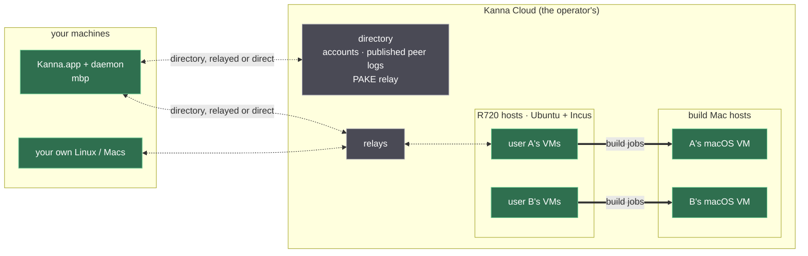
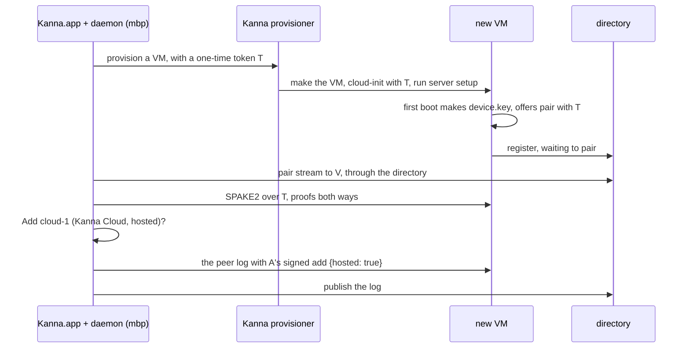

# Kanna Cloud

**Status:** planned · **Builds on:** [the fleet](fleet.md) · **Parts:** [provisioning a host](fleet-provisioning.md), [build Macs](build-macs.md), [build Mac isolation](build-mac-isolation.md) · **Order:** [build order](fleet-build-order.md#cloud)

Kanna Cloud is a hosted service built on the [fleet](fleet.md)'s core. It runs **Linux VMs for you** on Kanna's servers (Dell R720s), gives your own machines **Kanna's directory and relays** so they find each other anywhere, and runs **build Macs** that build and test Apple code for Linux tasks. It has accounts, many tenants and an operator.

It is open source like the rest of Kanna. **A self-hosted Kanna Cloud is the same software run by someone else**: whoever runs it is the operator, and everything below about Kanna as operator applies to them. The free [self-hosted fleet](fleet.md) isn't designed around any of this: its first milestone neither includes nor depends on a directory, provisioning or build Macs. A self-hoster who wants them runs them, for example by running their own Kanna Cloud.

## Contents

1. [Rules](#1-rules)
2. [What Cloud runs](#2-what-cloud-runs)
3. [Provisioning](#3-provisioning)
4. [Enrollment by token](#4-enrollment-by-token)
5. [Directory and relays](#5-directory-and-relays)
6. [Build Macs](#6-build-macs)
7. [Agent sign-in on Kanna-run machines](#7-agent-sign-in-on-kanna-run-machines)
8. [Threat model](#8-threat-model)
9. [Open questions](#9-open-questions)
10. [Glossary](#10-glossary)

## 1. Rules

- **A VM never holds two users.** A user has any number of VMs; each is one user's, from creation to destruction, and is never handed to another.
- **The operator can see your code.** A machine that runs your agent sees your code, your agent's credentials and its transcripts, whoever operates it. End-to-end encryption protects only what passes through the directory and relays.
- **Trust still comes from your devices.** The directory can withhold entries but can't forge one; adding a peer still takes a signature from one of your own devices and a gesture in the app.
- **Kanna-run machines can't grow your fleet.** A VM Kanna runs is marked `hosted` in your peer log; its key admits no one (§8).
- **Tenants are isolated by VMs,** Linux and macOS alike, with the network enforced on the host. Host accounts are never the boundary.
- **Cloud covers only what needs servers:** Kanna-run VMs, the directory and relays, build Macs, and later the phone away from the LAN, push and an always-on backlog copy. Everything else is the free fleet's.

## 2. What Cloud runs

| Piece | Runs on | Is |
|---|---|---|
| Tenant VMs | R720 hosts, Incus | a user's Linux machine, a peer in their fleet like any other |
| Directory | Kanna's servers | accounts; each user's published peer log, relay URLs and addresses; carries PAKE messages |
| Relays | Kanna's servers | `iroh-relay`, the same as a self-hosted one |
| Build Macs | Kanna's Macs | tenant-exclusive macOS VMs that run Linux tasks' Apple builds |

## 3. Provisioning

Operator work, in two steps:

1. **The host:** `scripts/fleet/provision-idrac.sh` installs Ubuntu Server on an R720 through its iDRAC ([provisioning a host](fleet-provisioning.md)); then Incus.
2. **A user's VM:** `kanna fleet provision` makes an Incus VM (Ubuntu 26.04, stock cloud image) for one user, runs [server setup](fleet-server-setup.md) in it with the user's enrollment token, and enrolls it (§4). Git credentials for its repos are made per VM: a deploy key or a fine-grained token ([tasks §4](fleet-tasks.md#4-repos-and-credentials)).

- **Networking:** a tenant VM reaches the internet and Kanna's relays, never another tenant's VM, the host's management or the operator's LAN; enforced on the host, IPv4 and IPv6. Users reach their VMs through iroh: direct over the internet when it can punch through, else relayed.
- **Releasing a VM** destroys it with its disks and snapshots (§8). Nothing of it is reused.

## 4. Enrollment by token

A VM Kanna made joins your fleet with a token handed to it at provisioning, instead of a code you type. Your own machines join a Cloud account by the fleet's code pairing ([identity §2](fleet-identity.md#2-pairing)), with the directory carrying the PAKE so they needn't share a LAN; a self-hosted fleet that moves to Cloud publishes the log it has, and nothing is paired again.

- **Different trust from the LAN.** On the LAN you are the only party to pairing. Here Kanna wrote T into the VM, so the PAKE protects the VM's enrollment from everyone except the operator, who runs the VM anyway. What still holds: the operator can't add any other key to your fleet, since an add needs a non-hosted device's signature and your gesture.
- **The gesture** needs the app open: a VM is added only while you're there to confirm it.

## 5. Directory and relays

- **The directory** holds each account's published peer log (signed by your devices, so it can withhold but not forge), each peer's relay URL and last addresses, and relays the PAKE for machines not on one LAN.
- **Relays** are `iroh-relay`, as in the self-hosted fleet; Kanna's are run for all tenants.
- **Later, on the directory:** an always-on copy of the backlog, encrypted with your keys, so a task added on a closed laptop reaches your VMs; push notifications; the phone away from the LAN. About $5 a month, as decided before; VM and build-Mac time are priced with billing.
- **A scheduler** can own every waiting task of a user's VMs and assign them centrally instead of runners asking ([tasks §2](fleet-tasks.md#2-owners-and-grants)).

## 6. Build Macs

A Linux task's `xcodebuild`, `xcrun`, `simctl` and chosen `swift` calls run on a build Mac against the agent's worktree, as if Xcode were local, and a remote task's `.app` is fetched to the MBP's Simulator ([build Macs](build-macs.md)). Build Macs form a **pool** shared by tenants, so every build runs in a macOS VM exclusive to one tenant, and the host never runs project code ([isolation](build-mac-isolation.md)). Build Macs are a Cloud feature: the self-hosted fleet isn't designed around them, and a self-hoster who wants them runs the same pool software, for example in their own Kanna Cloud.

## 7. Agent sign-in on Kanna-run machines

[Agent sign-in](agent-sign-in.md) is the fleet's: accounts are added once on the Mac and supplied to each machine. On a VM Kanna runs:

- **What sits on the VM, the operator can read:** a Claude setup token or an API key is there in its environment. Short-lived credentials are preferred: Codex's holder model gives the VM only access tokens, with the holder on one of your own devices, never a hosted VM.
- **Released or revoked, its credentials are rotated:** the app asks you to rotate a long-lived token or key a released VM held, and revokes its deploy key.

## 8. Threat model

| Risk | On your own machine (fleet) | On a VM Kanna runs |
|---|---|---|
| Who holds `device.key` | your daemon, `0600` in its state folder | the VM's daemon, made on its first boot inside the VM; the provisioner never sees it |
| Who can sign with it | you and your agents (a single-tenant risk: [identity §4](fleet-identity.md#4-risks)) | also the operator: host root reads a guest's disk and memory, and the R720s' CPUs have no memory encryption to stop it |
| What a signature can do | add and revoke peers (with a gesture) | nothing beyond being that VM: a `hosted` key's adds and revokes of others don't count |
| Your code and credentials | yours | visible to the operator (§1) |
| Reassignment | — | never: a released VM is destroyed with its disks and snapshots, your app revokes its key, and the next user gets a new VM with a new key |
| Other tenants | none | VMs and host-enforced networks between them (§3); build Macs per [isolation](build-mac-isolation.md) |

- **A prompt-injected agent on a hosted VM** can read its `device.key` too; the `hosted` rule means it can't admit a peer either, and the key is on the agent's sandbox deny list as everywhere.
- **The directory** is the operator's: it can withhold peers or delay revocations, which your devices also carry to each other directly. It can't forge an add.

## 9. Open questions

- **Hosted peers can't admit or revoke others.** **Proposed:** yes. An add signed by a `hosted` key never counts, and it may revoke only itself. This changes the peer log ([identity §3](fleet-identity.md#3-the-peer-log)) and needs a slice.
- **A copy of agent secrets in the directory**, so a machine enrolls while the Mac is closed (the earlier plan). **Proposed:** none: enrollment needs the gesture, so the app is open anyway, and a copy only adds what the operator could take.
- **The first tenant:** r720-1 already hosts VMs bridged onto the user's LAN. **Proposed:** that's acceptable while the operator is the only tenant; the host-enforced tenant network (§3) and a Linux tenant isolation model come before a second tenant.
- **A Cloud user's own Mac as their private build Mac.** **Proposed:** not in the first Cloud milestone; the pool is Kanna's Macs.

## 10. Glossary

| Term | Meaning |
|---|---|
| **Operator** | Whoever runs a Kanna Cloud: Kanna, or anyone self-hosting it |
| **Tenant** | One user (an account), owner of their VMs and peer log |
| **Hosted peer** | A machine in your peer log that the operator runs, marked `hosted` when you add it |
| **Directory** | Cloud's service that publishes each account's peer log and relays pairing |
| **Enrollment token** | The one-time code a provisioned VM pairs with, put in its setup by the provisioner |
| **Incus** | The VM and container manager on the R720 hosts |
