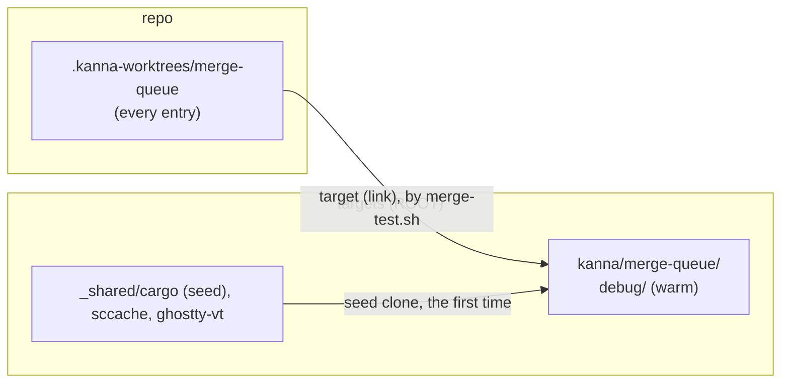

# Kanna's merge pipeline

Status: built. Tested by the merge queue running on this repo. Uses the [default merge-queue pipeline](merge-queue-pipeline.md) in the [merge queue](merge-queue.md); builds on the [build store](build-store.md).

This repo, kanna-v4, has no `.kanna/pipelines/merge-queue.kojo`: its queue runs the [default pipeline](merge-queue-pipeline.md), with `merge.test` set to `scripts/merge-test.sh` in `.kanna/config.json` and the resolver and judge on `tasks.agent`. This spec is what that script does, and why the queue's build stays warm.

## 1. The test script

`scripts/merge-test.sh` sets up the build the way `build.sh` does: it links `target/` to `ROOT/kanna/merge-queue` on the build volume, links libghostty-vt from the store, starts from main's dependency seed the first time, and uses the compile cache ([build store](build-store.md)). Then it runs `cargo test --workspace --no-fail-fast`.

The daemon knows nothing of this. It only keeps the queue's worktree at the same path for every entry ([merge queue §3.1](merge-queue.md#31-the-queues-worktree)), so cargo's fingerprints stay valid and a run rebuilds only the crates the merge changed.

## 2. One build folder

One build folder is safe here, though a `CARGO_TARGET_DIR` shared by task worktrees isn't ([build store §7](build-store.md#7-rejected)), because the queue runs one entry at a time and nothing else builds in its worktree. The queue's build is warm for main as it last landed, which is the closest starting point for the next merge.

The build folder can be [evicted](build-store.md#5-eviction) like any other when the volume runs low, except while a run is using it, and the next run starts it from the seed again.

## 3. Timings

The queue's first build from the seed took 6m08s for 28 crates, and a build after a change to `kanna-daemon` took 12s for one crate.

## 4. Tests

The e2e scenario `merge_queue` checks with a mock repo that across every entry the queue's worktree found `target/` cold only once ([merge queue §8](merge-queue.md#8-tests)).
