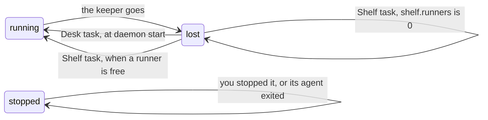

# Agents after the keeper is lost

**Status:** built (`Tasks::resume_lost`, `Candidate::Resume` in `crates/kanna-daemon/src/tasks.rs`; `Pane::lost` in `crates/kanna-mux/src/pane.rs`; `Runs::interrupted` in `runs.rs`) · **Tested:** e2e `keeper_lost`, `runners_take_the_oldest_task_with_something_to_do` in `tasks.rs` · **Builds on:** [tasks](tasks.md#which-agents-resume), [Shelf runners](shelf-runners.md), [the merge queue](merge-queue.md), [instance move §6](instance-move.md#6-after-the-move), [the keeper](../keeper.md) · **Why:** after the Mac restarted (2026-11-10), a ready task on the Desk had no agent until the planner ran `kanna restart` on its pane

The keeper holds every terminal. When it goes (the Mac restarts, it crashes, it's killed), every agent goes with it. At its next start the daemon brings back the agents that were running: each resumes its own conversation, in its own pane, with no one asking.

## Contents

1. [What comes back](#1-what-comes-back)
2. [Telling a lost terminal from a stopped one](#2-telling-a-lost-terminal-from-a-stopped-one)
3. [How it's built](#3-how-its-built)
4. [Glossary](#4-glossary)

## 1. What comes back

| The task, when the keeper was lost | After the daemon starts |
|---|---|
| on the Desk, idle or ready | its agent resumes its session; ready stays ready |
| on the Desk, mid-turn | the same, idle: Kanna sends it nothing, so it waits for you |
| the active task | the same, and still active |
| on the Shelf, running | a [runner](shelf-runners.md#1-what-runs) starts it again, resuming its session, in its turn by age and within `shelf.runners`; with runners off it stays stopped until you start it |
| stopped by you, by a runner, or its agent had exited | stays stopped |
| in the merge queue, its tests running | the test visit is recorded `interrupted` and runs again; the judge isn't asked |
| the planning agent | its pane is closed and the Desk opens a new planner, which resumes ([planner resume](planner-resume.md)) |

- **Resumed, never new.** The agent starts with its resuming command ([which agents resume](tasks.md#which-agents-resume)): the same session ID, in the same pane, which keeps its ID and place.
- **Its other terminals run again too:** a task's tabs that were running when the keeper was lost start again with their own commands, as after `kanna task start`.
- **A resumed Shelf task holds its runner** until its next turn ends, as one started with `kanna task start` does.
- **Recorded** in the task's events as `started` by `daemon`, `why: keeper lost`.

## 2. Telling a lost terminal from a stopped one

The terminal's record in `terminals.json` and what the keeper holds say which it is:

| The record | The keeper | It is |
|---|---|---|
| running | holds it | running: taken back |
| running | holds it, with an exit code | exited while no daemon ran: shown exited with that code |
| running | doesn't hold it, no exit | **lost with the keeper** |
| exited, with a code | | the agent exited, or a runner quit it |
| exited (129), `hungUp` | | stopped: `kanna task stop`, or `kanna instances stop` |

A lost terminal's pane is shown exited with no exit code and not hung up (`Pane::lost`). Its record stays `running` on disk, so a daemon that stops again before the task resumed still finds it lost at its next start. An exit the daemon saw always has a code, and a stop always marks `hungUp` before it hangs up.

An agent that exited by itself in the moments after the daemon stopped and before the keeper went can't be told from a lost one, and resumes.

## 3. How it's built

- **Desk tasks** resume in `Tasks::resume_lost`, called once at daemon start after the terminals are restored: for each Desk task whose agent's pane is lost, it finds the session if it has none yet and restarts the pane with the resuming command, as `kanna task start` does.
- **Shelf tasks** are a runner candidate (`Candidate::Resume`): a Shelf task with no `stopped` reason whose agent's pane is lost. It's queued by the task's age with new tasks and woken ones, so `shelf.runners`, a repo's cap and 0 apply to it.
- **A run's visit** whose terminal is lost is `interrupted` and runs again, for a command and an agent stage alike. Before, a lost test terminal read as exit 1 and sent a queued merge to the judge.
- **A task's other terminals:** `Core::wake` reruns a task's lost terminals with the hung-up ones.

## 4. Glossary

| Term | Meaning |
|---|---|
| keeper | the process that holds every terminal's pty, so they outlast the daemon ([the keeper](../keeper.md)) |
| lost | a terminal the records hold as running that the keeper no longer has, with no exit for it |
| hung up | a terminal Kanna ended with SIGHUP for a stop, marked `hungUp` to run again when its task starts |
